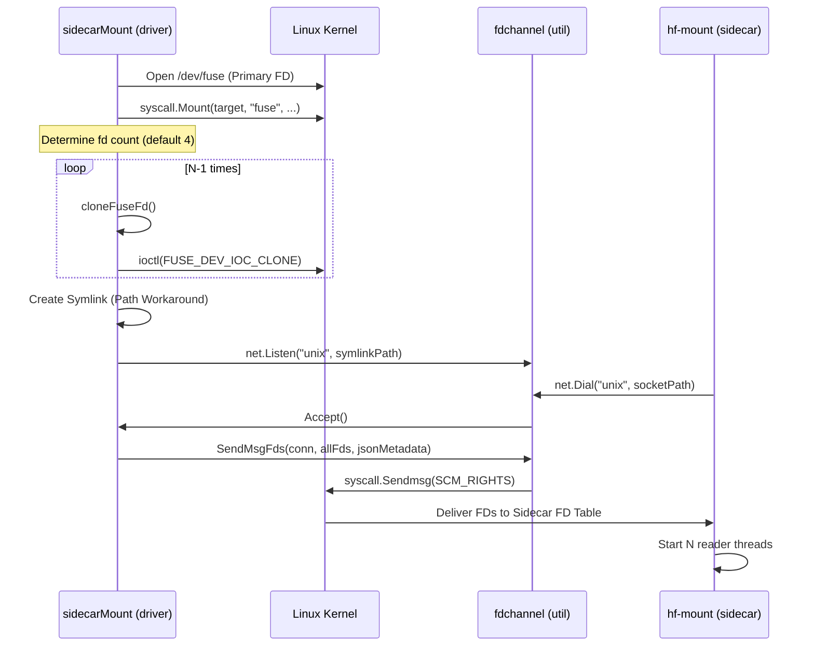
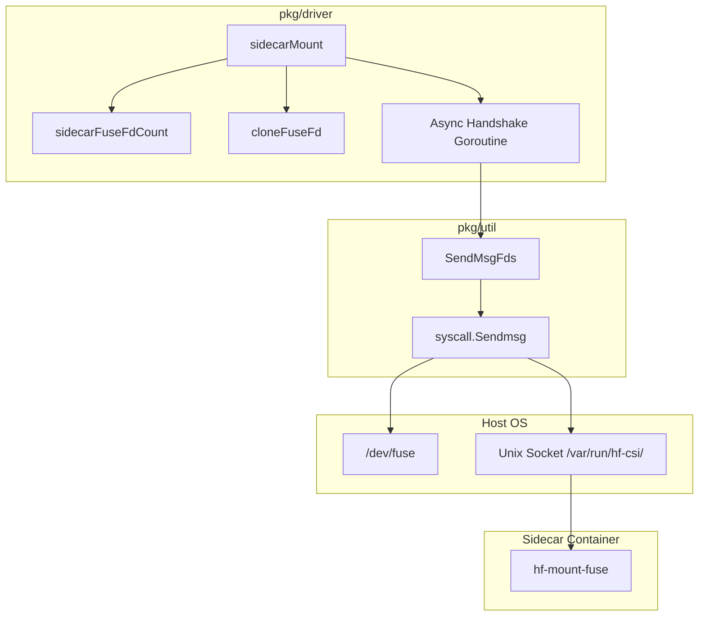

<!-- source: DeepWiki mcp.deepwiki.com · repo huggingface/hf-csi-driver · page 9 Internals: fd-Passing and FUSE Device Cloning · fetched 2026-10-26 -->

# Internals: fd-Passing and FUSE Device Cloning

Relevant source files

The following files were used as context for generating this wiki page:

- [pkg/driver/sidecar_mounter_linux.go](pkg/driver/sidecar_mounter_linux.go)
- [pkg/util/fdchannel.go](pkg/util/fdchannel.go)
- [pkg/util/fdchannel_test.go](pkg/util/fdchannel_test.go)

In sidecar mode, the `hf-csi-driver` performs a privileged kernel mount and then transfers control of the FUSE session to an unprivileged sidecar container. This transition relies on Unix domain sockets and the `SCM_RIGHTS` mechanism to pass file descriptors (fds) across process boundaries, combined with FUSE device cloning to enable multi-threaded performance.

## The fd-Passing Mechanism (`util/fdchannel`)

The `util/fdchannel` package provides a specialized wrapper around Linux socket system calls to facilitate the transfer of open file descriptors. This is necessary because the sidecar container lacks the `CAP_SYS_ADMIN` capability required to call `mount(2)` or open `/dev/fuse` for mounting.

### Key Functions

*   **`SendMsgFds(conn net.Conn, fds []int, msg []byte)`**: This is the primary entry point for the CSI driver. It takes a slice of fds and a payload (JSON metadata), packs them into a single `SCM_RIGHTS` control message (ancillary data), and sends them via `syscall.Sendmsg`. [pkg/util/fdchannel.go:22-42]()
*   **`SendMsg(conn net.Conn, fd int, msg []byte)`**: A convenience wrapper for sending a single fd. [pkg/util/fdchannel.go:13-15]()
*   **`RecvMsg(conn net.Conn)`**: Used by the receiver (primarily in tests or sidecar implementations) to extract the first fd and the message payload from the socket buffer. [pkg/util/fdchannel.go:46-83]()

### Unix Socket Path Length Workaround

Unix domain socket paths are limited to 108 characters (`UNIX_PATH_MAX`). Because the CSI driver operates within deep Kubernetes directory structures (e.g., `/var/lib/kubelet/pods/<uid>/volumes/...`), these paths frequently exceed the limit. 

To resolve this, the driver creates a short-lived symlink in `/var/run/hf-csi/` pointing to the long path. The socket is then bound using the symlink path. [pkg/driver/sidecar_mounter_linux.go:35-38](), [pkg/driver/sidecar_mounter_linux.go:204-219]()

## FUSE Device Cloning (`FUSE_DEV_IOC_CLONE`)

To support multi-threaded FUSE reads without requiring the sidecar to have `CAP_SYS_ADMIN`, the driver utilizes the `FUSE_DEV_IOC_CLONE` ioctl.

1.  **Primary FD**: The driver opens `/dev/fuse` and performs the initial `syscall.Mount`. [pkg/driver/sidecar_mounter_linux.go:136-160]()
2.  **Cloning**: For every additional reader thread requested (via `fuseFdCount`), the driver opens `/dev/fuse` again and calls `ioctl(new_fd, FUSE_DEV_IOC_CLONE, &primary_fd)`. [pkg/driver/sidecar_mounter_linux.go:81-96]()
3.  **Result**: This binds the new fd to the same FUSE session as the primary fd. The driver then ships the entire set of fds to the sidecar in one `SendMsgFds` call. [pkg/driver/sidecar_mounter_linux.go:264-273]()

### Sidecar fd-Passing Lifecycle

The following diagram illustrates the interaction between the CSI Driver's `sidecarMount` function and the `fdchannel` utility during a volume publish event.

**Sequence: Sidecar fd-Passing and Cloning**

Sources: [pkg/driver/sidecar_mounter_linux.go:130-280](), [pkg/util/fdchannel.go:22-42]()

## Implementation Details

### Data Flow: Code Entity Mapping

This table maps the conceptual "Natural Language" steps to the specific code entities in the `hf-csi-driver`.

| Step | Code Entity | File Reference |
| :--- | :--- | :--- |
| **FUSE Mount** | `syscall.Mount` | [pkg/driver/sidecar_mounter_linux.go:156]() |
| **FD Cloning** | `cloneFuseFd` / `fuseDevIoctlClone` | [pkg/driver/sidecar_mounter_linux.go:84-96]() |
| **Path Workaround** | `symlinkBase` / `os.Symlink` | [pkg/driver/sidecar_mounter_linux.go:38](), [pkg/driver/sidecar_mounter_linux.go:211]() |
| **IPC Payload** | `SendMsgFds` | [pkg/util/fdchannel.go:22]() |
| **FD Configuration** | `sidecarFuseFdCount` | [pkg/driver/sidecar_mounter_linux.go:59-79]() |

### Async Goroutine Lifecycle

The `sidecarMount` function does not block the CSI `NodePublishVolume` call indefinitely. It starts an asynchronous goroutine to handle the socket handshake.

1.  **Setup**: The kernel mount is performed synchronously. If this succeeds, `NodePublishVolume` returns success to the Kubelet. [pkg/driver/sidecar_mounter_linux.go:130-160]()
2.  **Handshake**: A goroutine is spawned to wait for the sidecar's connection. It has a timeout (default 5 minutes). [pkg/driver/sidecar_mounter_linux.go:193-200]()
3.  **Cleanup**: Once the fds are sent, the driver closes its local copies of the fds. The FUSE session remains active in the kernel because the sidecar now holds the fds. [pkg/driver/sidecar_mounter_linux.go:275-279]()

**Entity Relationship: Sidecar IPC Components**

Sources: [pkg/driver/sidecar_mounter_linux.go:59-96](), [pkg/driver/sidecar_mounter_linux.go:130-280](), [pkg/util/fdchannel.go:22-42]()

### Resource Cleanup
If the sidecar fails to connect within the `socketAcceptTimeout`, the goroutine closes the fds and unmounts the target path to prevent "Transport endpoint is not connected" errors on the host. [pkg/driver/sidecar_mounter_linux.go:222-230]()

Sources:
* [pkg/driver/sidecar_mounter_linux.go:33-52]()
* [pkg/driver/sidecar_mounter_linux.go:59-96]()
* [pkg/driver/sidecar_mounter_linux.go:130-280]()
* [pkg/util/fdchannel.go:1-83]()
* [pkg/util/fdchannel_test.go:11-92]()

---

