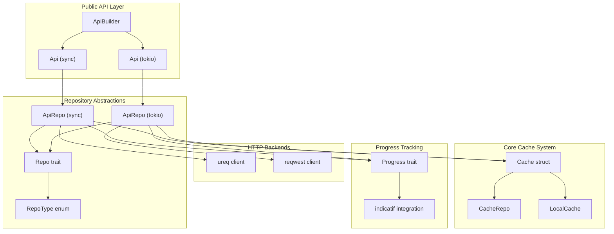
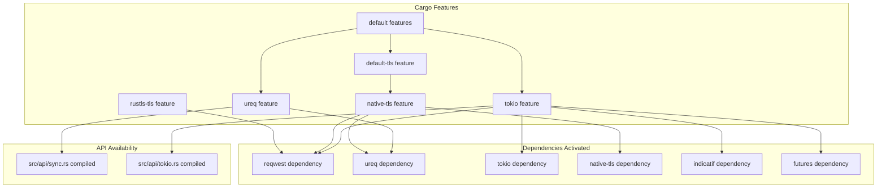
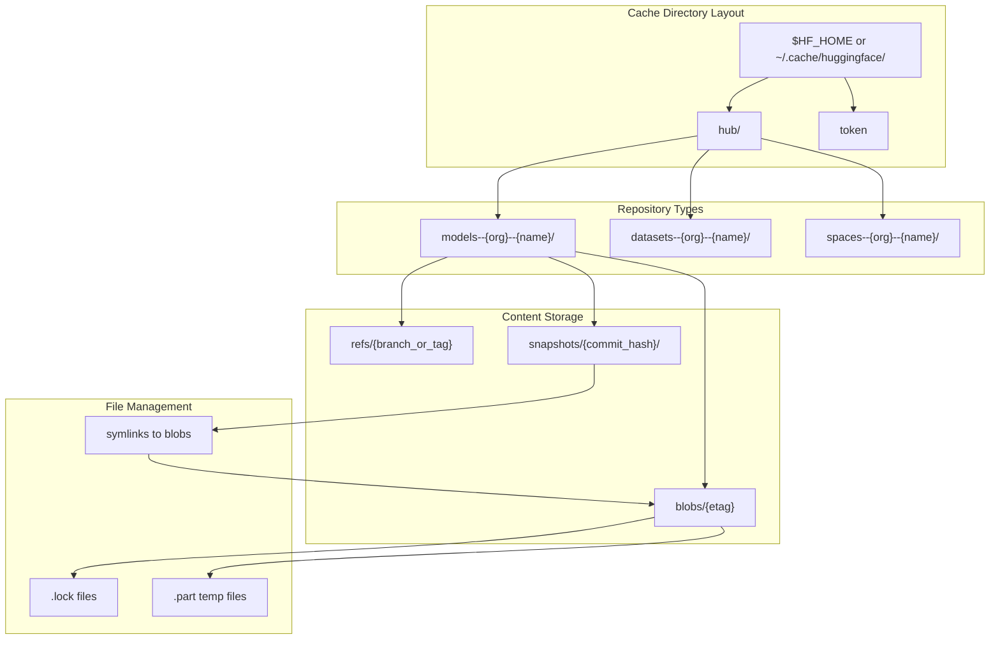

<!-- source: DeepWiki mcp.deepwiki.com · repo huggingface/hf-hub · page 1 Overview · fetched 2026-10-26 -->

# Overview

Relevant source files

The following files were used as context for generating this wiki page:

- [Cargo.toml](Cargo.toml)
- [README.md](README.md)

This document provides an introduction to the hf-hub crate, a Rust client library for interacting with Hugging Face Hub. It covers the high-level architecture, core components, and design principles that enable efficient downloading and caching of machine learning models, datasets, and spaces from the Hugging Face ecosystem.

The hf-hub crate is designed to be compatible with the Python `huggingface_hub` package, sharing the same cache structure and file organization patterns. For detailed API usage patterns, see [Getting Started](#2). For in-depth component documentation, see [Core Architecture](#3) and [API Reference](#4).

## Purpose and Design Goals

The hf-hub crate serves as a Rust implementation of core Hugging Face Hub functionality, specifically focused on:

- **File downloading and caching** with content-addressed blob storage
- **Python ecosystem compatibility** by reusing the same cache structure as `huggingface_hub`
- **Flexible compilation** through feature gates supporting different HTTP and TLS backends
- **Both synchronous and asynchronous APIs** to accommodate different application architectures

The crate implements a subset of functionality from the Python package, prioritizing download operations, local caching, and repository management over more advanced Hub API features.

Sources: [Cargo.toml:11-14](), [README.md:1-19]()

## High-Level Architecture

### Core Component Structure

This diagram shows the main code entities and their relationships. The dual API design allows applications to choose between synchronous operations using `ureq` or asynchronous operations using `reqwest` and `tokio`, while sharing the same underlying cache infrastructure.

Sources: [README.md:34-42](), [Cargo.toml:27-38]()

### Feature-Based Compilation System

The feature system allows compile-time selection of functionality, enabling applications to include only the HTTP client and TLS backend they need. The default configuration includes both sync and async APIs with native TLS support.

Sources: [Cargo.toml:50-83](), [README.md:44-61]()

## Cache Architecture and Python Compatibility

### Cache Organization Structure

The cache system uses content-addressed storage where files are stored once by their ETag hash in the `blobs` directory, with symbolic links from repository snapshots. This provides deduplication across different model versions and repositories while maintaining compatibility with the Python `huggingface_hub` package.

Sources: [README.md:1-6](), [Cargo.toml:11-14]()

## API Surface and Usage Patterns

### Synchronous vs Asynchronous APIs

| Feature | Sync API (`ureq`) | Async API (`tokio`) |
|---------|-------------------|---------------------|
| HTTP Client | `ureq` | `reqwest` |
| Runtime | None required | `tokio` runtime |
| Progress Tracking | Basic | Advanced with `indicatif` |
| Concurrent Downloads | No | Yes |
| SOCKS Proxy | Yes | Yes |
| TLS Backend | `native-tls` or `rustls` | `native-tls` or `rustls` |

Both APIs share the same cache system and provide equivalent functionality for downloading and managing cached files. The choice between them depends on whether the application is already using async Rust patterns.

### Core Usage Pattern

The fundamental usage pattern for both APIs follows the same structure:

1. Create an `Api` instance using default settings or `ApiBuilder`
2. Get a repository handle using `.model()`, `.dataset()`, or `.space()`
3. Download files using `.get()` method on the repository
4. Receive local file paths pointing to cached content

This pattern abstracts the complexity of HTTP requests, caching, and file management behind a simple interface.

Sources: [README.md:31-42](), [Cargo.toml:19-44]()

## Integration with Hugging Face Ecosystem

The hf-hub crate is designed as a drop-in replacement for Python `huggingface_hub` caching behavior, ensuring that:

- **Cache directories are shared** between Python and Rust applications
- **File downloads are deduplicated** across both ecosystems  
- **Repository structure is identical** to Python package expectations
- **Authentication tokens are compatible** and stored in the same location

This compatibility enables mixed-language workflows where Python training scripts and Rust inference applications can share the same model cache without redundant downloads.

Sources: [README.md:1-11](), [Cargo.toml:11-14]()

---

