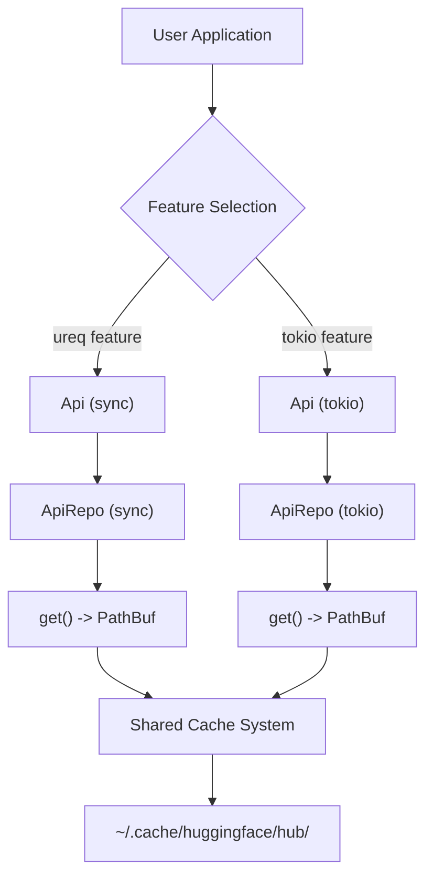
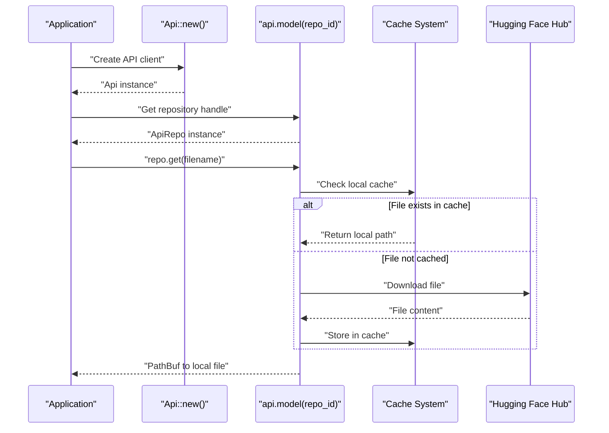
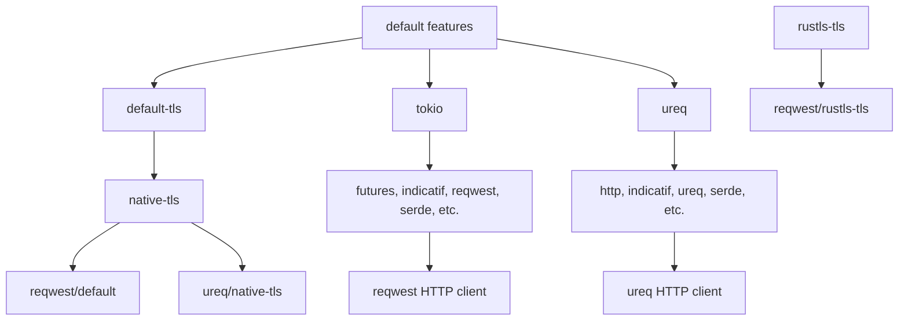

<!-- source: DeepWiki mcp.deepwiki.com · repo huggingface/hf-hub · page 2 Getting Started · fetched 2026-10-26 -->

# Getting Started

<details>
<summary>Relevant source files</summary>

The following files were used as context for generating this wiki page:

- [Cargo.toml](Cargo.toml)
- [README.md](README.md)
- [examples/download.rs](examples/download.rs)

</details>


This document provides installation instructions and basic usage patterns for the `hf-hub` crate, enabling you to quickly download and cache files from Hugging Face Hub repositories. It covers the essential concepts needed to start using either the synchronous or asynchronous APIs.

For detailed information about the internal cache architecture, see [Cache System](#3.1). For comprehensive API documentation, see [API Reference](#4). For advanced configuration options, see [Configuration and Features](#5).

## Purpose and Installation

The `hf-hub` crate provides a Rust client for interacting with Hugging Face Hub, focusing on downloading and caching model files, datasets, and other repository contents. It maintains compatibility with the Python `huggingface_hub` package's cache structure.

### Adding the Dependency

Add `hf-hub` to your `Cargo.toml`:

```toml
[dependencies]
hf-hub = "0.4.2"
```

The default features include both synchronous (`ureq`) and asynchronous (`tokio`) APIs with `native-tls` for TLS support. For custom feature selection, see the [Feature Selection](#feature-selection) section below.

Sources: [Cargo.toml:1-14](), [README.md:24-28]()

## Core Concepts Overview

### API Architecture



The crate provides two parallel API implementations sharing the same cache system. The `sync::Api` uses the `ureq` HTTP client, while `tokio::Api` uses `reqwest` with async/await support.

Sources: [README.md:33-42](), [examples/download.rs:8-13]()

### Repository Types and Workflow



Sources: [README.md:33-42](), [examples/download.rs:8-26]()

## Basic Usage Examples

### Synchronous API

The synchronous API uses the `ureq` HTTP client and provides blocking operations:

```rust
use hf_hub::api::sync::Api;

// Create API client
let api = Api::new().unwrap();

// Get a repository handle
let repo = api.model("bert-base-uncased".to_string());

// Download and cache a file
let filename = repo.get("config.json").unwrap();
// filename is now PathBuf pointing to cached file
```

For larger files with progress tracking:

```rust
let repo = api.model("meta-llama/Llama-2-7b-hf".to_string());
let filename = repo.get("model-00001-of-00002.safetensors").unwrap();
```

Sources: [README.md:33-42](), [examples/download.rs:8-14]()

### Asynchronous API

The asynchronous API requires the `tokio` feature and provides non-blocking operations:

```rust
use hf_hub::api::tokio::Api;

#[tokio::main]
async fn main() {
    // Create async API client
    let api = Api::new().unwrap();
    
    // Get repository handle
    let repo = api.model("bert-base-uncased".to_string());
    
    // Download asynchronously
    let filename = repo.get("config.json").await.unwrap();
}
```

For concurrent downloads:

```rust
let api = Api::new().unwrap();
let repo = api.model("meta-llama/Llama-2-7b-hf".to_string());

let filename = repo
    .get("model-00001-of-00002.safetensors")
    .await
    .unwrap();
```

Sources: [examples/download.rs:17-26]()

### Repository Types

The crate supports three repository types through the `Api` interface:

| Method | Repository Type | Example Usage |
|--------|----------------|---------------|
| `api.model(repo_id)` | Models | `api.model("bert-base-uncased".to_string())` |
| `api.dataset(repo_id)` | Datasets | `api.dataset("squad".to_string())` |
| `api.space(repo_id)` | Spaces | `api.space("gradio/calculator".to_string())` |

Each method returns an `ApiRepo` instance with the same `get()` interface for downloading files.

Sources: [README.md:38-39]()

## Feature Selection

### Default Features

The default feature set includes:

```toml
default = ["default-tls", "tokio", "ureq"]
```

This provides both sync and async APIs with `native-tls` (OpenSSL) for TLS.

### Custom Feature Combinations

Choose specific combinations based on your needs:

| Use Case | Features | Command |
|----------|----------|---------|
| Async only, native TLS | `tokio`, `native-tls` | `cargo add hf-hub --no-default-features --features tokio,native-tls` |
| Async only, Rust TLS | `tokio`, `rustls-tls` | `cargo add hf-hub --no-default-features --features tokio,rustls-tls` |
| Sync only, native TLS | `ureq`, `native-tls` | `cargo add hf-hub --no-default-features --features ureq,native-tls` |
| Sync only, Rust TLS | `ureq`, `rustls-tls` | `cargo add hf-hub --no-default-features --features ureq,rustls-tls` |

### Feature Dependencies



Sources: [Cargo.toml:50-83](), [README.md:44-60]()

## Error Handling

Both APIs return `Result` types. Common error scenarios include:

- Network connectivity issues
- Authentication failures  
- File not found in repository
- Cache permission problems

```rust
match repo.get("config.json") {
    Ok(path) => println!("File cached at: {:?}", path),
    Err(e) => eprintln!("Download failed: {}", e),
}
```

## Cache Location

Files are cached in the standard Hugging Face cache directory:

- **Linux/macOS**: `~/.cache/huggingface/hub/`
- **Windows**: `%USERPROFILE%\.cache\huggingface\hub\`

The cache directory can be customized via the `HF_HOME` environment variable.

Sources: [README.md:4-6]()

## Next Steps

- For understanding the cache structure and blob storage system, see [Cache System](#3.1)
- For comprehensive API documentation including all available methods, see [API Reference](#4)
- For advanced configuration including SOCKS proxy support, see [Configuration and Features](#5)
- For GUI integration and complex usage patterns, see [Advanced Examples](#6)

---

