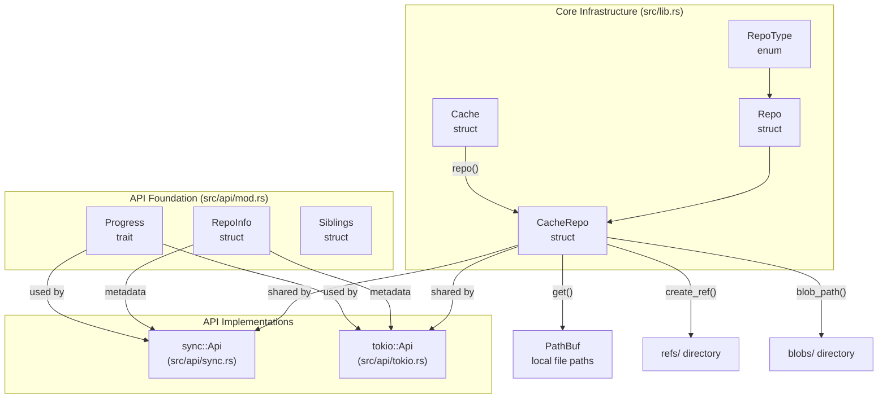
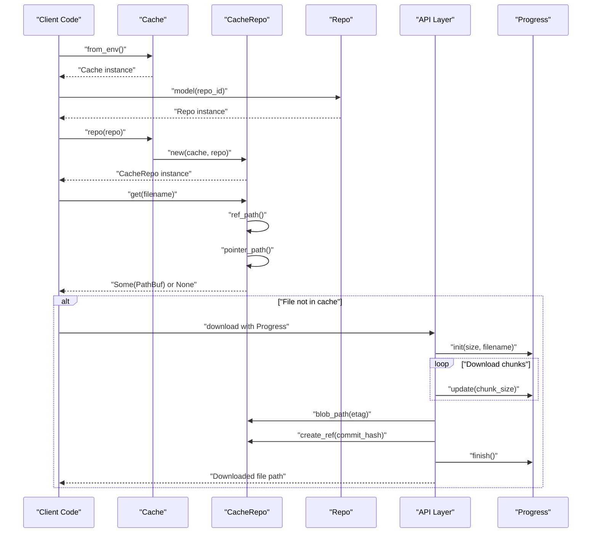
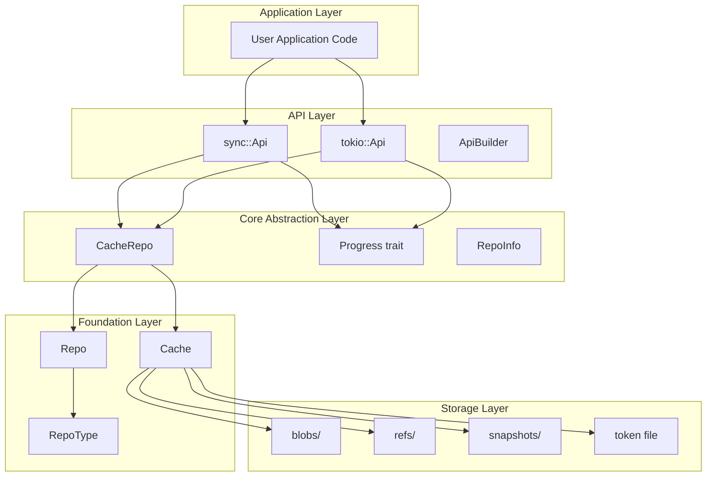

<!-- source: DeepWiki mcp.deepwiki.com · repo huggingface/hf-hub · page 3 Core Architecture · fetched 2026-10-26 -->

# Core Architecture

Relevant source files

The following files were used as context for generating this wiki page:

- [src/api/mod.rs](src/api/mod.rs)
- [src/lib.rs](src/lib.rs)

This document provides a deep dive into the fundamental components that form the shared infrastructure of the hf-hub crate. These core components enable both synchronous and asynchronous APIs to work with a unified caching system and repository abstraction layer.

For specific details about the caching mechanism and file organization, see [Cache System](#3.1). For information about the Progress trait and repository abstractions, see [Repository and Progress Abstractions](#3.2). For complete API documentation, see [API Reference](#4).

## Core Components Overview

The hf-hub architecture is built around four primary components that provide a shared foundation for all operations:

### Component Architecture Diagram

**Sources:** [src/lib.rs:28-195](), [src/api/mod.rs:16-77]()

## Component Responsibilities

| Component | Purpose | Key Methods |
|-----------|---------|-------------|
| `Cache` | Manages cache directory location and token handling | `from_env()`, `repo()`, `token()` |
| `Repo` | Represents a repository on Hugging Face Hub | `new()`, `folder_name()`, `url()` |
| `RepoType` | Distinguishes between Models, Datasets, and Spaces | N/A (enum variants) |
| `CacheRepo` | Combines Cache and Repo for file operations | `get()`, `create_ref()`, `blob_path()` |
| `Progress` | Provides download progress reporting interface | `init()`, `update()`, `finish()` |

**Sources:** [src/lib.rs:30-290](), [src/api/mod.rs:18-27]()

## System Interaction Flow

The following diagram shows how these core components interact during typical operations:

### Core Component Interaction Flow

**Sources:** [src/lib.rs:42-91](), [src/lib.rs:141-151](), [src/api/mod.rs:18-27]()

## Architecture Layers

The core architecture is organized in distinct layers that separate concerns:

### Layered Architecture

**Sources:** [src/lib.rs:1-290](), [src/api/mod.rs:1-123]()

## Key Design Principles

### Repository Abstraction

The `Repo` struct provides a unified way to reference any repository on Hugging Face Hub:

- **Repository Types**: Models, Datasets, and Spaces are distinguished by `RepoType` enum [src/lib.rs:17-26]()
- **Revision Handling**: Supports branches, tags, and commit hashes through the `revision` field [src/lib.rs:212-227]()
- **URL Generation**: Automatically generates correct URLs for different repository types [src/lib.rs:262-289]()

### Cache Integration

The `CacheRepo` struct bridges repositories and local storage:

- **Path Resolution**: Generates file system paths following Hub cache conventions [src/lib.rs:153-194]()
- **Reference Management**: Maintains branch-to-commit mappings in `refs/` directory [src/lib.rs:168-179]()
- **Content Addressing**: Uses ETags for blob storage deduplication [src/lib.rs:182-187]()

### Progress Abstraction

The `Progress` trait enables flexible progress reporting:

- **Trait-based Design**: Allows custom progress implementations [src/api/mod.rs:18-27]()
- **Built-in Integration**: Native support for `indicatif::ProgressBar` [src/api/mod.rs:35-60]()
- **No-op Implementation**: Unit type `()` provides silent operation [src/api/mod.rs:29-33]()

## Environmental Configuration

The system supports flexible configuration through environment variables and defaults:

| Configuration | Environment Variable | Default Value |
|---------------|---------------------|---------------|
| Cache Location | `HF_HOME` | `~/.cache/huggingface/hub` |
| Hub Endpoint | `HF_ENDPOINT` | `https://huggingface.co` |
| Token Location | N/A | `{HF_HOME}/../token` |

**Sources:** [src/lib.rs:14](), [src/lib.rs:42-51](), [src/lib.rs:59-85](), [src/api/mod.rs:14]()

This core architecture provides the foundation that enables both synchronous and asynchronous APIs to share the same caching infrastructure, repository abstractions, and progress reporting mechanisms while maintaining clean separation of concerns.

---

