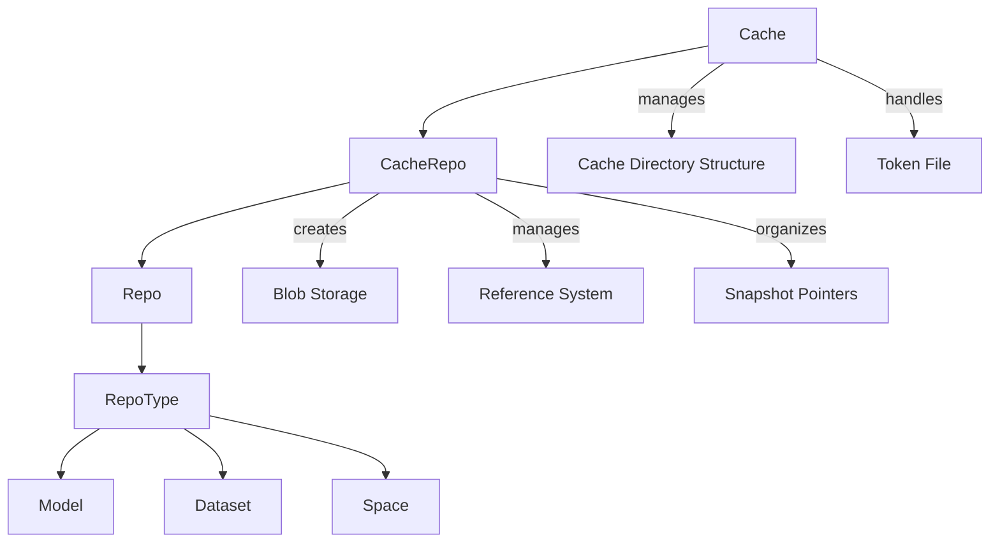
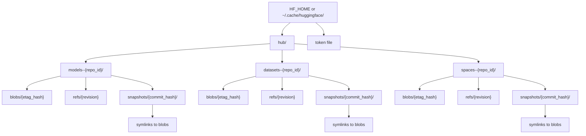
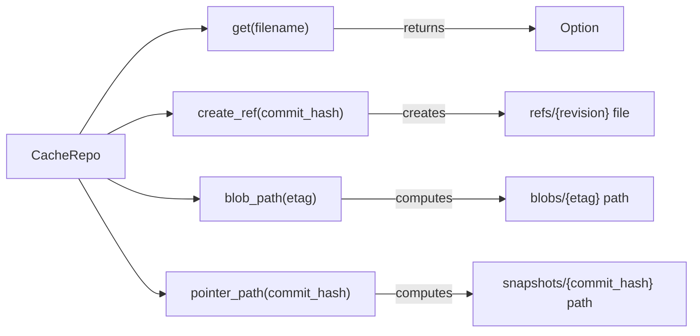
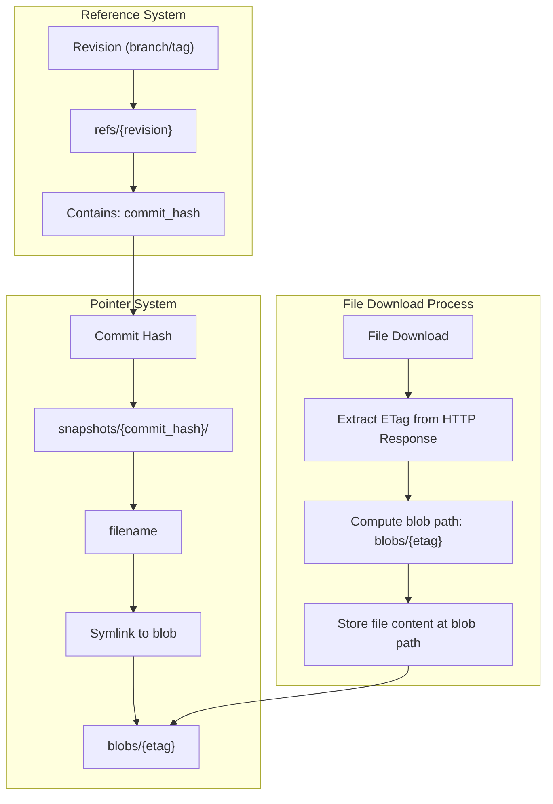
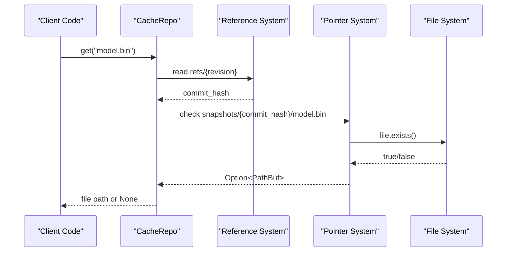

<!-- source: DeepWiki mcp.deepwiki.com · repo huggingface/hf-hub · page 3.1 Cache System · fetched 2026-10-26 -->

# Cache System

<details>
<summary>Relevant source files</summary>

The following files were used as context for generating this wiki page:

- [src/lib.rs](src/lib.rs)

</details>


The Cache System provides local file storage and management for content downloaded from Hugging Face Hub. It implements a content-addressed blob storage system with pointer-based file organization, supporting deduplication, concurrent access safety, and compatibility with the Python `huggingface_hub` package.

For information about the API interfaces that use this cache system, see [Synchronous API](#4.1) and [Asynchronous API](#4.2). For repository abstraction details, see [Repository and Progress Abstractions](#3.2).

## Cache Architecture Overview

The cache system is built around three core structures that work together to provide efficient local storage:



**Cache Architecture Components**

Sources: [src/lib.rs:29-125]()

## Directory Structure and Organization

The cache organizes files using a sophisticated directory structure that enables content deduplication and version management:



**Cache Directory Structure**

Sources: [src/lib.rs:42-51](), [src/lib.rs:197-205](), [src/lib.rs:153-194]()

## Core Cache Components

### Cache Struct

The `Cache` struct serves as the primary interface for cache operations:

| Method | Purpose | Return Type |
|--------|---------|-------------|
| `new(path)` | Create cache at specific path | `Cache` |
| `from_env()` | Create cache from `HF_HOME` environment variable | `Cache` |
| `default()` | Create cache at default location (`~/.cache/huggingface/hub`) | `Cache` |
| `token()` | Retrieve authentication token if available | `Option<String>` |
| `repo(repo)` | Create repository-specific cache handle | `CacheRepo` |
| `model(id)`, `dataset(id)`, `space(id)` | Convenience methods for specific repo types | `CacheRepo` |

Sources: [src/lib.rs:34-125]()

### CacheRepo Operations

The `CacheRepo` struct handles operations within a specific repository context:



**CacheRepo Method Flow**

Sources: [src/lib.rs:128-195]()

## Repository Type System

The cache supports three types of repositories, each with distinct URL patterns and folder naming:

| RepoType | Folder Prefix | API URL Pattern | Hub URL Pattern |
|----------|---------------|-----------------|-----------------|
| `Model` | `models--` | `models/{repo_id}` | `{repo_id}` |
| `Dataset` | `datasets--` | `datasets/{repo_id}` | `datasets/{repo_id}` |
| `Space` | `spaces--` | `spaces/{repo_id}` | `spaces/{repo_id}` |

The `folder_name()` method normalizes repository IDs by replacing forward slashes with double dashes:

```
facebook/opt-125m → models--facebook--opt-125m
```

Sources: [src/lib.rs:16-26](), [src/lib.rs:245-253](), [src/lib.rs:261-290]()

## Content-Addressed Storage System

The cache implements a blob storage system where files are stored by their ETag hash, enabling deduplication across different repositories and revisions:



**Content-Addressed Storage Flow**

Sources: [src/lib.rs:182-187](), [src/lib.rs:189-194]()

## Token Management

The cache system manages Hugging Face authentication tokens stored in a dedicated token file:


**Token Resolution Process**

The token file location is computed by:
1. Taking the cache path
2. Removing the `"hub"` suffix 
3. Appending `"token"`

Sources: [src/lib.rs:58-85]()

## File Retrieval Logic

The `get()` method implements the file resolution process that traverses the pointer system:



**File Retrieval Sequence**

Sources: [src/lib.rs:141-151]()

## Environment Configuration

The cache location can be configured through environment variables or falls back to platform-specific defaults:

| Configuration Method | Path Resolution |
|---------------------|-----------------|
| `HF_HOME` environment variable | `${HF_HOME}/hub` |
| Default (Unix-like) | `~/.cache/huggingface/hub` |
| Default (Windows) | `%USERPROFILE%\.cache\huggingface\hub` |

Sources: [src/lib.rs:42-51](), [src/lib.rs:197-205]()

## Concurrent Access and Safety

While the core cache structures don't implement explicit locking mechanisms, the system is designed to work with the file locking implemented in the API layers. The blob storage system with content-addressed files provides natural deduplication and reduces conflicts during concurrent operations.

Sources: Referenced in overall architecture diagrams and API integration patterns

---

