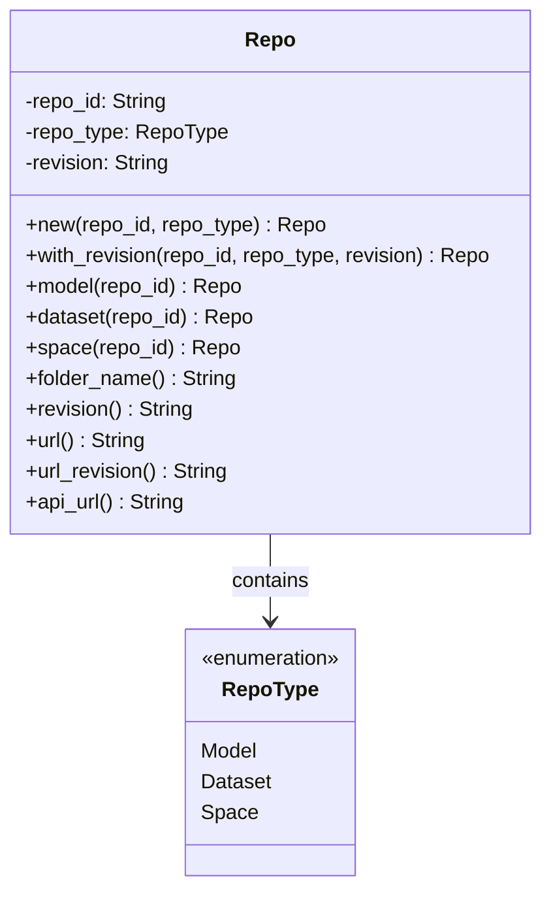
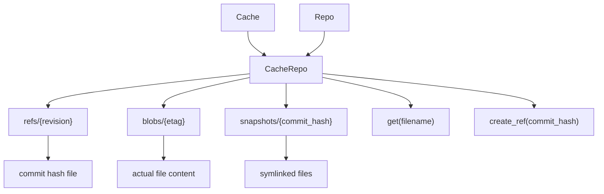
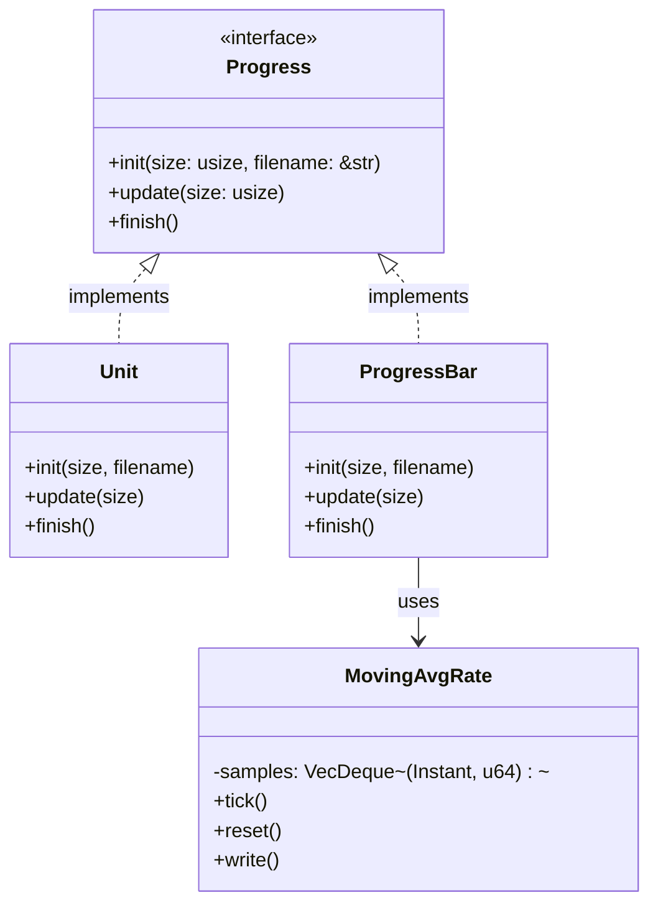
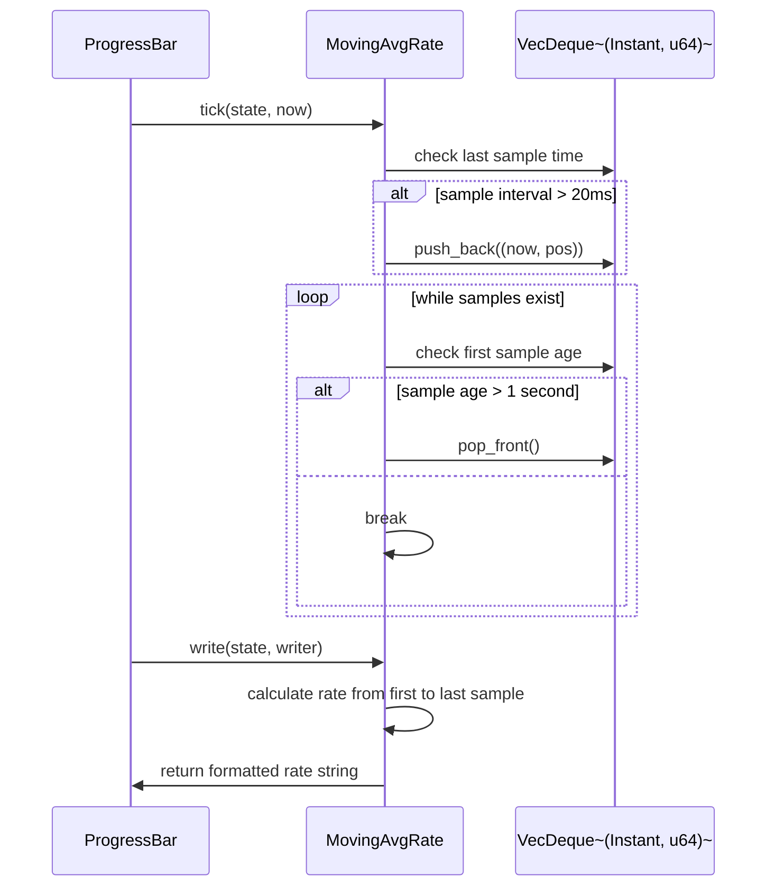
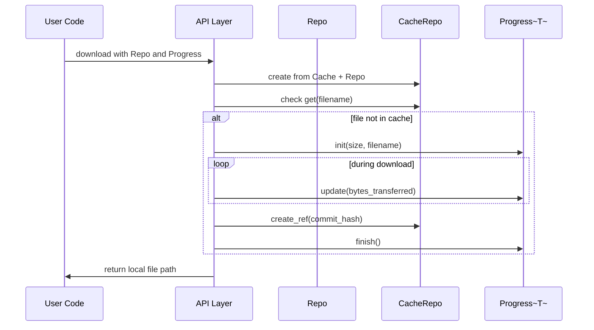

<!-- source: DeepWiki mcp.deepwiki.com · repo huggingface/hf-hub · page 3.2 Repository and Progress Abstractions · fetched 2026-10-26 -->

# Repository and Progress Abstractions

<details>
<summary>Relevant source files</summary>

The following files were used as context for generating this wiki page:

- [src/api/mod.rs](src/api/mod.rs)
- [src/lib.rs](src/lib.rs)

</details>


This document covers the core abstractions that form the foundation of the hf-hub API: the repository system (`Repo`, `RepoType`, `CacheRepo`) and the progress tracking system (`Progress` trait). These abstractions provide a unified interface for working with different types of Hugging Face Hub repositories and tracking download progress across both synchronous and asynchronous APIs.

For details on the cache storage implementation, see [Cache System](#3.1). For specific API usage patterns, see [API Reference](#4).

## Repository Type System

The repository abstraction begins with the `RepoType` enum, which distinguishes between the three types of repositories supported by Hugging Face Hub.

### RepoType Enumeration

The `RepoType` enum defines the fundamental repository categories:

```rust
pub enum RepoType {
    Model,    // Weight files and configuration
    Dataset,  // Data in parquet files  
    Space,    // Demo applications
}
```

Each variant maps to different URL patterns and cache directory structures within the Hub ecosystem.

**Repository Type Mapping**

| RepoType | URL Prefix | Cache Folder | Purpose |
|----------|------------|--------------|---------|
| `Model` | (none) | `models--{repo_id}` | Model weights and config files |
| `Dataset` | `datasets/` | `datasets--{repo_id}` | Data files, typically parquet |
| `Space` | `spaces/` | `spaces--{repo_id}` | Demo applications |

Sources: [src/lib.rs:16-26](), [src/lib.rs:246-253](), [src/lib.rs:262-272]()

## Repository Abstraction

The `Repo` struct represents a specific repository instance with version information.

### Repo Structure and Methods



### Repository Construction Patterns

The `Repo` struct provides multiple constructor patterns:

- **Generic constructor**: `Repo::new(repo_id, repo_type)` defaults to "main" branch
- **Versioned constructor**: `Repo::with_revision(repo_id, repo_type, revision)` specifies exact revision
- **Type-specific shortcuts**: `Repo::model()`, `Repo::dataset()`, `Repo::space()`

The `folder_name()` method generates normalized cache directory names by combining the type prefix with the repository ID, replacing forward slashes with double dashes for filesystem compatibility.

Sources: [src/lib.rs:207-290]()

## Cache Repository Integration

The `CacheRepo` struct bridges the repository abstraction with the local cache system.

### CacheRepo Architecture



### CacheRepo Operations

The `CacheRepo` struct provides these key methods:

- **`get(filename)`**: Resolves a filename to its local cache path if present
- **`create_ref(commit_hash)`**: Creates a reference linking a branch/tag to a specific commit
- **Path resolution methods**: `ref_path()`, `blob_path()`, `pointer_path()` for internal cache structure navigation

The path resolution follows the pattern: revision → commit hash → snapshot directory → individual files as symlinks to blob storage.

Sources: [src/lib.rs:127-195]()

## Progress Abstraction System

The `Progress` trait provides a standardized interface for tracking download progress across different implementations.

### Progress Trait Definition



### Progress Trait Methods

The `Progress` trait defines three lifecycle methods:

- **`init(size, filename)`**: Called at download start with total file size and name
- **`update(size)`**: Called during download with bytes transferred since last update  
- **`finish()`**: Called when download completes successfully

### Built-in Progress Implementations

The library provides two built-in implementations:

**Unit Type Implementation (`()`)**
- No-op implementation for when progress tracking is not needed
- All methods are empty functions

**ProgressBar Implementation** 
- Uses `indicatif::ProgressBar` for visual progress display
- Configures progress bar style with filename, transfer rate, and ETA
- Truncates long filenames to 30 characters with leading ellipsis
- Integrates `MovingAvgRate` for smooth transfer rate calculation

Sources: [src/api/mod.rs:16-60]()

## Progress Rate Calculation

The `MovingAvgRate` struct implements sophisticated transfer rate calculation for smooth progress display.

### MovingAvgRate Implementation



The `MovingAvgRate` maintains a sliding window of position samples over the last second, sampling at most every 20 milliseconds. This provides smooth rate calculation without excessive overhead.

Sources: [src/api/mod.rs:79-122]()

## Repository Metadata Structures

The API includes structures for representing repository metadata from the Hub.

### Metadata Types

**`Siblings` Structure**
- Represents individual files within a repository
- Contains `rfilename` field with the relative path within the repo

**`RepoInfo` Structure**  
- Complete repository information from Hub API
- Contains `siblings` vector of all files
- Contains `sha` field with the current commit hash

These structures support the repository browsing and file discovery functionality used by both API implementations.

Sources: [src/api/mod.rs:62-77]()

## Integration Patterns

The repository and progress abstractions work together in the download workflow:



This pattern allows the same core abstractions to work across both synchronous and asynchronous API implementations, with the progress system providing consistent feedback regardless of the underlying HTTP client or execution model.

Sources: [src/lib.rs:87-102](), [src/api/mod.rs:16-27]()

---

