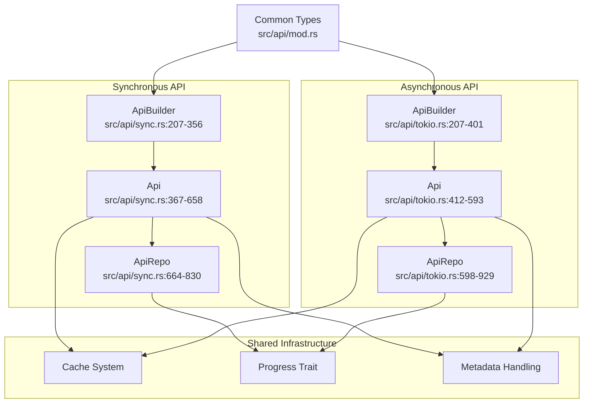
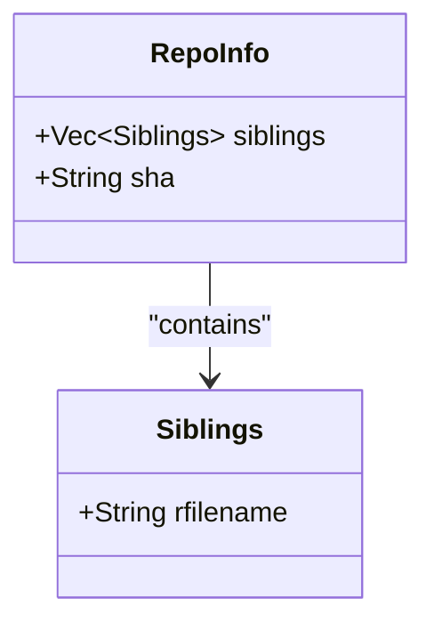
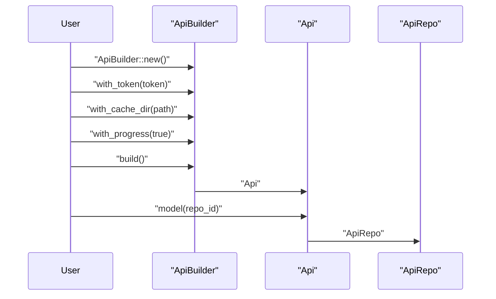
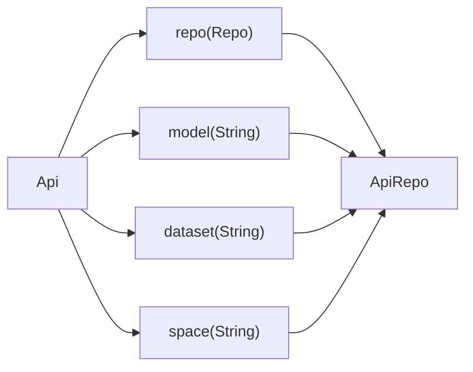
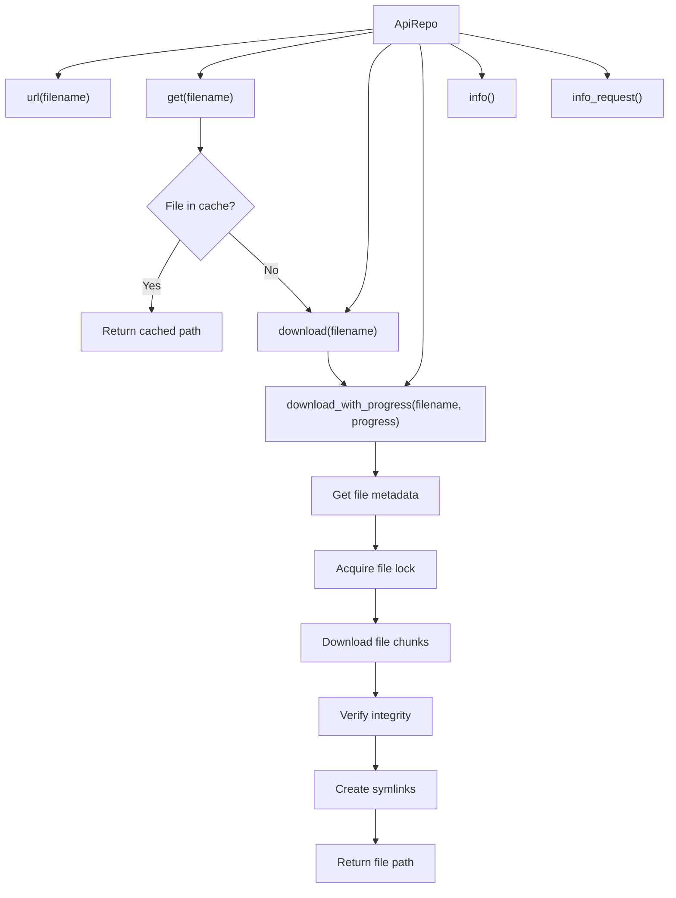
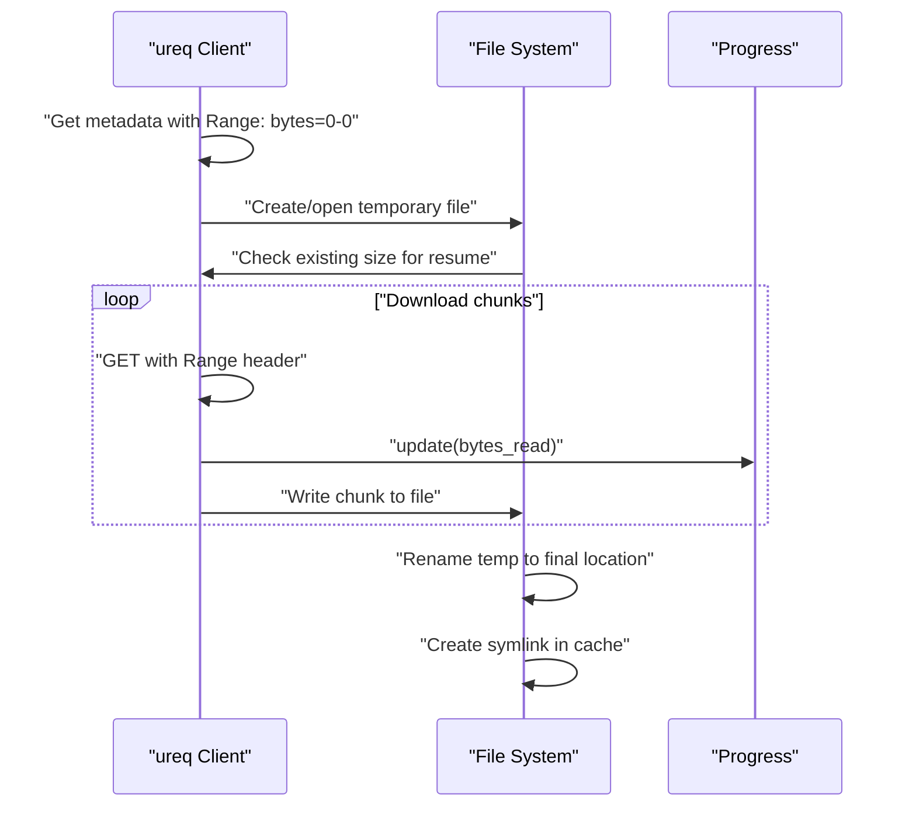
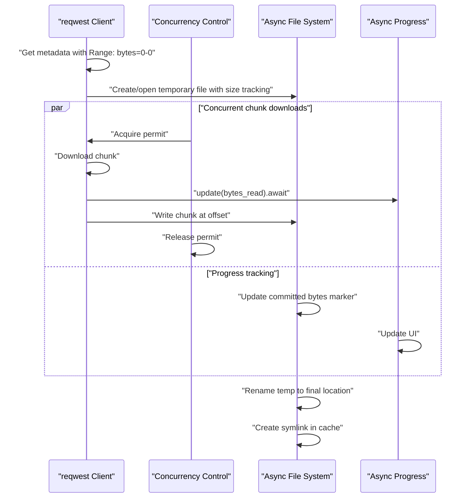
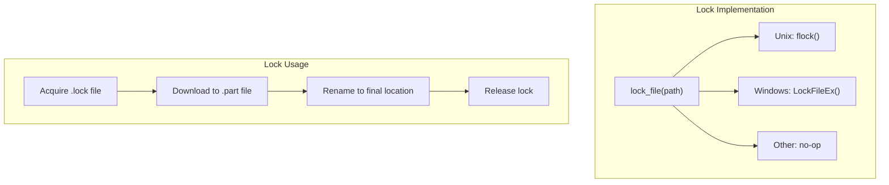

<!-- source: DeepWiki mcp.deepwiki.com · repo huggingface/hf-hub · page 4 API Reference · fetched 2026-10-26 -->

# API Reference

Relevant source files

The following files were used as context for generating this wiki page:

- [src/api/mod.rs](src/api/mod.rs)
- [src/api/sync.rs](src/api/sync.rs)
- [src/api/tokio.rs](src/api/tokio.rs)

This document provides comprehensive documentation for the hf-hub crate's API interfaces, covering both synchronous and asynchronous implementations for downloading and managing files from Hugging Face Hub repositories. The API provides a unified interface for accessing models, datasets, and spaces with built-in caching, progress tracking, and error handling.

For detailed usage patterns and examples, see [Getting Started](#2). For configuration of HTTP backends and feature flags, see [Configuration and Features](#5). For in-depth coverage of individual API implementations, see [Synchronous API](#4.1) and [Asynchronous API](#4.2).

## API Architecture Overview

The hf-hub crate provides two complete API implementations that share common infrastructure but differ in their execution model. Both APIs use identical patterns for construction, configuration, and method signatures, differing only in async/await semantics.

**Sources:** [src/api/mod.rs:1-123](), [src/api/sync.rs:1-1298](), [src/api/tokio.rs:1-1434]()

## Common Types and Traits

### Progress Trait

Both APIs use a common `Progress` trait for tracking download progress, with separate synchronous and asynchronous implementations.

| Type | Location | Purpose |
|------|----------|---------|
| `Progress` (sync) | [src/api/mod.rs:18-27]() | Synchronous progress tracking interface |
| `Progress` (async) | [src/api/tokio.rs:36-46]() | Asynchronous progress tracking interface |
| `ProgressBar` | [src/api/mod.rs:35-60]() | Built-in progress bar implementation |
| `()` | [src/api/mod.rs:29-33]() | No-op progress implementation |

### Repository Information

**Sources:** [src/api/mod.rs:62-77]()

### Error Types

Both APIs define their own `ApiError` enums with similar variants but different underlying error types:

| Error Variant | Sync Location | Async Location | Purpose |
|---------------|---------------|----------------|---------|
| `MissingHeader` | [src/api/sync.rs:161-162]() | [src/api/tokio.rs:155-156]() | Required HTTP header missing |
| `InvalidHeader` | [src/api/sync.rs:165-166]() | [src/api/tokio.rs:159-160]() | Header value malformed |
| `RequestError` | [src/api/sync.rs:176-177]() | [src/api/tokio.rs:171-172]() | HTTP request failed |
| `IoError` | [src/api/sync.rs:184-185]() | [src/api/tokio.rs:179-180]() | File system operation failed |
| `TooManyRetries` | [src/api/sync.rs:188-189]() | [src/api/tokio.rs:183-184]() | Retry limit exceeded |
| `LockAcquisition` | [src/api/sync.rs:202-203]() | [src/api/tokio.rs:202-203]() | File lock could not be acquired |

## API Construction Pattern

Both APIs use an identical builder pattern for configuration:

### Builder Configuration Methods

| Method | Sync Location | Async Location | Purpose |
|--------|---------------|----------------|---------|
| `new()` | [src/api/sync.rs:229-232]() | [src/api/tokio.rs:232-235]() | Create default builder |
| `from_env()` | [src/api/sync.rs:242-249]() | [src/api/tokio.rs:245-252]() | Use environment variables |
| `from_cache()` | [src/api/sync.rs:258-280]() | [src/api/tokio.rs:276-299]() | Use existing cache |
| `with_token()` | [src/api/sync.rs:301-304]() | [src/api/tokio.rs:320-323]() | Set authentication token |
| `with_cache_dir()` | [src/api/sync.rs:295-298]() | [src/api/tokio.rs:314-317]() | Set cache directory |
| `with_progress()` | [src/api/sync.rs:283-286]() | [src/api/tokio.rs:302-305]() | Enable/disable progress bars |
| `with_endpoint()` | [src/api/sync.rs:289-292]() | [src/api/tokio.rs:308-311]() | Set Hub endpoint URL |
| `build()` | [src/api/sync.rs:334-355]() | [src/api/tokio.rs:362-400]() | Construct final API instance |

**Sources:** [src/api/sync.rs:207-356](), [src/api/tokio.rs:207-401]()

## Core API Operations

### Repository Access Methods

Both `Api` classes provide identical methods for accessing different repository types:

| Method | Sync Location | Async Location | Returns |
|--------|---------------|----------------|---------|
| `repo()` | [src/api/sync.rs:623-625]() | [src/api/tokio.rs:557-559]() | `ApiRepo` for any repository type |
| `model()` | [src/api/sync.rs:634-636]() | [src/api/tokio.rs:568-570]() | `ApiRepo` for model repository |
| `dataset()` | [src/api/sync.rs:645-647]() | [src/api/tokio.rs:579-581]() | `ApiRepo` for dataset repository |
| `space()` | [src/api/sync.rs:656-658]() | [src/api/tokio.rs:590-592]() | `ApiRepo` for space repository |

### File Operations

The `ApiRepo` class provides the primary interface for file operations:

| Method | Sync Location | Async Location | Purpose |
|--------|---------------|----------------|---------|
| `url()` | [src/api/sync.rs:696-701]() | [src/api/tokio.rs:618-623]() | Get remote file URL |
| `get()` | [src/api/sync.rs:709-715]() | [src/api/tokio.rs:807-813]() | Get file from cache or download |
| `download()` | [src/api/sync.rs:799-805]() | [src/api/tokio.rs:826-833]() | Force download file |
| `download_with_progress()` | [src/api/sync.rs:746-788]() | [src/api/tokio.rs:868-899]() | Download with custom progress |
| `info()` | [src/api/sync.rs:813-815]() | [src/api/tokio.rs:909-911]() | Get repository information |
| `info_request()` | [src/api/sync.rs:826-829]() | [src/api/tokio.rs:925-928]() | Get raw HTTP request builder |

**Sources:** [src/api/sync.rs:664-830](), [src/api/tokio.rs:598-929]()

## Download Implementation Differences

While the APIs provide identical interfaces, their download implementations differ significantly:

### Synchronous Download Flow

### Asynchronous Download Flow

**Sources:** [src/api/sync.rs:550-619](), [src/api/tokio.rs:625-797]()

## HTTP Client Configuration

The APIs use different underlying HTTP clients with distinct configuration approaches:

| Feature | Sync Implementation | Async Implementation |
|---------|-------------------|---------------------|
| HTTP Client | `ureq::Agent` | `reqwest::Client` |
| TLS Backend | `native-tls` or built-in | `native-tls` or `rustls-tls` |
| Proxy Support | [src/api/sync.rs:342-343]() | Built into `reqwest` |
| Redirect Policy | Manual handling [src/api/sync.rs:473-501]() | Custom policy [src/api/tokio.rs:368-383]() |
| Concurrency | Single-threaded | Configurable via `max_files` |
| Chunk Downloads | Sequential | Parallel with semaphore |

**Sources:** [src/api/sync.rs:676-686](), [src/api/tokio.rs:362-400]()

## File Locking and Safety

Both APIs implement identical file locking mechanisms to prevent concurrent writes:

**Sources:** [src/api/sync.rs:82-155](), [src/api/tokio.rs:76-149]()

For detailed implementation specifics and advanced usage patterns, see [Synchronous API](#4.1) and [Asynchronous API](#4.2). For examples of custom progress implementations and integration patterns, see [Advanced Examples](#6).

---

