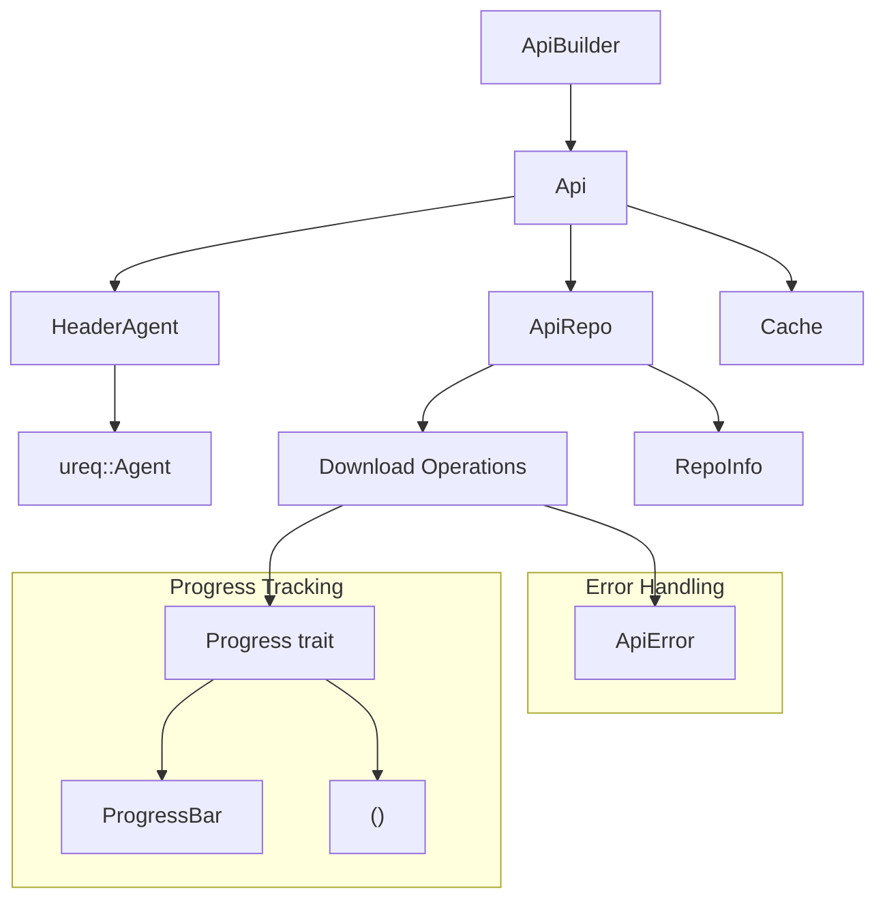
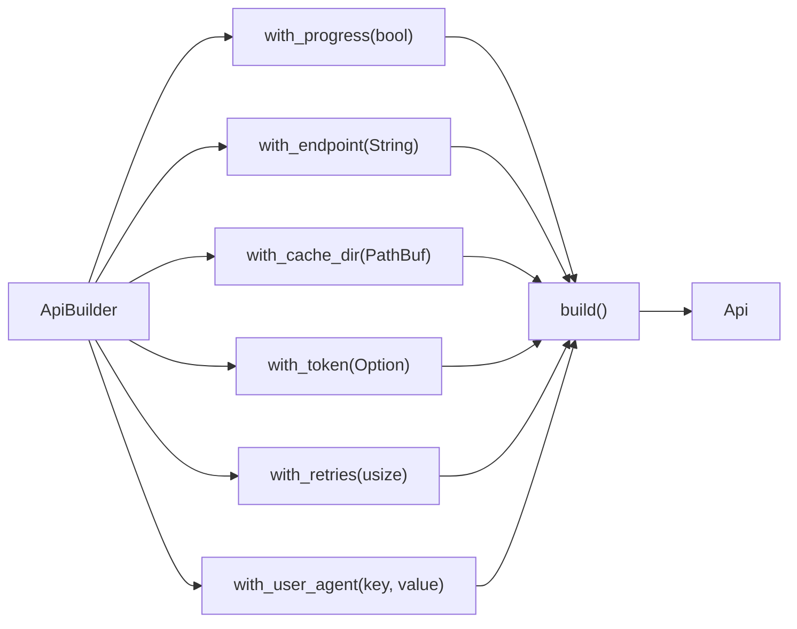
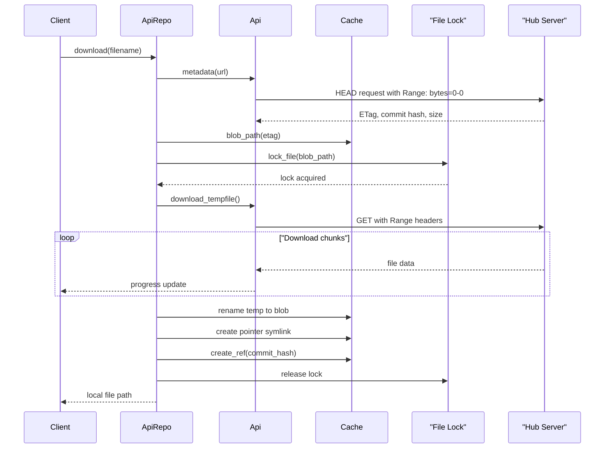
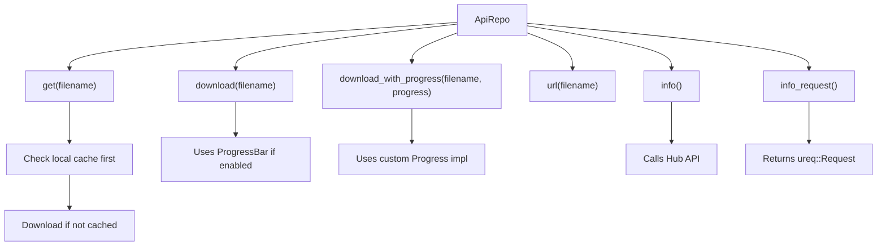
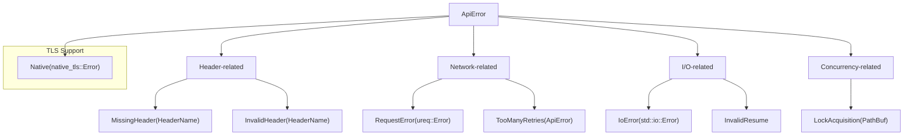
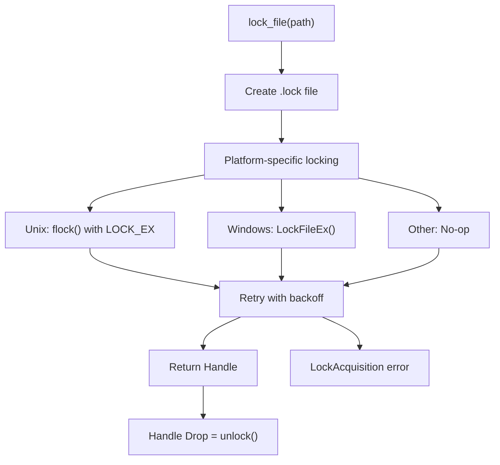

<!-- source: DeepWiki mcp.deepwiki.com · repo huggingface/hf-hub · page 4.1 Synchronous API · fetched 2026-10-26 -->

# Synchronous API

Relevant source files

The following files were used as context for generating this wiki page:

- [src/api/mod.rs](src/api/mod.rs)
- [src/api/sync.rs](src/api/sync.rs)

The Synchronous API provides blocking, thread-safe access to Hugging Face Hub resources using the `ureq` HTTP client. This API is designed for applications that prefer synchronous operations or run in environments where async/await is not suitable. For asynchronous operations with `tokio` support, see [Asynchronous API](#4.2).

The synchronous API handles file downloads, caching, resumable transfers, and concurrent access protection through file locking mechanisms. All operations block the calling thread until completion.

## Core API Components

The synchronous API is built around three main components that work together to provide Hub access:

### API Component Architecture

**Sources:** [src/api/sync.rs:207-830](), [src/api/mod.rs:16-77]()

| Component | Purpose | Key Methods |
|-----------|---------|-------------|
| `ApiBuilder` | Configuration and construction of `Api` instances | `new()`, `with_token()`, `with_cache_dir()`, `build()` |
| `Api` | Main entry point for Hub operations | `repo()`, `model()`, `dataset()`, `space()` |
| `ApiRepo` | Repository-specific operations | `download()`, `get()`, `info()`, `url()` |
| `HeaderAgent` | HTTP client wrapper with default headers | `get()` |

## Builder Pattern Configuration

The `ApiBuilder` follows the builder pattern to configure API instances with various options:

### Configuration Options

**Sources:** [src/api/sync.rs:207-356]()

The builder supports three construction patterns:

- **`ApiBuilder::new()`** - Default configuration with standard cache location
- **`ApiBuilder::from_env()`** - Configuration from environment variables (`HF_HOME`, `HF_ENDPOINT`)
- **`ApiBuilder::from_cache(cache)`** - Configuration with custom cache instance

Key configuration options include:
- **Progress display**: Toggle progress bars during downloads
- **Endpoint**: Custom Hub endpoint (defaults to `https://huggingface.co`)
- **Authentication**: Bearer token for private repositories
- **Retry behavior**: Number of download retry attempts
- **User agent**: Custom user agent components

## Download Process and Caching

The download process implements sophisticated caching, resumable transfers, and concurrent access protection:

### Download Sequence

**Sources:** [src/api/sync.rs:550-830](), [src/api/sync.rs:82-155]()

### Key Download Features

| Feature | Implementation | Location |
|---------|---------------|----------|
| **Resumable Downloads** | Uses temporary `.part` files and HTTP Range requests | [src/api/sync.rs:550-591]() |
| **File Locking** | Platform-specific file locking to prevent concurrent writes | [src/api/sync.rs:82-155]() |
| **Retry Logic** | Exponential backoff with jitter for failed downloads | [src/api/sync.rs:574-588]() |
| **Progress Tracking** | Pluggable `Progress` trait with `ProgressBar` support | [src/api/mod.rs:16-60]() |

The caching strategy uses:
- **Blob storage**: Content-addressed storage by ETag hash
- **Pointer system**: Symlinks from commit-specific paths to blobs
- **Reference tracking**: Maintains refs for different revisions

## Repository Operations

The `ApiRepo` struct provides repository-specific operations for models, datasets, and spaces:

### Repository Method Overview

**Sources:** [src/api/sync.rs:664-830]()

### Repository Types and URL Construction

The API supports three repository types through convenience methods:

| Method | Repository Type | URL Pattern |
|--------|----------------|-------------|
| `api.model(id)` | `RepoType::Model` | `{endpoint}/{id}/resolve/{revision}/{filename}` |
| `api.dataset(id)` | `RepoType::Dataset` | `{endpoint}/datasets/{id}/resolve/{revision}/{filename}` |
| `api.space(id)` | `RepoType::Space` | `{endpoint}/spaces/{id}/resolve/{revision}/{filename}` |

## Error Handling

The synchronous API uses the `ApiError` enum for comprehensive error handling:

### Error Type Classification

**Sources:** [src/api/sync.rs:157-204]()

Common error scenarios include:
- **Missing headers**: Required headers not present in Hub responses
- **Network failures**: Connection issues with automatic retry
- **Lock acquisition**: File being downloaded by another process
- **Invalid resume**: Corrupted partial download files

## File Locking and Concurrency

The synchronous API implements cross-platform file locking to ensure safe concurrent access:

### Platform-Specific Locking Implementation

**Sources:** [src/api/sync.rs:82-155]()

The locking mechanism:
- Creates `.lock` files alongside download targets
- Uses platform-specific file locking APIs (flock on Unix, LockFileEx on Windows)
- Implements retry logic with up to 5 attempts
- Automatically releases locks when `Handle` is dropped
- Provides no-op implementation for unsupported platforms

This ensures that concurrent download attempts for the same file are serialized, preventing corruption while allowing resumable downloads.

---

