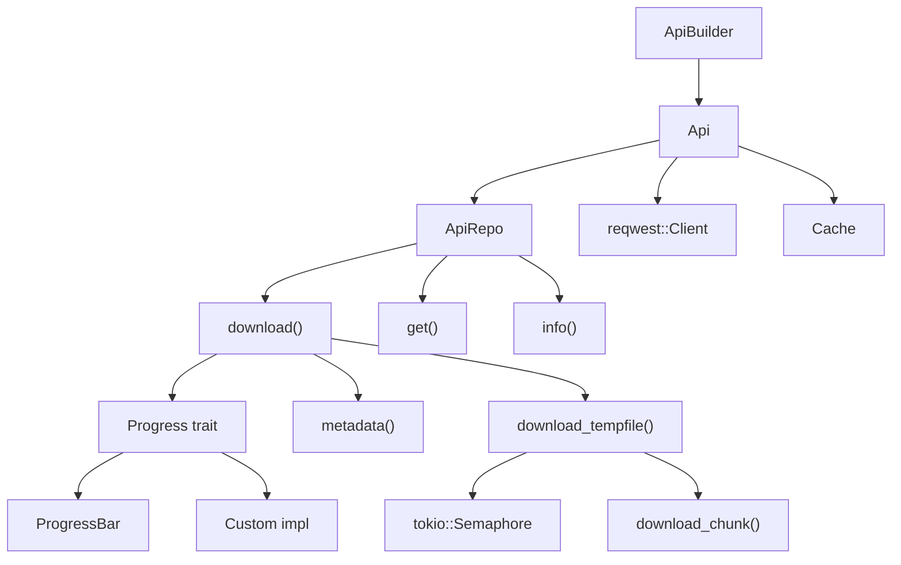
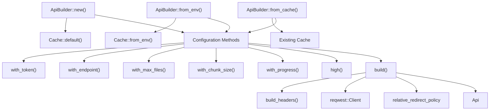
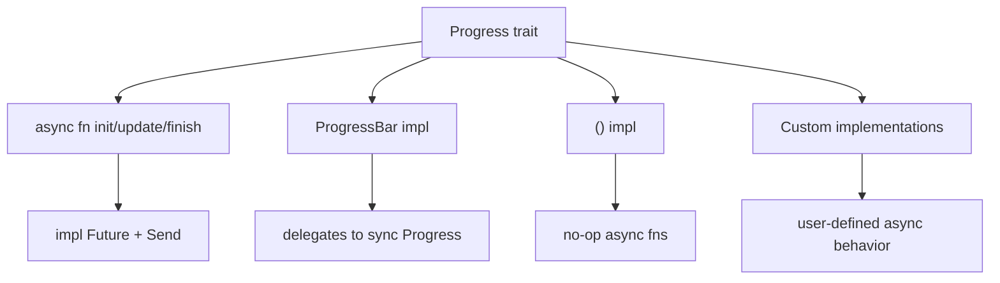
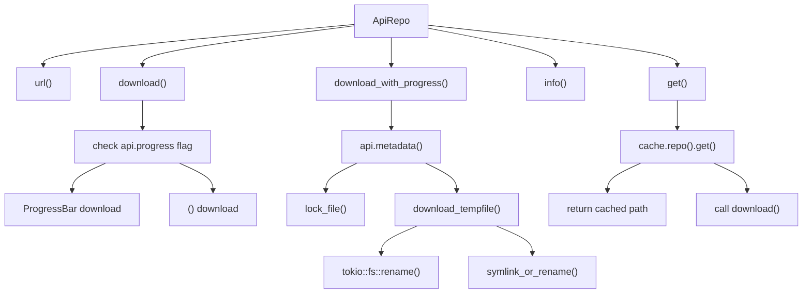
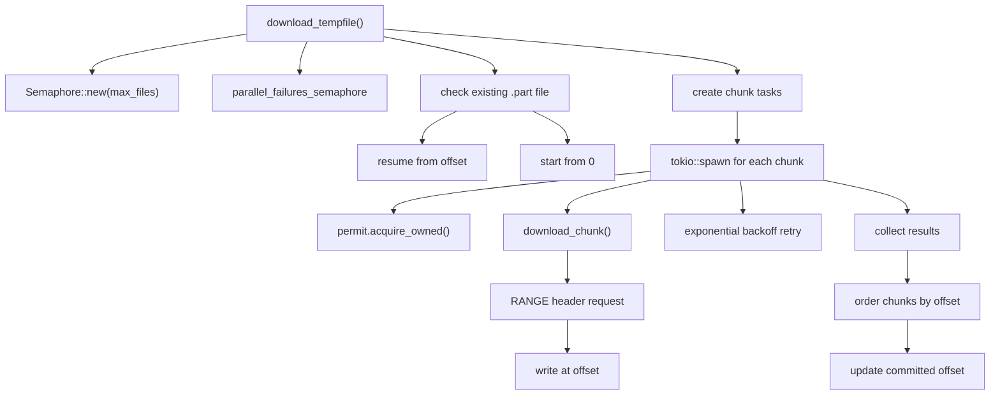
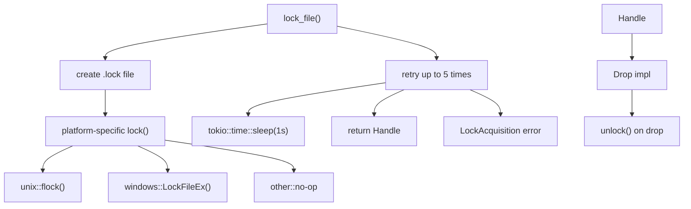

<!-- source: DeepWiki mcp.deepwiki.com · repo huggingface/hf-hub · page 4.2 Asynchronous API · fetched 2026-10-26 -->

# Asynchronous API

Relevant source files

The following files were used as context for generating this wiki page:

- [src/api/mod.rs](src/api/mod.rs)
- [src/api/tokio.rs](src/api/tokio.rs)

This document covers the asynchronous API implementation for interacting with the Hugging Face Hub. The async API is built on top of tokio and reqwest, providing concurrent downloads, progress tracking, and robust error handling for file operations.

For synchronous API functionality, see [Synchronous API](#4.1). For core caching and repository abstractions, see [Core Architecture](#3).

## Overview

The asynchronous API provides a tokio-based interface for downloading files from Hugging Face Hub with support for concurrent operations, progress tracking, and resumable downloads. The implementation leverages async/await patterns and is designed for high-throughput scenarios where multiple files need to be downloaded simultaneously.

**Core Components Diagram**

Sources: [src/api/tokio.rs:207-423](), [src/api/tokio.rs:595-929]()

## Api and ApiBuilder

The `ApiBuilder` provides a fluent interface for configuring the async API client with various options for performance tuning, authentication, and endpoint configuration.

**ApiBuilder Configuration Flow**

Sources: [src/api/tokio.rs:220-401]()

### Key Configuration Options

| Method | Purpose | Default Value |
|--------|---------|---------------|
| `with_max_files()` | Controls concurrent download limit | 1 |
| `with_chunk_size()` | Sets download chunk size for resumability | 10MB |
| `with_progress()` | Enables/disables progress bars | true |
| `high()` | Optimizes for high-CPU cloud environments | `num_cpus::get()` files, 10MB chunks |

The `high()` method [src/api/tokio.rs:264-267]() is specifically designed for cloud environments with high CPU counts and fast networks, allowing much higher concurrency than the default single-file configuration.

Sources: [src/api/tokio.rs:325-341](), [src/api/tokio.rs:264-267]()

## Progress Tracking

The async API implements an async-aware `Progress` trait that allows for non-blocking progress updates during file downloads.

**Progress Trait Implementation**

Sources: [src/api/tokio.rs:34-64]()

The async `Progress` trait [src/api/tokio.rs:36-46]() requires all methods to return futures, enabling non-blocking progress updates. The `ProgressBar` implementation [src/api/tokio.rs:48-58]() delegates to the synchronous version defined in [src/api/mod.rs:18-60]().

## Repository Operations

The `ApiRepo` struct provides repository-specific operations with async support for downloads and metadata retrieval.

**ApiRepo Operation Flow**

Sources: [src/api/tokio.rs:610-929]()

### Download Mechanisms

The async download implementation supports chunked, concurrent downloads with automatic retries and progress tracking.

**Concurrent Download Architecture**

Sources: [src/api/tokio.rs:625-761](), [src/api/tokio.rs:763-797]()

The download system uses several key mechanisms:

1. **Semaphore-based concurrency control** [src/api/tokio.rs:632-633]() limits the number of concurrent file handles
2. **Chunked downloads** [src/api/tokio.rs:669-717]() enable resumability and parallel processing  
3. **Binary heap ordering** [src/api/tokio.rs:720-746]() ensures chunks are committed in sequence
4. **Exponential backoff** [src/api/tokio.rs:694-710]() handles transient failures

## File Locking and Resumability

The async API implements cross-platform file locking to prevent concurrent downloads of the same file and support resumable downloads.

**File Locking Implementation**

Sources: [src/api/tokio.rs:76-93](), [src/api/tokio.rs:95-149]()

The locking mechanism supports resumable downloads by detecting partial `.part` files [src/api/tokio.rs:638-666]() and reading the committed progress marker stored as a 64-bit integer at the end of the file [src/api/tokio.rs:646-651]().

## Error Handling

The async API defines comprehensive error types for different failure scenarios that can occur during async operations.

| Error Type | Description | Source |
|------------|-------------|---------|
| `MissingHeader` | Expected HTTP header not present | [src/api/tokio.rs:155-156]() |
| `InvalidHeader` | Header value doesn't match expected format | [src/api/tokio.rs:159-160]() |
| `RequestError` | HTTP request failures from reqwest | [src/api/tokio.rs:171-172]() |
| `TooManyRetries` | Chunk download exceeded retry limit | [src/api/tokio.rs:183-184]() |
| `AcquireError` | Semaphore acquisition failed | [src/api/tokio.rs:191-192]() |
| `Join` | tokio task join failures | [src/api/tokio.rs:197-198]() |
| `LockAcquisition` | File locking failed after retries | [src/api/tokio.rs:202-203]() |

Sources: [src/api/tokio.rs:151-204]()

## Performance Features

The async API includes several performance optimizations for high-throughput scenarios:

### Concurrent File Downloads
The `max_files` parameter [src/api/tokio.rs:212-326]() controls how many files can be downloaded simultaneously using tokio's `Semaphore` [src/api/tokio.rs:632-633]().

### Chunked Downloads with Retries
Large files are split into chunks [src/api/tokio.rs:669-672]() that can be downloaded in parallel. Failed chunks are retried with exponential backoff [src/api/tokio.rs:483-485]() up to a configurable limit.

### Connection Reuse
The API creates dedicated `reqwest::Client` instances [src/api/tokio.rs:364-388]() with custom redirect policies that maintain connection pools for efficient HTTP reuse.

### Jittered Backoff
Retry delays include random jitter [src/api/tokio.rs:479-481]() to prevent thundering herd problems when multiple chunks fail simultaneously.

Sources: [src/api/tokio.rs:212-326](), [src/api/tokio.rs:669-717](), [src/api/tokio.rs:479-485]()

---

