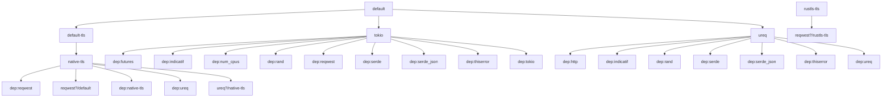
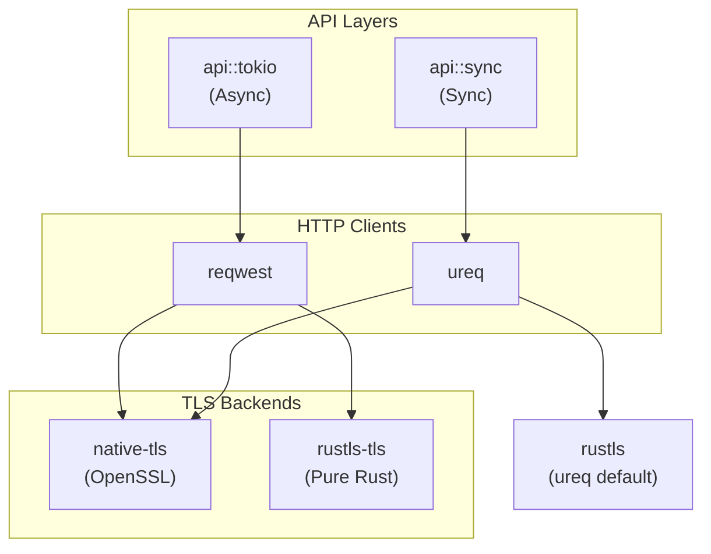

<!-- source: DeepWiki mcp.deepwiki.com · repo huggingface/hf-hub · page 5 Configuration and Features · fetched 2026-10-26 -->

# Configuration and Features

<details>
<summary>Relevant source files</summary>

The following files were used as context for generating this wiki page:

- [Cargo.toml](Cargo.toml)
- [README.md](README.md)

</details>


This document covers the configuration options available in the hf-hub crate through Cargo feature flags, including HTTP client selection, TLS backend configuration, and their various combinations. It explains how to customize the crate's compilation to match specific requirements for synchronous vs asynchronous operation and TLS implementation choices.

For detailed explanations of specific feature combinations and backend selection, see [Feature Gates and Backends](#5.1). For SOCKS proxy setup instructions, see [SOCKS Proxy Configuration](#5.2).

## Feature-Based Architecture

The hf-hub crate uses Cargo's feature system to provide flexible compilation options. This allows users to include only the functionality they need, reducing binary size and dependency complexity while supporting different runtime requirements.

### Feature Dependency Graph



Sources: [Cargo.toml:50-83]()

### HTTP Client and TLS Backend Matrix



Sources: [Cargo.toml:27-38](), [Cargo.toml:54-55](), [README.md:58-60]()

## Default Configuration

The default feature set enables maximum compatibility and functionality:

| Feature | Enabled | Purpose |
|---------|---------|---------|
| `default-tls` | ✓ | Enables `native-tls` backend |
| `tokio` | ✓ | Async API with tokio runtime |
| `ureq` | ✓ | Sync API with ureq client |

This configuration provides both synchronous and asynchronous APIs with OpenSSL-based TLS through `native-tls`.

Sources: [Cargo.toml:51]()

## Feature Combinations

### TLS Backend Selection

The crate supports two TLS implementations:

**native-tls (Default)**
- Uses system's native TLS implementation (OpenSSL on most platforms)
- Enabled by `default-tls` and `native-tls` features
- Works with both `reqwest` and `ureq`

**rustls-tls**
- Pure Rust TLS implementation
- Enabled by `rustls-tls` feature
- Only affects `reqwest`; `ureq` always uses rustls by default

Sources: [Cargo.toml:53-55](), [README.md:58-60]()

### API Selection

**Tokio Feature**
- Enables asynchronous API through `api::tokio` module
- Includes progress reporting with `indicatif`
- Provides concurrent download capabilities
- Requires `reqwest` HTTP client

**Ureq Feature**
- Enables synchronous API through `api::sync` module
- Lighter weight implementation
- Uses `ureq` HTTP client
- Includes SOCKS proxy support

Sources: [Cargo.toml:56-83]()

## Configuration Examples

### Minimal Async Configuration
```toml
[dependencies]
hf-hub = { version = "0.4", default-features = false, features = ["tokio", "rustls-tls"] }
```

### Minimal Sync Configuration
```toml
[dependencies]
hf-hub = { version = "0.4", default-features = false, features = ["ureq", "native-tls"] }
```

### Both APIs with Rustls
```toml
[dependencies]
hf-hub = { version = "0.4", default-features = false, features = ["tokio", "ureq", "rustls-tls"] }
```

Sources: [README.md:50-55]()

## Platform-Specific Dependencies

The crate includes conditional dependencies for platform-specific functionality:

### Windows
- `windows-sys` crate for file system operations
- Provides Win32 API access for advanced file handling

### Unix/Linux
- `libc` crate for system calls
- Enables POSIX-compliant file operations

These dependencies are automatically included when relevant features (`tokio` or `ureq`) are enabled.

Sources: [Cargo.toml:41-48]()

## Build Considerations

### Binary Size Impact
- Default features include both sync and async APIs
- Disabling unused features reduces binary size
- `tokio` feature adds significant dependencies

### Compilation Time
- `rustls-tls` may compile faster than `native-tls`
- `native-tls` requires system OpenSSL libraries
- Feature selection affects total dependency count

### Runtime Dependencies
- `native-tls` requires system TLS libraries
- `rustls-tls` is self-contained
- `tokio` requires async runtime

Sources: [Cargo.toml:19-83](), [README.md:44-61]()

---

