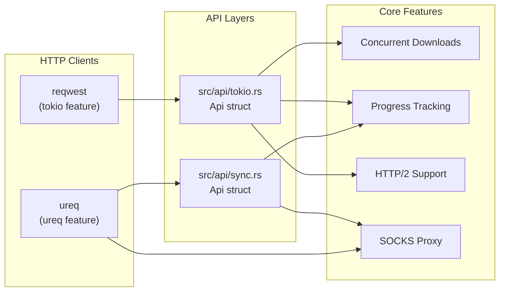
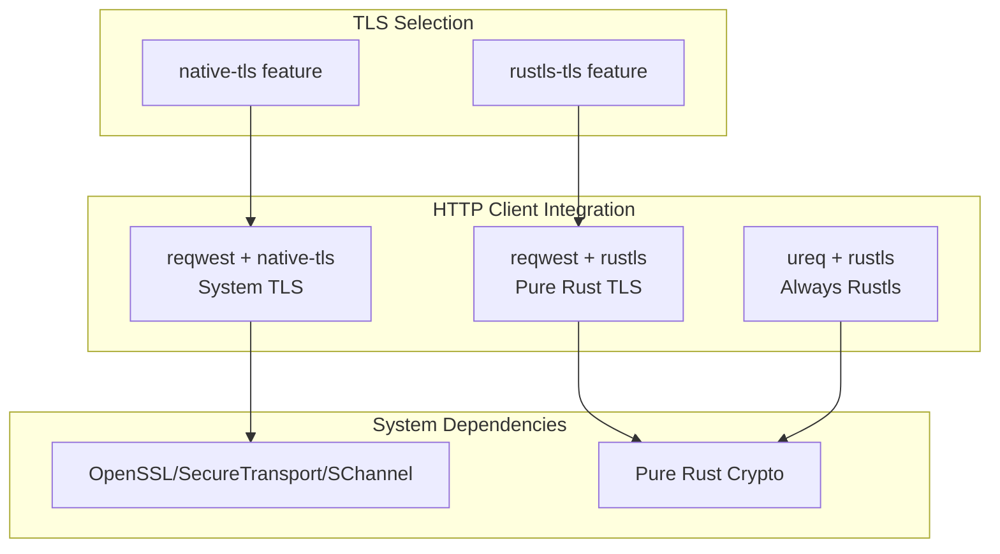
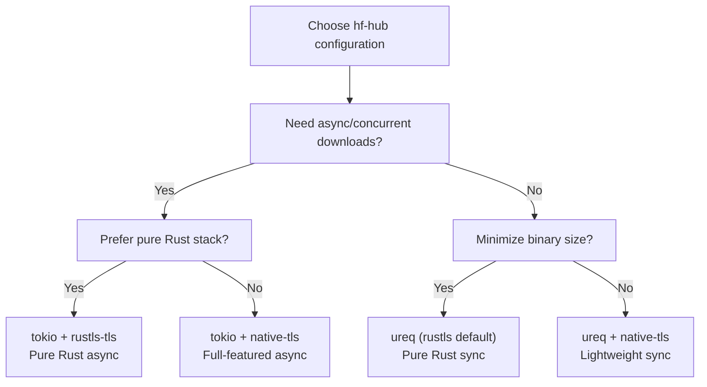

<!-- source: DeepWiki mcp.deepwiki.com · repo huggingface/hf-hub · page 5.1 Feature Gates and Backends · fetched 2026-10-26 -->

# Feature Gates and Backends

<details>
<summary>Relevant source files</summary>

The following files were used as context for generating this wiki page:

- [Cargo.toml](Cargo.toml)
- [README.md](README.md)

</details>


This document explains the feature flag system that controls HTTP client and TLS backend selection in hf-hub. The crate supports multiple combinations of HTTP clients (`tokio`/`ureq`) and TLS implementations (`native-tls`/`rustls-tls`) through Cargo feature gates.

For general configuration guidance, see [Configuration and Features](#5). For SOCKS proxy configuration specifically, see [SOCKS Proxy Configuration](#5.2).

## Feature Gate Architecture

The hf-hub crate uses a modular feature system that allows compile-time selection of HTTP clients and TLS backends. This design enables users to choose the most appropriate combination for their use case while avoiding unnecessary dependencies.

### Feature Dependency Graph

```mermaid
graph TD
    default["default"] --> default_tls["default-tls"]
    default --> tokio_feat["tokio"]
    default --> ureq_feat["ureq"]
    
    default_tls --> native_tls_feat["native-tls"]
    
    native_tls_feat --> reqwest_dep["dep:reqwest"]
    native_tls_feat --> reqwest_default["reqwest?/default"]
    native_tls_feat --> native_tls_dep["dep:native-tls"]
    native_tls_feat --> ureq_dep["dep:ureq"]
    native_tls_feat --> ureq_native_tls["ureq?/native-tls"]
    
    rustls_tls_feat["rustls-tls"] --> reqwest_rustls["reqwest?/rustls-tls"]
    
    tokio_feat --> futures_dep["dep:futures"]
    tokio_feat --> indicatif_dep["dep:indicatif"]
    tokio_feat --> num_cpus_dep["dep:num_cpus"]
    tokio_feat --> rand_dep["dep:rand"]
    tokio_feat --> reqwest_dep
    tokio_feat --> reqwest_charset["reqwest/charset"]
    tokio_feat --> reqwest_http2["reqwest/http2"]
    tokio_feat --> serde_dep["dep:serde"]
    tokio_feat --> serde_json_dep["dep:serde_json"]
    tokio_feat --> thiserror_dep["dep:thiserror"]
    tokio_feat --> tokio_dep["dep:tokio"]
    tokio_feat --> tokio_rt["tokio/rt-multi-thread"]
    
    ureq_feat --> http_dep["dep:http"]
    ureq_feat --> indicatif_dep
    ureq_feat --> rand_dep
    ureq_feat --> serde_dep
    ureq_feat --> serde_json_dep
    ureq_feat --> thiserror_dep
    ureq_feat --> ureq_dep
```



Sources: [Cargo.toml:50-84]()

### Backend Selection Matrix

| Feature Combination | HTTP Client | TLS Backend | Async Support | Use Case |
|---------------------|-------------|-------------|---------------|----------|
| `tokio` + `native-tls` | reqwest | OpenSSL | Yes | Full-featured async with system TLS |
| `tokio` + `rustls-tls` | reqwest | Rustls | Yes | Pure Rust async stack |
| `ureq` + `native-tls` | ureq | OpenSSL | No | Lightweight sync with system TLS |
| `ureq` + `rustls-tls` | ureq | Rustls | No | Pure Rust sync stack |

## HTTP Client Backends

### Tokio Backend (`tokio` feature)

The `tokio` feature enables the asynchronous API powered by the `reqwest` HTTP client. This backend provides concurrent downloads, progress tracking, and full HTTP/2 support.

**Dependencies enabled:**
- `reqwest` with `charset`, `http2`, and `macos-system-configuration` features
- `tokio` with `rt-multi-thread` and `fs` features
- `indicatif` for progress bars
- `futures`, `num_cpus`, `rand` for async utilities
- Platform-specific dependencies (`libc`, `windows-sys`)

### Ureq Backend (`ureq` feature)

The `ureq` feature enables the synchronous API using the lightweight `ureq` HTTP client. This backend has a smaller dependency footprint and simpler threading model.

**Dependencies enabled:**
- `ureq` with `json` and `socks-proxy` features
- `http` for HTTP primitives
- `indicatif` for progress tracking
- Shared utilities (`serde`, `serde_json`, `thiserror`, `rand`)



Sources: [Cargo.toml:56-83]()

## TLS Backend Configuration

### Native TLS Backend (`native-tls` feature)

The `native-tls` feature uses the system's native TLS implementation (OpenSSL on most platforms, Secure Transport on macOS, SChannel on Windows). This is the default TLS backend.

**Configuration in Cargo.toml:**
```toml
native-tls = ["dep:reqwest", "reqwest?/default", "dep:native-tls", "dep:ureq", "ureq?/native-tls"]
default-tls = ["native-tls"]
```

### Rustls TLS Backend (`rustls-tls` feature)

The `rustls-tls` feature uses the pure Rust `rustls` implementation, avoiding OpenSSL dependencies. This provides a fully Rust-based networking stack.

**Note:** When using `ureq`, the TLS backend is always `rustls` regardless of the `rustls-tls` feature flag, as `ureq` uses `rustls` as its default and only TLS implementation.



Sources: [Cargo.toml:53-55](), [README.md:58-60]()

## Feature Combinations and Examples

### Default Configuration

The default feature set enables both HTTP clients and native TLS:

```toml
default = ["default-tls", "tokio", "ureq"]
```

This allows users to choose between sync and async APIs at runtime while using the system's TLS implementation.

### Minimal Configurations

**Async-only with Rustls:**
```bash
cargo add hf-hub --no-default-features --features tokio,rustls-tls
```

**Sync-only with Native TLS:**
```bash
cargo add hf-hub --no-default-features --features ureq,native-tls
```

### Configuration Selection Guide



### Runtime Implications

The feature selection affects both compile-time dependencies and runtime behavior:

- **Compile-time**: Different dependency trees and binary sizes
- **Runtime**: Different HTTP clients with varying performance characteristics
- **API surface**: Sync vs async method availability

Sources: [Cargo.toml:51](), [README.md:44-61]()

## Cross-Platform Considerations

The crate includes platform-specific dependencies that are automatically enabled with the main features:

**Unix platforms (`cfg(unix)`):**
- `libc` for system integration

**Windows platforms (`cfg(windows)`):**
- `windows-sys` with specific Win32 API features for file system operations

These dependencies are conditionally compiled and don't affect feature selection on other platforms.

Sources: [Cargo.toml:41-48]()

---

