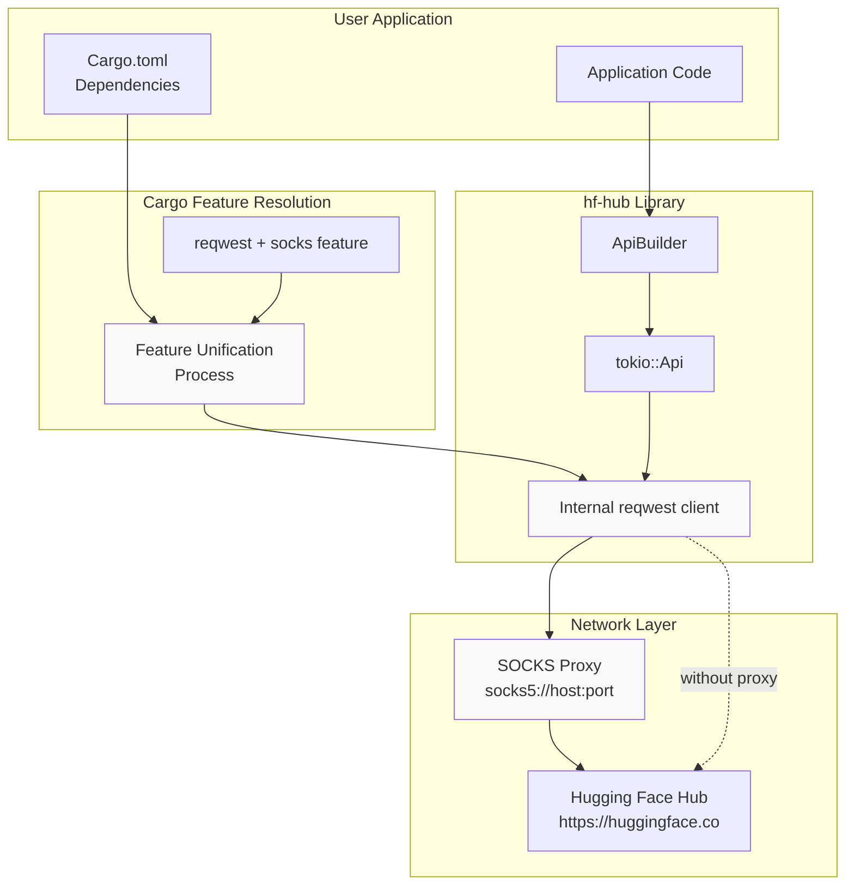
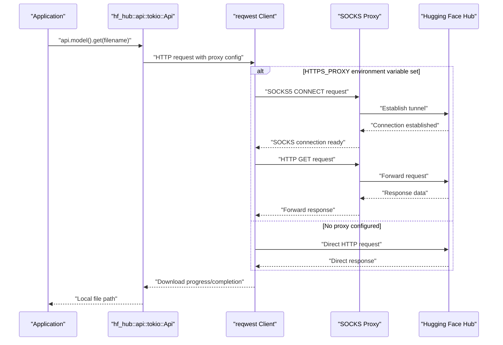

<!-- source: DeepWiki mcp.deepwiki.com · repo huggingface/hf-hub · page 5.2 SOCKS Proxy Configuration · fetched 2026-10-26 -->

# SOCKS Proxy Configuration

<details>
<summary>Relevant source files</summary>

The following files were used as context for generating this wiki page:

- [examples/socks/Cargo.toml](examples/socks/Cargo.toml)
- [examples/socks/README.md](examples/socks/README.md)
- [examples/socks/src/main.rs](examples/socks/src/main.rs)

</details>


This document covers how to configure SOCKS proxy support in the hf-hub library. SOCKS proxy functionality is enabled through Cargo's feature unification mechanism rather than direct configuration within hf-hub itself.

For general information about feature gates and backend selection, see [Feature Gates and Backends](#5.1).

## Overview

The hf-hub library supports SOCKS proxy routing through its integration with the `reqwest` HTTP client. SOCKS support is not directly implemented within hf-hub but is inherited from `reqwest` when the appropriate features are enabled. This approach leverages Cargo's feature unification to seamlessly extend hf-hub's networking capabilities.

## Feature Unification Mechanism

SOCKS proxy support in hf-hub relies on Cargo's [feature unification](https://doc.rust-lang.org/cargo/reference/resolver.html#features) mechanism. When you add `reqwest` with the `socks` feature to your project alongside hf-hub, the SOCKS functionality becomes available to hf-hub's async API automatically.

### Dependency Configuration

To enable SOCKS proxy support, add `reqwest` with the `socks` feature to your `Cargo.toml`:

```toml
[dependencies]
hf-hub = "0.4.0"
reqwest = { version = "0.12.9", features = ["socks"] }
tokio = { version = "1.42.0", features = ["macros"] }
```

The feature unification occurs because hf-hub internally depends on `reqwest` for its async HTTP operations. When your project specifies additional features for `reqwest`, those features are automatically unified with hf-hub's usage of the same dependency.

**Sources:** [examples/socks/Cargo.toml:6-11](), [examples/socks/README.md:1-5]()

## Proxy Configuration Methods

### Environment Variables

The primary method for configuring SOCKS proxy settings is through environment variables that `reqwest` recognizes:

| Environment Variable | Purpose |
|---------------------|---------|
| `HTTPS_PROXY` | HTTPS proxy URL, including SOCKS URLs |
| `HTTP_PROXY` | HTTP proxy URL, including SOCKS URLs |
| `ALL_PROXY` | Fallback proxy URL for all protocols |
| `NO_PROXY` | Comma-separated list of hosts to bypass proxy |

SOCKS proxy URLs follow the format: `socks5://[username:password@]host:port`

### Runtime Configuration

The async API automatically respects proxy environment variables without requiring additional configuration:

```rust
let api = hf_hub::api::tokio::ApiBuilder::new()
    .with_progress(true)
    .build()
    .unwrap();
```

**Sources:** [examples/socks/src/main.rs:1-15]()

## Architecture Diagram

**SOCKS Proxy Feature Integration**



**Sources:** [examples/socks/Cargo.toml:1-12](), [examples/socks/README.md:1-5]()

## Request Flow with SOCKS Proxy

**SOCKS Proxy Request Sequence**



**Sources:** [examples/socks/src/main.rs:3-15]()

## Implementation Example

The following example demonstrates SOCKS proxy usage with environment variable configuration:

### Basic SOCKS Proxy Usage

[examples/socks/src/main.rs:1-15]() shows the complete implementation:

- Environment variable `HTTPS_PROXY` is expected to contain the SOCKS proxy URL
- The `ApiBuilder` creates an async API instance with progress tracking enabled
- Downloads proceed automatically through the configured proxy

### Key Implementation Points

1. **No Direct Configuration**: hf-hub does not provide explicit SOCKS configuration methods
2. **Environment Variable Driven**: Proxy settings are configured through standard environment variables
3. **Async API Only**: SOCKS proxy support is available only through the async (`tokio`) API
4. **Automatic Detection**: `reqwest` automatically detects and uses configured proxy settings

**Sources:** [examples/socks/src/main.rs:1-15](), [examples/socks/README.md:1-5]()

## Limitations and Considerations

### API Compatibility

SOCKS proxy support is only available with the async API (`hf_hub::api::tokio`) because it depends on `reqwest`. The synchronous API uses `ureq`, which has different proxy support capabilities.

### Feature Dependencies

The SOCKS functionality requires:
- The `tokio` feature to be enabled in hf-hub
- The `socks` feature to be enabled in `reqwest`
- Proper environment variable configuration

### Error Handling

Proxy connection failures are handled by the underlying `reqwest` client and will manifest as standard HTTP request errors within hf-hub's API.

**Sources:** [examples/socks/Cargo.toml:6-11](), [examples/socks/README.md:1-5]()

---

