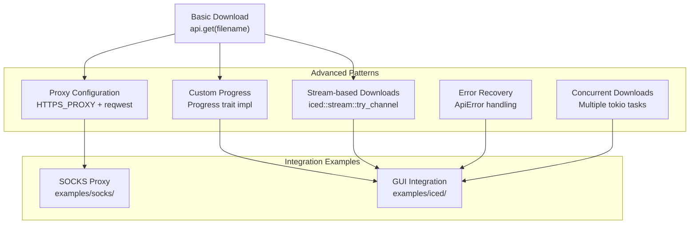
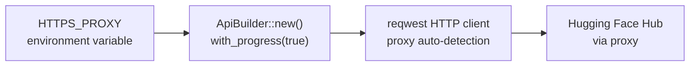
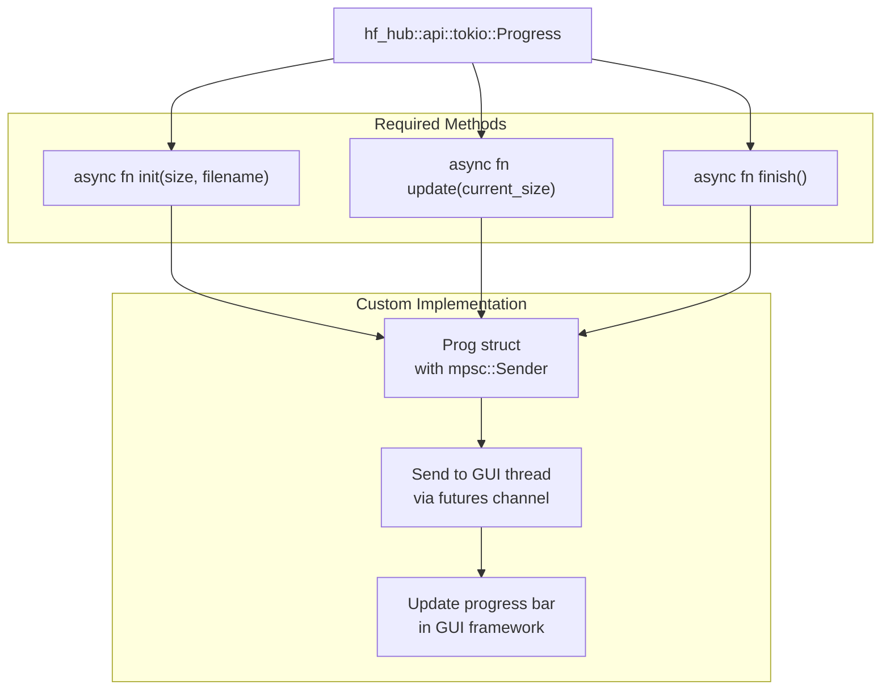
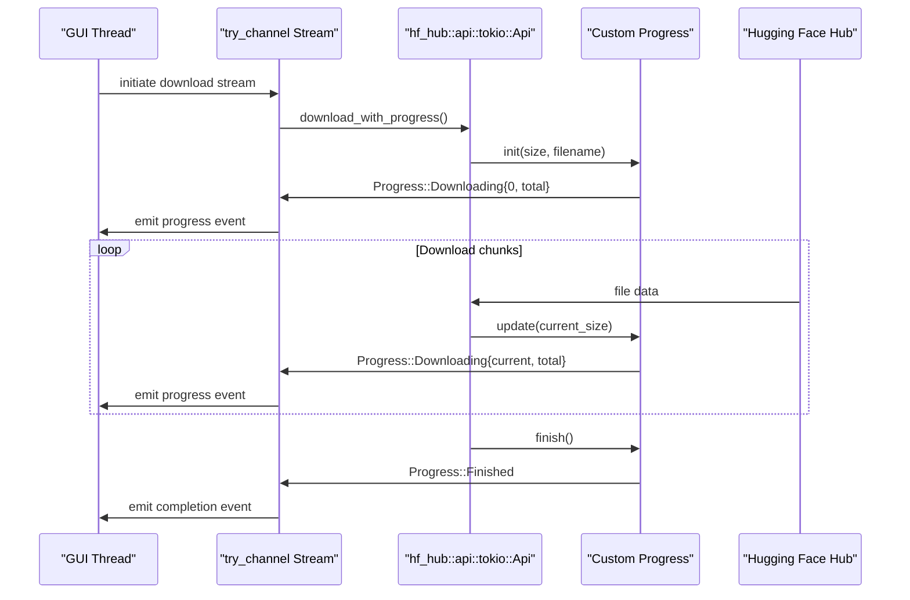
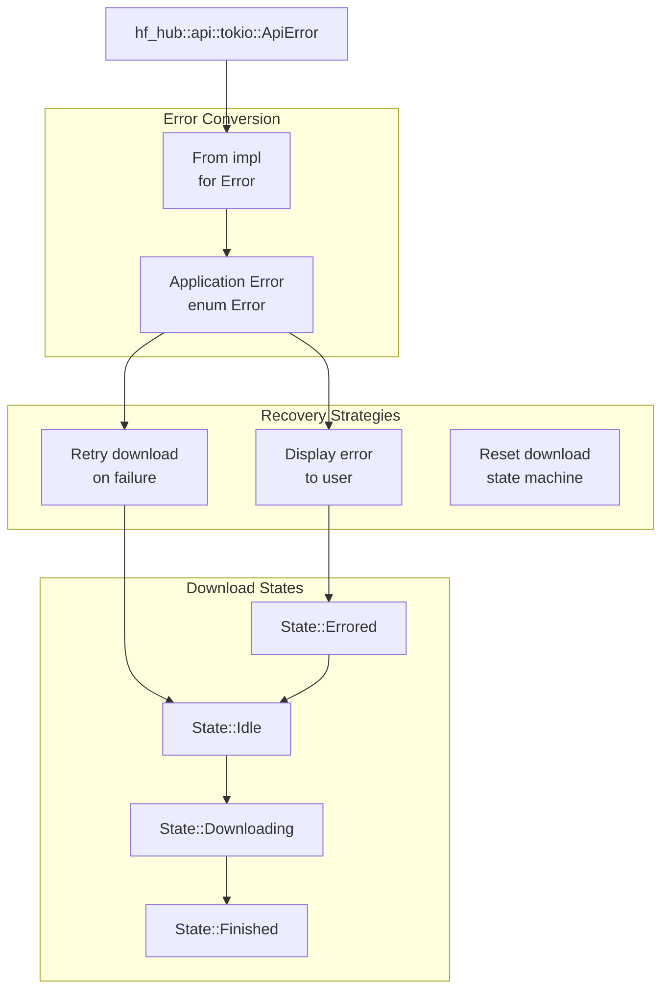
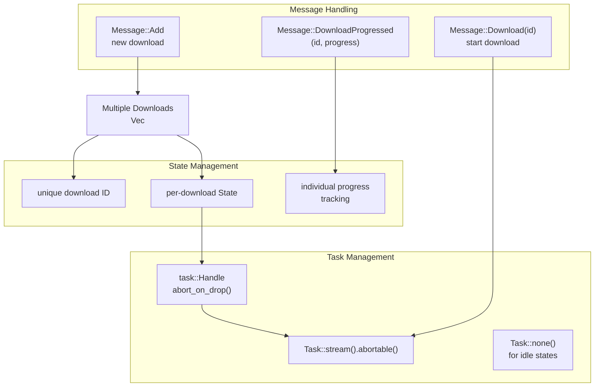

<!-- source: DeepWiki mcp.deepwiki.com · repo huggingface/hf-hub · page 6 Advanced Examples · fetched 2026-10-26 -->

# Advanced Examples

Relevant source files

The following files were used as context for generating this wiki page:

- [examples/iced/src/main.rs](examples/iced/src/main.rs)
- [examples/socks/src/main.rs](examples/socks/src/main.rs)

This page demonstrates complex usage patterns and integration examples that go beyond basic file downloading. It covers custom progress implementations, proxy configuration, stream-based downloads, error handling, and GUI integration patterns.

For basic usage patterns and simple download examples, see [Getting Started](#2). For detailed API reference including progress traits and download methods, see [API Reference](#4).

## Overview of Advanced Patterns

The hf-hub crate supports several advanced integration patterns that extend beyond simple file downloads:

Sources: [examples/socks/src/main.rs:1-16](), [examples/iced/src/main.rs:1-245]()

## SOCKS Proxy Configuration

The crate supports proxy configuration through environment variables when using the reqwest backend with tokio. The HTTPS_PROXY environment variable is automatically recognized by the underlying HTTP client.

The SOCKS example demonstrates this pattern by expecting the `HTTPS_PROXY` environment variable to be set and using the tokio API with progress tracking enabled. The `ApiBuilder` automatically configures the underlying reqwest client to use the specified proxy.

Sources: [examples/socks/src/main.rs:3-8]()

## Custom Progress Implementation

Advanced applications often require custom progress tracking that integrates with their UI framework or logging system. The `Progress` trait provides hooks for initialization, updates, and completion.

The Iced example implements a custom `Prog` struct that sends progress updates through an mpsc channel to the GUI thread. This pattern allows progress tracking to work across thread boundaries in async applications.

Sources: [examples/iced/src/main.rs:36-67]()

## Stream-based Downloads

For GUI applications and reactive systems, downloads can be exposed as streams that emit progress events. This pattern integrates well with frameworks like Iced that expect stream-based data flows.

The `try_channel` function creates a stream that emits `Progress` events throughout the download lifecycle:

This pattern enables clean separation between download logic and UI updates, making it easier to handle errors and provide responsive user interfaces.

Sources: [examples/iced/src/main.rs:69-81]()

## Error Handling and Recovery

Advanced applications need robust error handling that can recover from network failures, provide user feedback, and retry failed downloads. The crate's error types integrate with application-specific error handling patterns.

The Iced example demonstrates a state machine approach where downloads can transition between idle, downloading, finished, and errored states, with retry capability from any terminal state.

Sources: [examples/iced/src/main.rs:15-24](), [examples/iced/src/main.rs:154-159]()

## Concurrent Download Management

For applications managing multiple simultaneous downloads, the crate supports concurrent operations with individual progress tracking and task management.

Each download operation can be managed as a separate task with abort capabilities:

This pattern allows applications to manage multiple downloads with individual progress tracking, error handling, and the ability to cancel operations cleanly.

Sources: [examples/iced/src/main.rs:147-186](), [examples/iced/src/main.rs:98-125]()

## GUI Integration

For complete GUI integration examples including progress bars, user interaction, and visual feedback, see [GUI Integration with Iced](#6.1). The Iced example demonstrates how to combine all the advanced patterns above into a cohesive desktop application.

Sources: [examples/iced/src/main.rs:1-245]()

---

