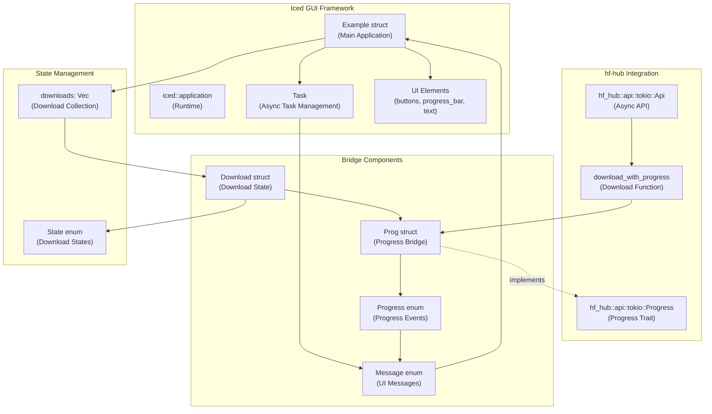
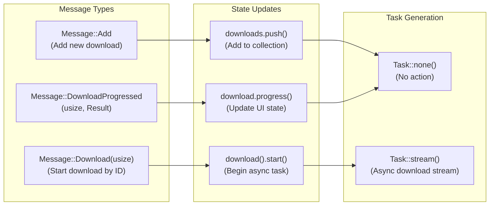
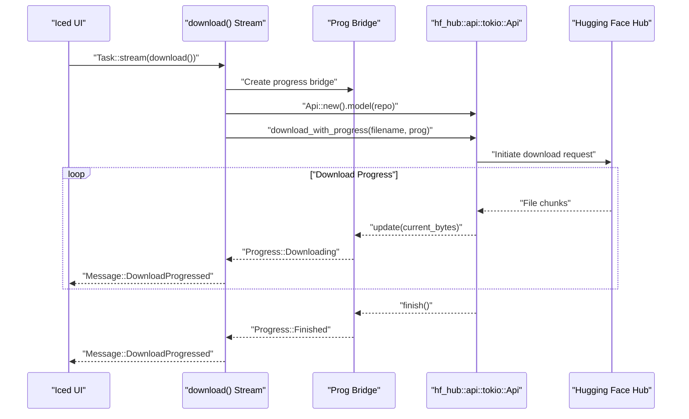

<!-- source: DeepWiki mcp.deepwiki.com · repo huggingface/hf-hub · page 6.1 GUI Integration with Iced · fetched 2026-10-26 -->

# GUI Integration with Iced

<details>
<summary>Relevant source files</summary>

The following files were used as context for generating this wiki page:

- [examples/iced/Cargo.toml](examples/iced/Cargo.toml)
- [examples/iced/src/main.rs](examples/iced/src/main.rs)

</details>


This document covers the integration of hf-hub with the Iced GUI framework, demonstrating how to create desktop applications that can download models from Hugging Face Hub with real-time progress tracking and user interaction. The example shows async download management, progress reporting, and reactive UI updates.

For basic download functionality without GUI integration, see [Getting Started](#2). For detailed async API documentation, see [Asynchronous API](#4.2).

## Architecture Overview

The Iced integration example demonstrates a complete GUI application that manages multiple concurrent downloads from Hugging Face Hub. The architecture bridges hf-hub's async download capabilities with Iced's reactive UI system through a message-passing interface.

### System Components Architecture



Sources: [examples/iced/src/main.rs:1-244]()

### Message Flow and State Transitions

```mermaid
stateDiagram-v2
    [*] --> Idle: "Download::new()"
    
    Idle --> Downloading: "Message::Download"
    Downloading --> Downloading: "Progress::Downloading"
    Downloading --> Finished: "Progress::Finished"
    Downloading --> Errored: "Error"
    
    Finished --> Downloading: "Start again"
    Errored --> Downloading: "Try again"
    
    state Downloading {
        [*] --> ProgressUpdate: "Prog::update()"
        ProgressUpdate --> ProgressUpdate: "current/total updates"
        ProgressUpdate --> [*]: "Prog::finish()"
    }
    
    note right of Idle
        State::Idle
        progress: 0.0%
    end note
    
    note right of Downloading
        State::Downloading
        progress: f32
        _task: task::Handle
    end note
    
    note right of Finished
        State::Finished
        progress: 100.0%
    end note
    
    note right of Errored
        State::Errored
        progress: 0.0%
    end note
```

Sources: [examples/iced/src/main.rs:154-159](), [examples/iced/src/main.rs:189-205]()

## Implementation Details

### Progress Bridge Implementation

The core integration point is the `Prog` struct that implements hf-hub's `Progress` trait and bridges progress updates to Iced's message system:

| Component | Type | Purpose |
|-----------|------|---------|
| `Prog` | `struct` | Implements `hf_hub::api::tokio::Progress` trait |
| `output` | `iced::futures::channel::mpsc::Sender<Progress>` | Channel for sending progress updates |
| `total` | `usize` | Total file size for progress calculations |

The `Prog` implementation provides three key methods:

- `init()` - Called when download starts, sets total size and sends initial progress
- `update()` - Called during download with current bytes transferred
- `finish()` - Called when download completes successfully

Sources: [examples/iced/src/main.rs:37-67]()

### Message System Architecture

The application uses Iced's message-driven architecture with three primary message types:



Sources: [examples/iced/src/main.rs:84-88](), [examples/iced/src/main.rs:98-125]()

### Download State Management

Each download is managed through a state machine implemented in the `Download` struct:

| State | Progress Value | UI Behavior | Available Actions |
|-------|---------------|-------------|-------------------|
| `Idle` | 0.0% | "Start the download!" button | Can start download |
| `Downloading` | Variable (0-100%) | Progress text and bar | Shows current progress |
| `Finished` | 100.0% | "Download finished!" + restart button | Can restart download |
| `Errored` | 0.0% | Error message + retry button | Can retry download |

Sources: [examples/iced/src/main.rs:147-244]()

## Configuration and Dependencies

### Cargo Configuration

The Iced example requires specific feature flags to enable async functionality:

| Dependency | Version | Features | Purpose |
|------------|---------|----------|---------|
| `iced` | 0.13.1 | `["tokio"]` | GUI framework with async support |
| `hf-hub` | local path | `["tokio", "rustls-tls"]` | Async API with TLS backend |

The configuration explicitly disables default features for hf-hub and selects the async tokio API with rustls-tls for pure Rust TLS implementation.

Sources: [examples/iced/Cargo.toml:1-9]()

### Download Function Implementation

The `download` function creates a stream that bridges hf-hub's async API with Iced's task system:



The function uses `iced::stream::try_channel` to create a stream that handles both successful progress updates and error conditions, enabling seamless integration with Iced's reactive architecture.

Sources: [examples/iced/src/main.rs:69-81]()

## Usage Patterns

### Multiple Download Management

The application demonstrates managing multiple concurrent downloads through a collection-based approach:

- Each download has a unique ID for message routing
- Downloads maintain independent state and progress tracking  
- The UI dynamically updates to show progress for all active downloads
- Users can add new downloads while others are in progress

### Error Handling Integration

The example shows comprehensive error handling that bridges hf-hub's `ApiError` type to the application's error system:

```rust
// Error conversion implementation
impl From<ApiError> for Error {
    fn from(value: ApiError) -> Self {
        Self::Api(value.to_string())
    }
}
```

This enables automatic error propagation from hf-hub operations to the GUI's error display system.

Sources: [examples/iced/src/main.rs:20-24](), [examples/iced/src/main.rs:201-203](), [examples/iced/src/main.rs:227-233]()

---

