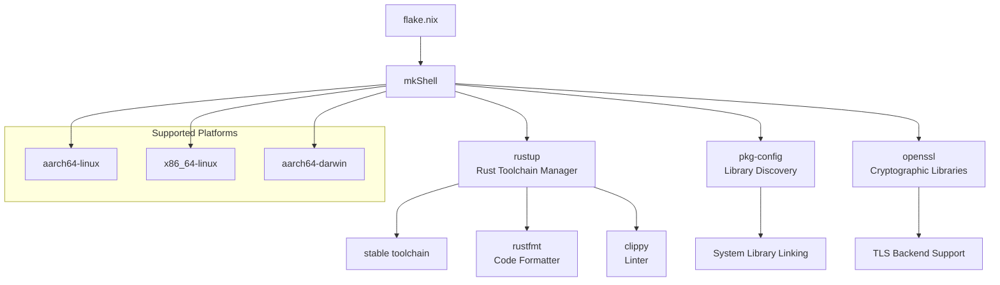
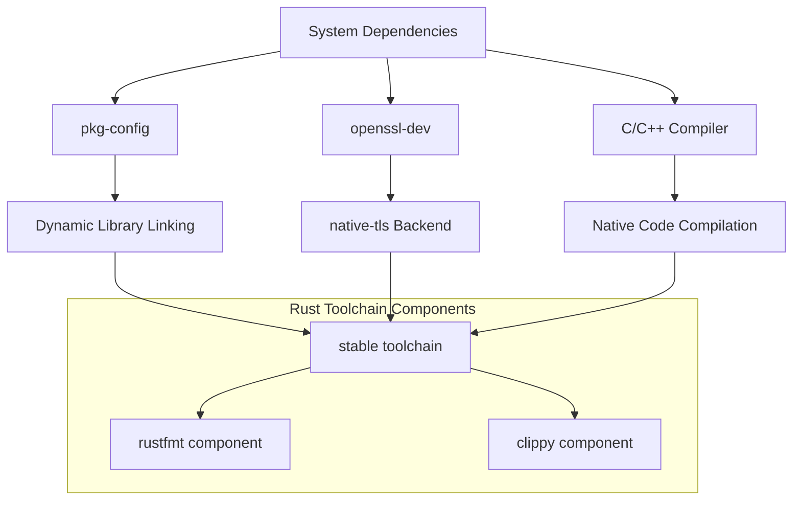
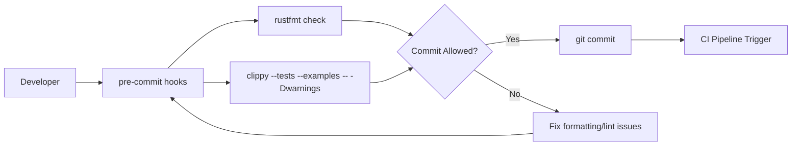
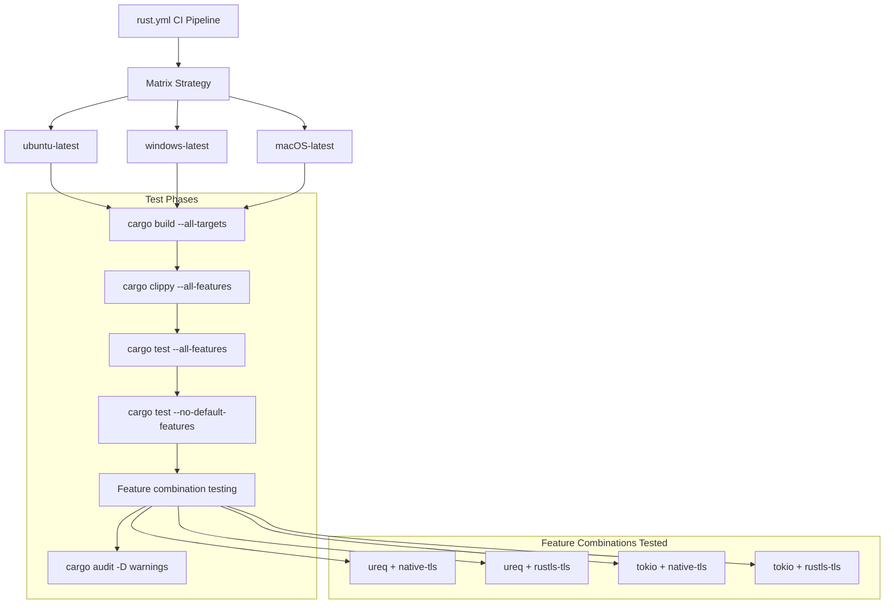

<!-- source: DeepWiki mcp.deepwiki.com · repo huggingface/hf-hub · page 7 Development Environment · fetched 2026-10-26 -->

# Development Environment

Relevant source files

The following files were used as context for generating this wiki page:

- [.github/workflows/rust.yml](.github/workflows/rust.yml)
- [.pre-commit-config.yaml](.pre-commit-config.yaml)
- [flake.lock](flake.lock)
- [flake.nix](flake.nix)

This document covers the setup and tooling required for contributors and advanced users working with the hf-hub codebase. It provides guidance on establishing a development environment, understanding the quality assurance processes, and navigating the multi-platform testing infrastructure.

For specific details about Nix development shell usage, see [Nix Development Shell](#7.1). For comprehensive information about the testing pipeline and code quality processes, see [CI/CD and Code Quality](#7.2).

## Development Setup Options

The hf-hub project provides multiple approaches for setting up a development environment, accommodating different developer preferences and system configurations.

### Nix Development Shell

The project includes a Nix flake configuration that provides a reproducible development environment across different platforms. The `flake.nix` defines a development shell with all necessary dependencies pre-configured.

**Development Environment Components**

Sources: [flake.nix:1-33]()

### Manual Development Setup

For developers who prefer not to use Nix, the core dependencies can be installed manually:

| Component | Purpose | Installation Method |
|-----------|---------|-------------------|
| `rustup` | Rust toolchain management | https://rustup.rs/ |
| `pkg-config` | System library discovery | System package manager |
| `openssl` | Cryptographic library | System package manager |
| `cargo-audit` | Security vulnerability scanning | `cargo install cargo-audit` |

## Core Dependencies and System Requirements

The development environment requires several system-level dependencies that support the various feature combinations and TLS backends.

**System Dependencies**

Sources: [flake.nix:23-27](), [.github/workflows/rust.yml:19-24]()

## Development Workflow and Quality Assurance

The project maintains code quality through automated tooling and comprehensive testing across multiple feature combinations and platforms.

### Pre-commit Hooks

The `.pre-commit-config.yaml` configures automatic code quality checks that run before each commit:

| Hook | Purpose | Configuration |
|------|---------|---------------|
| `fmt` | Code formatting via `rustfmt` | Enforces consistent style |
| `clippy` | Static analysis and linting | Runs with `-Dwarnings` for strict checking |

**Quality Assurance Pipeline**

Sources: [.pre-commit-config.yaml:1-16]()

### Multi-Platform Testing Strategy

The CI pipeline validates the codebase across multiple operating systems and feature combinations to ensure broad compatibility.

**CI Testing Matrix**

Sources: [.github/workflows/rust.yml:1-52]()

## Testing and Feature Validation

The development environment emphasizes comprehensive testing across the library's feature matrix. The CI pipeline validates four critical feature combinations:

- **Synchronous + Native TLS**: `ureq` with `native-tls` backend
- **Synchronous + Pure Rust TLS**: `ureq` with `rustls-tls` backend  
- **Asynchronous + Native TLS**: `tokio` with `native-tls` backend
- **Asynchronous + Pure Rust TLS**: `tokio` with `rustls-tls` backend

This ensures that all supported HTTP client and TLS backend combinations function correctly across different operating systems.

### Security and Dependency Management

The development workflow includes automated security scanning through `cargo-audit`, which checks for known vulnerabilities in the dependency tree. This tool is installed during CI and run with `-D warnings` to treat any security advisories as build failures.

Sources: [.github/workflows/rust.yml:28-29](), [.github/workflows/rust.yml:50-51](), [.github/workflows/rust.yml:44-48]()

---

