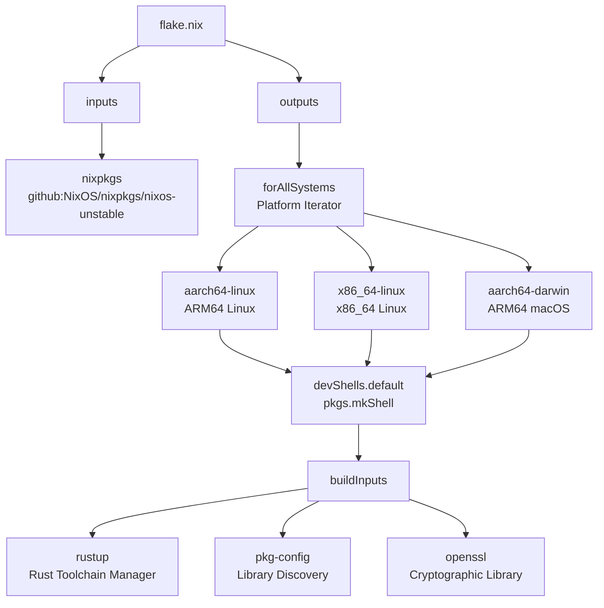
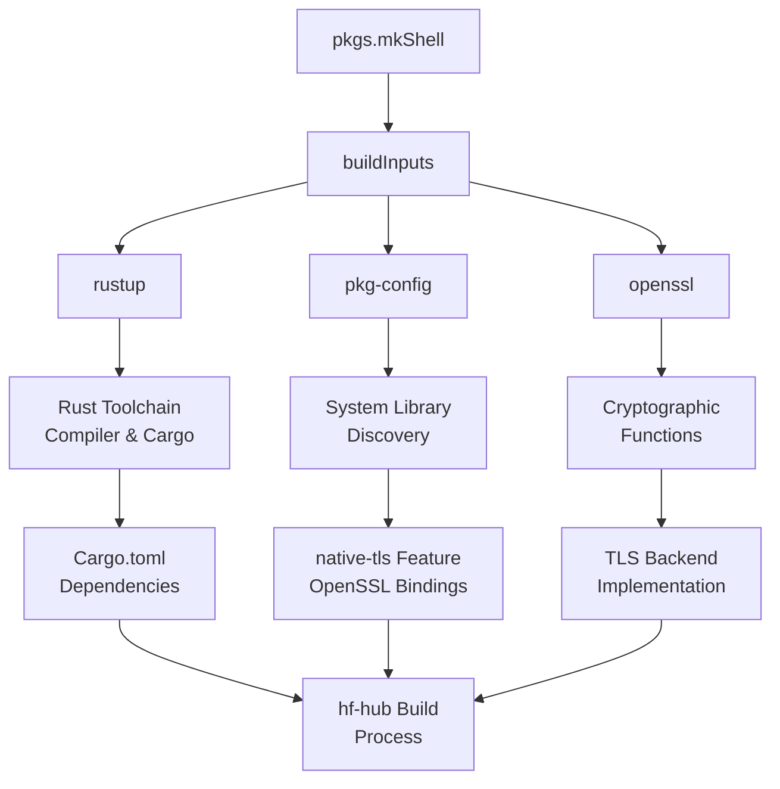
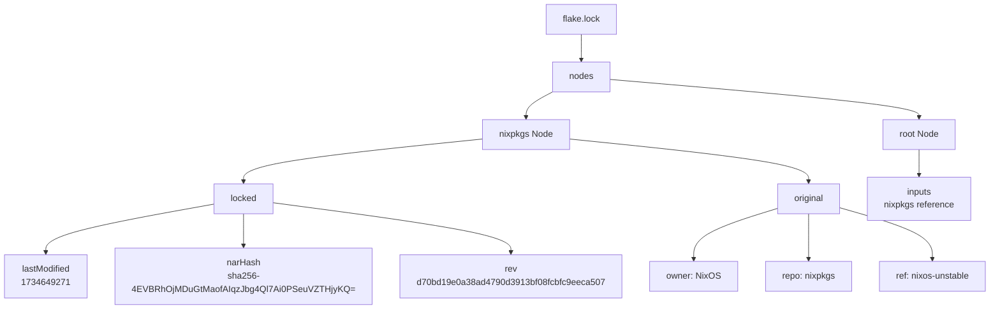
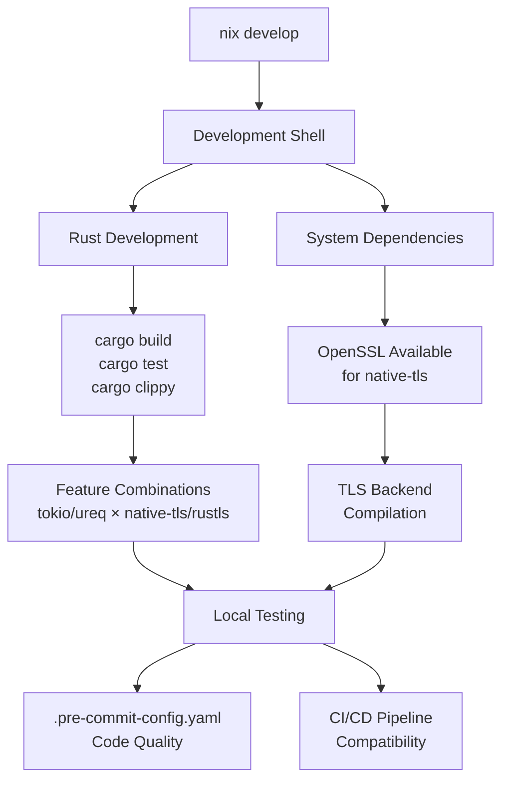

<!-- source: DeepWiki mcp.deepwiki.com · repo huggingface/hf-hub · page 7.1 Nix Development Shell · fetched 2026-10-26 -->

# Nix Development Shell

<details>
<summary>Relevant source files</summary>

The following files were used as context for generating this wiki page:

- [flake.lock](flake.lock)
- [flake.nix](flake.nix)

</details>


This document covers the Nix-based development environment provided by the hf-hub crate for reproducible development setup. The Nix flake configuration enables consistent development environments across different platforms with all necessary build dependencies pre-configured.

For information about the broader development workflow including CI/CD and code quality tools, see [CI/CD and Code Quality](#7.2).

## Purpose and Platform Support

The hf-hub repository provides a Nix flake that creates a standardized development shell with all required dependencies for building and developing the Rust codebase. This eliminates environment-specific build issues and ensures consistent tooling across contributors.

The development shell supports multiple architectures through the `forAllSystems` function:

| Architecture | Platform | Support Status |
|--------------|----------|----------------|
| `aarch64-linux` | ARM64 Linux | Full support |
| `x86_64-linux` | x86_64 Linux | Full support |
| `aarch64-darwin` | ARM64 macOS | Full support |

**Nix Flake Platform Architecture**



Sources: [flake.nix:9-13](), [flake.nix:16-31]()

## Development Dependencies Configuration

The development shell provides three core dependencies that are essential for building the hf-hub crate:

**Development Shell Dependency Stack**



Sources: [flake.nix:22-28]()

### Dependency Details

| Dependency | Purpose | Role in hf-hub |
|------------|---------|----------------|
| `rustup` | Rust toolchain management | Provides `rustc`, `cargo`, and associated tools |
| `pkg-config` | System library discovery | Enables finding OpenSSL headers and libraries |
| `openssl` | Cryptographic library | Required for `native-tls` feature and HTTPS connections |

The `openssl` dependency is particularly critical as it provides the system-level cryptographic functions required by the `native-tls` feature, which is used by both the `ureq` and `reqwest` HTTP clients when the `native-tls` feature is enabled.

Sources: [flake.nix:23-27]()

## Usage Instructions

### Entering the Development Shell

To use the Nix development shell, ensure you have Nix installed with flakes enabled, then run:

```bash
nix develop
```

This command will:
1. Parse the `flake.nix` configuration
2. Download and cache the specified nixpkgs revision
3. Build the development environment
4. Drop you into a shell with all dependencies available

### Verifying the Environment

Once in the development shell, verify that all tools are available:

```bash
# Check Rust toolchain
rustup --version
rustc --version
cargo --version

# Check system dependencies
pkg-config --version
openssl version
```

### Building the Project

With the development environment active, standard Rust development commands work seamlessly:

```bash
# Build with default features
cargo build

# Run tests
cargo test

# Build with specific features
cargo build --features tokio,native-tls
```

Sources: [flake.nix:22-28]()

## Flake Lock and Version Management

The `flake.lock` file ensures reproducible builds by pinning exact versions of all dependencies:

**Flake Dependency Locking**



Sources: [flake.lock:1-27]()

The lock file captures:
- **Exact commit hash**: `d70bd19e0a38ad4790d3913bf08fcbfc9eeca507`
- **Content hash**: `sha256-4EVBRhOjMDuGtMaofAIqzJbg4Ql7Ai0PSeuVZTHjyKQ=`
- **Last modified timestamp**: `1734649271`

This ensures that all developers and CI systems use identical package versions, eliminating "works on my machine" issues.

## Integration with Development Workflow

The Nix development shell integrates with the broader hf-hub development ecosystem:

**Development Environment Integration**



Sources: [flake.nix:22-28]()

The development shell ensures that local development closely matches the CI environment, reducing integration issues and enabling confident local testing before pushing changes.

---

