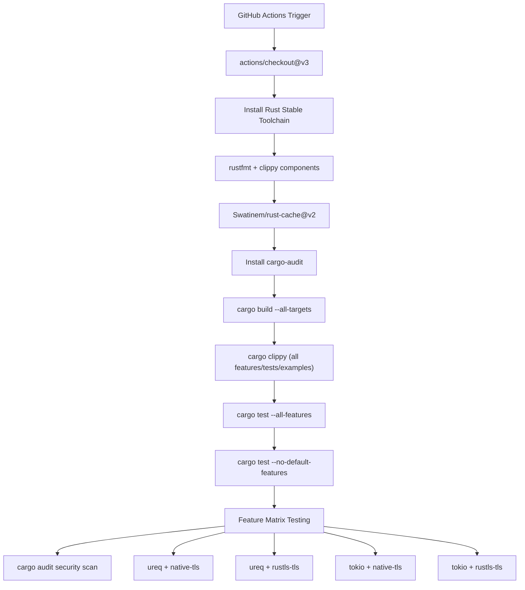
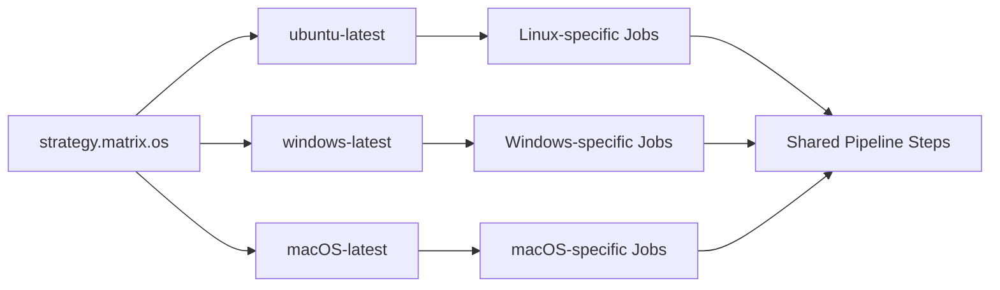
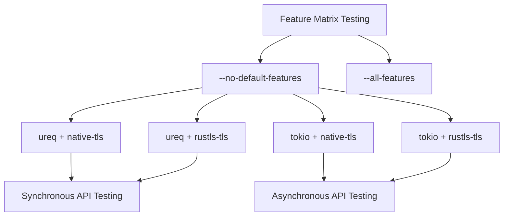
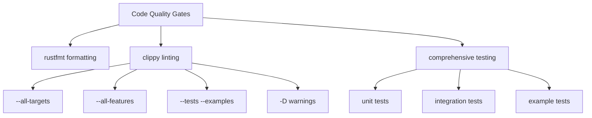
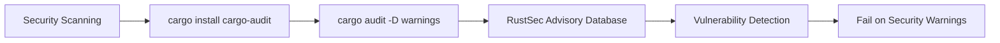
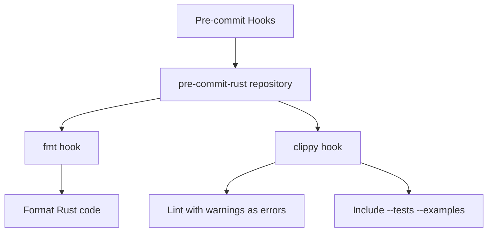

<!-- source: DeepWiki mcp.deepwiki.com · repo huggingface/hf-hub · page 7.2 CI/CD and Code Quality · fetched 2026-10-26 -->

# CI/CD and Code Quality

Relevant source files

The following files were used as context for generating this wiki page:

- [.github/workflows/rust.yml](.github/workflows/rust.yml)
- [.pre-commit-config.yaml](.pre-commit-config.yaml)

This document covers the continuous integration and continuous deployment (CI/CD) pipeline, automated testing strategies, code quality enforcement, and security scanning processes used in the hf-hub codebase. The focus is on the GitHub Actions workflows, feature matrix testing, and pre-commit hooks that ensure code reliability across multiple platforms and feature combinations.

For information about development environment setup, see [Nix Development Shell](#7.1). For details about configurable features and backends, see [Feature Gates and Backends](#5.1).

## CI/CD Pipeline Overview

The hf-hub project uses GitHub Actions for continuous integration, with a comprehensive workflow that tests across multiple operating systems and feature combinations. The pipeline is triggered on pushes to the main branch and on all pull requests.

**CI/CD Workflow Structure**

Sources: [.github/workflows/rust.yml:1-52]()

## Multi-Platform Testing Strategy

The CI pipeline employs a matrix strategy to ensure compatibility across different operating systems. This approach validates that the crate works consistently regardless of the target platform.

| Platform | OS Version | Purpose |
|----------|------------|---------|
| Ubuntu | `ubuntu-latest` | Primary Linux testing environment |
| Windows | `windows-latest` | Windows compatibility validation |
| macOS | `macOS-latest` | Apple ecosystem compatibility |

**Platform Matrix Execution**

Sources: [.github/workflows/rust.yml:11-14]()

## Feature Matrix Testing

The pipeline includes comprehensive feature combination testing to validate that all supported backend configurations work correctly. This ensures users can choose any combination of HTTP client and TLS backend without encountering compatibility issues.

**Feature Combination Matrix**

The specific test commands validate each combination:

| HTTP Client | TLS Backend | Test Command |
|-------------|-------------|--------------|
| `ureq` | `native-tls` | `cargo test --no-default-features --features ureq,native-tls` |
| `ureq` | `rustls-tls` | `cargo test --no-default-features --features ureq,rustls-tls` |
| `tokio` | `native-tls` | `cargo test --no-default-features --features tokio,native-tls` |
| `tokio` | `rustls-tls` | `cargo test --no-default-features --features tokio,rustls-tls` |

Sources: [.github/workflows/rust.yml:40-48]()

## Code Quality Enforcement

The pipeline enforces strict code quality standards through multiple layers of validation. Clippy linting is configured to treat all warnings as errors, ensuring consistent code quality across the entire codebase.

**Quality Gates Process**

The clippy configuration uses aggressive linting settings:
- `--all-targets`: Lints all build targets
- `--all-features`: Enables all feature flags during linting
- `--tests --examples`: Includes test and example code in linting
- `-D warnings`: Treats warnings as compilation errors

Sources: [.github/workflows/rust.yml:34-35]()

## Security Scanning

The pipeline includes automated security vulnerability scanning using `cargo-audit`. This tool checks all dependencies against the RustSec Advisory Database to identify known security issues.

**Security Audit Workflow**

The audit process:
1. Installs the latest version of `cargo-audit`
2. Scans all dependencies for known vulnerabilities
3. Uses `-D warnings` flag to fail the build on any security issues
4. Reports detailed information about any discovered vulnerabilities

Sources: [.github/workflows/rust.yml:28-29](), [.github/workflows/rust.yml:50-51]()

## Pre-commit Hooks

The project uses pre-commit hooks to enforce code quality standards before commits are made to the repository. This provides immediate feedback to developers during the development process.

**Pre-commit Hook Configuration**

The pre-commit configuration includes:
- **fmt hook**: Automatically formats Rust code using `rustfmt`
- **clippy hook**: Runs clippy linting with the same strict configuration as CI
  - Includes `--tests` and `--examples` flags
  - Uses `-Dwarnings` to treat warnings as errors

Sources: [.pre-commit-config.yaml:1-16]()

## Build Optimization

The CI pipeline includes several optimizations to reduce build times and improve efficiency:

- **Rust Cache**: Uses `Swatinem/rust-cache@v2` to cache compiled dependencies between runs
- **Stable Toolchain**: Pins to stable Rust toolchain for consistent builds
- **Component Installation**: Pre-installs `rustfmt` and `clippy` components to avoid repeated downloads

These optimizations significantly reduce CI execution time while maintaining comprehensive test coverage across all supported configurations.

Sources: [.github/workflows/rust.yml:19-26]()