# Page: Overview

# Overview

<details>
<summary>Relevant source files</summary>

The following files were used as context for generating this wiki page:

- [Cargo.toml](Cargo.toml)
- [README.md](README.md)

</details>


This document provides an introduction to the hf-hub crate, a Rust client library for interacting with Hugging Face Hub. It covers the high-level architecture, core components, and design principles that enable efficient downloading and caching of machine learning models, datasets, and spaces from the Hugging Face ecosystem.

The hf-hub crate is designed to be compatible with the Python `huggingface_hub` package, sharing the same cache structure and file organization patterns. For detailed API usage patterns, see [Getting Started](#2). For in-depth component documentation, see [Core Architecture](#3) and [API Reference](#4).

## Purpose and Design Goals

The hf-hub crate serves as a Rust implementation of core Hugging Face Hub functionality, specifically focused on:

- **File downloading and caching** with content-addressed blob storage
- **Python ecosystem compatibility** by reusing the same cache structure as `huggingface_hub`
- **Flexible compilation** through feature gates supporting different HTTP and TLS backends
- **Both synchronous and asynchronous APIs** to accommodate different application architectures

The crate implements a subset of functionality from the Python package, prioritizing download operations, local caching, and repository management over more advanced Hub API features.

Sources: [Cargo.toml:11-14](), [README.md:1-19]()

## High-Level Architecture

### Core Component Structure

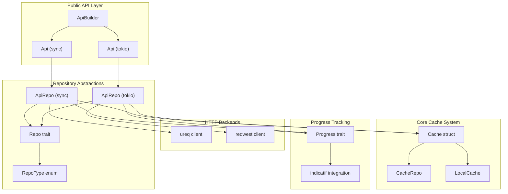

This diagram shows the main code entities and their relationships. The dual API design allows applications to choose between synchronous operations using `ureq` or asynchronous operations using `reqwest` and `tokio`, while sharing the same underlying cache infrastructure.

Sources: [README.md:34-42](), [Cargo.toml:27-38]()

### Feature-Based Compilation System

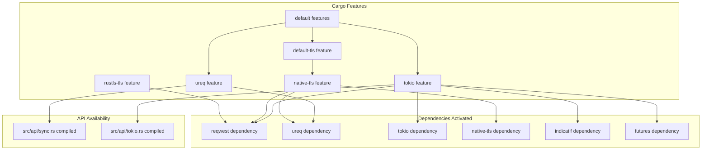

The feature system allows compile-time selection of functionality, enabling applications to include only the HTTP client and TLS backend they need. The default configuration includes both sync and async APIs with native TLS support.

Sources: [Cargo.toml:50-83](), [README.md:44-61]()

## Cache Architecture and Python Compatibility

### Cache Organization Structure

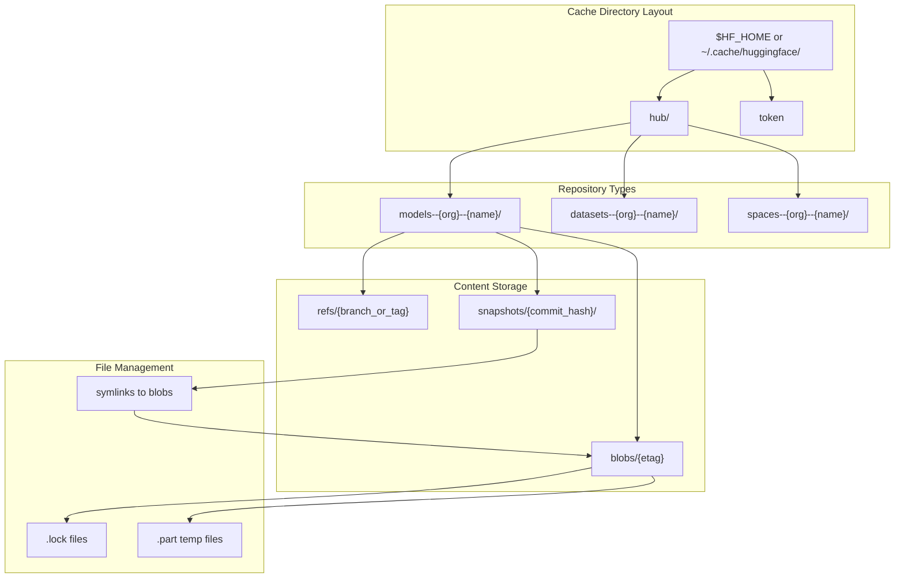

The cache system uses content-addressed storage where files are stored once by their ETag hash in the `blobs` directory, with symbolic links from repository snapshots. This provides deduplication across different model versions and repositories while maintaining compatibility with the Python `huggingface_hub` package.

Sources: [README.md:1-6](), [Cargo.toml:11-14]()

## API Surface and Usage Patterns

### Synchronous vs Asynchronous APIs

| Feature | Sync API (`ureq`) | Async API (`tokio`) |
|---------|-------------------|---------------------|
| HTTP Client | `ureq` | `reqwest` |
| Runtime | None required | `tokio` runtime |
| Progress Tracking | Basic | Advanced with `indicatif` |
| Concurrent Downloads | No | Yes |
| SOCKS Proxy | Yes | Yes |
| TLS Backend | `native-tls` or `rustls` | `native-tls` or `rustls` |

Both APIs share the same cache system and provide equivalent functionality for downloading and managing cached files. The choice between them depends on whether the application is already using async Rust patterns.

### Core Usage Pattern

The fundamental usage pattern for both APIs follows the same structure:

1. Create an `Api` instance using default settings or `ApiBuilder`
2. Get a repository handle using `.model()`, `.dataset()`, or `.space()`
3. Download files using `.get()` method on the repository
4. Receive local file paths pointing to cached content

This pattern abstracts the complexity of HTTP requests, caching, and file management behind a simple interface.

Sources: [README.md:31-42](), [Cargo.toml:19-44]()

## Integration with Hugging Face Ecosystem

The hf-hub crate is designed as a drop-in replacement for Python `huggingface_hub` caching behavior, ensuring that:

- **Cache directories are shared** between Python and Rust applications
- **File downloads are deduplicated** across both ecosystems  
- **Repository structure is identical** to Python package expectations
- **Authentication tokens are compatible** and stored in the same location

This compatibility enables mixed-language workflows where Python training scripts and Rust inference applications can share the same model cache without redundant downloads.

Sources: [README.md:1-11](), [Cargo.toml:11-14]()

---

# Page: Getting Started

# Getting Started

<details>
<summary>Relevant source files</summary>

The following files were used as context for generating this wiki page:

- [Cargo.toml](Cargo.toml)
- [README.md](README.md)
- [examples/download.rs](examples/download.rs)

</details>


This document provides installation instructions and basic usage patterns for the `hf-hub` crate, enabling you to quickly download and cache files from Hugging Face Hub repositories. It covers the essential concepts needed to start using either the synchronous or asynchronous APIs.

For detailed information about the internal cache architecture, see [Cache System](#3.1). For comprehensive API documentation, see [API Reference](#4). For advanced configuration options, see [Configuration and Features](#5).

## Purpose and Installation

The `hf-hub` crate provides a Rust client for interacting with Hugging Face Hub, focusing on downloading and caching model files, datasets, and other repository contents. It maintains compatibility with the Python `huggingface_hub` package's cache structure.

### Adding the Dependency

Add `hf-hub` to your `Cargo.toml`:

```toml
[dependencies]
hf-hub = "0.4.2"
```

The default features include both synchronous (`ureq`) and asynchronous (`tokio`) APIs with `native-tls` for TLS support. For custom feature selection, see the [Feature Selection](#feature-selection) section below.

Sources: [Cargo.toml:1-14](), [README.md:24-28]()

## Core Concepts Overview

### API Architecture

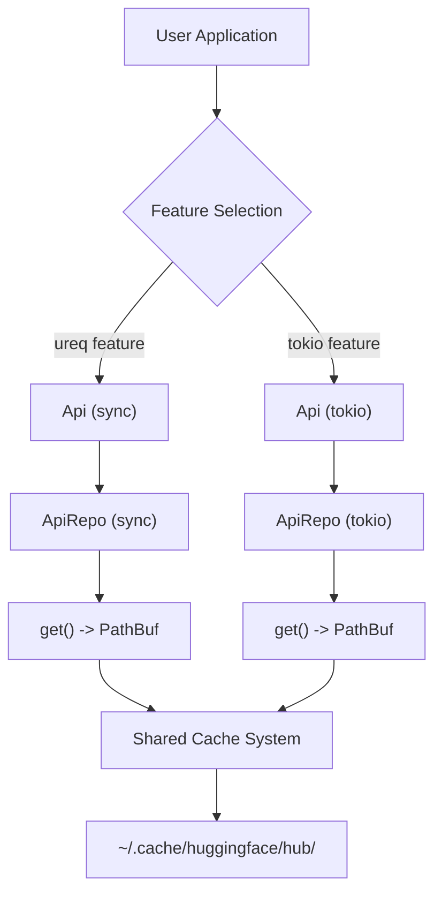

The crate provides two parallel API implementations sharing the same cache system. The `sync::Api` uses the `ureq` HTTP client, while `tokio::Api` uses `reqwest` with async/await support.

Sources: [README.md:33-42](), [examples/download.rs:8-13]()

### Repository Types and Workflow

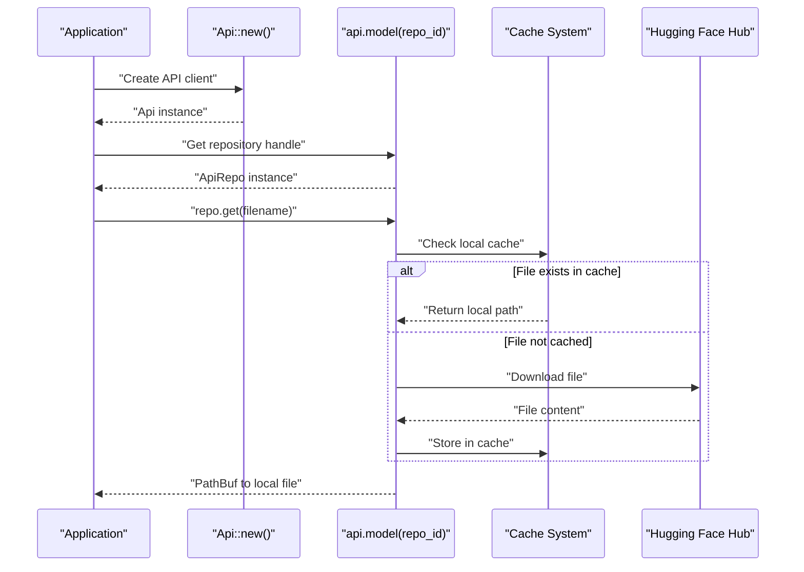

Sources: [README.md:33-42](), [examples/download.rs:8-26]()

## Basic Usage Examples

### Synchronous API

The synchronous API uses the `ureq` HTTP client and provides blocking operations:

```rust
use hf_hub::api::sync::Api;

// Create API client
let api = Api::new().unwrap();

// Get a repository handle
let repo = api.model("bert-base-uncased".to_string());

// Download and cache a file
let filename = repo.get("config.json").unwrap();
// filename is now PathBuf pointing to cached file
```

For larger files with progress tracking:

```rust
let repo = api.model("meta-llama/Llama-2-7b-hf".to_string());
let filename = repo.get("model-00001-of-00002.safetensors").unwrap();
```

Sources: [README.md:33-42](), [examples/download.rs:8-14]()

### Asynchronous API

The asynchronous API requires the `tokio` feature and provides non-blocking operations:

```rust
use hf_hub::api::tokio::Api;

#[tokio::main]
async fn main() {
    // Create async API client
    let api = Api::new().unwrap();
    
    // Get repository handle
    let repo = api.model("bert-base-uncased".to_string());
    
    // Download asynchronously
    let filename = repo.get("config.json").await.unwrap();
}
```

For concurrent downloads:

```rust
let api = Api::new().unwrap();
let repo = api.model("meta-llama/Llama-2-7b-hf".to_string());

let filename = repo
    .get("model-00001-of-00002.safetensors")
    .await
    .unwrap();
```

Sources: [examples/download.rs:17-26]()

### Repository Types

The crate supports three repository types through the `Api` interface:

| Method | Repository Type | Example Usage |
|--------|----------------|---------------|
| `api.model(repo_id)` | Models | `api.model("bert-base-uncased".to_string())` |
| `api.dataset(repo_id)` | Datasets | `api.dataset("squad".to_string())` |
| `api.space(repo_id)` | Spaces | `api.space("gradio/calculator".to_string())` |

Each method returns an `ApiRepo` instance with the same `get()` interface for downloading files.

Sources: [README.md:38-39]()

## Feature Selection

### Default Features

The default feature set includes:

```toml
default = ["default-tls", "tokio", "ureq"]
```

This provides both sync and async APIs with `native-tls` (OpenSSL) for TLS.

### Custom Feature Combinations

Choose specific combinations based on your needs:

| Use Case | Features | Command |
|----------|----------|---------|
| Async only, native TLS | `tokio`, `native-tls` | `cargo add hf-hub --no-default-features --features tokio,native-tls` |
| Async only, Rust TLS | `tokio`, `rustls-tls` | `cargo add hf-hub --no-default-features --features tokio,rustls-tls` |
| Sync only, native TLS | `ureq`, `native-tls` | `cargo add hf-hub --no-default-features --features ureq,native-tls` |
| Sync only, Rust TLS | `ureq`, `rustls-tls` | `cargo add hf-hub --no-default-features --features ureq,rustls-tls` |

### Feature Dependencies

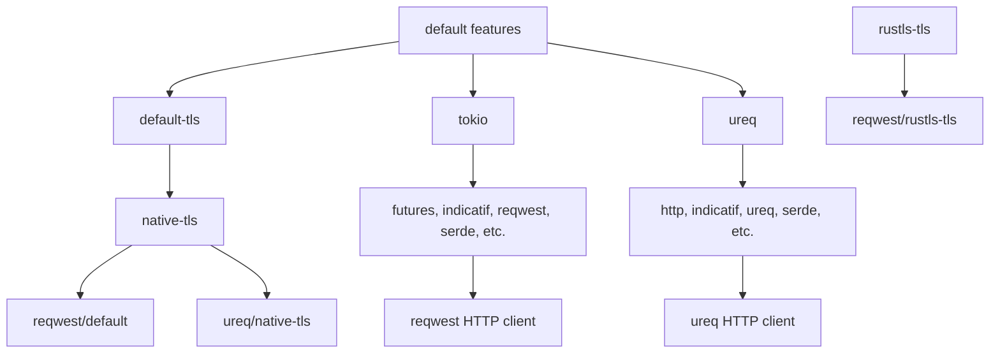

Sources: [Cargo.toml:50-83](), [README.md:44-60]()

## Error Handling

Both APIs return `Result` types. Common error scenarios include:

- Network connectivity issues
- Authentication failures  
- File not found in repository
- Cache permission problems

```rust
match repo.get("config.json") {
    Ok(path) => println!("File cached at: {:?}", path),
    Err(e) => eprintln!("Download failed: {}", e),
}
```

## Cache Location

Files are cached in the standard Hugging Face cache directory:

- **Linux/macOS**: `~/.cache/huggingface/hub/`
- **Windows**: `%USERPROFILE%\.cache\huggingface\hub\`

The cache directory can be customized via the `HF_HOME` environment variable.

Sources: [README.md:4-6]()

## Next Steps

- For understanding the cache structure and blob storage system, see [Cache System](#3.1)
- For comprehensive API documentation including all available methods, see [API Reference](#4)
- For advanced configuration including SOCKS proxy support, see [Configuration and Features](#5)
- For GUI integration and complex usage patterns, see [Advanced Examples](#6)

---

# Page: Core Architecture

# Core Architecture

<details>
<summary>Relevant source files</summary>

The following files were used as context for generating this wiki page:

- [src/api/mod.rs](src/api/mod.rs)
- [src/lib.rs](src/lib.rs)

</details>


This document provides a deep dive into the fundamental components that form the shared infrastructure of the hf-hub crate. These core components enable both synchronous and asynchronous APIs to work with a unified caching system and repository abstraction layer.

For specific details about the caching mechanism and file organization, see [Cache System](#3.1). For information about the Progress trait and repository abstractions, see [Repository and Progress Abstractions](#3.2). For complete API documentation, see [API Reference](#4).

## Core Components Overview

The hf-hub architecture is built around four primary components that provide a shared foundation for all operations:

### Component Architecture Diagram

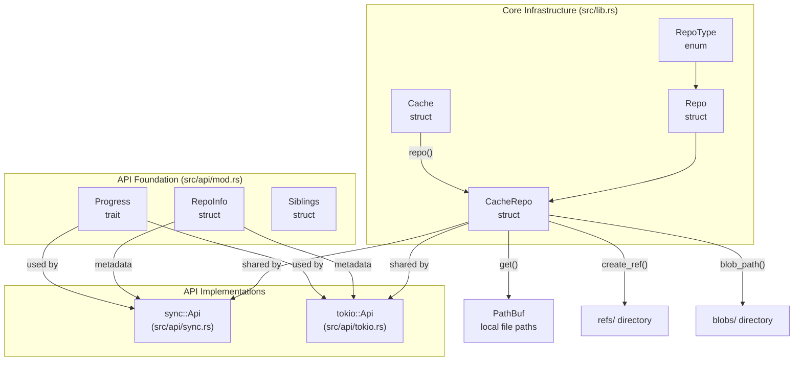

**Sources:** [src/lib.rs:28-195](), [src/api/mod.rs:16-77]()

## Component Responsibilities

| Component | Purpose | Key Methods |
|-----------|---------|-------------|
| `Cache` | Manages cache directory location and token handling | `from_env()`, `repo()`, `token()` |
| `Repo` | Represents a repository on Hugging Face Hub | `new()`, `folder_name()`, `url()` |
| `RepoType` | Distinguishes between Models, Datasets, and Spaces | N/A (enum variants) |
| `CacheRepo` | Combines Cache and Repo for file operations | `get()`, `create_ref()`, `blob_path()` |
| `Progress` | Provides download progress reporting interface | `init()`, `update()`, `finish()` |

**Sources:** [src/lib.rs:30-290](), [src/api/mod.rs:18-27]()

## System Interaction Flow

The following diagram shows how these core components interact during typical operations:

### Core Component Interaction Flow

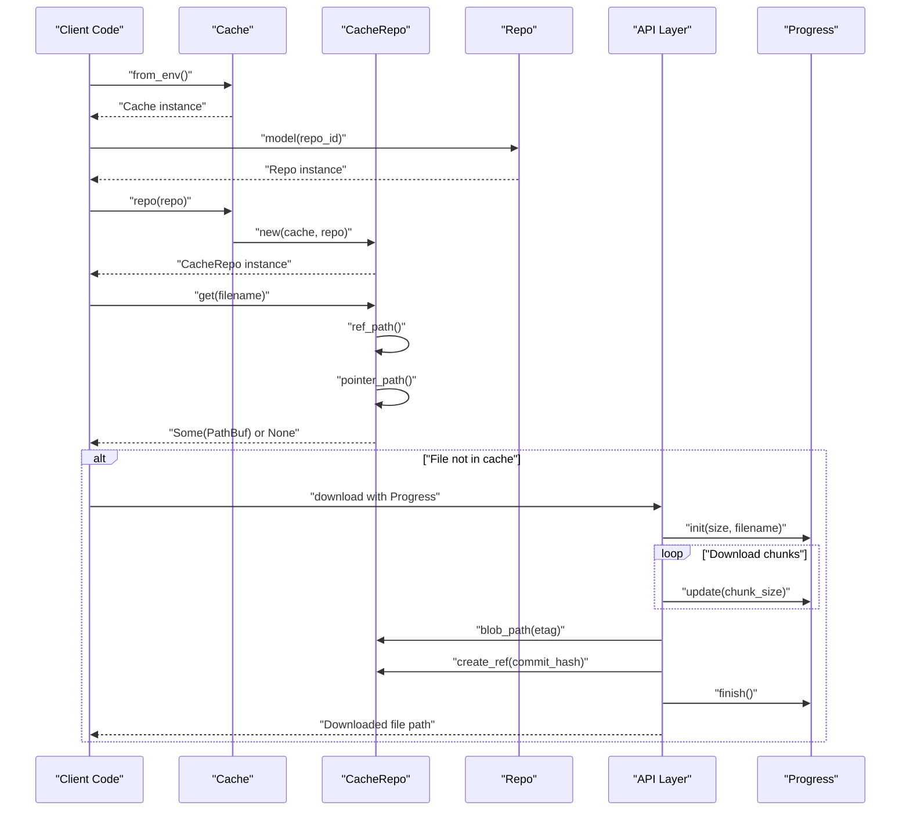

**Sources:** [src/lib.rs:42-91](), [src/lib.rs:141-151](), [src/api/mod.rs:18-27]()

## Architecture Layers

The core architecture is organized in distinct layers that separate concerns:

### Layered Architecture

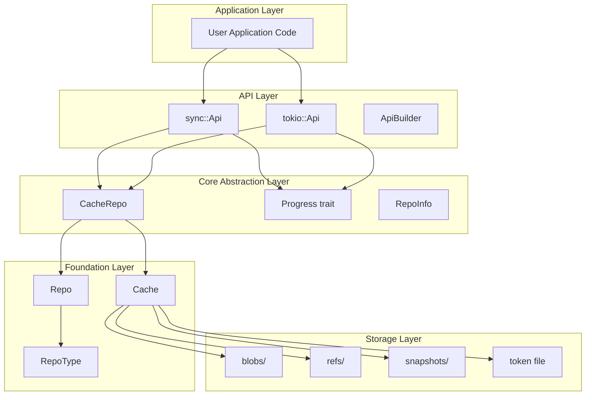

**Sources:** [src/lib.rs:1-290](), [src/api/mod.rs:1-123]()

## Key Design Principles

### Repository Abstraction

The `Repo` struct provides a unified way to reference any repository on Hugging Face Hub:

- **Repository Types**: Models, Datasets, and Spaces are distinguished by `RepoType` enum [src/lib.rs:17-26]()
- **Revision Handling**: Supports branches, tags, and commit hashes through the `revision` field [src/lib.rs:212-227]()
- **URL Generation**: Automatically generates correct URLs for different repository types [src/lib.rs:262-289]()

### Cache Integration

The `CacheRepo` struct bridges repositories and local storage:

- **Path Resolution**: Generates file system paths following Hub cache conventions [src/lib.rs:153-194]()
- **Reference Management**: Maintains branch-to-commit mappings in `refs/` directory [src/lib.rs:168-179]()
- **Content Addressing**: Uses ETags for blob storage deduplication [src/lib.rs:182-187]()

### Progress Abstraction

The `Progress` trait enables flexible progress reporting:

- **Trait-based Design**: Allows custom progress implementations [src/api/mod.rs:18-27]()
- **Built-in Integration**: Native support for `indicatif::ProgressBar` [src/api/mod.rs:35-60]()
- **No-op Implementation**: Unit type `()` provides silent operation [src/api/mod.rs:29-33]()

## Environmental Configuration

The system supports flexible configuration through environment variables and defaults:

| Configuration | Environment Variable | Default Value |
|---------------|---------------------|---------------|
| Cache Location | `HF_HOME` | `~/.cache/huggingface/hub` |
| Hub Endpoint | `HF_ENDPOINT` | `https://huggingface.co` |
| Token Location | N/A | `{HF_HOME}/../token` |

**Sources:** [src/lib.rs:14](), [src/lib.rs:42-51](), [src/lib.rs:59-85](), [src/api/mod.rs:14]()

This core architecture provides the foundation that enables both synchronous and asynchronous APIs to share the same caching infrastructure, repository abstractions, and progress reporting mechanisms while maintaining clean separation of concerns.

---

# Page: Cache System

# Cache System

<details>
<summary>Relevant source files</summary>

The following files were used as context for generating this wiki page:

- [src/lib.rs](src/lib.rs)

</details>


The Cache System provides local file storage and management for content downloaded from Hugging Face Hub. It implements a content-addressed blob storage system with pointer-based file organization, supporting deduplication, concurrent access safety, and compatibility with the Python `huggingface_hub` package.

For information about the API interfaces that use this cache system, see [Synchronous API](#4.1) and [Asynchronous API](#4.2). For repository abstraction details, see [Repository and Progress Abstractions](#3.2).

## Cache Architecture Overview

The cache system is built around three core structures that work together to provide efficient local storage:

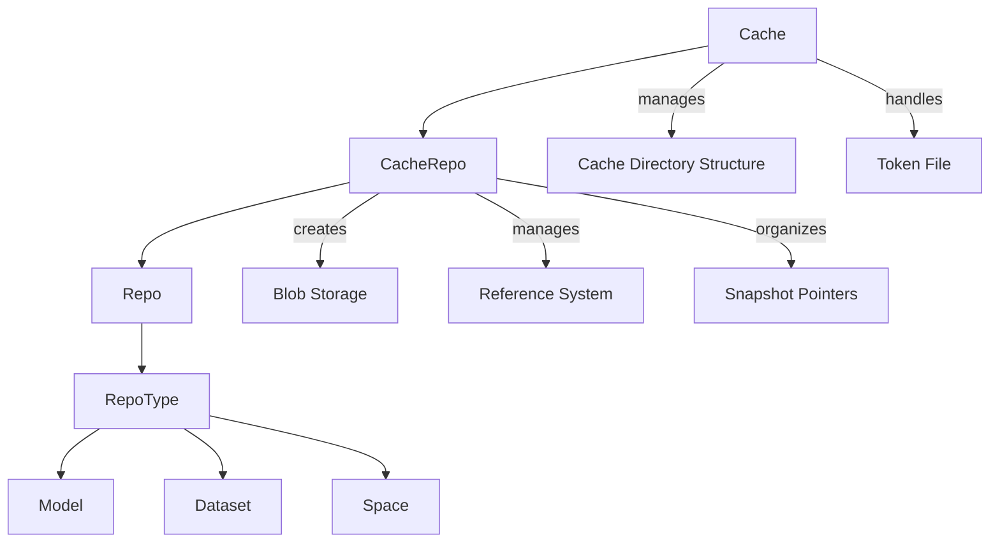

**Cache Architecture Components**

Sources: [src/lib.rs:29-125]()

## Directory Structure and Organization

The cache organizes files using a sophisticated directory structure that enables content deduplication and version management:

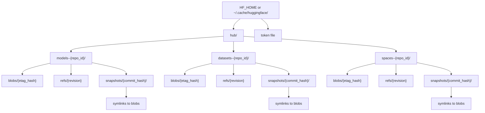

**Cache Directory Structure**

Sources: [src/lib.rs:42-51](), [src/lib.rs:197-205](), [src/lib.rs:153-194]()

## Core Cache Components

### Cache Struct

The `Cache` struct serves as the primary interface for cache operations:

| Method | Purpose | Return Type |
|--------|---------|-------------|
| `new(path)` | Create cache at specific path | `Cache` |
| `from_env()` | Create cache from `HF_HOME` environment variable | `Cache` |
| `default()` | Create cache at default location (`~/.cache/huggingface/hub`) | `Cache` |
| `token()` | Retrieve authentication token if available | `Option<String>` |
| `repo(repo)` | Create repository-specific cache handle | `CacheRepo` |
| `model(id)`, `dataset(id)`, `space(id)` | Convenience methods for specific repo types | `CacheRepo` |

Sources: [src/lib.rs:34-125]()

### CacheRepo Operations

The `CacheRepo` struct handles operations within a specific repository context:

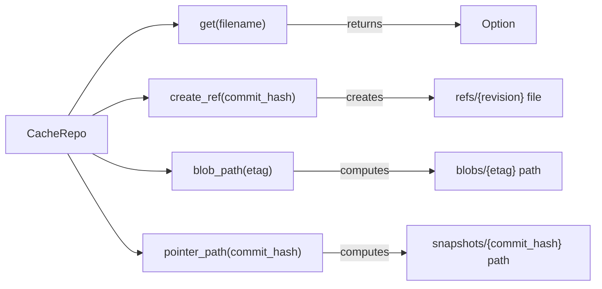

**CacheRepo Method Flow**

Sources: [src/lib.rs:128-195]()

## Repository Type System

The cache supports three types of repositories, each with distinct URL patterns and folder naming:

| RepoType | Folder Prefix | API URL Pattern | Hub URL Pattern |
|----------|---------------|-----------------|-----------------|
| `Model` | `models--` | `models/{repo_id}` | `{repo_id}` |
| `Dataset` | `datasets--` | `datasets/{repo_id}` | `datasets/{repo_id}` |
| `Space` | `spaces--` | `spaces/{repo_id}` | `spaces/{repo_id}` |

The `folder_name()` method normalizes repository IDs by replacing forward slashes with double dashes:

```
facebook/opt-125m → models--facebook--opt-125m
```

Sources: [src/lib.rs:16-26](), [src/lib.rs:245-253](), [src/lib.rs:261-290]()

## Content-Addressed Storage System

The cache implements a blob storage system where files are stored by their ETag hash, enabling deduplication across different repositories and revisions:

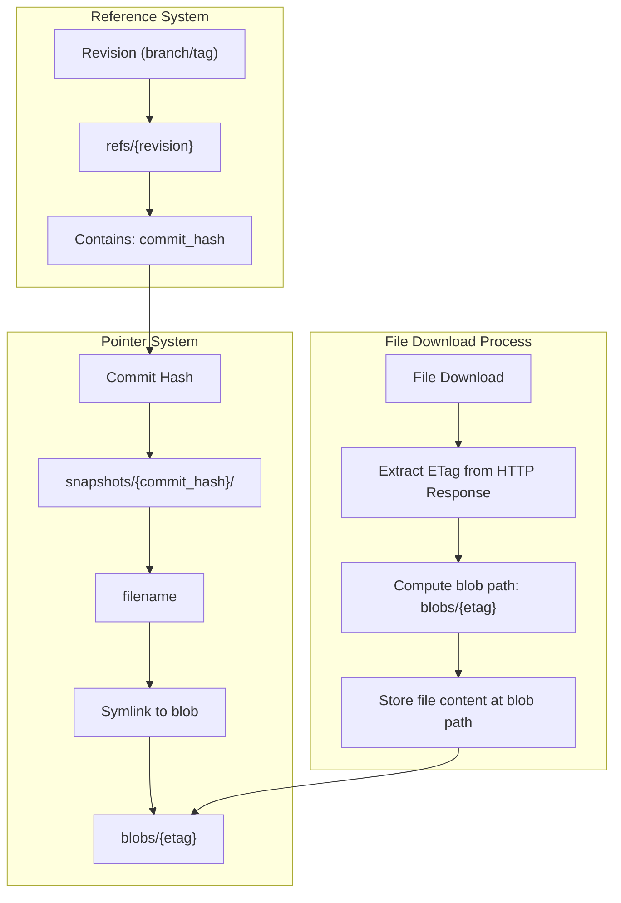

**Content-Addressed Storage Flow**

Sources: [src/lib.rs:182-187](), [src/lib.rs:189-194]()

## Token Management

The cache system manages Hugging Face authentication tokens stored in a dedicated token file:

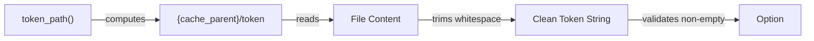

**Token Resolution Process**

The token file location is computed by:
1. Taking the cache path
2. Removing the `"hub"` suffix 
3. Appending `"token"`

Sources: [src/lib.rs:58-85]()

## File Retrieval Logic

The `get()` method implements the file resolution process that traverses the pointer system:

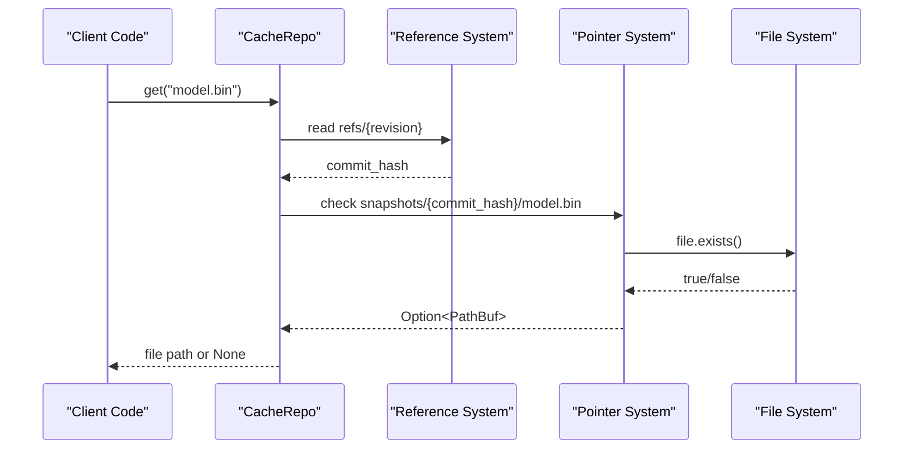

**File Retrieval Sequence**

Sources: [src/lib.rs:141-151]()

## Environment Configuration

The cache location can be configured through environment variables or falls back to platform-specific defaults:

| Configuration Method | Path Resolution |
|---------------------|-----------------|
| `HF_HOME` environment variable | `${HF_HOME}/hub` |
| Default (Unix-like) | `~/.cache/huggingface/hub` |
| Default (Windows) | `%USERPROFILE%\.cache\huggingface\hub` |

Sources: [src/lib.rs:42-51](), [src/lib.rs:197-205]()

## Concurrent Access and Safety

While the core cache structures don't implement explicit locking mechanisms, the system is designed to work with the file locking implemented in the API layers. The blob storage system with content-addressed files provides natural deduplication and reduces conflicts during concurrent operations.

Sources: Referenced in overall architecture diagrams and API integration patterns

---

# Page: Repository and Progress Abstractions

# Repository and Progress Abstractions

<details>
<summary>Relevant source files</summary>

The following files were used as context for generating this wiki page:

- [src/api/mod.rs](src/api/mod.rs)
- [src/lib.rs](src/lib.rs)

</details>


This document covers the core abstractions that form the foundation of the hf-hub API: the repository system (`Repo`, `RepoType`, `CacheRepo`) and the progress tracking system (`Progress` trait). These abstractions provide a unified interface for working with different types of Hugging Face Hub repositories and tracking download progress across both synchronous and asynchronous APIs.

For details on the cache storage implementation, see [Cache System](#3.1). For specific API usage patterns, see [API Reference](#4).

## Repository Type System

The repository abstraction begins with the `RepoType` enum, which distinguishes between the three types of repositories supported by Hugging Face Hub.

### RepoType Enumeration

The `RepoType` enum defines the fundamental repository categories:

```rust
pub enum RepoType {
    Model,    // Weight files and configuration
    Dataset,  // Data in parquet files  
    Space,    // Demo applications
}
```

Each variant maps to different URL patterns and cache directory structures within the Hub ecosystem.

**Repository Type Mapping**

| RepoType | URL Prefix | Cache Folder | Purpose |
|----------|------------|--------------|---------|
| `Model` | (none) | `models--{repo_id}` | Model weights and config files |
| `Dataset` | `datasets/` | `datasets--{repo_id}` | Data files, typically parquet |
| `Space` | `spaces/` | `spaces--{repo_id}` | Demo applications |

Sources: [src/lib.rs:16-26](), [src/lib.rs:246-253](), [src/lib.rs:262-272]()

## Repository Abstraction

The `Repo` struct represents a specific repository instance with version information.

### Repo Structure and Methods

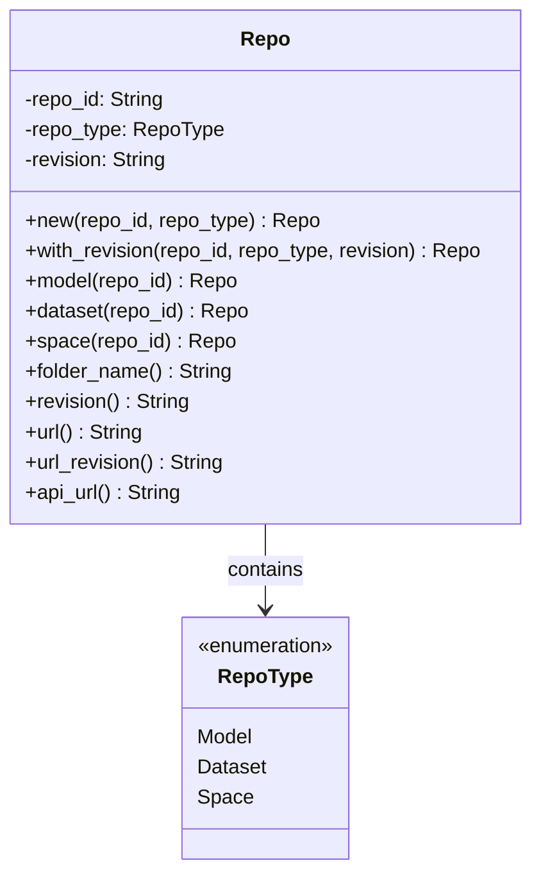

### Repository Construction Patterns

The `Repo` struct provides multiple constructor patterns:

- **Generic constructor**: `Repo::new(repo_id, repo_type)` defaults to "main" branch
- **Versioned constructor**: `Repo::with_revision(repo_id, repo_type, revision)` specifies exact revision
- **Type-specific shortcuts**: `Repo::model()`, `Repo::dataset()`, `Repo::space()`

The `folder_name()` method generates normalized cache directory names by combining the type prefix with the repository ID, replacing forward slashes with double dashes for filesystem compatibility.

Sources: [src/lib.rs:207-290]()

## Cache Repository Integration

The `CacheRepo` struct bridges the repository abstraction with the local cache system.

### CacheRepo Architecture

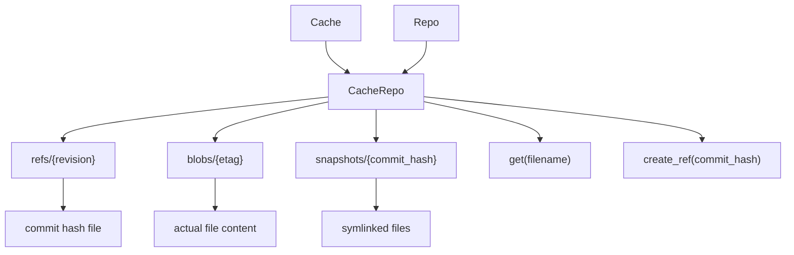

### CacheRepo Operations

The `CacheRepo` struct provides these key methods:

- **`get(filename)`**: Resolves a filename to its local cache path if present
- **`create_ref(commit_hash)`**: Creates a reference linking a branch/tag to a specific commit
- **Path resolution methods**: `ref_path()`, `blob_path()`, `pointer_path()` for internal cache structure navigation

The path resolution follows the pattern: revision → commit hash → snapshot directory → individual files as symlinks to blob storage.

Sources: [src/lib.rs:127-195]()

## Progress Abstraction System

The `Progress` trait provides a standardized interface for tracking download progress across different implementations.

### Progress Trait Definition

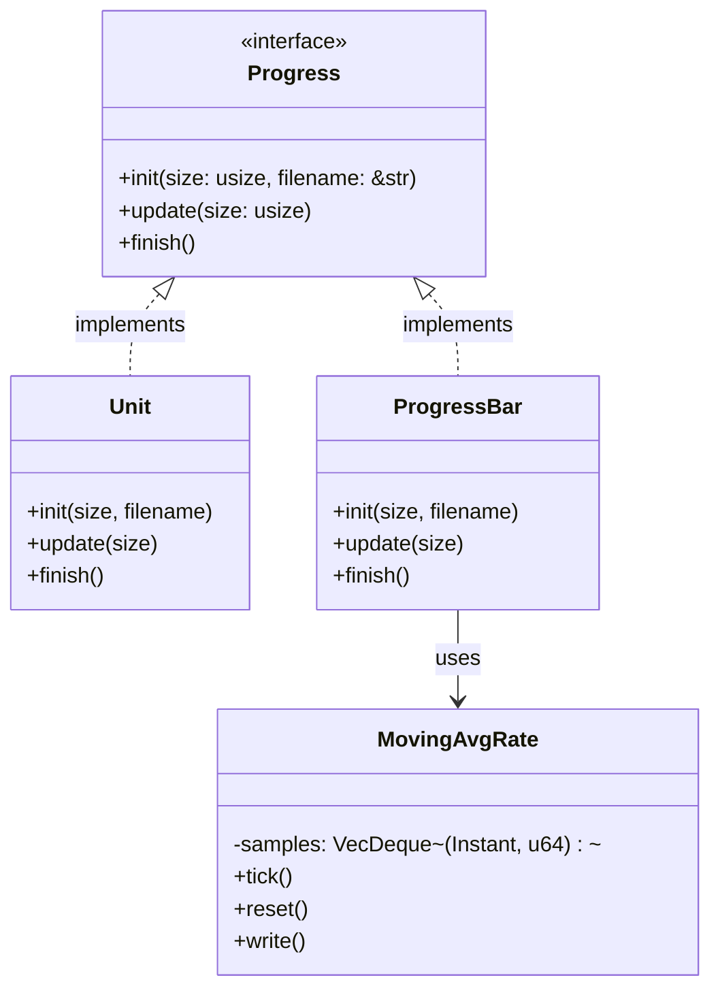

### Progress Trait Methods

The `Progress` trait defines three lifecycle methods:

- **`init(size, filename)`**: Called at download start with total file size and name
- **`update(size)`**: Called during download with bytes transferred since last update  
- **`finish()`**: Called when download completes successfully

### Built-in Progress Implementations

The library provides two built-in implementations:

**Unit Type Implementation (`()`)**
- No-op implementation for when progress tracking is not needed
- All methods are empty functions

**ProgressBar Implementation** 
- Uses `indicatif::ProgressBar` for visual progress display
- Configures progress bar style with filename, transfer rate, and ETA
- Truncates long filenames to 30 characters with leading ellipsis
- Integrates `MovingAvgRate` for smooth transfer rate calculation

Sources: [src/api/mod.rs:16-60]()

## Progress Rate Calculation

The `MovingAvgRate` struct implements sophisticated transfer rate calculation for smooth progress display.

### MovingAvgRate Implementation

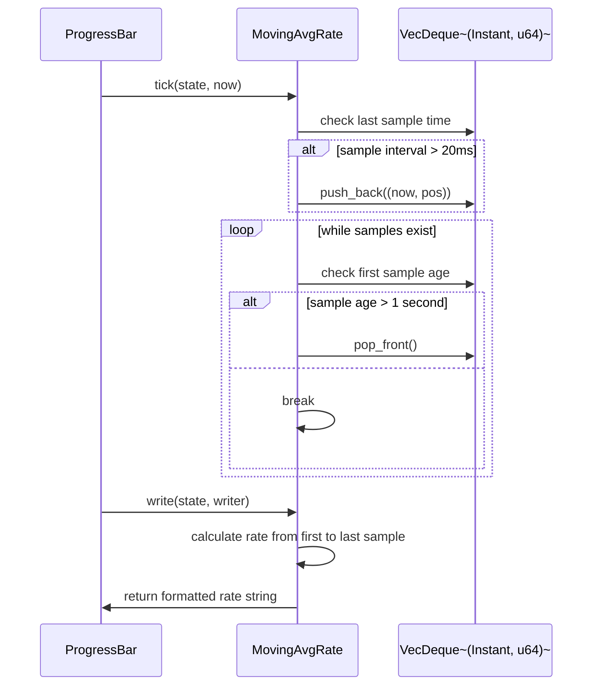

The `MovingAvgRate` maintains a sliding window of position samples over the last second, sampling at most every 20 milliseconds. This provides smooth rate calculation without excessive overhead.

Sources: [src/api/mod.rs:79-122]()

## Repository Metadata Structures

The API includes structures for representing repository metadata from the Hub.

### Metadata Types

**`Siblings` Structure**
- Represents individual files within a repository
- Contains `rfilename` field with the relative path within the repo

**`RepoInfo` Structure**  
- Complete repository information from Hub API
- Contains `siblings` vector of all files
- Contains `sha` field with the current commit hash

These structures support the repository browsing and file discovery functionality used by both API implementations.

Sources: [src/api/mod.rs:62-77]()

## Integration Patterns

The repository and progress abstractions work together in the download workflow:

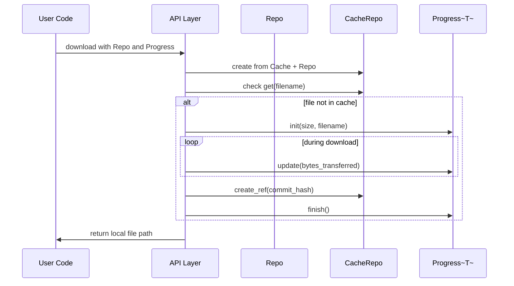

This pattern allows the same core abstractions to work across both synchronous and asynchronous API implementations, with the progress system providing consistent feedback regardless of the underlying HTTP client or execution model.

Sources: [src/lib.rs:87-102](), [src/api/mod.rs:16-27]()

---

# Page: API Reference

# API Reference

<details>
<summary>Relevant source files</summary>

The following files were used as context for generating this wiki page:

- [src/api/mod.rs](src/api/mod.rs)
- [src/api/sync.rs](src/api/sync.rs)
- [src/api/tokio.rs](src/api/tokio.rs)

</details>


This document provides comprehensive documentation for the hf-hub crate's API interfaces, covering both synchronous and asynchronous implementations for downloading and managing files from Hugging Face Hub repositories. The API provides a unified interface for accessing models, datasets, and spaces with built-in caching, progress tracking, and error handling.

For detailed usage patterns and examples, see [Getting Started](#2). For configuration of HTTP backends and feature flags, see [Configuration and Features](#5). For in-depth coverage of individual API implementations, see [Synchronous API](#4.1) and [Asynchronous API](#4.2).

## API Architecture Overview

The hf-hub crate provides two complete API implementations that share common infrastructure but differ in their execution model. Both APIs use identical patterns for construction, configuration, and method signatures, differing only in async/await semantics.

```mermaid
graph TB
    CommonTypes["Common Types<br/>src/api/mod.rs"]
    
    subgraph "Synchronous API"
        SyncBuilder["ApiBuilder<br/>src/api/sync.rs:207-356"]
        SyncApi["Api<br/>src/api/sync.rs:367-658"]
        SyncRepo["ApiRepo<br/>src/api/sync.rs:664-830"]
    end
    
    subgraph "Asynchronous API"
        AsyncBuilder["ApiBuilder<br/>src/api/tokio.rs:207-401"]
        AsyncApi["Api<br/>src/api/tokio.rs:412-593"]
        AsyncRepo["ApiRepo<br/>src/api/tokio.rs:598-929"]
    end
    
    subgraph "Shared Infrastructure"
        Cache["Cache System"]
        Progress["Progress Trait"]
        Metadata["Metadata Handling"]
    end
    
    CommonTypes --> SyncBuilder
    CommonTypes --> AsyncBuilder
    SyncBuilder --> SyncApi
    AsyncBuilder --> AsyncApi
    SyncApi --> SyncRepo
    AsyncApi --> AsyncRepo
    
    SyncApi --> Cache
    AsyncApi --> Cache
    SyncRepo --> Progress
    AsyncRepo --> Progress
    SyncApi --> Metadata
    AsyncApi --> Metadata
```

**Sources:** [src/api/mod.rs:1-123](), [src/api/sync.rs:1-1298](), [src/api/tokio.rs:1-1434]()

## Common Types and Traits

### Progress Trait

Both APIs use a common `Progress` trait for tracking download progress, with separate synchronous and asynchronous implementations.

| Type | Location | Purpose |
|------|----------|---------|
| `Progress` (sync) | [src/api/mod.rs:18-27]() | Synchronous progress tracking interface |
| `Progress` (async) | [src/api/tokio.rs:36-46]() | Asynchronous progress tracking interface |
| `ProgressBar` | [src/api/mod.rs:35-60]() | Built-in progress bar implementation |
| `()` | [src/api/mod.rs:29-33]() | No-op progress implementation |

### Repository Information

```mermaid
classDiagram
    class RepoInfo {
        +Vec~Siblings~ siblings
        +String sha
    }
    
    class Siblings {
        +String rfilename
    }
    
    RepoInfo --> Siblings : "contains"
```

**Sources:** [src/api/mod.rs:62-77]()

### Error Types

Both APIs define their own `ApiError` enums with similar variants but different underlying error types:

| Error Variant | Sync Location | Async Location | Purpose |
|---------------|---------------|----------------|---------|
| `MissingHeader` | [src/api/sync.rs:161-162]() | [src/api/tokio.rs:155-156]() | Required HTTP header missing |
| `InvalidHeader` | [src/api/sync.rs:165-166]() | [src/api/tokio.rs:159-160]() | Header value malformed |
| `RequestError` | [src/api/sync.rs:176-177]() | [src/api/tokio.rs:171-172]() | HTTP request failed |
| `IoError` | [src/api/sync.rs:184-185]() | [src/api/tokio.rs:179-180]() | File system operation failed |
| `TooManyRetries` | [src/api/sync.rs:188-189]() | [src/api/tokio.rs:183-184]() | Retry limit exceeded |
| `LockAcquisition` | [src/api/sync.rs:202-203]() | [src/api/tokio.rs:202-203]() | File lock could not be acquired |

## API Construction Pattern

Both APIs use an identical builder pattern for configuration:

```mermaid
sequenceDiagram
    participant User
    participant Builder as "ApiBuilder"
    participant Api as "Api"
    participant Repo as "ApiRepo"
    
    User->>Builder: "ApiBuilder::new()"
    User->>Builder: "with_token(token)"
    User->>Builder: "with_cache_dir(path)"
    User->>Builder: "with_progress(true)"
    User->>Builder: "build()"
    Builder->>Api: "Api"
    User->>Api: "model(repo_id)"
    Api->>Repo: "ApiRepo"
```

### Builder Configuration Methods

| Method | Sync Location | Async Location | Purpose |
|--------|---------------|----------------|---------|
| `new()` | [src/api/sync.rs:229-232]() | [src/api/tokio.rs:232-235]() | Create default builder |
| `from_env()` | [src/api/sync.rs:242-249]() | [src/api/tokio.rs:245-252]() | Use environment variables |
| `from_cache()` | [src/api/sync.rs:258-280]() | [src/api/tokio.rs:276-299]() | Use existing cache |
| `with_token()` | [src/api/sync.rs:301-304]() | [src/api/tokio.rs:320-323]() | Set authentication token |
| `with_cache_dir()` | [src/api/sync.rs:295-298]() | [src/api/tokio.rs:314-317]() | Set cache directory |
| `with_progress()` | [src/api/sync.rs:283-286]() | [src/api/tokio.rs:302-305]() | Enable/disable progress bars |
| `with_endpoint()` | [src/api/sync.rs:289-292]() | [src/api/tokio.rs:308-311]() | Set Hub endpoint URL |
| `build()` | [src/api/sync.rs:334-355]() | [src/api/tokio.rs:362-400]() | Construct final API instance |

**Sources:** [src/api/sync.rs:207-356](), [src/api/tokio.rs:207-401]()

## Core API Operations

### Repository Access Methods

Both `Api` classes provide identical methods for accessing different repository types:

```mermaid
graph LR
    Api["Api"]
    
    Api --> repo["repo(Repo)"]
    Api --> model["model(String)"]
    Api --> dataset["dataset(String)"]
    Api --> space["space(String)"]
    
    repo --> ApiRepo["ApiRepo"]
    model --> ApiRepo
    dataset --> ApiRepo
    space --> ApiRepo
```

| Method | Sync Location | Async Location | Returns |
|--------|---------------|----------------|---------|
| `repo()` | [src/api/sync.rs:623-625]() | [src/api/tokio.rs:557-559]() | `ApiRepo` for any repository type |
| `model()` | [src/api/sync.rs:634-636]() | [src/api/tokio.rs:568-570]() | `ApiRepo` for model repository |
| `dataset()` | [src/api/sync.rs:645-647]() | [src/api/tokio.rs:579-581]() | `ApiRepo` for dataset repository |
| `space()` | [src/api/sync.rs:656-658]() | [src/api/tokio.rs:590-592]() | `ApiRepo` for space repository |

### File Operations

The `ApiRepo` class provides the primary interface for file operations:

```mermaid
flowchart TD
    Start["ApiRepo"] --> url["url(filename)"]
    Start --> get["get(filename)"]
    Start --> download["download(filename)"]
    Start --> download_with_progress["download_with_progress(filename, progress)"]
    Start --> info["info()"]
    Start --> info_request["info_request()"]
    
    get --> cache_check{"File in cache?"}
    cache_check -->|Yes| return_cached["Return cached path"]
    cache_check -->|No| download
    
    download --> download_with_progress
    download_with_progress --> metadata["Get file metadata"]
    metadata --> lock["Acquire file lock"]
    lock --> download_chunks["Download file chunks"]
    download_chunks --> verify["Verify integrity"]
    verify --> symlink["Create symlinks"]
    symlink --> return_path["Return file path"]
```

| Method | Sync Location | Async Location | Purpose |
|--------|---------------|----------------|---------|
| `url()` | [src/api/sync.rs:696-701]() | [src/api/tokio.rs:618-623]() | Get remote file URL |
| `get()` | [src/api/sync.rs:709-715]() | [src/api/tokio.rs:807-813]() | Get file from cache or download |
| `download()` | [src/api/sync.rs:799-805]() | [src/api/tokio.rs:826-833]() | Force download file |
| `download_with_progress()` | [src/api/sync.rs:746-788]() | [src/api/tokio.rs:868-899]() | Download with custom progress |
| `info()` | [src/api/sync.rs:813-815]() | [src/api/tokio.rs:909-911]() | Get repository information |
| `info_request()` | [src/api/sync.rs:826-829]() | [src/api/tokio.rs:925-928]() | Get raw HTTP request builder |

**Sources:** [src/api/sync.rs:664-830](), [src/api/tokio.rs:598-929]()

## Download Implementation Differences

While the APIs provide identical interfaces, their download implementations differ significantly:

### Synchronous Download Flow

```mermaid
sequenceDiagram
    participant Client as "ureq Client"
    participant File as "File System"
    participant Progress as "Progress"
    
    Client->>Client: "Get metadata with Range: bytes=0-0"
    Client->>File: "Create/open temporary file"
    File->>Client: "Check existing size for resume"
    loop "Download chunks"
        Client->>Client: "GET with Range header"
        Client->>Progress: "update(bytes_read)"
        Client->>File: "Write chunk to file"
    end
    File->>File: "Rename temp to final location"
    File->>File: "Create symlink in cache"
```

### Asynchronous Download Flow

```mermaid
sequenceDiagram
    participant Client as "reqwest Client"
    participant Semaphore as "Concurrency Control"
    participant File as "Async File System"
    participant Progress as "Async Progress"
    
    Client->>Client: "Get metadata with Range: bytes=0-0"
    Client->>File: "Create/open temporary file with size tracking"
    
    par "Concurrent chunk downloads"
        Semaphore->>Client: "Acquire permit"
        Client->>Client: "Download chunk"
        Client->>Progress: "update(bytes_read).await"
        Client->>File: "Write chunk at offset"
        Semaphore->>Semaphore: "Release permit"
    and "Progress tracking"
        File->>File: "Update committed bytes marker"
        Progress->>Progress: "Update UI"
    end
    
    File->>File: "Rename temp to final location"
    File->>File: "Create symlink in cache"
```

**Sources:** [src/api/sync.rs:550-619](), [src/api/tokio.rs:625-797]()

## HTTP Client Configuration

The APIs use different underlying HTTP clients with distinct configuration approaches:

| Feature | Sync Implementation | Async Implementation |
|---------|-------------------|---------------------|
| HTTP Client | `ureq::Agent` | `reqwest::Client` |
| TLS Backend | `native-tls` or built-in | `native-tls` or `rustls-tls` |
| Proxy Support | [src/api/sync.rs:342-343]() | Built into `reqwest` |
| Redirect Policy | Manual handling [src/api/sync.rs:473-501]() | Custom policy [src/api/tokio.rs:368-383]() |
| Concurrency | Single-threaded | Configurable via `max_files` |
| Chunk Downloads | Sequential | Parallel with semaphore |

**Sources:** [src/api/sync.rs:676-686](), [src/api/tokio.rs:362-400]()

## File Locking and Safety

Both APIs implement identical file locking mechanisms to prevent concurrent writes:

```mermaid
graph TB
    subgraph "Lock Implementation"
        lock_file["lock_file(path)"]
        unix_lock["Unix: flock()"]
        windows_lock["Windows: LockFileEx()"]
        other_lock["Other: no-op"]
    end
    
    lock_file --> unix_lock
    lock_file --> windows_lock
    lock_file --> other_lock
    
    subgraph "Lock Usage"
        acquire["Acquire .lock file"]
        download["Download to .part file"]
        rename["Rename to final location"]
        release["Release lock"]
    end
    
    acquire --> download
    download --> rename
    rename --> release
```

**Sources:** [src/api/sync.rs:82-155](), [src/api/tokio.rs:76-149]()

For detailed implementation specifics and advanced usage patterns, see [Synchronous API](#4.1) and [Asynchronous API](#4.2). For examples of custom progress implementations and integration patterns, see [Advanced Examples](#6).

---

# Page: Synchronous API

# Synchronous API

<details>
<summary>Relevant source files</summary>

The following files were used as context for generating this wiki page:

- [src/api/mod.rs](src/api/mod.rs)
- [src/api/sync.rs](src/api/sync.rs)

</details>


The Synchronous API provides blocking, thread-safe access to Hugging Face Hub resources using the `ureq` HTTP client. This API is designed for applications that prefer synchronous operations or run in environments where async/await is not suitable. For asynchronous operations with `tokio` support, see [Asynchronous API](#4.2).

The synchronous API handles file downloads, caching, resumable transfers, and concurrent access protection through file locking mechanisms. All operations block the calling thread until completion.

## Core API Components

The synchronous API is built around three main components that work together to provide Hub access:

### API Component Architecture

```mermaid
graph TB
    ApiBuilder[ApiBuilder] --> Api[Api]
    Api --> ApiRepo[ApiRepo]
    Api --> HeaderAgent[HeaderAgent]
    HeaderAgent --> UreqAgent["ureq::Agent"]
    Api --> Cache[Cache]
    ApiRepo --> DownloadOps["Download Operations"]
    ApiRepo --> RepoInfo[RepoInfo]
    
    subgraph "Error Handling"
        ApiError[ApiError]
    end
    
    subgraph "Progress Tracking"
        ProgressTrait["Progress trait"]
        ProgressBar[ProgressBar]
        UnitProgress["()"]
    end
    
    DownloadOps --> ProgressTrait
    DownloadOps --> ApiError
    ProgressTrait --> ProgressBar
    ProgressTrait --> UnitProgress
```

**Sources:** [src/api/sync.rs:207-830](), [src/api/mod.rs:16-77]()

| Component | Purpose | Key Methods |
|-----------|---------|-------------|
| `ApiBuilder` | Configuration and construction of `Api` instances | `new()`, `with_token()`, `with_cache_dir()`, `build()` |
| `Api` | Main entry point for Hub operations | `repo()`, `model()`, `dataset()`, `space()` |
| `ApiRepo` | Repository-specific operations | `download()`, `get()`, `info()`, `url()` |
| `HeaderAgent` | HTTP client wrapper with default headers | `get()` |

## Builder Pattern Configuration

The `ApiBuilder` follows the builder pattern to configure API instances with various options:

### Configuration Options

```mermaid
graph LR
    ApiBuilder --> WithProgress["with_progress(bool)"]
    ApiBuilder --> WithEndpoint["with_endpoint(String)"]
    ApiBuilder --> WithCacheDir["with_cache_dir(PathBuf)"]
    ApiBuilder --> WithToken["with_token(Option<String>)"]
    ApiBuilder --> WithRetries["with_retries(usize)"]
    ApiBuilder --> WithUserAgent["with_user_agent(key, value)"]
    
    WithProgress --> BuildMethod["build()"]
    WithEndpoint --> BuildMethod
    WithCacheDir --> BuildMethod
    WithToken --> BuildMethod
    WithRetries --> BuildMethod
    WithUserAgent --> BuildMethod
    
    BuildMethod --> Api[Api]
```

**Sources:** [src/api/sync.rs:207-356]()

The builder supports three construction patterns:

- **`ApiBuilder::new()`** - Default configuration with standard cache location
- **`ApiBuilder::from_env()`** - Configuration from environment variables (`HF_HOME`, `HF_ENDPOINT`)
- **`ApiBuilder::from_cache(cache)`** - Configuration with custom cache instance

Key configuration options include:
- **Progress display**: Toggle progress bars during downloads
- **Endpoint**: Custom Hub endpoint (defaults to `https://huggingface.co`)
- **Authentication**: Bearer token for private repositories
- **Retry behavior**: Number of download retry attempts
- **User agent**: Custom user agent components

## Download Process and Caching

The download process implements sophisticated caching, resumable transfers, and concurrent access protection:

### Download Sequence

```mermaid
sequenceDiagram
    participant Client
    participant ApiRepo
    participant Api
    participant Cache
    participant FileLock as "File Lock"
    participant HubServer as "Hub Server"
    
    Client->>ApiRepo: download(filename)
    ApiRepo->>Api: metadata(url)
    Api->>HubServer: HEAD request with Range: bytes=0-0
    HubServer-->>Api: ETag, commit hash, size
    
    ApiRepo->>Cache: blob_path(etag)
    ApiRepo->>FileLock: lock_file(blob_path)
    FileLock-->>ApiRepo: lock acquired
    
    ApiRepo->>Api: download_tempfile()
    Api->>HubServer: GET with Range headers
    
    loop "Download chunks"
        HubServer-->>Api: file data
        Api-->>Client: progress update
    end
    
    ApiRepo->>Cache: rename temp to blob
    ApiRepo->>Cache: create pointer symlink
    ApiRepo->>Cache: create_ref(commit_hash)
    ApiRepo->>FileLock: release lock
    ApiRepo-->>Client: local file path
```

**Sources:** [src/api/sync.rs:550-830](), [src/api/sync.rs:82-155]()

### Key Download Features

| Feature | Implementation | Location |
|---------|---------------|----------|
| **Resumable Downloads** | Uses temporary `.part` files and HTTP Range requests | [src/api/sync.rs:550-591]() |
| **File Locking** | Platform-specific file locking to prevent concurrent writes | [src/api/sync.rs:82-155]() |
| **Retry Logic** | Exponential backoff with jitter for failed downloads | [src/api/sync.rs:574-588]() |
| **Progress Tracking** | Pluggable `Progress` trait with `ProgressBar` support | [src/api/mod.rs:16-60]() |

The caching strategy uses:
- **Blob storage**: Content-addressed storage by ETag hash
- **Pointer system**: Symlinks from commit-specific paths to blobs
- **Reference tracking**: Maintains refs for different revisions

## Repository Operations

The `ApiRepo` struct provides repository-specific operations for models, datasets, and spaces:

### Repository Method Overview

```mermaid
graph TB
    ApiRepo --> GetMethod["get(filename)"]
    ApiRepo --> DownloadMethod["download(filename)"]
    ApiRepo --> DownloadWithProgress["download_with_progress(filename, progress)"]
    ApiRepo --> UrlMethod["url(filename)"]
    ApiRepo --> InfoMethod["info()"]
    ApiRepo --> InfoRequest["info_request()"]
    
    GetMethod --> CacheCheck["Check local cache first"]
    CacheCheck --> DownloadFallback["Download if not cached"]
    
    DownloadMethod --> ProgressBar["Uses ProgressBar if enabled"]
    DownloadWithProgress --> CustomProgress["Uses custom Progress impl"]
    
    InfoMethod --> HubAPI["Calls Hub API"]
    InfoRequest --> RawRequest["Returns ureq::Request"]
```

**Sources:** [src/api/sync.rs:664-830]()

### Repository Types and URL Construction

The API supports three repository types through convenience methods:

| Method | Repository Type | URL Pattern |
|--------|----------------|-------------|
| `api.model(id)` | `RepoType::Model` | `{endpoint}/{id}/resolve/{revision}/{filename}` |
| `api.dataset(id)` | `RepoType::Dataset` | `{endpoint}/datasets/{id}/resolve/{revision}/{filename}` |
| `api.space(id)` | `RepoType::Space` | `{endpoint}/spaces/{id}/resolve/{revision}/{filename}` |

## Error Handling

The synchronous API uses the `ApiError` enum for comprehensive error handling:

### Error Type Classification

```mermaid
graph TB
    ApiError --> HeaderErrors["Header-related"]
    ApiError --> NetworkErrors["Network-related"]
    ApiError --> IOErrors["I/O-related"]
    ApiError --> LockingErrors["Concurrency-related"]
    
    HeaderErrors --> MissingHeader["MissingHeader(HeaderName)"]
    HeaderErrors --> InvalidHeader["InvalidHeader(HeaderName)"]
    
    NetworkErrors --> RequestError["RequestError(ureq::Error)"]
    NetworkErrors --> TooManyRetries["TooManyRetries(ApiError)"]
    
    IOErrors --> IoError["IoError(std::io::Error)"]
    IOErrors --> InvalidResume["InvalidResume"]
    
    LockingErrors --> LockAcquisition["LockAcquisition(PathBuf)"]
    
    subgraph "TLS Support"
        NativeError["Native(native_tls::Error)"]
    end
    
    ApiError --> NativeError
```

**Sources:** [src/api/sync.rs:157-204]()

Common error scenarios include:
- **Missing headers**: Required headers not present in Hub responses
- **Network failures**: Connection issues with automatic retry
- **Lock acquisition**: File being downloaded by another process
- **Invalid resume**: Corrupted partial download files

## File Locking and Concurrency

The synchronous API implements cross-platform file locking to ensure safe concurrent access:

### Platform-Specific Locking Implementation

```mermaid
graph TB
    LockFile["lock_file(path)"] --> CreateLockFile["Create .lock file"]
    CreateLockFile --> PlatformLock["Platform-specific locking"]
    
    PlatformLock --> UnixLock["Unix: flock() with LOCK_EX"]
    PlatformLock --> WindowsLock["Windows: LockFileEx()"]
    PlatformLock --> OtherLock["Other: No-op"]
    
    UnixLock --> RetryLoop["Retry with backoff"]
    WindowsLock --> RetryLoop
    OtherLock --> RetryLoop
    
    RetryLoop --> Success["Return Handle"]
    RetryLoop --> Failure["LockAcquisition error"]
    
    Success --> AutoUnlock["Handle Drop = unlock()"]
```

**Sources:** [src/api/sync.rs:82-155]()

The locking mechanism:
- Creates `.lock` files alongside download targets
- Uses platform-specific file locking APIs (flock on Unix, LockFileEx on Windows)
- Implements retry logic with up to 5 attempts
- Automatically releases locks when `Handle` is dropped
- Provides no-op implementation for unsupported platforms

This ensures that concurrent download attempts for the same file are serialized, preventing corruption while allowing resumable downloads.

---

# Page: Asynchronous API

# Asynchronous API

<details>
<summary>Relevant source files</summary>

The following files were used as context for generating this wiki page:

- [src/api/mod.rs](src/api/mod.rs)
- [src/api/tokio.rs](src/api/tokio.rs)

</details>


This document covers the asynchronous API implementation for interacting with the Hugging Face Hub. The async API is built on top of tokio and reqwest, providing concurrent downloads, progress tracking, and robust error handling for file operations.

For synchronous API functionality, see [Synchronous API](#4.1). For core caching and repository abstractions, see [Core Architecture](#3).

## Overview

The asynchronous API provides a tokio-based interface for downloading files from Hugging Face Hub with support for concurrent operations, progress tracking, and resumable downloads. The implementation leverages async/await patterns and is designed for high-throughput scenarios where multiple files need to be downloaded simultaneously.

**Core Components Diagram**

```mermaid
graph TD
    ApiBuilder["ApiBuilder"] --> Api["Api"]
    Api --> ApiRepo["ApiRepo"]
    Api --> Client["reqwest::Client"]
    Api --> Cache["Cache"]
    
    ApiRepo --> DownloadMethods["download()"]
    ApiRepo --> GetMethods["get()"]
    ApiRepo --> InfoMethods["info()"]
    
    DownloadMethods --> ProgressTrait["Progress trait"]
    DownloadMethods --> Metadata["metadata()"]
    DownloadMethods --> DownloadTempfile["download_tempfile()"]
    
    ProgressTrait --> ProgressBar["ProgressBar"]
    ProgressTrait --> CustomProgress["Custom impl"]
    
    DownloadTempfile --> Semaphore["tokio::Semaphore"]
    DownloadTempfile --> DownloadChunk["download_chunk()"]
```

Sources: [src/api/tokio.rs:207-423](), [src/api/tokio.rs:595-929]()

## Api and ApiBuilder

The `ApiBuilder` provides a fluent interface for configuring the async API client with various options for performance tuning, authentication, and endpoint configuration.

**ApiBuilder Configuration Flow**

```mermaid
graph TD
    New["ApiBuilder::new()"] --> Cache["Cache::default()"]
    FromEnv["ApiBuilder::from_env()"] --> EnvCache["Cache::from_env()"]
    FromCache["ApiBuilder::from_cache()"] --> ExistingCache["Existing Cache"]
    
    New --> Config["Configuration Methods"]
    FromEnv --> Config
    FromCache --> Config
    
    Config --> WithToken["with_token()"]
    Config --> WithEndpoint["with_endpoint()"]
    Config --> WithMaxFiles["with_max_files()"]
    Config --> WithChunkSize["with_chunk_size()"]
    Config --> WithProgress["with_progress()"]
    Config --> HighCpu["high()"]
    
    Config --> Build["build()"]
    Build --> Headers["build_headers()"]
    Build --> ClientCreation["reqwest::Client"]
    Build --> RedirectPolicy["relative_redirect_policy"]
    Build --> FinalApi["Api"]
```

Sources: [src/api/tokio.rs:220-401]()

### Key Configuration Options

| Method | Purpose | Default Value |
|--------|---------|---------------|
| `with_max_files()` | Controls concurrent download limit | 1 |
| `with_chunk_size()` | Sets download chunk size for resumability | 10MB |
| `with_progress()` | Enables/disables progress bars | true |
| `high()` | Optimizes for high-CPU cloud environments | `num_cpus::get()` files, 10MB chunks |

The `high()` method [src/api/tokio.rs:264-267]() is specifically designed for cloud environments with high CPU counts and fast networks, allowing much higher concurrency than the default single-file configuration.

Sources: [src/api/tokio.rs:325-341](), [src/api/tokio.rs:264-267]()

## Progress Tracking

The async API implements an async-aware `Progress` trait that allows for non-blocking progress updates during file downloads.

**Progress Trait Implementation**

```mermaid
graph TD
    ProgressTrait["Progress trait"] --> AsyncMethods["async fn init/update/finish"]
    
    ProgressTrait --> ProgressBarImpl["ProgressBar impl"]
    ProgressTrait --> UnitImpl["() impl"]
    ProgressTrait --> CustomImpl["Custom implementations"]
    
    ProgressBarImpl --> SyncProgress["delegates to sync Progress"]
    UnitImpl --> NoOp["no-op async fns"]
    CustomImpl --> UserDefined["user-defined async behavior"]
    
    AsyncMethods --> Futures["impl Future<Output = ()> + Send"]
```

Sources: [src/api/tokio.rs:34-64]()

The async `Progress` trait [src/api/tokio.rs:36-46]() requires all methods to return futures, enabling non-blocking progress updates. The `ProgressBar` implementation [src/api/tokio.rs:48-58]() delegates to the synchronous version defined in [src/api/mod.rs:18-60]().

## Repository Operations

The `ApiRepo` struct provides repository-specific operations with async support for downloads and metadata retrieval.

**ApiRepo Operation Flow**

```mermaid
graph TD
    ApiRepo["ApiRepo"] --> URL["url()"]
    ApiRepo --> Download["download()"]
    ApiRepo --> Get["get()"]
    ApiRepo --> Info["info()"]
    ApiRepo --> DownloadWithProgress["download_with_progress()"]
    
    Download --> CheckProgress["check api.progress flag"]
    CheckProgress --> ProgressBarDownload["ProgressBar download"]
    CheckProgress --> NoProgressDownload["() download"]
    
    DownloadWithProgress --> GetMetadata["api.metadata()"]
    GetMetadata --> LockFile["lock_file()"]
    GetMetadata --> DownloadTempfile["download_tempfile()"]
    DownloadTempfile --> RenameFile["tokio::fs::rename()"]
    DownloadTempfile --> CreateSymlink["symlink_or_rename()"]
    
    Get --> CacheCheck["cache.repo().get()"]
    CacheCheck --> CacheHit["return cached path"]
    CacheCheck --> CacheMiss["call download()"]
```

Sources: [src/api/tokio.rs:610-929]()

### Download Mechanisms

The async download implementation supports chunked, concurrent downloads with automatic retries and progress tracking.

**Concurrent Download Architecture**

```mermaid
graph TD
    DownloadTempfile["download_tempfile()"] --> CreateSemaphore["Semaphore::new(max_files)"]
    DownloadTempfile --> CreateFailureSem["parallel_failures_semaphore"]
    DownloadTempfile --> CheckExisting["check existing .part file"]
    
    CheckExisting --> ResumeDownload["resume from offset"]
    CheckExisting --> FreshDownload["start from 0"]
    
    DownloadTempfile --> ChunkLoop["create chunk tasks"]
    ChunkLoop --> SpawnTasks["tokio::spawn for each chunk"]
    
    SpawnTasks --> AcquirePermit["permit.acquire_owned()"]
    SpawnTasks --> DownloadChunk["download_chunk()"]
    SpawnTasks --> RetryLogic["exponential backoff retry"]
    
    DownloadChunk --> RangeRequest["RANGE header request"]
    RangeRequest --> WriteToFile["write at offset"]
    
    SpawnTasks --> FuturesUnordered["collect results"]
    FuturesUnordered --> BinaryHeap["order chunks by offset"]
    BinaryHeap --> CommitProgress["update committed offset"]
```

Sources: [src/api/tokio.rs:625-761](), [src/api/tokio.rs:763-797]()

The download system uses several key mechanisms:

1. **Semaphore-based concurrency control** [src/api/tokio.rs:632-633]() limits the number of concurrent file handles
2. **Chunked downloads** [src/api/tokio.rs:669-717]() enable resumability and parallel processing  
3. **Binary heap ordering** [src/api/tokio.rs:720-746]() ensures chunks are committed in sequence
4. **Exponential backoff** [src/api/tokio.rs:694-710]() handles transient failures

## File Locking and Resumability

The async API implements cross-platform file locking to prevent concurrent downloads of the same file and support resumable downloads.

**File Locking Implementation**

```mermaid
graph TD
    LockFile["lock_file()"] --> CreateLockFile["create .lock file"]
    CreateLockFile --> PlatformLock["platform-specific lock()"]
    
    PlatformLock --> UnixFlock["unix::flock()"]
    PlatformLock --> WindowsLockFileEx["windows::LockFileEx()"]
    PlatformLock --> OtherNoOp["other::no-op"]
    
    LockFile --> RetryLoop["retry up to 5 times"]
    RetryLoop --> SleepDelay["tokio::time::sleep(1s)"]
    RetryLoop --> AcquireSuccess["return Handle"]
    RetryLoop --> AcquireFailure["LockAcquisition error"]
    
    Handle["Handle"] --> DropTrait["Drop impl"]
    DropTrait --> UnlockFile["unlock() on drop"]
```

Sources: [src/api/tokio.rs:76-93](), [src/api/tokio.rs:95-149]()

The locking mechanism supports resumable downloads by detecting partial `.part` files [src/api/tokio.rs:638-666]() and reading the committed progress marker stored as a 64-bit integer at the end of the file [src/api/tokio.rs:646-651]().

## Error Handling

The async API defines comprehensive error types for different failure scenarios that can occur during async operations.

| Error Type | Description | Source |
|------------|-------------|---------|
| `MissingHeader` | Expected HTTP header not present | [src/api/tokio.rs:155-156]() |
| `InvalidHeader` | Header value doesn't match expected format | [src/api/tokio.rs:159-160]() |
| `RequestError` | HTTP request failures from reqwest | [src/api/tokio.rs:171-172]() |
| `TooManyRetries` | Chunk download exceeded retry limit | [src/api/tokio.rs:183-184]() |
| `AcquireError` | Semaphore acquisition failed | [src/api/tokio.rs:191-192]() |
| `Join` | tokio task join failures | [src/api/tokio.rs:197-198]() |
| `LockAcquisition` | File locking failed after retries | [src/api/tokio.rs:202-203]() |

Sources: [src/api/tokio.rs:151-204]()

## Performance Features

The async API includes several performance optimizations for high-throughput scenarios:

### Concurrent File Downloads
The `max_files` parameter [src/api/tokio.rs:212-326]() controls how many files can be downloaded simultaneously using tokio's `Semaphore` [src/api/tokio.rs:632-633]().

### Chunked Downloads with Retries
Large files are split into chunks [src/api/tokio.rs:669-672]() that can be downloaded in parallel. Failed chunks are retried with exponential backoff [src/api/tokio.rs:483-485]() up to a configurable limit.

### Connection Reuse
The API creates dedicated `reqwest::Client` instances [src/api/tokio.rs:364-388]() with custom redirect policies that maintain connection pools for efficient HTTP reuse.

### Jittered Backoff
Retry delays include random jitter [src/api/tokio.rs:479-481]() to prevent thundering herd problems when multiple chunks fail simultaneously.

Sources: [src/api/tokio.rs:212-326](), [src/api/tokio.rs:669-717](), [src/api/tokio.rs:479-485]()

---

# Page: Configuration and Features

# Configuration and Features

<details>
<summary>Relevant source files</summary>

The following files were used as context for generating this wiki page:

- [Cargo.toml](Cargo.toml)
- [README.md](README.md)

</details>


This document covers the configuration options available in the hf-hub crate through Cargo feature flags, including HTTP client selection, TLS backend configuration, and their various combinations. It explains how to customize the crate's compilation to match specific requirements for synchronous vs asynchronous operation and TLS implementation choices.

For detailed explanations of specific feature combinations and backend selection, see [Feature Gates and Backends](#5.1). For SOCKS proxy setup instructions, see [SOCKS Proxy Configuration](#5.2).

## Feature-Based Architecture

The hf-hub crate uses Cargo's feature system to provide flexible compilation options. This allows users to include only the functionality they need, reducing binary size and dependency complexity while supporting different runtime requirements.

### Feature Dependency Graph

```mermaid
graph TD
    Default["default"] --> DefaultTLS["default-tls"]
    Default --> Tokio["tokio"]
    Default --> Ureq["ureq"]
    
    DefaultTLS --> NativeTLS["native-tls"]
    
    NativeTLS --> ReqwestDep["dep:reqwest"]
    NativeTLS --> ReqwestDefault["reqwest?/default"]
    NativeTLS --> NativeTLSDep["dep:native-tls"]
    NativeTLS --> UreqDep["dep:ureq"]
    NativeTLS --> UreqNativeTLS["ureq?/native-tls"]
    
    RustlsTLS["rustls-tls"] --> ReqwestRustls["reqwest?/rustls-tls"]
    
    Tokio --> Futures["dep:futures"]
    Tokio --> Indicatif1["dep:indicatif"]
    Tokio --> NumCpus["dep:num_cpus"]
    Tokio --> Rand1["dep:rand"]
    Tokio --> ReqwestTokio["dep:reqwest"]
    Tokio --> Serde1["dep:serde"]
    Tokio --> SerdeJson1["dep:serde_json"]
    Tokio --> Thiserror1["dep:thiserror"]
    Tokio --> TokioDep["dep:tokio"]
    
    Ureq --> Http["dep:http"]
    Ureq --> Indicatif2["dep:indicatif"]
    Ureq --> Rand2["dep:rand"]
    Ureq --> Serde2["dep:serde"]
    Ureq --> SerdeJson2["dep:serde_json"]
    Ureq --> Thiserror2["dep:thiserror"]
    Ureq --> UreqDep2["dep:ureq"]
```

Sources: [Cargo.toml:50-83]()

### HTTP Client and TLS Backend Matrix

```mermaid
graph TB
    subgraph "HTTP Clients"
        ReqwestClient["reqwest"]
        UreqClient["ureq"]
    end
    
    subgraph "TLS Backends"
        NativeTLSBackend["native-tls<br/>(OpenSSL)"]
        RustlsBackend["rustls-tls<br/>(Pure Rust)"]
    end
    
    subgraph "API Layers"
        AsyncAPI["api::tokio<br/>(Async)"]
        SyncAPI["api::sync<br/>(Sync)"]
    end
    
    AsyncAPI --> ReqwestClient
    SyncAPI --> UreqClient
    
    ReqwestClient --> NativeTLSBackend
    ReqwestClient --> RustlsBackend
    UreqClient --> NativeTLSBackend
    UreqClient --> RustlsDefault["rustls<br/>(ureq default)"]
```

Sources: [Cargo.toml:27-38](), [Cargo.toml:54-55](), [README.md:58-60]()

## Default Configuration

The default feature set enables maximum compatibility and functionality:

| Feature | Enabled | Purpose |
|---------|---------|---------|
| `default-tls` | ✓ | Enables `native-tls` backend |
| `tokio` | ✓ | Async API with tokio runtime |
| `ureq` | ✓ | Sync API with ureq client |

This configuration provides both synchronous and asynchronous APIs with OpenSSL-based TLS through `native-tls`.

Sources: [Cargo.toml:51]()

## Feature Combinations

### TLS Backend Selection

The crate supports two TLS implementations:

**native-tls (Default)**
- Uses system's native TLS implementation (OpenSSL on most platforms)
- Enabled by `default-tls` and `native-tls` features
- Works with both `reqwest` and `ureq`

**rustls-tls**
- Pure Rust TLS implementation
- Enabled by `rustls-tls` feature
- Only affects `reqwest`; `ureq` always uses rustls by default

Sources: [Cargo.toml:53-55](), [README.md:58-60]()

### API Selection

**Tokio Feature**
- Enables asynchronous API through `api::tokio` module
- Includes progress reporting with `indicatif`
- Provides concurrent download capabilities
- Requires `reqwest` HTTP client

**Ureq Feature**
- Enables synchronous API through `api::sync` module
- Lighter weight implementation
- Uses `ureq` HTTP client
- Includes SOCKS proxy support

Sources: [Cargo.toml:56-83]()

## Configuration Examples

### Minimal Async Configuration
```toml
[dependencies]
hf-hub = { version = "0.4", default-features = false, features = ["tokio", "rustls-tls"] }
```

### Minimal Sync Configuration
```toml
[dependencies]
hf-hub = { version = "0.4", default-features = false, features = ["ureq", "native-tls"] }
```

### Both APIs with Rustls
```toml
[dependencies]
hf-hub = { version = "0.4", default-features = false, features = ["tokio", "ureq", "rustls-tls"] }
```

Sources: [README.md:50-55]()

## Platform-Specific Dependencies

The crate includes conditional dependencies for platform-specific functionality:

### Windows
- `windows-sys` crate for file system operations
- Provides Win32 API access for advanced file handling

### Unix/Linux
- `libc` crate for system calls
- Enables POSIX-compliant file operations

These dependencies are automatically included when relevant features (`tokio` or `ureq`) are enabled.

Sources: [Cargo.toml:41-48]()

## Build Considerations

### Binary Size Impact
- Default features include both sync and async APIs
- Disabling unused features reduces binary size
- `tokio` feature adds significant dependencies

### Compilation Time
- `rustls-tls` may compile faster than `native-tls`
- `native-tls` requires system OpenSSL libraries
- Feature selection affects total dependency count

### Runtime Dependencies
- `native-tls` requires system TLS libraries
- `rustls-tls` is self-contained
- `tokio` requires async runtime

Sources: [Cargo.toml:19-83](), [README.md:44-61]()

---

# Page: Feature Gates and Backends

# Feature Gates and Backends

<details>
<summary>Relevant source files</summary>

The following files were used as context for generating this wiki page:

- [Cargo.toml](Cargo.toml)
- [README.md](README.md)

</details>


This document explains the feature flag system that controls HTTP client and TLS backend selection in hf-hub. The crate supports multiple combinations of HTTP clients (`tokio`/`ureq`) and TLS implementations (`native-tls`/`rustls-tls`) through Cargo feature gates.

For general configuration guidance, see [Configuration and Features](#5). For SOCKS proxy configuration specifically, see [SOCKS Proxy Configuration](#5.2).

## Feature Gate Architecture

The hf-hub crate uses a modular feature system that allows compile-time selection of HTTP clients and TLS backends. This design enables users to choose the most appropriate combination for their use case while avoiding unnecessary dependencies.

### Feature Dependency Graph

```mermaid
graph TD
    default["default"] --> default_tls["default-tls"]
    default --> tokio_feat["tokio"]
    default --> ureq_feat["ureq"]
    
    default_tls --> native_tls_feat["native-tls"]
    
    native_tls_feat --> reqwest_dep["dep:reqwest"]
    native_tls_feat --> reqwest_default["reqwest?/default"]
    native_tls_feat --> native_tls_dep["dep:native-tls"]
    native_tls_feat --> ureq_dep["dep:ureq"]
    native_tls_feat --> ureq_native_tls["ureq?/native-tls"]
    
    rustls_tls_feat["rustls-tls"] --> reqwest_rustls["reqwest?/rustls-tls"]
    
    tokio_feat --> futures_dep["dep:futures"]
    tokio_feat --> indicatif_dep["dep:indicatif"]
    tokio_feat --> num_cpus_dep["dep:num_cpus"]
    tokio_feat --> rand_dep["dep:rand"]
    tokio_feat --> reqwest_dep
    tokio_feat --> reqwest_charset["reqwest/charset"]
    tokio_feat --> reqwest_http2["reqwest/http2"]
    tokio_feat --> serde_dep["dep:serde"]
    tokio_feat --> serde_json_dep["dep:serde_json"]
    tokio_feat --> thiserror_dep["dep:thiserror"]
    tokio_feat --> tokio_dep["dep:tokio"]
    tokio_feat --> tokio_rt["tokio/rt-multi-thread"]
    
    ureq_feat --> http_dep["dep:http"]
    ureq_feat --> indicatif_dep
    ureq_feat --> rand_dep
    ureq_feat --> serde_dep
    ureq_feat --> serde_json_dep
    ureq_feat --> thiserror_dep
    ureq_feat --> ureq_dep
```

Sources: [Cargo.toml:50-84]()

### Backend Selection Matrix

| Feature Combination | HTTP Client | TLS Backend | Async Support | Use Case |
|---------------------|-------------|-------------|---------------|----------|
| `tokio` + `native-tls` | reqwest | OpenSSL | Yes | Full-featured async with system TLS |
| `tokio` + `rustls-tls` | reqwest | Rustls | Yes | Pure Rust async stack |
| `ureq` + `native-tls` | ureq | OpenSSL | No | Lightweight sync with system TLS |
| `ureq` + `rustls-tls` | ureq | Rustls | No | Pure Rust sync stack |

## HTTP Client Backends

### Tokio Backend (`tokio` feature)

The `tokio` feature enables the asynchronous API powered by the `reqwest` HTTP client. This backend provides concurrent downloads, progress tracking, and full HTTP/2 support.

**Dependencies enabled:**
- `reqwest` with `charset`, `http2`, and `macos-system-configuration` features
- `tokio` with `rt-multi-thread` and `fs` features
- `indicatif` for progress bars
- `futures`, `num_cpus`, `rand` for async utilities
- Platform-specific dependencies (`libc`, `windows-sys`)

### Ureq Backend (`ureq` feature)

The `ureq` feature enables the synchronous API using the lightweight `ureq` HTTP client. This backend has a smaller dependency footprint and simpler threading model.

**Dependencies enabled:**
- `ureq` with `json` and `socks-proxy` features
- `http` for HTTP primitives
- `indicatif` for progress tracking
- Shared utilities (`serde`, `serde_json`, `thiserror`, `rand`)

```mermaid
graph LR
    subgraph "HTTP Clients"
        reqwest["reqwest<br/>(tokio feature)"]
        ureq["ureq<br/>(ureq feature)"]
    end
    
    subgraph "API Layers"
        sync_api["src/api/sync.rs<br/>Api struct"]
        async_api["src/api/tokio.rs<br/>Api struct"]
    end
    
    subgraph "Core Features"
        concurrent["Concurrent Downloads"]
        progress["Progress Tracking"] 
        http2["HTTP/2 Support"]
        socks["SOCKS Proxy"]
    end
    
    reqwest --> async_api
    ureq --> sync_api
    
    async_api --> concurrent
    async_api --> progress
    async_api --> http2
    
    sync_api --> progress
    sync_api --> socks
    ureq --> socks
```

Sources: [Cargo.toml:56-83]()

## TLS Backend Configuration

### Native TLS Backend (`native-tls` feature)

The `native-tls` feature uses the system's native TLS implementation (OpenSSL on most platforms, Secure Transport on macOS, SChannel on Windows). This is the default TLS backend.

**Configuration in Cargo.toml:**
```toml
native-tls = ["dep:reqwest", "reqwest?/default", "dep:native-tls", "dep:ureq", "ureq?/native-tls"]
default-tls = ["native-tls"]
```

### Rustls TLS Backend (`rustls-tls` feature)

The `rustls-tls` feature uses the pure Rust `rustls` implementation, avoiding OpenSSL dependencies. This provides a fully Rust-based networking stack.

**Note:** When using `ureq`, the TLS backend is always `rustls` regardless of the `rustls-tls` feature flag, as `ureq` uses `rustls` as its default and only TLS implementation.

```mermaid
graph TD
    subgraph "TLS Selection"
        native_tls["native-tls feature"] 
        rustls_tls["rustls-tls feature"]
    end
    
    subgraph "HTTP Client Integration"
        reqwest_native["reqwest + native-tls<br/>System TLS"]
        reqwest_rustls["reqwest + rustls<br/>Pure Rust TLS"]
        ureq_rustls["ureq + rustls<br/>Always Rustls"]
    end
    
    subgraph "System Dependencies"
        openssl["OpenSSL/SecureTransport/SChannel"]
        rust_crypto["Pure Rust Crypto"]
    end
    
    native_tls --> reqwest_native
    rustls_tls --> reqwest_rustls
    
    reqwest_native --> openssl
    reqwest_rustls --> rust_crypto
    ureq_rustls --> rust_crypto
```

Sources: [Cargo.toml:53-55](), [README.md:58-60]()

## Feature Combinations and Examples

### Default Configuration

The default feature set enables both HTTP clients and native TLS:

```toml
default = ["default-tls", "tokio", "ureq"]
```

This allows users to choose between sync and async APIs at runtime while using the system's TLS implementation.

### Minimal Configurations

**Async-only with Rustls:**
```bash
cargo add hf-hub --no-default-features --features tokio,rustls-tls
```

**Sync-only with Native TLS:**
```bash
cargo add hf-hub --no-default-features --features ureq,native-tls
```

### Configuration Selection Guide

```mermaid
flowchart TD
    start["Choose hf-hub configuration"]
    
    async_q["Need async/concurrent downloads?"]
    tls_q["Prefer pure Rust stack?"]
    size_q["Minimize binary size?"]
    
    tokio_native["tokio + native-tls<br/>Full-featured async"]
    tokio_rustls["tokio + rustls-tls<br/>Pure Rust async"]
    ureq_native["ureq + native-tls<br/>Lightweight sync"]
    ureq_rustls["ureq (rustls default)<br/>Pure Rust sync"]
    
    start --> async_q
    async_q -->|Yes| tls_q
    async_q -->|No| size_q
    
    tls_q -->|Yes| tokio_rustls
    tls_q -->|No| tokio_native
    
    size_q -->|Yes| ureq_rustls
    size_q -->|No| ureq_native
```

### Runtime Implications

The feature selection affects both compile-time dependencies and runtime behavior:

- **Compile-time**: Different dependency trees and binary sizes
- **Runtime**: Different HTTP clients with varying performance characteristics
- **API surface**: Sync vs async method availability

Sources: [Cargo.toml:51](), [README.md:44-61]()

## Cross-Platform Considerations

The crate includes platform-specific dependencies that are automatically enabled with the main features:

**Unix platforms (`cfg(unix)`):**
- `libc` for system integration

**Windows platforms (`cfg(windows)`):**
- `windows-sys` with specific Win32 API features for file system operations

These dependencies are conditionally compiled and don't affect feature selection on other platforms.

Sources: [Cargo.toml:41-48]()

---

# Page: SOCKS Proxy Configuration

# SOCKS Proxy Configuration

<details>
<summary>Relevant source files</summary>

The following files were used as context for generating this wiki page:

- [examples/socks/Cargo.toml](examples/socks/Cargo.toml)
- [examples/socks/README.md](examples/socks/README.md)
- [examples/socks/src/main.rs](examples/socks/src/main.rs)

</details>


This document covers how to configure SOCKS proxy support in the hf-hub library. SOCKS proxy functionality is enabled through Cargo's feature unification mechanism rather than direct configuration within hf-hub itself.

For general information about feature gates and backend selection, see [Feature Gates and Backends](#5.1).

## Overview

The hf-hub library supports SOCKS proxy routing through its integration with the `reqwest` HTTP client. SOCKS support is not directly implemented within hf-hub but is inherited from `reqwest` when the appropriate features are enabled. This approach leverages Cargo's feature unification to seamlessly extend hf-hub's networking capabilities.

## Feature Unification Mechanism

SOCKS proxy support in hf-hub relies on Cargo's [feature unification](https://doc.rust-lang.org/cargo/reference/resolver.html#features) mechanism. When you add `reqwest` with the `socks` feature to your project alongside hf-hub, the SOCKS functionality becomes available to hf-hub's async API automatically.

### Dependency Configuration

To enable SOCKS proxy support, add `reqwest` with the `socks` feature to your `Cargo.toml`:

```toml
[dependencies]
hf-hub = "0.4.0"
reqwest = { version = "0.12.9", features = ["socks"] }
tokio = { version = "1.42.0", features = ["macros"] }
```

The feature unification occurs because hf-hub internally depends on `reqwest` for its async HTTP operations. When your project specifies additional features for `reqwest`, those features are automatically unified with hf-hub's usage of the same dependency.

**Sources:** [examples/socks/Cargo.toml:6-11](), [examples/socks/README.md:1-5]()

## Proxy Configuration Methods

### Environment Variables

The primary method for configuring SOCKS proxy settings is through environment variables that `reqwest` recognizes:

| Environment Variable | Purpose |
|---------------------|---------|
| `HTTPS_PROXY` | HTTPS proxy URL, including SOCKS URLs |
| `HTTP_PROXY` | HTTP proxy URL, including SOCKS URLs |
| `ALL_PROXY` | Fallback proxy URL for all protocols |
| `NO_PROXY` | Comma-separated list of hosts to bypass proxy |

SOCKS proxy URLs follow the format: `socks5://[username:password@]host:port`

### Runtime Configuration

The async API automatically respects proxy environment variables without requiring additional configuration:

```rust
let api = hf_hub::api::tokio::ApiBuilder::new()
    .with_progress(true)
    .build()
    .unwrap();
```

**Sources:** [examples/socks/src/main.rs:1-15]()

## Architecture Diagram

**SOCKS Proxy Feature Integration**

```mermaid
graph TB
    subgraph "User Application"
        UserCargo["Cargo.toml<br/>Dependencies"]
        UserCode["Application Code"]
    end
    
    subgraph "Cargo Feature Resolution"
        FeatureUnification["Feature Unification<br/>Process"]
        ReqwestSocks["reqwest + socks feature"]
    end
    
    subgraph "hf-hub Library"
        ApiBuilder["ApiBuilder"]
        TokioApi["tokio::Api"]
        HttpClient["Internal reqwest client"]
    end
    
    subgraph "Network Layer"
        SocksProxy["SOCKS Proxy<br/>socks5://host:port"]
        HuggingFaceHub["Hugging Face Hub<br/>https://huggingface.co"]
    end
    
    UserCargo --> FeatureUnification
    ReqwestSocks --> FeatureUnification
    FeatureUnification --> HttpClient
    
    UserCode --> ApiBuilder
    ApiBuilder --> TokioApi
    TokioApi --> HttpClient
    
    HttpClient --> SocksProxy
    SocksProxy --> HuggingFaceHub
    HttpClient -.->|"without proxy"| HuggingFaceHub
    
    style FeatureUnification fill:#f9f9f9
    style HttpClient fill:#f9f9f9
    style SocksProxy fill:#f9f9f9
```

**Sources:** [examples/socks/Cargo.toml:1-12](), [examples/socks/README.md:1-5]()

## Request Flow with SOCKS Proxy

**SOCKS Proxy Request Sequence**

```mermaid
sequenceDiagram
    participant App as "Application"
    participant Api as "hf_hub::api::tokio::Api"
    participant Reqwest as "reqwest Client"
    participant Socks as "SOCKS Proxy"
    participant Hub as "Hugging Face Hub"
    
    App->>Api: "api.model().get(filename)"
    Api->>Reqwest: "HTTP request with proxy config"
    
    alt HTTPS_PROXY environment variable set
        Reqwest->>Socks: "SOCKS5 CONNECT request"
        Socks->>Hub: "Establish tunnel"
        Hub-->>Socks: "Connection established"
        Socks-->>Reqwest: "SOCKS connection ready"
        Reqwest->>Socks: "HTTP GET request"
        Socks->>Hub: "Forward request"
        Hub-->>Socks: "Response data"
        Socks-->>Reqwest: "Forward response"
    else No proxy configured
        Reqwest->>Hub: "Direct HTTP request"
        Hub-->>Reqwest: "Direct response"
    end
    
    Reqwest-->>Api: "Download progress/completion"
    Api-->>App: "Local file path"
```

**Sources:** [examples/socks/src/main.rs:3-15]()

## Implementation Example

The following example demonstrates SOCKS proxy usage with environment variable configuration:

### Basic SOCKS Proxy Usage

[examples/socks/src/main.rs:1-15]() shows the complete implementation:

- Environment variable `HTTPS_PROXY` is expected to contain the SOCKS proxy URL
- The `ApiBuilder` creates an async API instance with progress tracking enabled
- Downloads proceed automatically through the configured proxy

### Key Implementation Points

1. **No Direct Configuration**: hf-hub does not provide explicit SOCKS configuration methods
2. **Environment Variable Driven**: Proxy settings are configured through standard environment variables
3. **Async API Only**: SOCKS proxy support is available only through the async (`tokio`) API
4. **Automatic Detection**: `reqwest` automatically detects and uses configured proxy settings

**Sources:** [examples/socks/src/main.rs:1-15](), [examples/socks/README.md:1-5]()

## Limitations and Considerations

### API Compatibility

SOCKS proxy support is only available with the async API (`hf_hub::api::tokio`) because it depends on `reqwest`. The synchronous API uses `ureq`, which has different proxy support capabilities.

### Feature Dependencies

The SOCKS functionality requires:
- The `tokio` feature to be enabled in hf-hub
- The `socks` feature to be enabled in `reqwest`
- Proper environment variable configuration

### Error Handling

Proxy connection failures are handled by the underlying `reqwest` client and will manifest as standard HTTP request errors within hf-hub's API.

**Sources:** [examples/socks/Cargo.toml:6-11](), [examples/socks/README.md:1-5]()

---

# Page: Advanced Examples

# Advanced Examples

<details>
<summary>Relevant source files</summary>

The following files were used as context for generating this wiki page:

- [examples/iced/src/main.rs](examples/iced/src/main.rs)
- [examples/socks/src/main.rs](examples/socks/src/main.rs)

</details>


This page demonstrates complex usage patterns and integration examples that go beyond basic file downloading. It covers custom progress implementations, proxy configuration, stream-based downloads, error handling, and GUI integration patterns.

For basic usage patterns and simple download examples, see [Getting Started](#2). For detailed API reference including progress traits and download methods, see [API Reference](#4).

## Overview of Advanced Patterns

The hf-hub crate supports several advanced integration patterns that extend beyond simple file downloads:

```mermaid
graph TB
    BasicDownload["Basic Download<br/>api.get(filename)"]
    
    subgraph "Advanced Patterns"
        ProxyConfig["Proxy Configuration<br/>HTTPS_PROXY + reqwest"]
        CustomProgress["Custom Progress<br/>Progress trait impl"]
        StreamDownload["Stream-based Downloads<br/>iced::stream::try_channel"]
        ErrorHandling["Error Recovery<br/>ApiError handling"]
        ConcurrentDownloads["Concurrent Downloads<br/>Multiple tokio tasks"]
    end
    
    subgraph "Integration Examples"
        SocksExample["SOCKS Proxy<br/>examples/socks/"]
        IcedGUI["GUI Integration<br/>examples/iced/"]
    end
    
    BasicDownload --> ProxyConfig
    BasicDownload --> CustomProgress
    BasicDownload --> StreamDownload
    
    ProxyConfig --> SocksExample
    CustomProgress --> IcedGUI
    StreamDownload --> IcedGUI
    ErrorHandling --> IcedGUI
    ConcurrentDownloads --> IcedGUI
```

Sources: [examples/socks/src/main.rs:1-16](), [examples/iced/src/main.rs:1-245]()

## SOCKS Proxy Configuration

The crate supports proxy configuration through environment variables when using the reqwest backend with tokio. The HTTPS_PROXY environment variable is automatically recognized by the underlying HTTP client.

```mermaid
graph LR
    EnvVar["HTTPS_PROXY<br/>environment variable"]
    ApiBuilder["ApiBuilder::new()<br/>with_progress(true)"]
    ReqwestClient["reqwest HTTP client<br/>proxy auto-detection"]
    HFHub["Hugging Face Hub<br/>via proxy"]
    
    EnvVar --> ApiBuilder
    ApiBuilder --> ReqwestClient
    ReqwestClient --> HFHub
```

The SOCKS example demonstrates this pattern by expecting the `HTTPS_PROXY` environment variable to be set and using the tokio API with progress tracking enabled. The `ApiBuilder` automatically configures the underlying reqwest client to use the specified proxy.

Sources: [examples/socks/src/main.rs:3-8]()

## Custom Progress Implementation

Advanced applications often require custom progress tracking that integrates with their UI framework or logging system. The `Progress` trait provides hooks for initialization, updates, and completion.

```mermaid
graph TB
    ProgressTrait["hf_hub::api::tokio::Progress"]
    
    subgraph "Required Methods"
        InitMethod["async fn init(size, filename)"]
        UpdateMethod["async fn update(current_size)"]
        FinishMethod["async fn finish()"]
    end
    
    subgraph "Custom Implementation"
        IcedProg["Prog struct<br/>with mpsc::Sender"]
        ChannelSend["Send to GUI thread<br/>via futures channel"]
        UIUpdate["Update progress bar<br/>in GUI framework"]
    end
    
    ProgressTrait --> InitMethod
    ProgressTrait --> UpdateMethod
    ProgressTrait --> FinishMethod
    
    InitMethod --> IcedProg
    UpdateMethod --> IcedProg
    FinishMethod --> IcedProg
    
    IcedProg --> ChannelSend
    ChannelSend --> UIUpdate
```

The Iced example implements a custom `Prog` struct that sends progress updates through an mpsc channel to the GUI thread. This pattern allows progress tracking to work across thread boundaries in async applications.

Sources: [examples/iced/src/main.rs:36-67]()

## Stream-based Downloads

For GUI applications and reactive systems, downloads can be exposed as streams that emit progress events. This pattern integrates well with frameworks like Iced that expect stream-based data flows.

The `try_channel` function creates a stream that emits `Progress` events throughout the download lifecycle:

```mermaid
sequenceDiagram
    participant GUI as "GUI Thread"
    participant Stream as "try_channel Stream"
    participant API as "hf_hub::api::tokio::Api"
    participant Progress as "Custom Progress"
    participant Hub as "Hugging Face Hub"
    
    GUI->>Stream: initiate download stream
    Stream->>API: download_with_progress()
    API->>Progress: init(size, filename)
    Progress->>Stream: Progress::Downloading{0, total}
    Stream->>GUI: emit progress event
    
    loop Download chunks
        Hub->>API: file data
        API->>Progress: update(current_size)
        Progress->>Stream: Progress::Downloading{current, total}
        Stream->>GUI: emit progress event
    end
    
    API->>Progress: finish()
    Progress->>Stream: Progress::Finished
    Stream->>GUI: emit completion event
```

This pattern enables clean separation between download logic and UI updates, making it easier to handle errors and provide responsive user interfaces.

Sources: [examples/iced/src/main.rs:69-81]()

## Error Handling and Recovery

Advanced applications need robust error handling that can recover from network failures, provide user feedback, and retry failed downloads. The crate's error types integrate with application-specific error handling patterns.

```mermaid
graph TB
    ApiError["hf_hub::api::tokio::ApiError"]
    
    subgraph "Error Conversion"
        CustomError["Application Error<br/>enum Error"]
        ErrorImpl["From<ApiError> impl<br/>for Error"]
    end
    
    subgraph "Recovery Strategies"
        RetryLogic["Retry download<br/>on failure"]
        UserFeedback["Display error<br/>to user"]
        StateReset["Reset download<br/>state machine"]
    end
    
    subgraph "Download States"
        IdleState["State::Idle"]
        DownloadingState["State::Downloading"]
        ErroredState["State::Errored"]
        FinishedState["State::Finished"]
    end
    
    ApiError --> ErrorImpl
    ErrorImpl --> CustomError
    CustomError --> RetryLogic
    CustomError --> UserFeedback
    
    RetryLogic --> IdleState
    UserFeedback --> ErroredState
    IdleState --> DownloadingState
    DownloadingState --> FinishedState
    ErroredState --> IdleState
```

The Iced example demonstrates a state machine approach where downloads can transition between idle, downloading, finished, and errored states, with retry capability from any terminal state.

Sources: [examples/iced/src/main.rs:15-24](), [examples/iced/src/main.rs:154-159]()

## Concurrent Download Management

For applications managing multiple simultaneous downloads, the crate supports concurrent operations with individual progress tracking and task management.

Each download operation can be managed as a separate task with abort capabilities:

```mermaid
graph TB
    MultiDownload["Multiple Downloads<br/>Vec<Download>"]
    
    subgraph "Task Management"
        TaskHandle["task::Handle<br/>abort_on_drop()"]
        AbortableTask["Task::stream().abortable()"]
        TaskNone["Task::none()<br/>for idle states"]
    end
    
    subgraph "State Management"
        DownloadId["unique download ID"]
        DownloadState["per-download State"]
        ProgressTracker["individual progress<br/>tracking"]
    end
    
    subgraph "Message Handling"
        AddMessage["Message::Add<br/>new download"]
        DownloadMessage["Message::Download(id)<br/>start download"]
        ProgressMessage["Message::DownloadProgressed<br/>(id, progress)"]
    end
    
    MultiDownload --> DownloadId
    MultiDownload --> DownloadState
    DownloadState --> TaskHandle
    TaskHandle --> AbortableTask
    
    AddMessage --> MultiDownload
    DownloadMessage --> AbortableTask
    ProgressMessage --> ProgressTracker
```

This pattern allows applications to manage multiple downloads with individual progress tracking, error handling, and the ability to cancel operations cleanly.

Sources: [examples/iced/src/main.rs:147-186](), [examples/iced/src/main.rs:98-125]()

## GUI Integration

For complete GUI integration examples including progress bars, user interaction, and visual feedback, see [GUI Integration with Iced](#6.1). The Iced example demonstrates how to combine all the advanced patterns above into a cohesive desktop application.

Sources: [examples/iced/src/main.rs:1-245]()

---

# Page: GUI Integration with Iced

# GUI Integration with Iced

<details>
<summary>Relevant source files</summary>

The following files were used as context for generating this wiki page:

- [examples/iced/Cargo.toml](examples/iced/Cargo.toml)
- [examples/iced/src/main.rs](examples/iced/src/main.rs)

</details>


This document covers the integration of hf-hub with the Iced GUI framework, demonstrating how to create desktop applications that can download models from Hugging Face Hub with real-time progress tracking and user interaction. The example shows async download management, progress reporting, and reactive UI updates.

For basic download functionality without GUI integration, see [Getting Started](#2). For detailed async API documentation, see [Asynchronous API](#4.2).

## Architecture Overview

The Iced integration example demonstrates a complete GUI application that manages multiple concurrent downloads from Hugging Face Hub. The architecture bridges hf-hub's async download capabilities with Iced's reactive UI system through a message-passing interface.

### System Components Architecture

```mermaid
graph TB
    subgraph "Iced GUI Framework"
        IcedApp["Example struct<br/>(Main Application)"]
        IcedRuntime["iced::application<br/>(Runtime)"]
        TaskSystem["Task<Message><br/>(Async Task Management)"]
        UiElements["UI Elements<br/>(buttons, progress_bar, text)"]
    end
    
    subgraph "hf-hub Integration"
        ApiTokio["hf_hub::api::tokio::Api<br/>(Async API)"]
        ProgressTrait["hf_hub::api::tokio::Progress<br/>(Progress Trait)"]
        DownloadMethod["download_with_progress<br/>(Download Function)"]
    end
    
    subgraph "Bridge Components"
        ProgStruct["Prog struct<br/>(Progress Bridge)"]
        DownloadStruct["Download struct<br/>(Download State)"]
        MessageEnum["Message enum<br/>(UI Messages)"]
        ProgressEnum["Progress enum<br/>(Progress Events)"]
    end
    
    subgraph "State Management"
        StateEnum["State enum<br/>(Download States)"]
        DownloadsList["downloads: Vec<Download><br/>(Download Collection)"]
    end
    
    IcedApp --> TaskSystem
    IcedApp --> UiElements
    IcedApp --> DownloadsList
    TaskSystem --> MessageEnum
    
    ProgStruct -.->|implements| ProgressTrait
    ProgStruct --> ProgressEnum
    DownloadStruct --> StateEnum
    DownloadStruct --> ProgStruct
    
    ApiTokio --> DownloadMethod
    DownloadMethod --> ProgStruct
    ProgressEnum --> MessageEnum
    
    DownloadsList --> DownloadStruct
    MessageEnum --> IcedApp
```

Sources: [examples/iced/src/main.rs:1-244]()

### Message Flow and State Transitions

```mermaid
stateDiagram-v2
    [*] --> Idle: "Download::new()"
    
    Idle --> Downloading: "Message::Download"
    Downloading --> Downloading: "Progress::Downloading"
    Downloading --> Finished: "Progress::Finished"
    Downloading --> Errored: "Error"
    
    Finished --> Downloading: "Start again"
    Errored --> Downloading: "Try again"
    
    state Downloading {
        [*] --> ProgressUpdate: "Prog::update()"
        ProgressUpdate --> ProgressUpdate: "current/total updates"
        ProgressUpdate --> [*]: "Prog::finish()"
    }
    
    note right of Idle
        State::Idle
        progress: 0.0%
    end note
    
    note right of Downloading
        State::Downloading
        progress: f32
        _task: task::Handle
    end note
    
    note right of Finished
        State::Finished
        progress: 100.0%
    end note
    
    note right of Errored
        State::Errored
        progress: 0.0%
    end note
```

Sources: [examples/iced/src/main.rs:154-159](), [examples/iced/src/main.rs:189-205]()

## Implementation Details

### Progress Bridge Implementation

The core integration point is the `Prog` struct that implements hf-hub's `Progress` trait and bridges progress updates to Iced's message system:

| Component | Type | Purpose |
|-----------|------|---------|
| `Prog` | `struct` | Implements `hf_hub::api::tokio::Progress` trait |
| `output` | `iced::futures::channel::mpsc::Sender<Progress>` | Channel for sending progress updates |
| `total` | `usize` | Total file size for progress calculations |

The `Prog` implementation provides three key methods:

- `init()` - Called when download starts, sets total size and sends initial progress
- `update()` - Called during download with current bytes transferred
- `finish()` - Called when download completes successfully

Sources: [examples/iced/src/main.rs:37-67]()

### Message System Architecture

The application uses Iced's message-driven architecture with three primary message types:

```mermaid
graph LR
    subgraph "Message Types"
        MsgAdd["Message::Add<br/>(Add new download)"]
        MsgDownload["Message::Download(usize)<br/>(Start download by ID)"]
        MsgProgress["Message::DownloadProgressed<br/>(usize, Result<Progress, Error>)"]
    end
    
    subgraph "State Updates"
        AddDownload["downloads.push()<br/>(Add to collection)"]
        StartTask["download().start()<br/>(Begin async task)"]
        UpdateProgress["download.progress()<br/>(Update UI state)"]
    end
    
    MsgAdd --> AddDownload
    MsgDownload --> StartTask
    MsgProgress --> UpdateProgress
    
    subgraph "Task Generation"
        TaskNone["Task::none()<br/>(No action)"]
        TaskStream["Task::stream()<br/>(Async download stream)"]
    end
    
    AddDownload --> TaskNone
    StartTask --> TaskStream
    UpdateProgress --> TaskNone
```

Sources: [examples/iced/src/main.rs:84-88](), [examples/iced/src/main.rs:98-125]()

### Download State Management

Each download is managed through a state machine implemented in the `Download` struct:

| State | Progress Value | UI Behavior | Available Actions |
|-------|---------------|-------------|-------------------|
| `Idle` | 0.0% | "Start the download!" button | Can start download |
| `Downloading` | Variable (0-100%) | Progress text and bar | Shows current progress |
| `Finished` | 100.0% | "Download finished!" + restart button | Can restart download |
| `Errored` | 0.0% | Error message + retry button | Can retry download |

Sources: [examples/iced/src/main.rs:147-244]()

## Configuration and Dependencies

### Cargo Configuration

The Iced example requires specific feature flags to enable async functionality:

| Dependency | Version | Features | Purpose |
|------------|---------|----------|---------|
| `iced` | 0.13.1 | `["tokio"]` | GUI framework with async support |
| `hf-hub` | local path | `["tokio", "rustls-tls"]` | Async API with TLS backend |

The configuration explicitly disables default features for hf-hub and selects the async tokio API with rustls-tls for pure Rust TLS implementation.

Sources: [examples/iced/Cargo.toml:1-9]()

### Download Function Implementation

The `download` function creates a stream that bridges hf-hub's async API with Iced's task system:

```mermaid
sequenceDiagram
    participant UI as "Iced UI"
    participant Stream as "download() Stream"
    participant Prog as "Prog Bridge"
    participant Api as "hf_hub::api::tokio::Api"
    participant Hub as "Hugging Face Hub"
    
    UI->>Stream: "Task::stream(download())"
    Stream->>Prog: "Create progress bridge"
    Stream->>Api: "Api::new().model(repo)"
    Stream->>Api: "download_with_progress(filename, prog)"
    
    Api->>Hub: "Initiate download request"
    
    loop "Download Progress"
        Hub-->>Api: "File chunks"
        Api-->>Prog: "update(current_bytes)"
        Prog-->>Stream: "Progress::Downloading"
        Stream-->>UI: "Message::DownloadProgressed"
    end
    
    Api-->>Prog: "finish()"
    Prog-->>Stream: "Progress::Finished"
    Stream-->>UI: "Message::DownloadProgressed"
```

The function uses `iced::stream::try_channel` to create a stream that handles both successful progress updates and error conditions, enabling seamless integration with Iced's reactive architecture.

Sources: [examples/iced/src/main.rs:69-81]()

## Usage Patterns

### Multiple Download Management

The application demonstrates managing multiple concurrent downloads through a collection-based approach:

- Each download has a unique ID for message routing
- Downloads maintain independent state and progress tracking  
- The UI dynamically updates to show progress for all active downloads
- Users can add new downloads while others are in progress

### Error Handling Integration

The example shows comprehensive error handling that bridges hf-hub's `ApiError` type to the application's error system:

```rust
// Error conversion implementation
impl From<ApiError> for Error {
    fn from(value: ApiError) -> Self {
        Self::Api(value.to_string())
    }
}
```

This enables automatic error propagation from hf-hub operations to the GUI's error display system.

Sources: [examples/iced/src/main.rs:20-24](), [examples/iced/src/main.rs:201-203](), [examples/iced/src/main.rs:227-233]()

---

# Page: Development Environment

# Development Environment

<details>
<summary>Relevant source files</summary>

The following files were used as context for generating this wiki page:

- [.github/workflows/rust.yml](.github/workflows/rust.yml)
- [.pre-commit-config.yaml](.pre-commit-config.yaml)
- [flake.lock](flake.lock)
- [flake.nix](flake.nix)

</details>


This document covers the setup and tooling required for contributors and advanced users working with the hf-hub codebase. It provides guidance on establishing a development environment, understanding the quality assurance processes, and navigating the multi-platform testing infrastructure.

For specific details about Nix development shell usage, see [Nix Development Shell](#7.1). For comprehensive information about the testing pipeline and code quality processes, see [CI/CD and Code Quality](#7.2).

## Development Setup Options

The hf-hub project provides multiple approaches for setting up a development environment, accommodating different developer preferences and system configurations.

### Nix Development Shell

The project includes a Nix flake configuration that provides a reproducible development environment across different platforms. The `flake.nix` defines a development shell with all necessary dependencies pre-configured.

**Development Environment Components**
```mermaid
graph TB
    FlakeNix["flake.nix"] --> DevShell["mkShell"]
    DevShell --> Rustup["rustup<br/>Rust Toolchain Manager"]
    DevShell --> PkgConfig["pkg-config<br/>Library Discovery"]
    DevShell --> OpenSSL["openssl<br/>Cryptographic Libraries"]
    
    Rustup --> StableToolchain["stable toolchain"]
    Rustup --> Rustfmt["rustfmt<br/>Code Formatter"]
    Rustup --> Clippy["clippy<br/>Linter"]
    
    PkgConfig --> SystemLibs["System Library Linking"]
    OpenSSL --> TLSSupport["TLS Backend Support"]
    
    subgraph "Supported Platforms"
        AArch64Linux["aarch64-linux"]
        X8664Linux["x86_64-linux"] 
        AArch64Darwin["aarch64-darwin"]
    end
    
    DevShell --> AArch64Linux
    DevShell --> X8664Linux
    DevShell --> AArch64Darwin
```

Sources: [flake.nix:1-33]()

### Manual Development Setup

For developers who prefer not to use Nix, the core dependencies can be installed manually:

| Component | Purpose | Installation Method |
|-----------|---------|-------------------|
| `rustup` | Rust toolchain management | https://rustup.rs/ |
| `pkg-config` | System library discovery | System package manager |
| `openssl` | Cryptographic library | System package manager |
| `cargo-audit` | Security vulnerability scanning | `cargo install cargo-audit` |

## Core Dependencies and System Requirements

The development environment requires several system-level dependencies that support the various feature combinations and TLS backends.

**System Dependencies**
```mermaid
graph TD
    SystemDeps["System Dependencies"] --> PkgConfig["pkg-config"]
    SystemDeps --> OpenSSLDev["openssl-dev"]
    SystemDeps --> CompilerToolchain["C/C++ Compiler"]
    
    PkgConfig --> LibraryLinking["Dynamic Library Linking"]
    OpenSSLDev --> NativeTLSBackend["native-tls Backend"]
    CompilerToolchain --> NativeDependencies["Native Code Compilation"]
    
    subgraph "Rust Toolchain Components"
        RustStable["stable toolchain"]
        RustFmt["rustfmt component"] 
        ClippyComponent["clippy component"]
    end
    
    LibraryLinking --> RustStable
    NativeTLSBackend --> RustStable
    NativeDependencies --> RustStable
    
    RustStable --> RustFmt
    RustStable --> ClippyComponent
```

Sources: [flake.nix:23-27](), [.github/workflows/rust.yml:19-24]()

## Development Workflow and Quality Assurance

The project maintains code quality through automated tooling and comprehensive testing across multiple feature combinations and platforms.

### Pre-commit Hooks

The `.pre-commit-config.yaml` configures automatic code quality checks that run before each commit:

| Hook | Purpose | Configuration |
|------|---------|---------------|
| `fmt` | Code formatting via `rustfmt` | Enforces consistent style |
| `clippy` | Static analysis and linting | Runs with `-Dwarnings` for strict checking |

**Quality Assurance Pipeline**
```mermaid
graph LR
    Developer["Developer"] --> PreCommit["pre-commit hooks"]
    PreCommit --> FmtCheck["rustfmt check"]
    PreCommit --> ClippyCheck["clippy --tests --examples -- -Dwarnings"]
    
    FmtCheck --> CommitAllowed{"Commit Allowed?"}
    ClippyCheck --> CommitAllowed
    
    CommitAllowed -->|Yes| GitCommit["git commit"]
    CommitAllowed -->|No| FixIssues["Fix formatting/lint issues"]
    FixIssues --> PreCommit
    
    GitCommit --> CIPipeline["CI Pipeline Trigger"]
```

Sources: [.pre-commit-config.yaml:1-16]()

### Multi-Platform Testing Strategy

The CI pipeline validates the codebase across multiple operating systems and feature combinations to ensure broad compatibility.

**CI Testing Matrix**
```mermaid
graph TB  
    CIPipeline["rust.yml CI Pipeline"] --> MatrixStrategy["Matrix Strategy"]
    
    MatrixStrategy --> Ubuntu["ubuntu-latest"]
    MatrixStrategy --> Windows["windows-latest"] 
    MatrixStrategy --> MacOS["macOS-latest"]
    
    subgraph "Test Phases"
        BuildPhase["cargo build --all-targets"]
        LintPhase["cargo clippy --all-features"]
        TestAllFeatures["cargo test --all-features"]
        TestNoSSL["cargo test --no-default-features"]
        TestFeatureCross["Feature combination testing"]
        AuditPhase["cargo audit -D warnings"]
    end
    
    Ubuntu --> BuildPhase
    Windows --> BuildPhase
    MacOS --> BuildPhase
    
    BuildPhase --> LintPhase
    LintPhase --> TestAllFeatures
    TestAllFeatures --> TestNoSSL
    TestNoSSL --> TestFeatureCross
    TestFeatureCross --> AuditPhase
    
    subgraph "Feature Combinations Tested"
        UreqNative["ureq + native-tls"]
        UreqRustls["ureq + rustls-tls"]
        TokioNative["tokio + native-tls"] 
        TokioRustls["tokio + rustls-tls"]
    end
    
    TestFeatureCross --> UreqNative
    TestFeatureCross --> UreqRustls
    TestFeatureCross --> TokioNative
    TestFeatureCross --> TokioRustls
```

Sources: [.github/workflows/rust.yml:1-52]()

## Testing and Feature Validation

The development environment emphasizes comprehensive testing across the library's feature matrix. The CI pipeline validates four critical feature combinations:

- **Synchronous + Native TLS**: `ureq` with `native-tls` backend
- **Synchronous + Pure Rust TLS**: `ureq` with `rustls-tls` backend  
- **Asynchronous + Native TLS**: `tokio` with `native-tls` backend
- **Asynchronous + Pure Rust TLS**: `tokio` with `rustls-tls` backend

This ensures that all supported HTTP client and TLS backend combinations function correctly across different operating systems.

### Security and Dependency Management

The development workflow includes automated security scanning through `cargo-audit`, which checks for known vulnerabilities in the dependency tree. This tool is installed during CI and run with `-D warnings` to treat any security advisories as build failures.

Sources: [.github/workflows/rust.yml:28-29](), [.github/workflows/rust.yml:50-51](), [.github/workflows/rust.yml:44-48]()

---

# Page: Nix Development Shell

# Nix Development Shell

<details>
<summary>Relevant source files</summary>

The following files were used as context for generating this wiki page:

- [flake.lock](flake.lock)
- [flake.nix](flake.nix)

</details>


This document covers the Nix-based development environment provided by the hf-hub crate for reproducible development setup. The Nix flake configuration enables consistent development environments across different platforms with all necessary build dependencies pre-configured.

For information about the broader development workflow including CI/CD and code quality tools, see [CI/CD and Code Quality](#7.2).

## Purpose and Platform Support

The hf-hub repository provides a Nix flake that creates a standardized development shell with all required dependencies for building and developing the Rust codebase. This eliminates environment-specific build issues and ensures consistent tooling across contributors.

The development shell supports multiple architectures through the `forAllSystems` function:

| Architecture | Platform | Support Status |
|--------------|----------|----------------|
| `aarch64-linux` | ARM64 Linux | Full support |
| `x86_64-linux` | x86_64 Linux | Full support |
| `aarch64-darwin` | ARM64 macOS | Full support |

**Nix Flake Platform Architecture**

```mermaid
graph TD
    FlakeNix["flake.nix"] --> Inputs["inputs"]
    FlakeNix --> Outputs["outputs"]
    
    Inputs --> NixpkgsInput["nixpkgs<br/>github:NixOS/nixpkgs/nixos-unstable"]
    
    Outputs --> ForAllSystems["forAllSystems<br/>Platform Iterator"]
    ForAllSystems --> Aarch64Linux["aarch64-linux<br/>ARM64 Linux"]
    ForAllSystems --> X8664Linux["x86_64-linux<br/>x86_64 Linux"] 
    ForAllSystems --> Aarch64Darwin["aarch64-darwin<br/>ARM64 macOS"]
    
    Aarch64Linux --> DevShell["devShells.default<br/>pkgs.mkShell"]
    X8664Linux --> DevShell
    Aarch64Darwin --> DevShell
    
    DevShell --> BuildInputs["buildInputs"]
    BuildInputs --> Rustup["rustup<br/>Rust Toolchain Manager"]
    BuildInputs --> PkgConfig["pkg-config<br/>Library Discovery"]
    BuildInputs --> OpenSSL["openssl<br/>Cryptographic Library"]
```

Sources: [flake.nix:9-13](), [flake.nix:16-31]()

## Development Dependencies Configuration

The development shell provides three core dependencies that are essential for building the hf-hub crate:

**Development Shell Dependency Stack**

```mermaid
graph TD
    MkShell["pkgs.mkShell"] --> BuildInputs["buildInputs"]
    
    BuildInputs --> Rustup["rustup"]
    BuildInputs --> PkgConfig["pkg-config"]
    BuildInputs --> OpenSSL["openssl"]
    
    Rustup --> RustToolchain["Rust Toolchain<br/>Compiler & Cargo"]
    PkgConfig --> SystemLibs["System Library<br/>Discovery"]
    OpenSSL --> CryptoFunctions["Cryptographic<br/>Functions"]
    
    RustToolchain --> CargoToml["Cargo.toml<br/>Dependencies"]
    SystemLibs --> NativeTLS["native-tls Feature<br/>OpenSSL Bindings"]
    CryptoFunctions --> TLSBackends["TLS Backend<br/>Implementation"]
    
    CargoToml --> HfHubBuild["hf-hub Build<br/>Process"]
    NativeTLS --> HfHubBuild
    TLSBackends --> HfHubBuild
```

Sources: [flake.nix:22-28]()

### Dependency Details

| Dependency | Purpose | Role in hf-hub |
|------------|---------|----------------|
| `rustup` | Rust toolchain management | Provides `rustc`, `cargo`, and associated tools |
| `pkg-config` | System library discovery | Enables finding OpenSSL headers and libraries |
| `openssl` | Cryptographic library | Required for `native-tls` feature and HTTPS connections |

The `openssl` dependency is particularly critical as it provides the system-level cryptographic functions required by the `native-tls` feature, which is used by both the `ureq` and `reqwest` HTTP clients when the `native-tls` feature is enabled.

Sources: [flake.nix:23-27]()

## Usage Instructions

### Entering the Development Shell

To use the Nix development shell, ensure you have Nix installed with flakes enabled, then run:

```bash
nix develop
```

This command will:
1. Parse the `flake.nix` configuration
2. Download and cache the specified nixpkgs revision
3. Build the development environment
4. Drop you into a shell with all dependencies available

### Verifying the Environment

Once in the development shell, verify that all tools are available:

```bash
# Check Rust toolchain
rustup --version
rustc --version
cargo --version

# Check system dependencies
pkg-config --version
openssl version
```

### Building the Project

With the development environment active, standard Rust development commands work seamlessly:

```bash
# Build with default features
cargo build

# Run tests
cargo test

# Build with specific features
cargo build --features tokio,native-tls
```

Sources: [flake.nix:22-28]()

## Flake Lock and Version Management

The `flake.lock` file ensures reproducible builds by pinning exact versions of all dependencies:

**Flake Dependency Locking**

```mermaid
graph TD
    FlakeLock["flake.lock"] --> Nodes["nodes"]
    
    Nodes --> NixpkgsNode["nixpkgs Node"]
    Nodes --> RootNode["root Node"]
    
    NixpkgsNode --> Locked["locked"]
    NixpkgsNode --> Original["original"]
    
    Locked --> LastModified["lastModified<br/>1734649271"]
    Locked --> NarHash["narHash<br/>sha256-4EVBRhOjMDuGtMaofAIqzJbg4Ql7Ai0PSeuVZTHjyKQ="]
    Locked --> Rev["rev<br/>d70bd19e0a38ad4790d3913bf08fcbfc9eeca507"]
    
    Original --> Owner["owner: NixOS"]
    Original --> Repo["repo: nixpkgs"]
    Original --> Ref["ref: nixos-unstable"]
    
    RootNode --> InputsRef["inputs<br/>nixpkgs reference"]
```

Sources: [flake.lock:1-27]()

The lock file captures:
- **Exact commit hash**: `d70bd19e0a38ad4790d3913bf08fcbfc9eeca507`
- **Content hash**: `sha256-4EVBRhOjMDuGtMaofAIqzJbg4Ql7Ai0PSeuVZTHjyKQ=`
- **Last modified timestamp**: `1734649271`

This ensures that all developers and CI systems use identical package versions, eliminating "works on my machine" issues.

## Integration with Development Workflow

The Nix development shell integrates with the broader hf-hub development ecosystem:

**Development Environment Integration**

```mermaid
graph TD
    NixDevelop["nix develop"] --> DevShell["Development Shell"]
    
    DevShell --> RustDev["Rust Development"]
    DevShell --> SystemDeps["System Dependencies"]
    
    RustDev --> CargoCommands["cargo build<br/>cargo test<br/>cargo clippy"]
    SystemDeps --> OpenSSLAvailable["OpenSSL Available<br/>for native-tls"]
    
    CargoCommands --> FeatureBuilds["Feature Combinations<br/>tokio/ureq × native-tls/rustls"]
    OpenSSLAvailable --> TLSFeatures["TLS Backend<br/>Compilation"]
    
    FeatureBuilds --> LocalTesting["Local Testing"]
    TLSFeatures --> LocalTesting
    
    LocalTesting --> PreCommitHooks[".pre-commit-config.yaml<br/>Code Quality"]
    LocalTesting --> CICompatibility["CI/CD Pipeline<br/>Compatibility"]
```

Sources: [flake.nix:22-28]()

The development shell ensures that local development closely matches the CI environment, reducing integration issues and enabling confident local testing before pushing changes.

---

# Page: CI/CD and Code Quality

# CI/CD and Code Quality

<details>
<summary>Relevant source files</summary>

The following files were used as context for generating this wiki page:

- [.github/workflows/rust.yml](.github/workflows/rust.yml)
- [.pre-commit-config.yaml](.pre-commit-config.yaml)

</details>


This document covers the continuous integration and continuous deployment (CI/CD) pipeline, automated testing strategies, code quality enforcement, and security scanning processes used in the hf-hub codebase. The focus is on the GitHub Actions workflows, feature matrix testing, and pre-commit hooks that ensure code reliability across multiple platforms and feature combinations.

For information about development environment setup, see [Nix Development Shell](#7.1). For details about configurable features and backends, see [Feature Gates and Backends](#5.1).

## CI/CD Pipeline Overview

The hf-hub project uses GitHub Actions for continuous integration, with a comprehensive workflow that tests across multiple operating systems and feature combinations. The pipeline is triggered on pushes to the main branch and on all pull requests.

**CI/CD Workflow Structure**
```mermaid
graph TD
    Trigger["GitHub Actions Trigger"] --> Checkout["actions/checkout@v3"]
    Checkout --> RustSetup["Install Rust Stable Toolchain"]
    RustSetup --> Components["rustfmt + clippy components"]
    Components --> Cache["Swatinem/rust-cache@v2"]
    Cache --> CargoAudit["Install cargo-audit"]
    
    CargoAudit --> Build["cargo build --all-targets"]
    Build --> Clippy["cargo clippy (all features/tests/examples)"]
    Clippy --> TestFull["cargo test --all-features"]
    TestFull --> TestNoSSL["cargo test --no-default-features"]
    TestNoSSL --> TestMatrix["Feature Matrix Testing"]
    TestMatrix --> Audit["cargo audit security scan"]
    
    TestMatrix --> UreqNative["ureq + native-tls"]
    TestMatrix --> UreqRustls["ureq + rustls-tls"]
    TestMatrix --> TokioNative["tokio + native-tls"]
    TestMatrix --> TokioRustls["tokio + rustls-tls"]
```

Sources: [.github/workflows/rust.yml:1-52]()

## Multi-Platform Testing Strategy

The CI pipeline employs a matrix strategy to ensure compatibility across different operating systems. This approach validates that the crate works consistently regardless of the target platform.

| Platform | OS Version | Purpose |
|----------|------------|---------|
| Ubuntu | `ubuntu-latest` | Primary Linux testing environment |
| Windows | `windows-latest` | Windows compatibility validation |
| macOS | `macOS-latest` | Apple ecosystem compatibility |

**Platform Matrix Execution**
```mermaid
graph LR
    Matrix["strategy.matrix.os"] --> Ubuntu["ubuntu-latest"]
    Matrix --> Windows["windows-latest"] 
    Matrix --> MacOS["macOS-latest"]
    
    Ubuntu --> LinuxJobs["Linux-specific Jobs"]
    Windows --> WindowsJobs["Windows-specific Jobs"]
    MacOS --> MacOSJobs["macOS-specific Jobs"]
    
    LinuxJobs --> SharedSteps["Shared Pipeline Steps"]
    WindowsJobs --> SharedSteps
    MacOSJobs --> SharedSteps
```

Sources: [.github/workflows/rust.yml:11-14]()

## Feature Matrix Testing

The pipeline includes comprehensive feature combination testing to validate that all supported backend configurations work correctly. This ensures users can choose any combination of HTTP client and TLS backend without encountering compatibility issues.

**Feature Combination Matrix**
```mermaid
graph TD
    FeatureTest["Feature Matrix Testing"] --> NoSSL["--no-default-features"]
    FeatureTest --> AllFeatures["--all-features"]
    
    NoSSL --> UreqNativeTLS["ureq + native-tls"]
    NoSSL --> UreqRustlsTLS["ureq + rustls-tls"]
    NoSSL --> TokioNativeTLS["tokio + native-tls"] 
    NoSSL --> TokioRustlsTLS["tokio + rustls-tls"]
    
    UreqNativeTLS --> SyncAPI["Synchronous API Testing"]
    UreqRustlsTLS --> SyncAPI
    TokioNativeTLS --> AsyncAPI["Asynchronous API Testing"]
    TokioRustlsTLS --> AsyncAPI
```

The specific test commands validate each combination:

| HTTP Client | TLS Backend | Test Command |
|-------------|-------------|--------------|
| `ureq` | `native-tls` | `cargo test --no-default-features --features ureq,native-tls` |
| `ureq` | `rustls-tls` | `cargo test --no-default-features --features ureq,rustls-tls` |
| `tokio` | `native-tls` | `cargo test --no-default-features --features tokio,native-tls` |
| `tokio` | `rustls-tls` | `cargo test --no-default-features --features tokio,rustls-tls` |

Sources: [.github/workflows/rust.yml:40-48]()

## Code Quality Enforcement

The pipeline enforces strict code quality standards through multiple layers of validation. Clippy linting is configured to treat all warnings as errors, ensuring consistent code quality across the entire codebase.

**Quality Gates Process**
```mermaid
graph TD
    CodeQuality["Code Quality Gates"] --> Format["rustfmt formatting"]
    CodeQuality --> Linting["clippy linting"]
    CodeQuality --> Testing["comprehensive testing"]
    
    Linting --> AllTargets["--all-targets"]
    Linting --> AllFeatures["--all-features"]
    Linting --> TestsExamples["--tests --examples"]
    Linting --> WarningsAsErrors["-D warnings"]
    
    Testing --> UnitTests["unit tests"]
    Testing --> IntegrationTests["integration tests"]
    Testing --> ExampleTests["example tests"]
```

The clippy configuration uses aggressive linting settings:
- `--all-targets`: Lints all build targets
- `--all-features`: Enables all feature flags during linting
- `--tests --examples`: Includes test and example code in linting
- `-D warnings`: Treats warnings as compilation errors

Sources: [.github/workflows/rust.yml:34-35]()

## Security Scanning

The pipeline includes automated security vulnerability scanning using `cargo-audit`. This tool checks all dependencies against the RustSec Advisory Database to identify known security issues.

**Security Audit Workflow**
```mermaid
graph LR
    SecurityScan["Security Scanning"] --> InstallAudit["cargo install cargo-audit"]
    InstallAudit --> RunAudit["cargo audit -D warnings"]
    RunAudit --> RustSecDB["RustSec Advisory Database"]
    RustSecDB --> VulnCheck["Vulnerability Detection"]
    VulnCheck --> FailOnWarnings["Fail on Security Warnings"]
```

The audit process:
1. Installs the latest version of `cargo-audit`
2. Scans all dependencies for known vulnerabilities
3. Uses `-D warnings` flag to fail the build on any security issues
4. Reports detailed information about any discovered vulnerabilities

Sources: [.github/workflows/rust.yml:28-29](), [.github/workflows/rust.yml:50-51]()

## Pre-commit Hooks

The project uses pre-commit hooks to enforce code quality standards before commits are made to the repository. This provides immediate feedback to developers during the development process.

**Pre-commit Hook Configuration**
```mermaid
graph TD
    PreCommit["Pre-commit Hooks"] --> RustRepo["pre-commit-rust repository"]
    RustRepo --> FmtHook["fmt hook"]
    RustRepo --> ClippyHook["clippy hook"]
    
    FmtHook --> FormatCode["Format Rust code"]
    ClippyHook --> LintCode["Lint with warnings as errors"]
    ClippyHook --> TestsExamples["Include --tests --examples"]
```

The pre-commit configuration includes:
- **fmt hook**: Automatically formats Rust code using `rustfmt`
- **clippy hook**: Runs clippy linting with the same strict configuration as CI
  - Includes `--tests` and `--examples` flags
  - Uses `-Dwarnings` to treat warnings as errors

Sources: [.pre-commit-config.yaml:1-16]()

## Build Optimization

The CI pipeline includes several optimizations to reduce build times and improve efficiency:

- **Rust Cache**: Uses `Swatinem/rust-cache@v2` to cache compiled dependencies between runs
- **Stable Toolchain**: Pins to stable Rust toolchain for consistent builds
- **Component Installation**: Pre-installs `rustfmt` and `clippy` components to avoid repeated downloads

These optimizations significantly reduce CI execution time while maintaining comprehensive test coverage across all supported configurations.

Sources: [.github/workflows/rust.yml:19-26]()