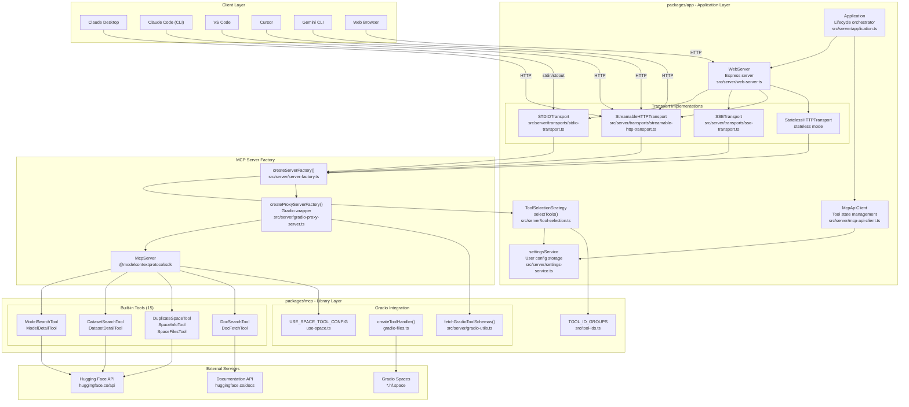
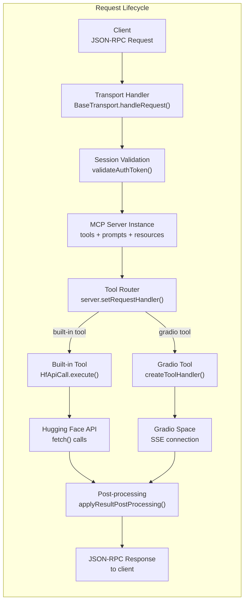
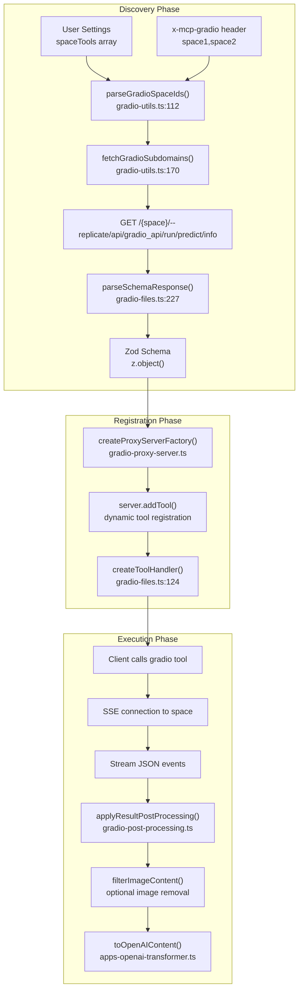

<!-- source: DeepWiki mcp.deepwiki.com · repo huggingface/hf-mcp-server · page 1 Overview · fetched 2026-10-26 -->

# Overview

<details>
<summary>Relevant source files</summary>

The following files were used as context for generating this wiki page:

- [.dockerignore](.dockerignore)
- [Dockerfile](Dockerfile)
- [README.md](README.md)
- [package.json](package.json)
- [packages/app/package.json](packages/app/package.json)
- [packages/app/vite.config.ts](packages/app/vite.config.ts)
- [packages/mcp/package.json](packages/mcp/package.json)
- [packages/mcp/src/duplicate-space.ts](packages/mcp/src/duplicate-space.ts)
- [packages/mcp/src/error-messages.ts](packages/mcp/src/error-messages.ts)
- [packages/mcp/src/index.ts](packages/mcp/src/index.ts)
- [packages/mcp/src/tool-ids.ts](packages/mcp/src/tool-ids.ts)
- [pnpm-lock.yaml](pnpm-lock.yaml)
- [start.sh](start.sh)

</details>


The Hugging Face MCP Server is an implementation of the Model Context Protocol (MCP) that enables AI assistants and development tools to interact with the Hugging Face ecosystem. It provides 15 built-in tools for searching and managing models, datasets, spaces, and documentation, plus dynamic integration with thousands of Gradio applications hosted on Hugging Face Spaces.

This page describes the system architecture, core components, and deployment options. For detailed installation instructions, see [Getting Started](#2). For information about the available tools and their usage, see [Tools and Prompts](#4). For transport layer details, see [Transport Layer](#7).

## System Purpose and Scope

The server acts as a bridge between MCP-compatible clients (Claude Desktop, VS Code, Cursor, Gemini CLI, etc.) and Hugging Face services. It exposes functionality through three main interfaces:

- **Tools**: Executable functions for searching, retrieving details, managing spaces, and invoking Gradio apps
- **Prompts**: Pre-configured prompt templates for common tasks (model/dataset summaries, paper analysis)
- **Resources**: Static resources like HTML widgets for embedding Gradio interfaces

The system supports four transport protocols (`STDIO`, `SSE`, `StreamableHTTP`, `StatelessHTTPJson`) and can run as a CLI tool, web service, or Docker container.

Sources: [README.md:1-13](), [packages/app/package.json:1-11](), [packages/mcp/src/index.ts:1-30]()

## System Architecture



This diagram shows how client connections flow through the transport layer to the MCP server factory, which uses `ToolSelectionStrategy` to determine available tools based on configuration, then creates an `McpServer` instance with registered tools from the `packages/mcp` library.

Sources: [packages/app/src/server/application.ts](), [packages/app/src/server/server-factory.ts](), [packages/app/src/server/tool-selection.ts](), [packages/mcp/src/tool-ids.ts:1-105]()

## Monorepo Structure

The project is organized as a monorepo with two main packages:

| Package | Path | Purpose | Key Exports |
|---------|------|---------|-------------|
| `@llmindset/hf-mcp` | `packages/mcp/` | MCP tool implementations and utilities | Tool classes, schemas, handlers, `TOOL_ID_GROUPS` |
| `@llmindset/hf-mcp-server` | `packages/app/` | Application server and web interface | Executables: `hf-mcp-server`, `hf-mcp-server-http`, `hf-mcp-server-http-json` |

The `packages/mcp` library is a pure implementation layer that exports tool configurations and handler functions. The `packages/app` layer consumes this library and adds:

- Transport protocol implementations
- Web server and dashboard UI
- Server factory pattern with tool selection
- Session management and metrics
- Docker containerization

Sources: [package.json:1-38](), [packages/mcp/package.json:1-54](), [packages/app/package.json:1-111]()

## Core Components and Data Flow



Each request follows this path:

1. **Transport Layer** receives and validates the JSON-RPC request
2. **Session Validation** checks authentication token and session state (for stateful transports)
3. **MCP Server** routes to appropriate tool handler based on method name
4. **Tool Execution** invokes either a built-in tool (direct HF API call) or Gradio tool (SSE streaming)
5. **Post-processing** applies transformations (image filtering, OpenAI format conversion)
6. **Response** returns formatted result to client

Sources: [packages/app/src/server/transports/base-transport.ts](), [packages/app/src/server/server-factory.ts](), [packages/mcp/src/hf-api-call.ts]()

## Built-in Tools Catalog

The system provides 15 built-in tools organized by category in `TOOL_ID_GROUPS`:

```mermaid
graph TB
    subgraph "Tool Categories - TOOL_ID_GROUPS"
        SearchGroup["search bouquet<br/>5 tools"]
        SpacesGroup["spaces bouquet<br/>5 tools"]
        DetailGroup["detail group<br/>3 tools"]
        DocsGroup["docs bouquet<br/>2 tools"]
        APIGroup["hf_api bouquet<br/>7 tools"]
    end
    
    subgraph "Search Tools"
        ModelSearch["model_search<br/>MODEL_SEARCH_TOOL_CONFIG"]
        DatasetSearch["dataset_search<br/>DATASET_SEARCH_TOOL_CONFIG"]
        PaperSearch["paper_search<br/>PAPER_SEARCH_TOOL_CONFIG"]
        SpaceSearch["space_semantic_search<br/>SEMANTIC_SEARCH_TOOL_CONFIG"]
        DocSearch["hf_doc_search<br/>DOCS_SEMANTIC_SEARCH_CONFIG"]
    end
    
    subgraph "Space Management"
        DuplicateSpace["duplicate_space<br/>DUPLICATE_SPACE_TOOL_CONFIG"]
        SpaceInfo["space_info<br/>SPACE_INFO_TOOL_CONFIG"]
        SpaceFiles["space_files<br/>SPACE_FILES_TOOL_CONFIG"]
        UseSpace["use_space<br/>USE_SPACE_TOOL_CONFIG"]
    end
    
    subgraph "Detail Retrieval"
        ModelDetail["model_detail<br/>MODEL_DETAIL_TOOL_CONFIG"]
        DatasetDetail["dataset_detail<br/>DATASET_DETAIL_TOOL_CONFIG"]
        HubInspect["hub_repo_details<br/>HUB_INSPECT_TOOL_CONFIG"]
    end
    
    subgraph "Documentation"
        DocFetch["hf_doc_fetch<br/>DOC_FETCH_CONFIG"]
    end
    
    SearchGroup --> ModelSearch
    SearchGroup --> DatasetSearch
    SearchGroup --> PaperSearch
    SearchGroup --> SpaceSearch
    SearchGroup --> DocSearch
    
    SpacesGroup --> SpaceSearch
    SpacesGroup --> DuplicateSpace
    SpacesGroup --> SpaceInfo
    SpacesGroup --> SpaceFiles
    SpacesGroup --> UseSpace
    
    DetailGroup --> ModelDetail
    DetailGroup --> DatasetDetail
    DetailGroup --> HubInspect
    
    DocsGroup --> DocSearch
    DocsGroup --> DocFetch
    
    APIGroup --> ModelSearch
    APIGroup --> DatasetSearch
    APIGroup --> PaperSearch
    APIGroup --> SpaceSearch
    APIGroup --> DocSearch
    APIGroup --> HubInspect
```



Each tool is exported from `packages/mcp` with a configuration object (schema, description, annotations) and an implementation class. The `TOOL_ID_GROUPS` constant in [packages/mcp/src/tool-ids.ts:68-96]() defines bouquet presets that group related tools.

Sources: [packages/mcp/src/tool-ids.ts:1-105](), [packages/mcp/src/index.ts:1-30]()

## Dynamic Gradio Tool Integration

Beyond the 15 built-in tools, the system dynamically discovers and registers Gradio application endpoints as MCP tools:



The `createProxyServerFactory()` function wraps the base server factory to inject Gradio tool discovery before server initialization. Each discovered endpoint becomes a tool with a generated schema based on the Gradio API contract.

Sources: [packages/app/src/server/gradio-proxy-server.ts](), [packages/app/src/server/gradio-utils.ts:112-200](), [packages/mcp/src/gradio-files.ts:124-240]()

## Transport Protocol Support

The server implements four transport protocols as defined by the MCP specification:

| Transport | Entry Point | Use Case | Session Model | Endpoints |
|-----------|-------------|----------|---------------|-----------|
| `STDIO` | `dist/server/stdio.js` | CLI integration (Claude Code, Gemini) | Single long-lived session | stdin/stdout pipes |
| `SSE` | `dist/server/sse.js` | Legacy web clients | Stateful (session map) | `GET /sse`, `POST /message` |
| `StreamableHTTP` | `dist/server/streamableHttp.js` | Modern web clients (VS Code, Cursor) | Stateful (session map) | `POST/GET/DELETE /mcp` |
| `StatelessHTTPJson` | `dist/server/streamableHttp.js --json` | Analytics/stateless mode | Stateless (per-request server) | `POST /mcp` |

All HTTP transports run on port 3000 by default and include a web dashboard at `/`. The `--json` flag enables stateless mode with optional analytics tracking.

**Session Management** (for stateful transports):

```typescript
// Default environment variables
MCP_CLIENT_HEARTBEAT_INTERVAL=30000    // Check SSE connection health
MCP_CLIENT_CONNECTION_CHECK=90000      // Check for stale sessions
MCP_CLIENT_CONNECTION_TIMEOUT=300000   // Remove inactive sessions
MCP_PING_ENABLED=true                  // Enable ping keep-alive
MCP_PING_INTERVAL=30000                // Ping frequency
```

Sources: [packages/app/package.json:6-11](), [README.md:226-235](), [start.sh:1-58]()

## Deployment Options

The server supports three deployment modes:

### 1. NPX (No Installation)

```bash
npx @llmindset/hf-mcp-server       # STDIO mode
npx @llmindset/hf-mcp-server-http  # HTTP mode
npx @llmindset/hf-mcp-server-json  # JSON mode
```

Sources: [README.md:144-146]()

### 2. Docker Container

```bash
docker pull ghcr.io/evalstate/hf-mcp-server:latest
docker run --rm -p 3000:3000 ghcr.io/evalstate/hf-mcp-server:latest
```

The `Dockerfile` builds both packages and defaults to `streamableHttpJson` transport. The `start.sh` script handles transport selection via the `TRANSPORT` environment variable.

Sources: [Dockerfile:1-67](), [start.sh:1-58]()

### 3. Development Mode

```bash
pnpm install
pnpm build
pnpm dev              # Concurrent watch mode
pnpm dev:stdio        # STDIO transport
pnpm dev:json         # JSON transport
```

The `concurrently` tool runs TypeScript compilation (`tsc --watch`), Vite bundling (`vite build --watch`), and server restart (`nodemon`) simultaneously.

Sources: [package.json:7-12](), [packages/app/package.json:40-46]()

## Configuration System

The server behavior is controlled through three mechanisms:

1. **Environment Variables**: Authentication, timeouts, API endpoints
   - `DEFAULT_HF_TOKEN`: Default token for unauthenticated requests (development only)
   - `HF_API_TIMEOUT`: API request timeout (default: 12500ms)
   - `USER_CONFIG_API`: External settings API URL
   - `SEARCH_ENABLES_FETCH`: Auto-enable `hf_doc_fetch` when `hf_doc_search` is enabled

2. **HTTP Headers**: Per-request tool selection
   - `x-mcp-bouquet`: Override tool selection with preset (`hf_api`, `search`, `spaces`, `docs`, `all`)
   - `x-mcp-mix`: Additive tool selection combined with user settings
   - `x-mcp-gradio`: Comma-separated Gradio space IDs to include
   - `Authorization: Bearer <token>`: User authentication

3. **User Settings**: Persistent configuration via web dashboard or external API
   - `builtInTools`: Array of enabled tool IDs
   - `spaceTools`: Array of Gradio space configurations
   - Storage: In-memory `settingsService` or external API via `USER_CONFIG_API`

The precedence order is: `x-mcp-bouquet` (override) > `x-mcp-mix` (additive) > user settings > fallback (all tools).

Sources: [README.md:238-248](), [packages/app/src/server/tool-selection.ts](), [packages/app/src/server/settings-service.ts]()

## Key Design Patterns

**Server Factory Pattern**: The `createServerFactory()` function returns a factory that creates per-session `McpServer` instances with selected tools. This enables different clients to have different tool sets based on their configuration.

**Proxy Factory Pattern**: The `createProxyServerFactory()` wraps the base factory to inject Gradio tool discovery, maintaining separation between built-in and dynamic tools.

**Tool Configuration Pattern**: Each tool exports a `*_TOOL_CONFIG` constant with `name`, `schema` (Zod), `description`, and `annotations`, ensuring consistent registration.

**Base Class Pattern**: `HfApiCall<TParams, TResult>` provides shared functionality for API requests, error handling, and token management across all built-in tools.

Sources: [packages/app/src/server/server-factory.ts](), [packages/app/src/server/gradio-proxy-server.ts](), [packages/mcp/src/hf-api-call.ts](), [packages/mcp/src/duplicate-space.ts:42-64]()

---

