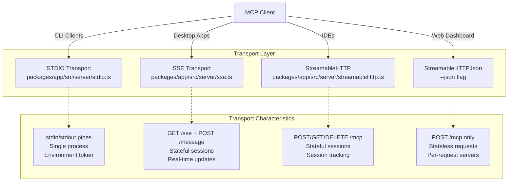
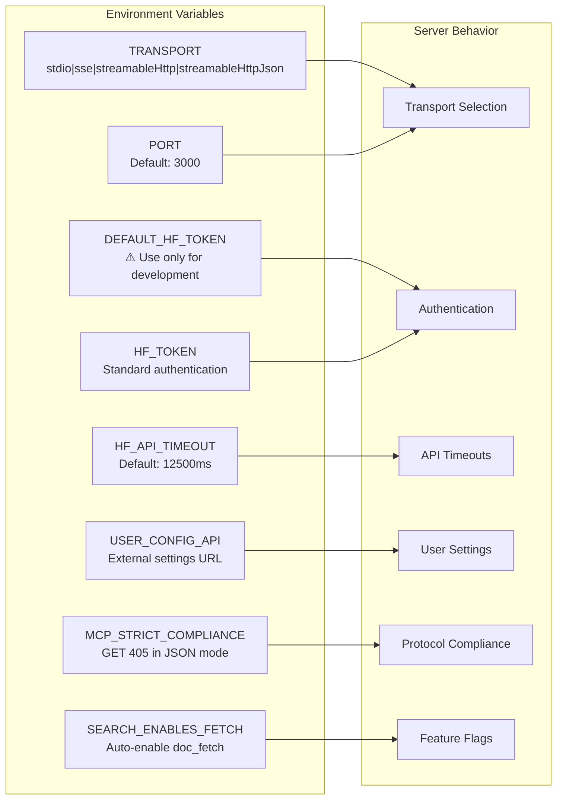
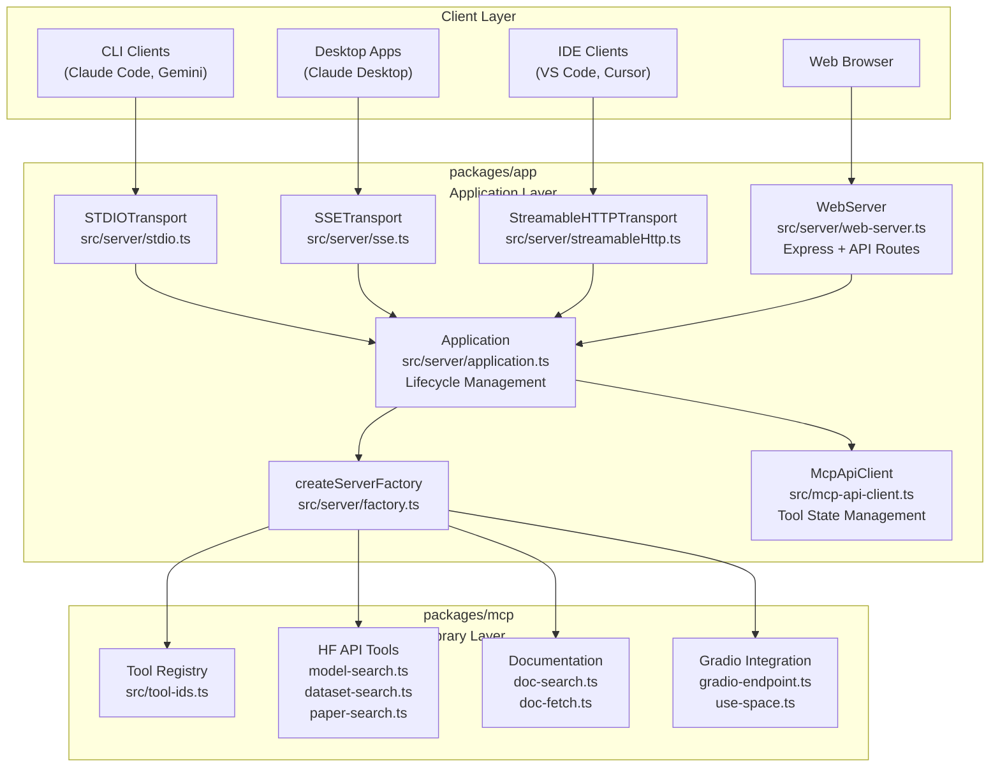

<!-- source: DeepWiki mcp.deepwiki.com · repo huggingface/hf-mcp-server · page 2 Getting Started · fetched 2026-10-26 -->

# Getting Started

<details>
<summary>Relevant source files</summary>

The following files were used as context for generating this wiki page:

- [.dockerignore](.dockerignore)
- [Dockerfile](Dockerfile)
- [README.md](README.md)
- [package.json](package.json)
- [packages/app/package.json](packages/app/package.json)
- [packages/app/vite.config.ts](packages/app/vite.config.ts)
- [packages/mcp/package.json](packages/mcp/package.json)
- [packages/mcp/src/duplicate-space.ts](packages/mcp/src/duplicate-space.ts)
- [packages/mcp/src/error-messages.ts](packages/mcp/src/error-messages.ts)
- [pnpm-lock.yaml](pnpm-lock.yaml)
- [start.sh](start.sh)

</details>


This page provides an overview of how to install, configure, and connect clients to the Hugging Face MCP Server. For detailed installation instructions, see [Installation and Setup](#2.1). For step-by-step client connection guides, see [Client Integration](#2.2).

The Hugging Face MCP Server enables AI clients (such as Claude Desktop, VS Code, Cursor, and Gemini CLI) to interact with the Hugging Face ecosystem through the Model Context Protocol (MCP). The server exposes tools for searching models/datasets/papers, managing Spaces, accessing documentation, and invoking Gradio applications.

---

## Prerequisites

Before installing the server, ensure you have:

| Requirement | Purpose | Notes |
|------------|---------|-------|
| **Node.js** (≥18) | Runtime environment | Required for all installation methods |
| **Hugging Face Token** | API authentication | Obtain from https://huggingface.co/settings/tokens |
| **pnpm** (10.15.1) | Package manager | Only for building from source; managed via Corepack |
| **Docker** (optional) | Containerized deployment | Alternative to Node.js installation |

**Sources:** [README.md:176-179](), [package.json:6]()

---

## Server Transport Modes

The server supports four transport mechanisms for client communication. Understanding these modes is essential for proper configuration:



**Transport Mode Comparison**

| Mode | Entry Point | Use Case | Session State | Authentication |
|------|------------|----------|---------------|----------------|
| **STDIO** | `stdio.js` | CLI tools (Claude Code, Gemini) | Single long-lived session | `HF_TOKEN` environment variable |
| **SSE** | `sse.js` | Desktop applications | Stateful with heartbeat | `Authorization` header |
| **StreamableHTTP** | `streamableHttp.js` | IDEs (VS Code, Cursor) | Stateful with tracking | `Authorization` header |
| **StreamableHTTPJson** | `streamableHttp.js --json` | Web clients, Analytics | Stateless or optional analytics | `Authorization` header |

**Sources:** [packages/app/package.json:8-10](), [README.md:125-135](), [start.sh:33-58]()

---

## Installation Methods

### Quick Start with npx

The fastest way to run the server without installation:

```bash
# STDIO mode (for CLI clients)
npx @llmindset/hf-mcp-server

# HTTP mode (for web-based clients)
npx @llmindset/hf-mcp-server-http

# JSON mode (stateless)
npx @llmindset/hf-mcp-server-json
```

Each command starts the server in a different transport mode. HTTP and JSON modes also launch a web dashboard on `http://localhost:3000/`.

**Sources:** [README.md:141-147](), [packages/app/package.json:8-10]()

### Docker Deployment

Pull and run the pre-built container:

```bash
# Pull image
docker pull ghcr.io/evalstate/hf-mcp-server:latest

# Run with default settings (StreamableHTTPJson mode)
docker run --rm -p 3000:3000 \
  -e DEFAULT_HF_TOKEN=hf_xxx \
  ghcr.io/evalstate/hf-mcp-server:latest

# Run in STDIO mode
docker run -i --rm \
  -e TRANSPORT=stdio \
  -e DEFAULT_HF_TOKEN=hf_xxx \
  ghcr.io/evalstate/hf-mcp-server:latest
```

The Docker image defaults to `streamableHttpJson` mode and exposes port 3000 for the web dashboard.

**Sources:** [README.md:149-157](), [Dockerfile:1-66](), [start.sh:3-14]()

### Building from Source

For development or customization:

```bash
# Clone repository
git clone https://github.com/huggingface/hf-mcp-server
cd hf-mcp-server

# Install dependencies (uses pnpm via Corepack)
pnpm install

# Build all packages
pnpm build

# Start server
pnpm start
```

The monorepo contains two packages:
- **`packages/mcp`**: Core MCP tool implementations and API integrations
- **`packages/app`**: Server application, transports, and web UI

**Sources:** [README.md:176-195](), [package.json:1-38](), [README.md:116-122]()

---

## Configuration via Environment Variables

The server behavior is controlled through environment variables:



**Key Environment Variables**

| Variable | Default | Description |
|----------|---------|-------------|
| `TRANSPORT` | `streamableHttpJson` | Transport type (stdio, sse, streamableHttp, streamableHttpJson) |
| `PORT` | `3000` | HTTP server port |
| `HF_TOKEN` | - | Standard Hugging Face authentication (used in Authorization header) |
| `DEFAULT_HF_TOKEN` | - | ⚠️ Fallback token when no header provided (dev/test only) |
| `HF_API_TIMEOUT` | `12500` | API request timeout in milliseconds |
| `USER_CONFIG_API` | - | External API for user settings (default: internal storage) |
| `MCP_STRICT_COMPLIANCE` | `false` | Reject GET requests with 405 in JSON mode |
| `SEARCH_ENABLES_FETCH` | `false` | Auto-enable `hf_doc_fetch` when `hf_doc_search` is enabled |

For stateful transports (SSE, StreamableHTTP), additional session management variables are available (see [Transport Layer](#7) for details).

**Sources:** [README.md:237-248](), [start.sh:3-27]()

---

## Authentication Flow

```mermaid
sequenceDiagram
    participant Client
    participant Transport
    participant ServerFactory["createServerFactory<br/>packages/app/src/server/factory.ts"]
    participant McpServer["McpServer<br/>@mcp-ui/server"]
    participant HfApi["Hugging Face API"]
    
    rect rgb(245, 245, 245)
        Note over Client,McpServer: Connection Phase
        Client->>Transport: Connect with Auth header
        Transport->>Transport: validateAuthAndTrackMetrics()
        alt Has Authorization header
            Transport->>ServerFactory: Create with token from header
        else No Authorization header
            Transport->>ServerFactory: Use DEFAULT_HF_TOKEN if set
        end
        ServerFactory->>McpServer: Instantiate with credentials
        McpServer-->>Client: Connection established
    end
    
    rect rgb(245, 245, 245)
        Note over Client,HfApi: Tool Invocation Phase
        Client->>McpServer: Call tool (e.g., model_search)
        McpServer->>HfApi: Request with token
        HfApi-->>McpServer: Response
        McpServer-->>Client: Tool result
    end
```

**Authentication Methods by Transport:**

- **STDIO**: Uses `HF_TOKEN` or `DEFAULT_HF_TOKEN` from environment variables
- **SSE/HTTP/JSON**: Uses `Authorization: Bearer <token>` header from client request
- **Docker**: Can set `DEFAULT_HF_TOKEN` for testing (not recommended for production)

**Sources:** [start.sh:12-27](), [README.md:241-242]()

---

## Client Connection Overview

The server is designed for integration with multiple MCP-compatible clients. Each client type uses a different transport:

**Supported Client Integrations**

| Client | Transport | Configuration Method |
|--------|-----------|---------------------|
| **Claude Desktop** | SSE/HTTP | Web connector gallery at claude.ai/settings/connectors |
| **Claude Code** | HTTP | CLI command: `claude mcp add` |
| **Gemini CLI** | HTTP | CLI command: `gemini mcp add` |
| **VS Code** | HTTP | Gallery at code.visualstudio.com/mcp or `mcp.json` |
| **Cursor** | HTTP | One-click install link or manual `mcp.json` |
| **Web Dashboard** | HTTPJson | Direct access at `http://localhost:3000/` |

For detailed setup instructions for each client, see [Client Integration](#2.2).

**Sources:** [README.md:11-108]()

---

## Server Architecture Overview



The system is organized as a monorepo with two main packages:
- **packages/app**: Contains the server application, transport implementations, and web UI
- **packages/mcp**: Contains the tool implementations and Hugging Face API integrations

**Sources:** [README.md:116-122](), [package.json:1-38](), [packages/app/package.json:1-111](), [packages/mcp/package.json:1-53]()

---

## Web Dashboard

When running in HTTP or JSON mode, the server provides a web interface at `http://localhost:3000/`:

**Dashboard Features:**
- **Settings Copy Page**: Pre-configured connection snippets for different clients
- **Tool Configuration**: Enable/disable built-in tools using bouquets or custom selections
- **Gradio Endpoints**: Add/remove Gradio Space tools dynamically
- **Monitoring**: Real-time metrics for connections, tool calls, and sessions
- **Transport Stats**: Connection health, session tracking, and performance metrics

The web interface is built with React and Vite, using Server-Sent Events to display real-time updates.

**Sources:** [README.md:156-157](), [packages/app/vite.config.ts:1-47]()

---

## Development Mode

For contributors and developers extending the server:

```bash
# Start both packages in watch mode with hot module reload
pnpm dev

# Development commands by transport
pnpm dev:stdio        # STDIO transport
pnpm dev:sse          # SSE transport  
pnpm dev:json         # JSON mode
pnpm dev:watch        # Watch mode with nodemon

# Build commands
pnpm build            # Build all packages
pnpm clean            # Clean build artifacts
pnpm buildrun         # Clean, build, lint, test, and start
```

The development workflow uses:
- **TypeScript compiler** in watch mode for server code (`tsc --watch`)
- **Vite** in watch mode for web UI (`vite build --watch`)
- **Concurrently** to run multiple watch processes
- **Nodemon** for automatic server restarts

**Sources:** [package.json:7-24](), [packages/app/package.json:33-56](), [README.md:173-196]()

---

## Next Steps

After understanding the basic installation and configuration options:

1. **[Installation and Setup](#2.1)**: Follow detailed instructions for your preferred installation method
2. **[Client Integration](#2.2)**: Connect your specific client (Claude, VS Code, etc.)
3. **[Tool Selection System](#5)**: Learn how to configure which tools are available
4. **[Architecture](#3)**: Understand the system components and their interactions
5. **[Development Guide](#9)**: Contribute to or extend the server

For production deployments, review the [Transport Layer](#7) documentation to understand session management and stateful vs. stateless modes.

**Sources:** [README.md:1-248]()

---

