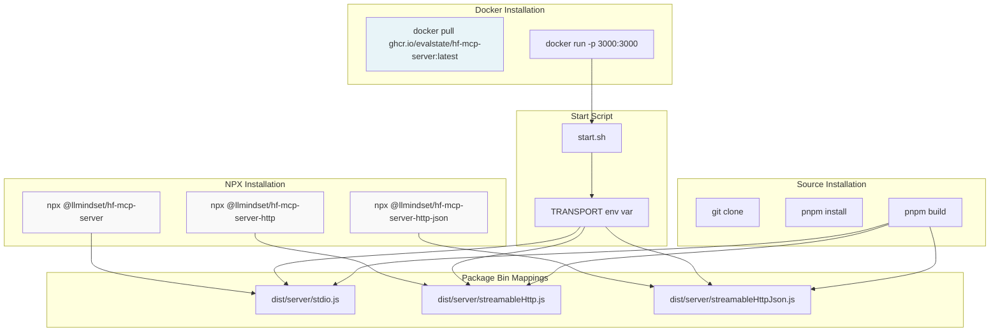
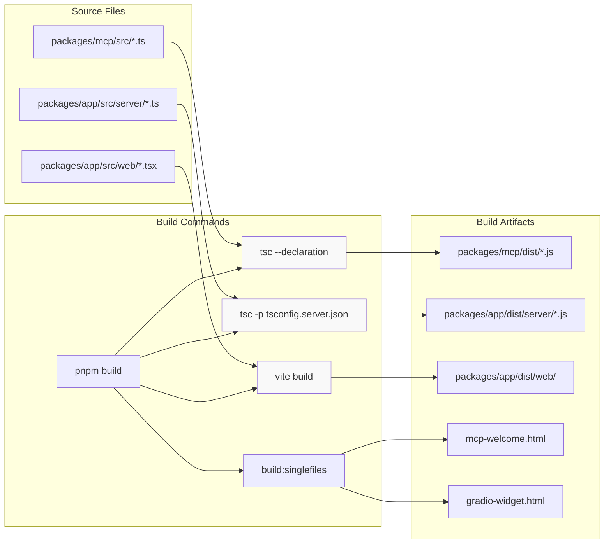
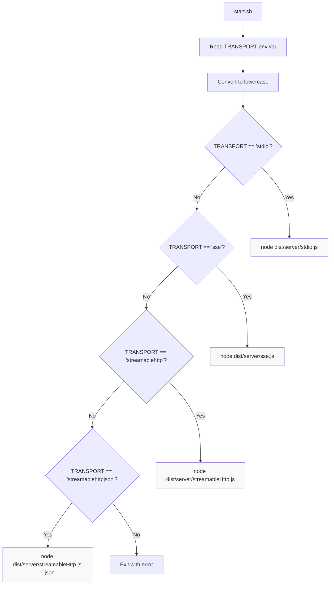

<!-- source: DeepWiki mcp.deepwiki.com · repo huggingface/hf-mcp-server · page 2.1 Installation and Setup · fetched 2026-10-26 -->

# Installation and Setup

<details>
<summary>Relevant source files</summary>

The following files were used as context for generating this wiki page:

- [.dockerignore](.dockerignore)
- [Dockerfile](Dockerfile)
- [README.md](README.md)
- [package.json](package.json)
- [packages/app/package.json](packages/app/package.json)
- [packages/app/vite.config.ts](packages/app/vite.config.ts)
- [packages/mcp/package.json](packages/mcp/package.json)
- [packages/mcp/src/duplicate-space.ts](packages/mcp/src/duplicate-space.ts)
- [packages/mcp/src/error-messages.ts](packages/mcp/src/error-messages.ts)
- [pnpm-lock.yaml](pnpm-lock.yaml)
- [start.sh](start.sh)

</details>


This page provides detailed instructions for installing dependencies, building the project, and running the HF MCP Server in different operational modes. The installation process supports multiple deployment strategies including quick execution via `npx`, containerized deployment with Docker, and development from source.

For instructions on connecting specific MCP clients (Claude, VS Code, Cursor, Gemini) to a running server instance, see [Client Integration](#2.2).

---

## Prerequisites

The HF MCP Server requires Node.js 18 or higher and uses `pnpm` as its package manager.

| Requirement | Minimum Version | Notes |
|-------------|----------------|-------|
| Node.js | 18.0.0 | Specified in [packages/mcp/package.json:458]() |
| pnpm | 10.15.1 | Managed via Corepack in [package.json:6]() |

The project uses Corepack to ensure consistent `pnpm` versions across all environments. Corepack is included with Node.js 16.9+ and can be enabled with:

```bash
corepack enable pnpm
```

**Sources:** [package.json:6](), [packages/mcp/package.json:458](), [Dockerfile:4]()

---

## Installation Methods

### Diagram: Installation Entry Points and Executables



**Sources:** [packages/app/package.json:7-11](), [start.sh:4-6](), [README.md:144-147]()

---

## Quick Installation with NPX

The fastest method to run the server is using `npx`, which downloads and executes the package without manual installation:

```bash
# STDIO mode (for CLI clients like Claude Code)
npx @llmindset/hf-mcp-server

# StreamableHTTP mode (stateful, for web-based clients)
npx @llmindset/hf-mcp-server-http

# StreamableHTTPJson mode (stateless, recommended for production)
npx @llmindset/hf-mcp-server-http-json
```

These commands map to the `bin` entries defined in [packages/app/package.json:7-11]():

| NPX Command | Binary Path | Transport Mode |
|-------------|-------------|----------------|
| `@llmindset/hf-mcp-server` | `dist/server/stdio.js` | STDIO |
| `@llmindset/hf-mcp-server-http` | `dist/server/streamableHttp.js` | StreamableHTTP |
| `@llmindset/hf-mcp-server-http-json` | `dist/server/streamableHttpJson.js` | StreamableHTTPJson |

The HTTP-based transports start a web server on port 3000 by default, serving the management dashboard at `http://localhost:3000/` and the MCP endpoint at `http://localhost:3000/mcp`.

**Sources:** [packages/app/package.json:7-11](), [README.md:144-147]()

---

## Docker Installation

The Docker image provides a self-contained deployment with all dependencies included.

### Pull the Image

```bash
docker pull ghcr.io/evalstate/hf-mcp-server:latest
```

### Run with Default Settings

```bash
docker run --rm -p 3000:3000 ghcr.io/evalstate/hf-mcp-server:latest
```

This starts the server in **StreamableHTTPJson** mode (the default for Docker deployments) as specified in [Dockerfile:59]().

### Run with Custom Transport

```bash
# STDIO mode
docker run -i --rm -e TRANSPORT=stdio -p 3000:3000 ghcr.io/evalstate/hf-mcp-server:latest

# SSE mode
docker run --rm -e TRANSPORT=sse -p 3000:3000 ghcr.io/evalstate/hf-mcp-server:latest

# StreamableHTTP mode
docker run --rm -e TRANSPORT=streamableHttp -p 3000:3000 ghcr.io/evalstate/hf-mcp-server:latest
```

The `TRANSPORT` environment variable is processed by [start.sh:4-7]() and converted to lowercase for case-insensitive matching.

### Run with Authentication Token

```bash
docker run --rm -p 3000:3000 -e DEFAULT_HF_TOKEN=hf_xxx ghcr.io/evalstate/hf-mcp-server:latest
```

⚠️ **Security Warning:** The `DEFAULT_HF_TOKEN` environment variable should only be used in development/test environments or for local STDIO deployments. For HTTP transports, authentication should be provided via the `Authorization: Bearer` header on a per-request basis.

**Sources:** [Dockerfile:1-67](), [start.sh:1-58](), [README.md:150-154]()

---

## Source Installation

Installing from source provides access to development scripts and allows customization.

### Clone and Install

```bash
# Clone the repository
git clone https://github.com/huggingface/hf-mcp-server.git
cd hf-mcp-server

# Install dependencies
pnpm install
```

The `pnpm install` command respects the workspace configuration defined in [pnpm-workspace.yaml]() and installs dependencies for both packages:
- `packages/mcp` - The core MCP library
- `packages/app` - The application layer with transports and web UI

### Build the Project

```bash
pnpm build
```

This executes the `build` script from [package.json:21](), which runs `pnpm -r build` to build all workspace packages recursively.

**Sources:** [package.json:2-38](), [README.md:177-183]()

---

## Build System

### Diagram: Build Process and Artifacts



### Build Scripts

The monorepo uses a hierarchical build system with scripts at both root and package levels:

| Script | Location | Command | Purpose |
|--------|----------|---------|---------|
| `build` | [package.json:21]() | `pnpm -r build` | Build all packages recursively |
| `build:server` | [packages/app/package.json:35]() | `tsc -p tsconfig.server.json` | Compile server TypeScript |
| `build:web` | [packages/app/package.json:36]() | `vite build` | Bundle web UI with Vite |
| `build:singlefiles` | [packages/app/package.json:37]() | Build standalone HTML | Create self-contained HTML files |
| `build` | [packages/mcp/package.json:26]() | `tsc --declaration` | Compile library with type definitions |

### Build Order and Dependencies

The build process follows this sequence:

1. **Library Build (`packages/mcp`)**: Compiles TypeScript sources to JavaScript with type definitions, outputs to `packages/mcp/dist/`
2. **Server Build**: Compiles server entry points (`stdio.js`, `streamableHttp.js`, `sse.js`) using [packages/app/tsconfig.server.json]()
3. **Web Build**: Bundles React dashboard using Vite configuration from [packages/app/vite.config.ts:8-47]()
4. **Single-File Builds**: Creates standalone HTML files (`mcp-welcome.html`, `gradio-widget.html`) using `vite-plugin-singlefile` from [packages/app/vite.config.ts:19]()

The Vite configuration uses conditional logic based on `VITE_BUILD_TARGET` environment variable to determine which HTML file to build as a single-file bundle.

### Clean Build

```bash
pnpm clean  # Remove all dist/ directories
pnpm build  # Full rebuild
```

The `clean` script is defined in [package.json:22]() and [packages/app/package.json:55]().

**Sources:** [package.json:21-24](), [packages/app/package.json:34-39](), [packages/app/vite.config.ts:1-48](), [packages/mcp/package.json:26]()

---

## Running the Server

### Transport Modes

The server supports four transport implementations, each optimized for different use cases:

| Transport | Entry Point | Use Case | Statefulness |
|-----------|-------------|----------|--------------|
| **STDIO** | [packages/app/package.json:8]() | CLI clients (Claude Code, Gemini CLI) | Single session |
| **SSE** | [packages/app/package.json:50]() | Legacy real-time updates | Stateful |
| **StreamableHTTP** | [packages/app/package.json:9]() | Web clients with session persistence | Stateful |
| **StreamableHTTPJson** | [packages/app/package.json:10]() | Stateless production deployments | Stateless |

### Development Scripts

```bash
# Start in StreamableHTTP mode with dashboard
pnpm dev

# Start in STDIO mode
pnpm dev:stdio

# Start in SSE mode
pnpm dev:sse

# Start in StreamableHTTPJson mode
pnpm dev:json

# Watch mode with auto-rebuild
pnpm dev:watch
```

These scripts are defined in [package.json:8-12]() and use `concurrently` to run both library and application builds simultaneously.

### Production Scripts

```bash
# Start production server (StreamableHTTP)
pnpm start

# Start in StreamableHTTPJson mode
pnpm start:json

# Start in STDIO mode
pnpm start:stdio

# Start in SSE mode
pnpm start:sse
```

Production scripts set `NODE_ENV=production` as seen in [packages/app/package.json:47-50]().

### Diagram: Transport Selection Flow



The transport selection logic is implemented in [start.sh:34-58](), which converts the `TRANSPORT` environment variable to lowercase and routes to the appropriate server entry point.

**Sources:** [start.sh:34-58](), [package.json:8-14](), [packages/app/package.json:40-50]()

---

## Environment Variables

### Core Configuration

| Variable | Default | Description | Reference |
|----------|---------|-------------|-----------|
| `TRANSPORT` | `streamableHttpJson` (Docker) | Transport type: `stdio`, `sse`, `streamableHttp`, `streamableHttpJson` | [start.sh:4](), [Dockerfile:59]() |
| `PORT` | `3000` | HTTP server port for web dashboard and MCP endpoints | [start.sh:8]() |
| `NODE_ENV` | `production` | Node environment mode | [Dockerfile:58]() |

### Authentication

| Variable | Purpose | Security Notes | Reference |
|----------|---------|----------------|-----------|
| `DEFAULT_HF_TOKEN` | Fallback token when no Authorization header provided | ⚠️ Use only in dev/test or local STDIO | [README.md:241]() |
| `HF_TOKEN` | Used as `DEFAULT_HF_TOKEN` in STDIO mode if not set | Auto-converted for STDIO transport | [start.sh:13-15]() |

The token fallback logic in [start.sh:13-15]() specifically handles STDIO mode by setting `DEFAULT_HF_TOKEN` from `HF_TOKEN` if the latter is present.

### API Configuration

| Variable | Default | Description | Reference |
|----------|---------|-------------|-----------|
| `HF_API_TIMEOUT` | `12500` | Hugging Face API timeout in milliseconds | [README.md:243]() |
| `USER_CONFIG_API` | Local frontend | URL for external user settings storage | [README.md:244]() |

### Tool Behavior

| Variable | Default | Description | Reference |
|----------|---------|-------------|-----------|
| `SEARCH_ENABLES_FETCH` | `false` | Auto-enable `hf_doc_fetch` when `hf_doc_search` is enabled | [README.md:247]() |
| `AUTHENTICATE_TOOL` | `false` | Include OAuth challenge tool | [README.md:246]() |
| `MCP_STRICT_COMPLIANCE` | `false` | Return 405 for GET requests in JSON mode (vs. welcome page) | [README.md:245]() |

### Session Management (Stateful Transports)

These variables apply to SSE and StreamableHTTP transports only:

| Variable | Default | Description | Reference |
|----------|---------|-------------|-----------|
| `MCP_CLIENT_HEARTBEAT_INTERVAL` | `30000` | SSE connection health check interval (ms) | [README.md:230]() |
| `MCP_CLIENT_CONNECTION_CHECK` | `90000` | Stale session check interval (ms) | [README.md:231]() |
| `MCP_CLIENT_CONNECTION_TIMEOUT` | `300000` | Remove sessions inactive for this duration (ms) | [README.md:232]() |
| `MCP_PING_ENABLED` | `true` | Enable ping keep-alive for sessions | [README.md:233]() |
| `MCP_PING_INTERVAL` | `30000` | Interval between ping cycles (ms) | [README.md:234]() |

**Sources:** [README.md:237-247](), [start.sh:4-15](), [Dockerfile:58-60]()

---

## Verification

### HTTP Transports (SSE, StreamableHTTP, StreamableHTTPJson)

After starting an HTTP-based transport, verify the server is running:

1. **Access the Web Dashboard:**
   ```
   http://localhost:3000/
   ```
   This serves the management interface built from [packages/app/src/web/index.html]().

2. **Check the MCP Endpoint:**
   - StreamableHTTP/HTTPJson: `http://localhost:3000/mcp`
   - SSE: `http://localhost:3000/sse` (with message endpoint at `/message`)

3. **Test with curl:**
   ```bash
   # StreamableHTTPJson mode
   curl -X POST http://localhost:3000/mcp \
     -H "Content-Type: application/json" \
     -H "Authorization: Bearer YOUR_HF_TOKEN" \
     -d '{"jsonrpc":"2.0","id":1,"method":"tools/list"}'
   ```

The endpoint paths are documented in [README.md:217-222]().

### STDIO Transport

STDIO transport communicates via stdin/stdout and does not start an HTTP server. Verify by:

1. Piping JSON-RPC messages to stdin
2. Checking stdout for responses
3. Monitoring stderr for error messages

**Sources:** [README.md:134-157](), [README.md:217-222]()

---

## Docker Build from Source

To build the Docker image locally:

```bash
docker build -t hf-mcp-server .
```

The Dockerfile uses a multi-stage approach:

1. **Dependency Installation:** [Dockerfile:8-13]() copies package files and runs `pnpm install --frozen-lockfile`
2. **Source Copy:** [Dockerfile:16]() copies all source files
3. **Build Process:** [Dockerfile:24-26]() runs `pnpm run build` to compile all packages
4. **Single-File Build:** [Dockerfile:29-35]() rebuilds `mcp-welcome.html` as standalone (~252KB self-contained file)

The build process includes verification steps in [Dockerfile:37-47]() that list directory structures and file sizes to confirm successful compilation.

**Sources:** [Dockerfile:1-67](), [.dockerignore:1-18]()

---

## Troubleshooting

### Build Failures

If the build fails with TypeScript errors:

```bash
pnpm clean
pnpm install
pnpm build
```

### Port Already in Use

If port 3000 is occupied, specify a different port:

```bash
PORT=3001 pnpm dev
```

Or for Docker:

```bash
docker run --rm -p 3001:3000 -e PORT=3001 ghcr.io/evalstate/hf-mcp-server:latest
```

Note: The internal container port remains 3000, only the host mapping changes.

### Module Resolution Errors

If you encounter module resolution errors after pulling updates:

```bash
pnpm install --force
pnpm build
```

**Sources:** [packages/app/package.json:55](), [start.sh:8]()

---

