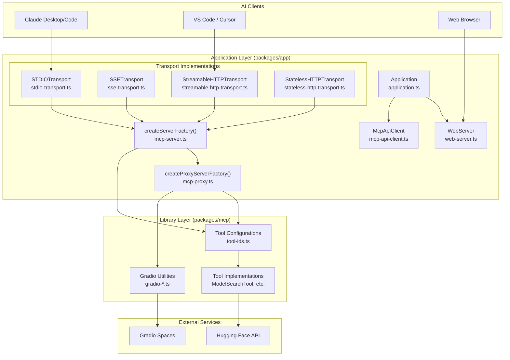
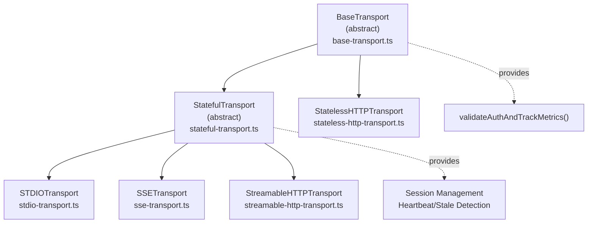
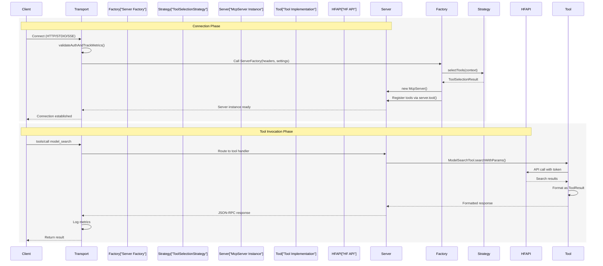
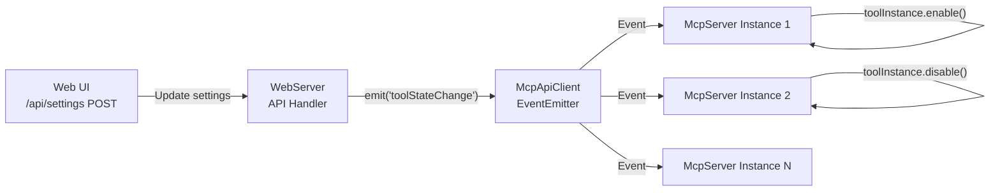

<!-- source: DeepWiki mcp.deepwiki.com · repo huggingface/hf-mcp-server · page 3 Architecture · fetched 2026-10-26 -->

# Architecture

<details>
<summary>Relevant source files</summary>

The following files were used as context for generating this wiki page:

- [package.json](package.json)
- [packages/app/package.json](packages/app/package.json)
- [packages/app/src/server/application.ts](packages/app/src/server/application.ts)
- [packages/app/src/server/mcp-server.ts](packages/app/src/server/mcp-server.ts)
- [packages/app/src/server/web-server.ts](packages/app/src/server/web-server.ts)
- [packages/app/src/shared/settings.ts](packages/app/src/shared/settings.ts)
- [packages/app/src/web/App.tsx](packages/app/src/web/App.tsx)
- [packages/mcp/package.json](packages/mcp/package.json)
- [pnpm-lock.yaml](pnpm-lock.yaml)

</details>


This document describes the overall system architecture of the Hugging Face MCP Server, including its package structure, core components, design patterns, and how they interact to serve MCP requests from AI clients.

For detailed information about specific subsystems, see:
- System component details: [System Components](#3.1)
- Package organization: [Package Structure](#3.2)
- MCP Server implementation: [MCP Server Core](#3.3)
- Transport layer design: [Transport Layer Architecture](#3.4)

## System Overview

The Hugging Face MCP Server is organized as a multi-layered application that bridges AI clients to the Hugging Face ecosystem through the Model Context Protocol. The system consists of three primary layers:

1. **Application Layer** (`packages/app`) - Manages server lifecycle, client connections, and web interface
2. **Library Layer** (`packages/mcp`) - Provides tool implementations and shared utilities
3. **External Services** - Hugging Face API, Gradio applications, and documentation services



**Sources:** [packages/app/src/server/application.ts:1-198](), [packages/app/src/server/web-server.ts:1-491](), [packages/app/src/server/mcp-server.ts:1-897](), [packages/app/package.json:1-112](), [packages/mcp/package.json:1-54]()

## Package Organization

The system is structured as a pnpm monorepo with workspace dependencies:

| Package | Path | Purpose | Main Exports |
|---------|------|---------|-------------|
| `@llmindset/hf-mcp-server` | `packages/app` | Application runtime, transports, web server | Binary executables, server implementations |
| `@llmindset/hf-mcp` | `packages/mcp` | Tool implementations, shared utilities | Tool classes, configuration objects |

**Dependency Flow:**
```
packages/app (application)
    ├─> packages/mcp (library)
    ├─> @modelcontextprotocol/sdk
    ├─> express (web server)
    └─> react (web UI)

packages/mcp (library)
    ├─> @modelcontextprotocol/sdk
    ├─> @huggingface/hub
    └─> zod (schema validation)
```

The `packages/app` package declares a workspace dependency on `packages/mcp` via `"@llmindset/hf-mcp": "workspace:^"` in [packages/app/package.json:59]().

**Binary Entrypoints:**

The application package exposes three binary commands in [packages/app/package.json:7-11]():

| Binary | File | Transport Type |
|--------|------|----------------|
| `hf-mcp-server` | `dist/server/stdio.js` | STDIO (CLI) |
| `hf-mcp-server-http` | `dist/server/streamableHttp.js` | Stateful HTTP |
| `hf-mcp-server-http-json` | `dist/server/streamableHttpJson.js` | Stateless HTTP |

**Sources:** [package.json:1-39](), [packages/app/package.json:1-112](), [packages/mcp/package.json:1-54]()

## Core Components and Responsibilities

### Application Orchestrator

The `Application` class in [packages/app/src/server/application.ts:23-198]() coordinates the entire server lifecycle:

**Key Responsibilities:**
- Initializes `WebServer` instance
- Creates `McpApiClient` for global tool state management
- Constructs server factory pipeline: `createServerFactory()` → `createProxyServerFactory()`
- Initializes appropriate transport based on `TransportType`
- Manages startup/shutdown sequences

**Constructor Dependencies:**
```typescript
interface ApplicationOptions {
    transportType: TransportType;
    webAppPort: number;
    webServerInstance: WebServer;
    apiClientConfig?: ApiClientConfig;
}
```

The application ensures proper ordering: web server starts first, then transport initializes, then static files are configured. This prevents route conflicts between transport endpoints and static assets.

**Sources:** [packages/app/src/server/application.ts:1-198]()

### WebServer

The `WebServer` class in [packages/app/src/server/web-server.ts:21-491]() provides the HTTP foundation:

**Core Functions:**
1. Express application setup with security middleware
2. CORS configuration with origin allowlist
3. API route management (`/api/transport`, `/api/settings`, `/api/transport-metrics`, etc.)
4. Static file serving (production) or Vite middleware integration (development)
5. Session and transport info aggregation

**Important Methods:**

| Method | Purpose | Line Reference |
|--------|---------|----------------|
| `setupMiddleware()` | Configure CORS, body parsing, security headers | [39-115]() |
| `setupApiRoutes()` | Register all `/api/*` endpoints | [223-489]() |
| `setupStaticFiles()` | Configure static assets or Vite dev server | [182-221]() |
| `setTransportInfo()` | Update transport metadata | [121-123]() |
| `setTransport()` | Inject transport instance for metrics | [138-140]() |

The WebServer maintains global tool state in `localSharedToolStates` [packages/app/src/server/web-server.ts:30]() and emits `toolStateChange` events via `McpApiClient` when settings are updated.

**Sources:** [packages/app/src/server/web-server.ts:1-491]()

### MCP Server Factory

The factory pattern is implemented in two stages:

**Stage 1: Base Factory** (`createServerFactory` in [packages/app/src/server/mcp-server.ts:96-896]())

Returns a `ServerFactory` function that:
1. Authenticates via `extractAuthBouquetAndMix()` to extract `hfToken`
2. Invokes `ToolSelectionStrategy.selectTools()` to determine enabled tools
3. Creates a new `McpServer` instance from `@modelcontextprotocol/sdk`
4. Registers all built-in tools (15+ tools) and prompts (4 prompts)
5. Registers dynamic tools conditionally based on tool selection
6. Sets up event listeners for `toolStateChange` events

**Stage 2: Proxy Factory** (`createProxyServerFactory` in [packages/app/src/server/mcp-proxy.ts]())

Wraps the base factory to inject Gradio tool discovery:
1. Calls original factory to get base `McpServer`
2. Parses Gradio space IDs from headers and settings
3. Fetches Gradio schemas via `fetchGradioSubdomains()`
4. Registers dynamic Gradio tools as `gr1_*`, `gr2_*`, etc.
5. Returns enhanced server instance

**Tool Registration Pattern:**

```typescript
toolInstances[TOOL_NAME] = server.tool(
    TOOL_CONFIG.name,           // Tool identifier
    TOOL_CONFIG.description,    // Human description
    TOOL_CONFIG.schema.shape,   // Zod schema
    TOOL_CONFIG.annotations,    // Metadata (title, hints)
    async (params) => { ... }   // Handler function
);
```

Each registered tool returns an object with `enable()` and `disable()` methods that control tool visibility to clients.

**Sources:** [packages/app/src/server/mcp-server.ts:1-897]()

### Transport Layer Hierarchy

The transport layer uses an inheritance hierarchy defined in [packages/app/src/server/transport/base-transport.ts]():



**BaseTransport** (abstract class) provides:
- `validateAuthAndTrackMetrics()` - Token validation and request tracking
- `ServerFactory` integration
- Metrics collection interface

**StatefulTransport** (abstract class, extends BaseTransport) adds:
- Session map management (`sessions: Map<string, SessionInfo>`)
- Heartbeat mechanism (30s interval)
- Stale session detection (10min timeout)
- Ping/pong support for connection health

**Concrete Implementations:**

| Transport | Base Class | Session Model | Use Case |
|-----------|------------|---------------|----------|
| `STDIOTransport` | `StatefulTransport` | Single persistent session | CLI clients (Claude Code, Gemini) |
| `SSETransport` | `StatefulTransport` | Multiple sessions via session map | Real-time web clients |
| `StreamableHTTPTransport` | `StatefulTransport` | Multiple sessions via session map | Stateful HTTP clients |
| `StatelessHTTPTransport` | `BaseTransport` | Per-request server creation | Stateless HTTP clients, analytics mode |

**Sources:** For detailed transport implementations, see [Transport Layer Architecture](#3.4)

### McpApiClient

The `McpApiClient` class in [packages/app/src/server/utils/mcp-api-client.ts]() provides centralized tool state management:

**Operating Modes:**

1. **Polling Mode** - Polls `/api/settings` at regular intervals (default 5s)
2. **External API Mode** - Fetches settings from external `USER_CONFIG_API` endpoint

**Key Methods:**

| Method | Purpose |
|--------|---------|
| `startPolling()` | Begin periodic settings fetch |
| `stopPolling()` | Stop polling |
| `getGradioEndpoints()` | Return current Gradio space tools |
| `emit('toolStateChange', ...)` | Notify all MCP server instances of state changes |

The client extends `EventEmitter` to broadcast `toolStateChange` events. Each MCP server instance listens for these events and calls `enable()`/`disable()` on the corresponding tool instance.

**Sources:** [packages/app/src/server/application.ts:87-93](), [packages/app/src/server/web-server.ts:403-410]()

## Request Processing Flow

The following diagram illustrates a complete request lifecycle from client to tool execution:



**Key Stages:**

1. **Connection Phase** ([packages/app/src/server/mcp-server.ts:96-172]()):
   - Transport calls `validateAuthAndTrackMetrics()` to extract token
   - Factory invokes `ToolSelectionStrategy` to determine enabled tools
   - New `McpServer` instance created with all tools registered
   - Tools start in enabled or disabled state based on selection result

2. **Tool Invocation Phase** ([packages/app/src/server/mcp-server.ts:383-406]()):
   - Client sends `tools/call` JSON-RPC request
   - Transport routes to appropriate server instance
   - Server invokes tool handler function
   - Tool calls Hugging Face API with authenticated token
   - Result formatted and returned via JSON-RPC

**Sources:** [packages/app/src/server/mcp-server.ts:96-406](), [packages/app/src/server/transport/base-transport.ts]()

## Design Patterns

### Factory Pattern

The system employs a two-stage factory pattern:

**Primary Factory** (`createServerFactory`):
```typescript
type ServerFactory = (
    headers: Record<string, string> | null,
    userSettings?: AppSettings,
    skipGradio?: boolean,
    sessionInfo?: SessionInfo
) => Promise<ServerFactoryResult>;
```

This function is invoked by transports to create fresh MCP server instances. Each invocation:
- Performs authentication
- Applies tool selection strategy
- Registers all tools
- Sets up event listeners

**Proxy Factory** (`createProxyServerFactory`):
Wraps the primary factory to intercept and enhance with Gradio tools. Uses the decorator pattern to transparently add functionality without modifying the base factory.

**Sources:** [packages/app/src/server/mcp-server.ts:96](), [packages/app/src/server/transport/base-transport.ts:66-75]()

### Strategy Pattern

The `ToolSelectionStrategy` class in [packages/app/src/server/utils/tool-selection-strategy.ts]() encapsulates tool selection logic:

**Precedence Rules:**
1. `x-mcp-bouquet` header (highest priority)
2. `x-mcp-mix` header + user settings
3. User settings only
4. Fallback to all tools

**Key Method:**
```typescript
async selectTools(context: ToolSelectionContext): Promise<ToolSelectionResult>
```

Returns:
- `enabledToolIds: string[]` - Tools to enable
- `gradioSpaceTools: SpaceTool[]` - Gradio endpoints to register
- `mode: ToolSelectionMode` - How selection was determined
- `reason: string` - Explanation for logging

The strategy is invoked during server factory execution in [packages/app/src/server/mcp-server.ts:115-185]().

**Sources:** [packages/app/src/server/utils/tool-selection-strategy.ts](), [packages/app/src/server/mcp-server.ts:115-185]()

### Observer Pattern

Tool state changes propagate via the observer pattern:



Each MCP server instance registers a `toolStateChange` listener in [packages/app/src/server/mcp-server.ts:873-891](). When the web UI updates settings via `/api/settings`, the `WebServer` emits events to all listening servers, which immediately update tool visibility.

**Sources:** [packages/app/src/server/web-server.ts:395-410](), [packages/app/src/server/mcp-server.ts:873-891]()

## Component Communication

### Application to WebServer

The `Application` class coordinates with `WebServer` through method calls:

```typescript
// In application.ts constructor
this.webServerInstance = options.webServerInstance;

// Setup sequence
this.webServerInstance.setTransportInfo(transportInfo);
this.webServerInstance.setupApiRoutes();
await this.webServerInstance.start(port);
```

**Sources:** [packages/app/src/server/application.ts:36-123]()

### WebServer to Transport

`WebServer` receives transport instance to access session data and metrics:

```typescript
// In application.ts
this.webServerInstance.setTransport(this.transport);

// In web-server.ts API routes
const sessions = this.transport.getSessions();
const metrics = this.transport.getMetrics();
```

This allows the web API to expose real-time transport status at `/api/sessions` and `/api/transport-metrics`.

**Sources:** [packages/app/src/server/web-server.ts:232-251](), [packages/app/src/server/application.ts:140]()

### Transport to Server Factory

Transports invoke the `ServerFactory` function to create MCP server instances:

**STDIO Transport** (single long-lived server):
```typescript
// In stdio-transport.ts
const { server } = await this.serverFactory(headers, undefined, false, sessionInfo);
this.mcpServer = server;
```

**Stateful HTTP Transports** (per-session servers):
```typescript
// Session creation
const { server } = await this.serverFactory(headers, userSettings, false, sessionInfo);
sessionInfo.mcpServer = server;
this.sessions.set(sessionId, sessionInfo);
```

**Stateless Transport** (per-request servers):
```typescript
// Each request creates new server
const { server } = await this.serverFactory(headers, userSettings, skipGradio, sessionInfo);
// Server used for single request then discarded
```

**Sources:** [packages/app/src/server/transport/base-transport.ts:66-75]()

### Server to Tools

The `McpServer` instance routes tool calls to registered handlers:

```typescript
// Tool registration in mcp-server.ts
server.tool(
    MODEL_SEARCH_TOOL_CONFIG.name,
    MODEL_SEARCH_TOOL_CONFIG.description,
    MODEL_SEARCH_TOOL_CONFIG.schema.shape,
    MODEL_SEARCH_TOOL_CONFIG.annotations,
    async (params: ModelSearchParams) => {
        const modelSearch = new ModelSearchTool(hfToken);
        const result = await modelSearch.searchWithParams(params);
        return { content: [{ type: 'text', text: result.formatted }] };
    }
);
```

Each tool handler instantiates the appropriate tool class from `packages/mcp` with the user's authentication token and invokes its methods.

**Sources:** [packages/app/src/server/mcp-server.ts:383-406]()

## Configuration and Environment

The system reads configuration from environment variables and settings:

| Variable | Purpose | Used By |
|----------|---------|---------|
| `DEFAULT_HF_TOKEN` | Default authentication token | `Application`, all transports |
| `USER_CONFIG_API` | External settings API URL | `Application`, `McpApiClient` |
| `NODE_ENV` | Development vs production mode | `WebServer`, `Application` |
| `CORS_ALLOWED_ORIGINS` | CORS origin allowlist override | `WebServer` |
| `HSTS` | Enable HTTP Strict Transport Security | `WebServer` |

**Runtime Configuration Flow:**
1. `Application` constructor reads `DEFAULT_HF_TOKEN` and `USER_CONFIG_API`
2. Creates `TransportInfo` object with configuration in [packages/app/src/server/application.ts:41-49]()
3. Passes to `McpApiClient` constructor
4. `McpApiClient` determines polling vs external mode in [packages/app/src/server/application.ts:66-86]()

**Sources:** [packages/app/src/server/application.ts:41-86](), [packages/app/src/server/web-server.ts:39-115]()

## State Management

### Local Settings Service

The `settingsService` in [packages/app/src/shared/settings.ts:50-96]() provides in-memory settings storage:

```typescript
interface AppSettings {
    builtInTools: string[];      // Enabled built-in tool IDs
    spaceTools: SpaceTool[];     // Gradio space configurations
}
```

**Key Operations:**
- `getSettings()` - Returns current settings
- `updateBuiltInTools()` - Updates enabled tools array
- `updateSpaceTools()` - Updates Gradio endpoints
- `isToolEnabled()` - Checks individual tool state

Used only in non-external-API mode (when `USER_CONFIG_API` is not set).

**Sources:** [packages/app/src/shared/settings.ts:1-96]()

### Session Management

Stateful transports maintain session state:

```typescript
interface SessionInfo {
    id: string;
    connectedAt: Date;
    lastActivity: Date;
    requestCount: number;
    mcpServer?: McpServer;
    clientInfo?: { name: string; version: string };
}
```

The session map is checked periodically by stale detection routines. Sessions with `lastActivity` older than 10 minutes are cleaned up.

**Sources:** For transport-specific session management, see [Transport Layer Architecture](#3.4)

### Tool State Synchronization

Tool states synchronize across all MCP server instances through the event system:

1. User updates settings in web UI
2. `/api/settings` endpoint receives POST request
3. `WebServer` updates `settingsService` and local state map
4. `WebServer` emits `toolStateChange` events via `McpApiClient`
5. All listening MCP servers receive events
6. Each server calls `enable()` or `disable()` on affected tools

This ensures immediate propagation without requiring reconnection.

**Sources:** [packages/app/src/server/web-server.ts:381-413](), [packages/app/src/server/mcp-server.ts:873-891]()

---

