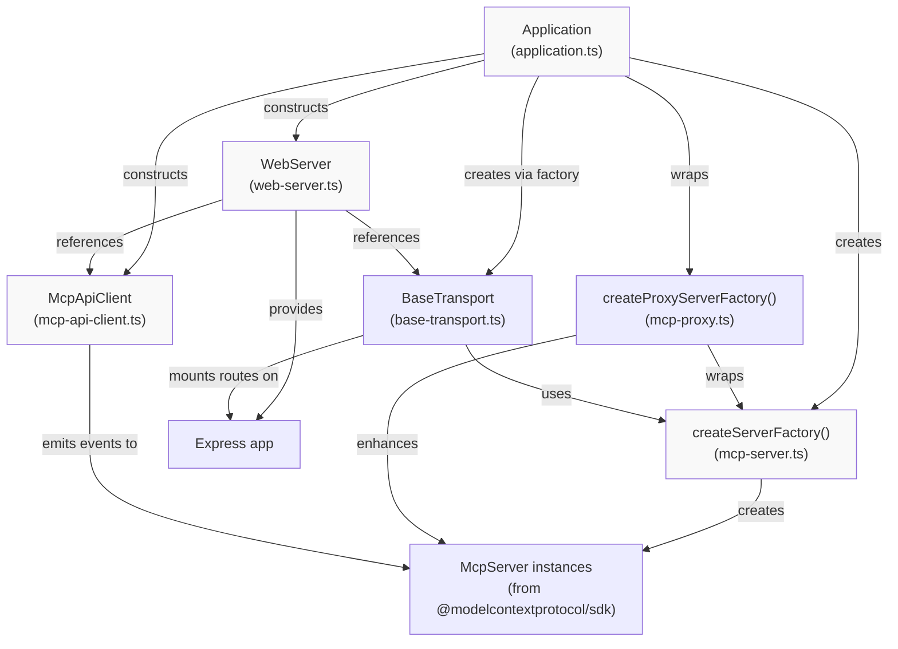
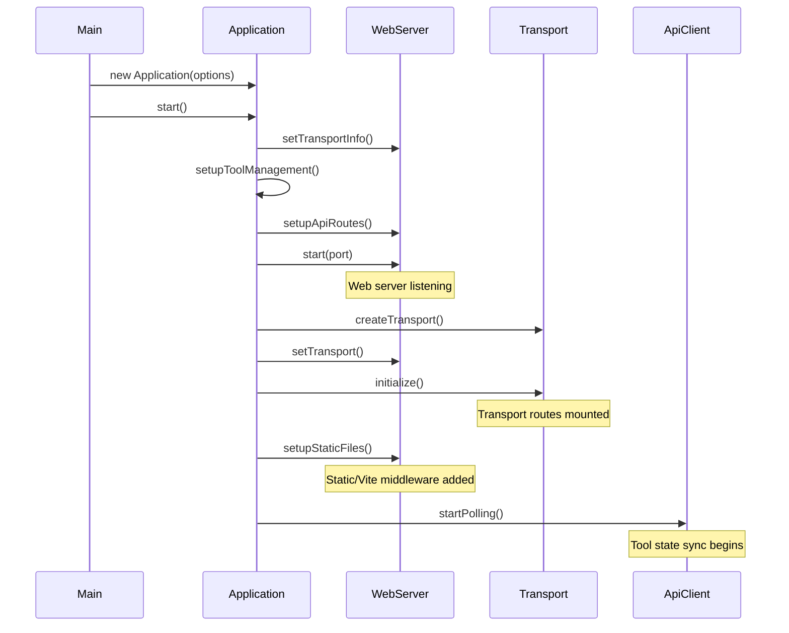
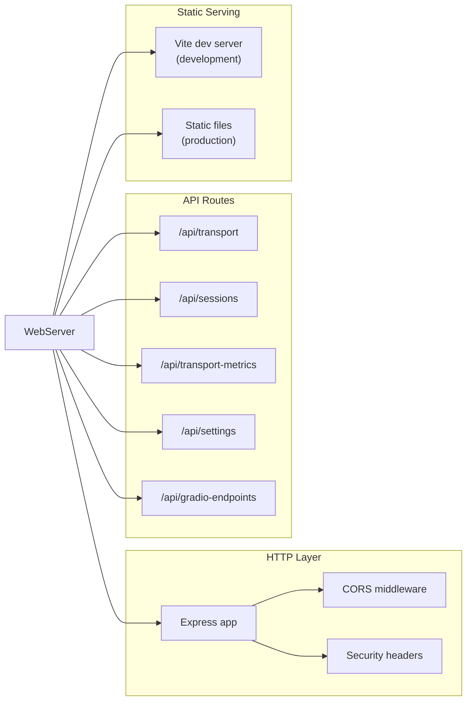
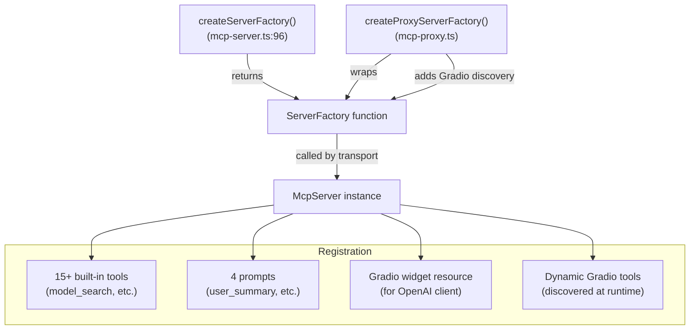
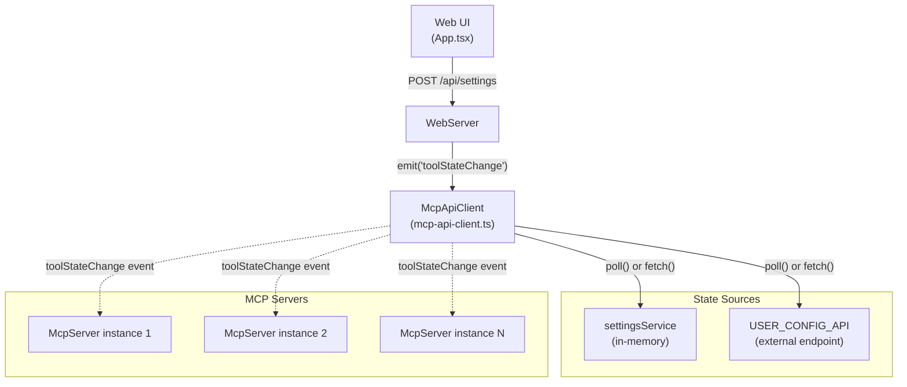
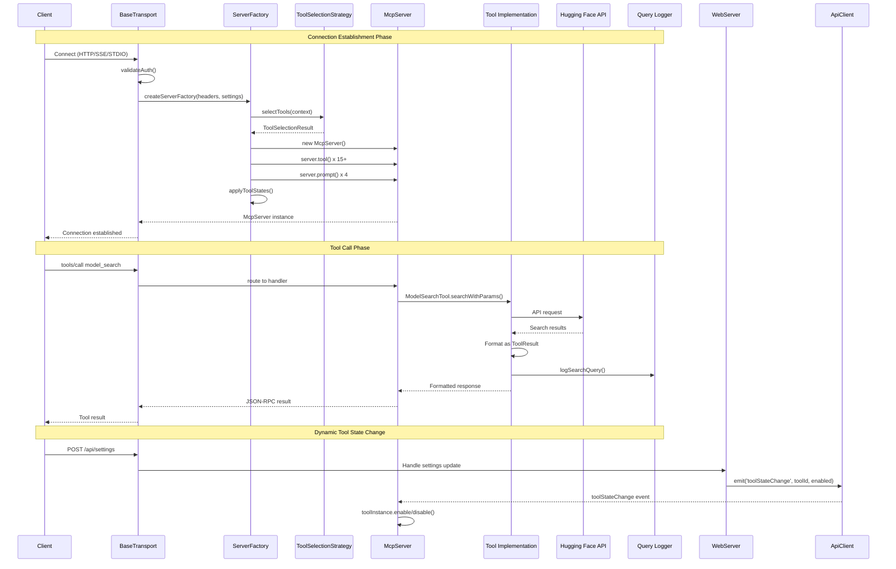

<!-- source: DeepWiki mcp.deepwiki.com · repo huggingface/hf-mcp-server · page 3.1 System Components · fetched 2026-10-26 -->

# System Components

<details>
<summary>Relevant source files</summary>

The following files were used as context for generating this wiki page:

- [packages/app/src/server/application.ts](packages/app/src/server/application.ts)
- [packages/app/src/server/mcp-server.ts](packages/app/src/server/mcp-server.ts)
- [packages/app/src/server/web-server.ts](packages/app/src/server/web-server.ts)
- [packages/app/src/shared/settings.ts](packages/app/src/shared/settings.ts)
- [packages/app/src/web/App.tsx](packages/app/src/web/App.tsx)

</details>


## Purpose and Scope

This document describes the five major components of the Hugging Face MCP Server architecture and their interactions. These components work together to provide a complete Model Context Protocol implementation that connects AI clients to Hugging Face services.

The components covered here are:
- **Application**: Lifecycle orchestration and component coordination
- **WebServer**: HTTP API and static file serving
- **MCP Server**: Tool and prompt registration with the MCP SDK
- **Transport Layer**: Client communication abstractions (detailed in [Transport Layer Architecture](#3.4))
- **McpApiClient**: Global tool state management

For information about the specific transport implementations, see [Transport Layer Architecture](#3.4). For package organization, see [Package Structure](#3.2).

---

## Component Architecture Overview

The system uses a layered architecture where the `Application` class coordinates all other components. Each component has distinct responsibilities and communicates through well-defined interfaces.

**Component Dependency Graph**



**Sources**: [packages/app/src/server/application.ts:1-198](), [packages/app/src/server/web-server.ts:1-491](), [packages/app/src/server/mcp-server.ts:1-897]()

---

## Application Component

The `Application` class ([packages/app/src/server/application.ts:23-192]()) serves as the main orchestrator that coordinates all other components. It manages the startup sequence, dependency injection, and graceful shutdown.

### Responsibilities

| Responsibility | Implementation |
|---|---|
| Component initialization order | [application.ts:99-123]() |
| Server factory creation | [application.ts:90-93]() |
| Transport lifecycle | [application.ts:133-149]() |
| Tool state management setup | [application.ts:125-131]() |
| Graceful shutdown coordination | [application.ts:172-187]() |

### Construction and Configuration

The `Application` constructor accepts an `ApplicationOptions` interface ([application.ts:13-18]()):

```typescript
interface ApplicationOptions {
  transportType: TransportType;
  webAppPort: number;
  webServerInstance: WebServer;
  apiClientConfig?: ApiClientConfig; // Optional - defaults to polling mode
}
```

The constructor performs these initialization steps:
1. Creates `TransportInfo` object with environment configuration ([application.ts:40-49]())
2. Configures `McpApiClient` based on `USER_CONFIG_API` environment variable ([application.ts:66-86]())
3. Creates base server factory via `createServerFactory()` ([application.ts:90]())
4. Wraps it with Gradio proxy via `createProxyServerFactory()` ([application.ts:93]())

### Startup Sequence

The `start()` method ([application.ts:99-123]()) orchestrates component initialization in this precise order:



**Sources**: [packages/app/src/server/application.ts:23-192]()

---

## WebServer Component

The `WebServer` class ([packages/app/src/server/web-server.ts:21-490]()) manages the Express HTTP server, API endpoints, static file serving, and acts as the central point for accessing transport and client information.

### Core Responsibilities



### API Endpoints

The `setupApiRoutes()` method ([web-server.ts:223-489]()) registers these endpoints:

| Endpoint | Method | Purpose | Implementation |
|---|---|---|---|
| `/api/transport` | GET | Returns current `TransportInfo` | [web-server.ts:226-228]() |
| `/api/sessions` | GET | Lists active MCP sessions | [web-server.ts:231-251]() |
| `/api/transport-metrics` | GET | Real-time metrics with optional temp logging | [web-server.ts:254-373]() |
| `/api/settings` | GET | Returns current `AppSettings` | [web-server.ts:376-378]() |
| `/api/settings` | POST | Updates tool/space settings and emits events | [web-server.ts:381-413]() |
| `/api/gradio-endpoints` | GET | Lists Gradio endpoint configuration | [web-server.ts:416-422]() |
| `/api/gradio-endpoints/:index` | POST | Toggles Gradio endpoint enabled state | [web-server.ts:425-454]() |
| `/api/gradio-endpoints/:index` | PUT | Updates Gradio endpoint configuration | [web-server.ts:457-488]() |

### CORS Configuration

CORS is configured globally ([web-server.ts:57-114]()) with support for:
- Exact origin matching from `CORS_ALLOWED_ORIGINS` constant
- Environment variable override via `CORS_ALLOWED_ORIGINS` env var
- Wildcard subdomain patterns (e.g., `*.use-mcp.dev`)
- Exposed headers defined in `CORS_EXPOSED_HEADERS` ([web-server.ts:109]())

### Static File Serving

The `setupStaticFiles()` method ([web-server.ts:182-221]()) configures different serving strategies:

**Development Mode** ([web-server.ts:184-208]()):
- Creates Vite dev server with HMR enabled
- Uses `middlewareMode: true` for integration
- Serves from `packages/app/src/web` directory

**Production Mode** ([web-server.ts:209-220]()):
- Serves pre-built static files from `dist/web`
- Fallback to `index.html` for SPA routing (non-API paths)

### Tool State Management

The `WebServer` maintains local tool state ([web-server.ts:30]()) and coordinates tool state changes:

1. Initializes states via `initializeToolStates()` ([web-server.ts:129-136]())
2. Tracks changes in `POST /api/settings` handler ([web-server.ts:395-410]())
3. Emits `toolStateChange` events through `McpApiClient` ([web-server.ts:405]())

**Sources**: [packages/app/src/server/web-server.ts:1-491]()

---

## MCP Server Component

The MCP Server component consists of factory functions that create `McpServer` instances from the `@modelcontextprotocol/sdk` package. Each instance has tools, prompts, and resources registered.

### Server Factory Pattern

**Server Factory Creation Flow**



### createServerFactory Implementation

The `createServerFactory()` function ([mcp-server.ts:96-896]()) returns a `ServerFactory` that:

1. **Authenticates user** via `whoAmI()` from `@huggingface/hub` ([mcp-server.ts:124-133]())
2. **Selects tools** using `ToolSelectionStrategy` ([mcp-server.ts:115-185]())
3. **Creates `McpServer`** with metadata ([mcp-server.ts:151-172]())
4. **Registers all tools** (15+ built-in tools) ([mcp-server.ts:198-815]())
5. **Registers prompts** (4 prompts) ([mcp-server.ts:221-355]())
6. **Registers resources** (Gradio widget for OpenAI) ([mcp-server.ts:818-831]())
7. **Applies tool states** based on selection strategy ([mcp-server.ts:839-859]())
8. **Sets up event listeners** for dynamic tool state changes ([mcp-server.ts:872-891]())

### Tool Registration Examples

Tools are registered using the `server.tool()` method:

**Authentication Tool** ([mcp-server.ts:198-206]()):
```typescript
server.tool('hf_whoami', whoDescription, {}, 
  { readOnlyHint: true, openWorldHint: false, title: 'Hugging Face User Info' },
  () => { return { content: [{ type: 'text', text: response }] }; }
);
```

**Search Tool** ([mcp-server.ts:357-381]()):
```typescript
toolInstances[SEMANTIC_SEARCH_TOOL_CONFIG.name] = server.tool(
  SEMANTIC_SEARCH_TOOL_CONFIG.name,
  SEMANTIC_SEARCH_TOOL_CONFIG.description,
  SEMANTIC_SEARCH_TOOL_CONFIG.schema.shape,
  SEMANTIC_SEARCH_TOOL_CONFIG.annotations,
  async (params: SearchParams) => {
    const semanticSearch = new SpaceSearchTool(hfToken);
    const searchResult = await semanticSearch.search(params.query, params.limit, params.mcp);
    // ... logging and formatting
    return { content: [{ type: 'text', text: result.formatted }] };
  }
);
```

### Tool Instance Management

All tool registrations return a tool instance with `enable()` and `disable()` methods ([mcp-server.ts:174-177]()). These instances are stored in `toolInstances` map ([mcp-server.ts:191]()) for dynamic state control.

The `applyToolStates()` function ([mcp-server.ts:839-859]()) enables/disables tools based on `ToolSelectionStrategy` results:

```typescript
for (const [toolName, toolInstance] of Object.entries(toolInstances)) {
  if (toolSelection.enabledToolIds.includes(toolName)) {
    toolInstance.enable();
  } else {
    toolInstance.disable();
  }
}
```

### Prompt Registration

Four prompts are registered ([mcp-server.ts:221-355]()) using similar pattern:

| Prompt | Config | Handler Class |
|---|---|---|
| `user_summary` | `USER_SUMMARY_PROMPT_CONFIG` | `UserSummaryPrompt` |
| `paper_summary` | `PAPER_SUMMARY_PROMPT_CONFIG` | `PaperSummaryPrompt` |
| `model_detail_prompt` | `MODEL_DETAIL_PROMPT_CONFIG` | `ModelDetailTool` |
| `dataset_detail_prompt` | `DATASET_DETAIL_PROMPT_CONFIG` | `DatasetDetailTool` |

### Resource Registration

For OpenAI MCP clients (identified by `clientInfo.name === 'openai-mcp'`), a Gradio widget resource is registered ([mcp-server.ts:818-831]()):

```typescript
if (sessionInfo?.clientInfo?.name === 'openai-mcp') {
  const widgetConfig = createGradioWidgetResourceConfig(version);
  server.registerResource(widgetConfig.name, widgetConfig.uri, {}, async () => ({
    contents: [{ uri: widgetConfig.uri, mimeType: widgetConfig.mimeType, 
                 text: widgetConfig.htmlContent, _meta: widgetConfig.metadata }]
  }));
}
```

### Event-Driven Tool State Changes

The server factory sets up listeners for `toolStateChange` events ([mcp-server.ts:873-891]()) in non-JSON, non-external API modes:

```typescript
const toolStateChangeHandler = (toolId: string, enabled: boolean) => {
  const toolInstance = toolInstances[toolId];
  if (toolInstance) {
    if (enabled) { toolInstance.enable(); } 
    else { toolInstance.disable(); }
  }
};
sharedApiClient.on('toolStateChange', toolStateChangeHandler);
```

**Sources**: [packages/app/src/server/mcp-server.ts:1-897]()

---

## Transport Layer Overview

The Transport Layer provides abstraction over different client communication mechanisms. Four implementations exist:

| Transport | Class | Use Case | File |
|---|---|---|---|
| STDIO | `STDIOTransport` | CLI clients (Claude Code) | `stdio-transport.ts` |
| SSE | `SSETransport` | Browser-based clients | `sse-transport.ts` |
| Stateful HTTP | `StreamableHTTPTransport` | IDE clients (VS Code) | `streamable-http-transport.ts` |
| Stateless HTTP | `StatelessHTTPTransport` | Per-request isolation | `stateless-http-transport.ts` |

All transports extend `BaseTransport` ([base-transport.ts]()) which provides common functionality. For detailed information about transport implementations, see [Transport Layer Architecture](#3.4).

### BaseTransport Interface

The `BaseTransport` abstract class defines this interface:

**Key Methods**:
- `initialize(config)`: Mount routes and start services
- `getSessions()`: Return active session information
- `getMetrics()`: Return transport-specific metrics
- `getConfiguration()`: Return transport configuration
- `cleanup()`: Clean up resources on shutdown

**ServerFactory Type** ([base-transport.ts]()):
```typescript
type ServerFactory = (
  headers: Record<string, string> | null,
  userSettings?: AppSettings,
  skipGradio?: boolean,
  sessionInfo?: {
    clientSessionId?: string;
    isAuthenticated?: boolean;
    clientInfo?: { name: string; version: string };
  }
) => Promise<ServerFactoryResult>;
```

Each transport calls the `ServerFactory` to create `McpServer` instances per session or per request.

**Sources**: Referenced in [packages/app/src/server/application.ts:133-149]()

---

## McpApiClient Component

The `McpApiClient` class manages global tool state and provides event-driven coordination between the web UI, MCP server instances, and external configuration sources.

### Architecture

**McpApiClient in System Context**



### Configuration Modes

The `McpApiClient` supports two configuration modes via `ApiClientConfig` type:

**Polling Mode** (default):
```typescript
{
  type: 'polling',
  baseUrl: 'http://localhost:3000',
  pollInterval: 5000,
  staticGradioEndpoints: GradioEndpoint[]
}
```
- Polls `GET /api/settings` endpoint
- Uses local `settingsService`
- Suitable for standalone deployment

**External Mode**:
```typescript
{
  type: 'external',
  externalUrl: 'https://api.example.com/config',
  hfToken?: string
}
```
- Fetches from external API (configured via `USER_CONFIG_API` env var)
- Authenticates using `hfToken` as bearer token
- Suitable for managed/hosted deployments

### Event System

The `McpApiClient` extends `EventEmitter` and emits these events:

| Event | Arguments | Triggered When |
|---|---|---|
| `toolStateChange` | `toolId: string, enabled: boolean` | Tool state changes in settings |

MCP server instances listen for these events ([mcp-server.ts:873-891]()) to dynamically enable/disable tools without requiring client reconnection.

### Polling Mechanism

The `startPolling()` method ([mcp-api-client.ts]()) implements periodic state synchronization:

1. Fetch current settings (internal or external)
2. Compare with previous state
3. Emit `toolStateChange` events for changes
4. Repeat at `pollInterval` (default 5000ms)

### Gradio Endpoint Management

The `McpApiClient` also manages Gradio endpoint configuration:

**Methods**:
- `getGradioEndpoints()`: Returns current Gradio endpoint list
- `updateGradioEndpointState(index, enabled)`: Toggle endpoint enabled state
- `updateGradioEndpoint(index, endpoint)`: Update endpoint configuration

These methods are called by `WebServer` API handlers ([web-server.ts:425-488]()).

**Sources**: Referenced in [packages/app/src/server/application.ts:87](), [packages/app/src/server/web-server.ts:144](), [packages/app/src/server/mcp-server.ts:873-891]()

---

## Component Interaction Flow

This sequence diagram shows how components interact during a typical tool call:

**Complete Request Flow**



### Key Interaction Points

**Application Startup** ([application.ts:99-123]()):
1. `Application` creates `McpApiClient` in constructor
2. `Application.start()` calls `WebServer.start()`
3. `Application` creates transport via `createTransport()`
4. Transport's `initialize()` mounts routes on Express app
5. `Application` starts API client polling

**Settings Update Flow** ([web-server.ts:381-413]()):
1. Web UI sends `POST /api/settings` with new tool states
2. `WebServer` updates `settingsService`
3. `WebServer` emits events via `ApiClient.emit('toolStateChange')`
4. All `McpServer` instances receive events and update tool states
5. No client reconnection required

**Per-Request Server Creation**:
1. Client sends MCP request to transport endpoint
2. Transport extracts headers and calls `ServerFactory`
3. `ServerFactory` creates new `McpServer` instance
4. Tools execute and return results
5. For stateful transports, same instance is reused per session

**Sources**: [packages/app/src/server/application.ts:99-123](), [packages/app/src/server/web-server.ts:381-413](), [packages/app/src/server/mcp-server.ts:96-896]()

---

