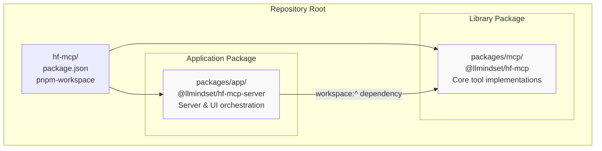
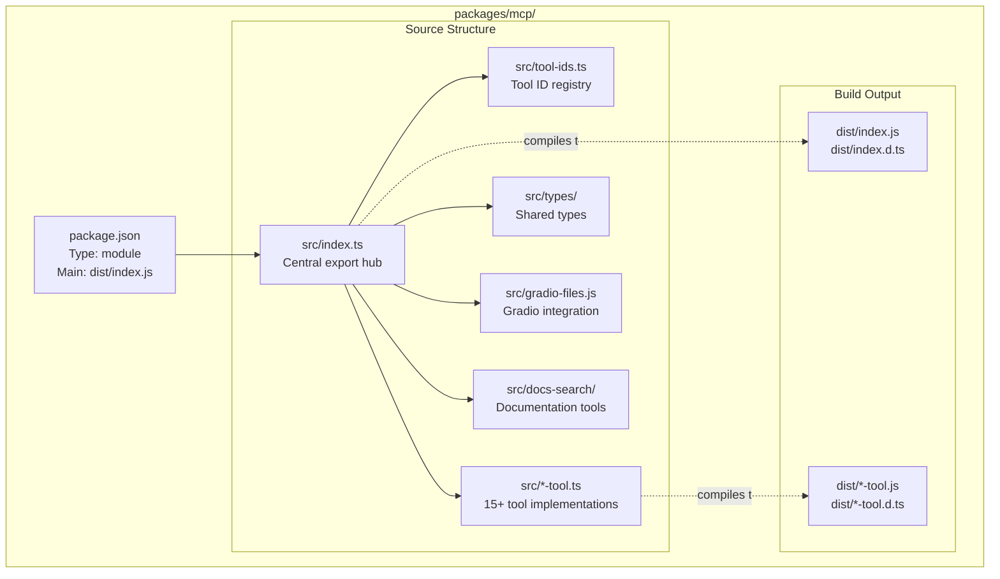
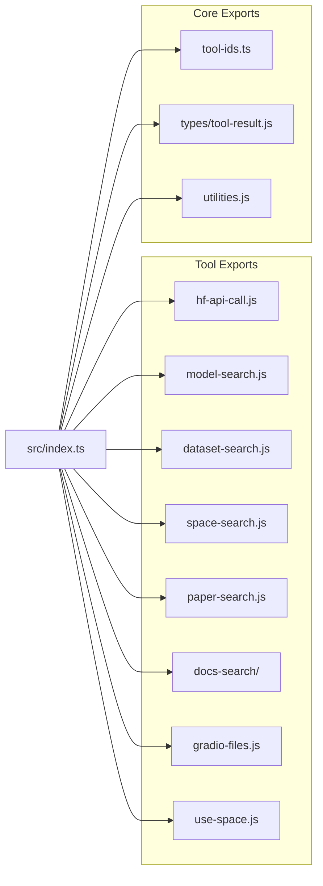
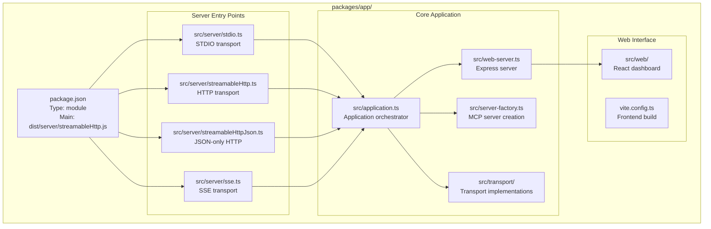
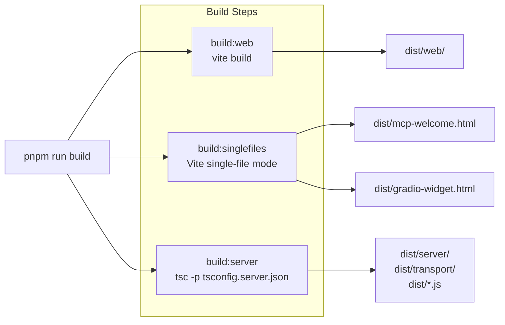
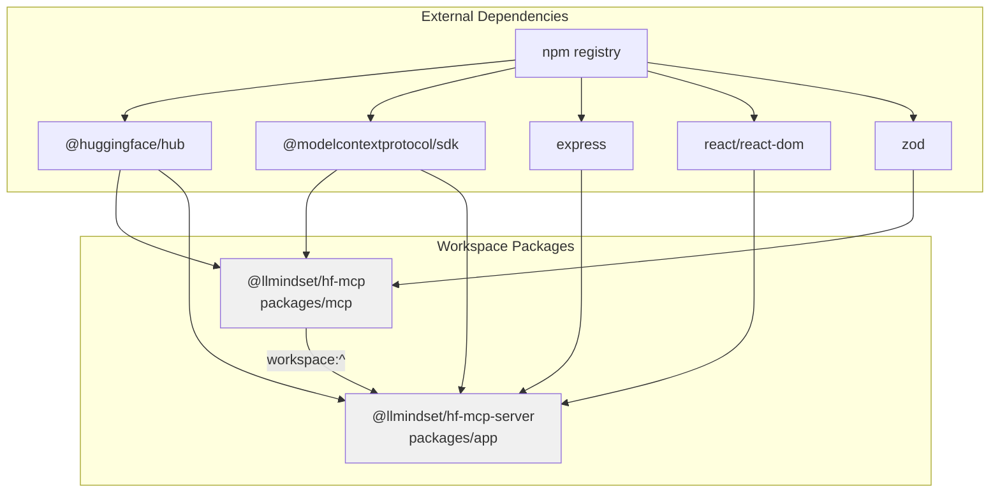
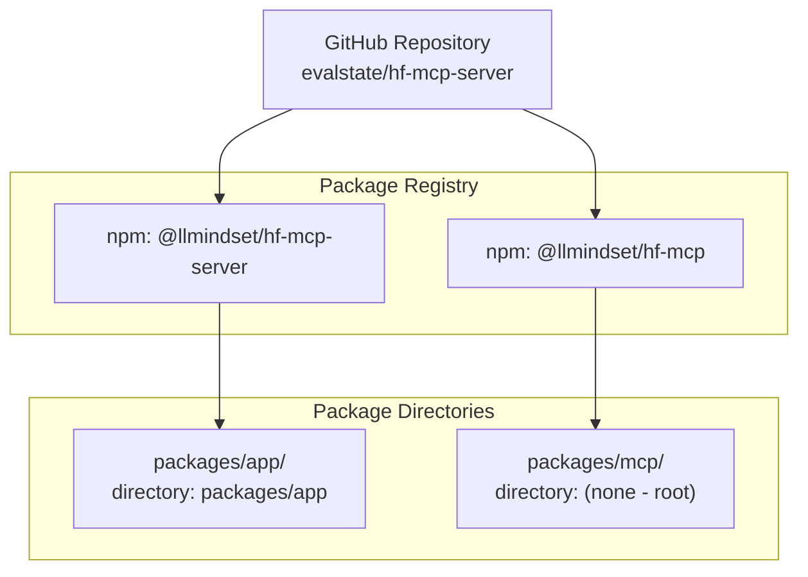

<!-- source: DeepWiki mcp.deepwiki.com · repo huggingface/hf-mcp-server · page 3.2 Package Structure · fetched 2026-10-26 -->

# Package Structure

Relevant source files

The following files were used as context for generating this wiki page:

- [package.json](package.json)
- [packages/app/package.json](packages/app/package.json)
- [packages/mcp/package.json](packages/mcp/package.json)
- [packages/mcp/src/index.ts](packages/mcp/src/index.ts)
- [packages/mcp/src/tool-ids.ts](packages/mcp/src/tool-ids.ts)
- [pnpm-lock.yaml](pnpm-lock.yaml)

This document explains the monorepo organization of the HF MCP Server codebase, detailing the two primary packages, their responsibilities, dependency relationships, and build outputs. For information about the internal architecture of the MCP server implementation, see [MCP Server Core](#3.3). For build system specifics and development workflows, see [Build System](#9.1).

---

## Monorepo Organization

The HF MCP Server is organized as a **pnpm workspace monorepo** with two distinct packages that separate library functionality from application concerns.

**Monorepo Structure**

Sources: [package.json:1-38](), [pnpm-lock.yaml:1-241]()

---

## Package Overview

| Package | Name | Version | Purpose | Published |
|---------|------|---------|---------|-----------|
| Library | `@llmindset/hf-mcp` | 0.2.43 | Tool implementations, schemas, API clients | Yes |
| Application | `@llmindset/hf-mcp-server` | 0.2.43 | MCP server, transports, web UI | Yes (main package) |

The **library package** (`packages/mcp`) contains pure tool logic and can be consumed independently, while the **application package** (`packages/app`) orchestrates the server runtime, transport layers, and user interfaces.

Sources: [packages/app/package.json:2-4](), [packages/mcp/package.json:2-4]()

---

## Library Package: `@llmindset/hf-mcp`

### Package Configuration

The library package is located at `packages/mcp/` and exports reusable tool implementations, utilities, and type definitions.

**Library Package Structure**

Sources: [packages/mcp/package.json:1-53](), [packages/mcp/src/index.ts:1-30]()

### Export Structure

The library package provides multiple export paths for optimized imports:

| Export Path | File | Purpose |
|------------|------|---------|
| `.` | `dist/index.js` | Default export - all tools and utilities |
| `./semantic` | `dist/semantic-search.js` | Space semantic search tool |
| `./model` | `dist/model-search.js` | Model search tool |
| `./paper` | `dist/paper-search.js` | Paper search tool |

**Named Exports from Main Entry Point**

The main `index.ts` exports all tool implementations, utility functions, and shared types:

**Index Export Structure**

Sources: [packages/mcp/src/index.ts:1-30](), [packages/mcp/package.json:7-23]()

### Tool ID Registry

The `tool-ids.ts` file serves as the canonical source of truth for all built-in tool identifiers, exporting constants extracted from tool configurations:

**Tool ID Constants** (examples):
- `SPACE_SEARCH_TOOL_ID` - "space_semantic_search"
- `MODEL_SEARCH_TOOL_ID` - "model_search"
- `MODEL_DETAIL_TOOL_ID` - "model_detail"
- `DATASET_SEARCH_TOOL_ID` - "dataset_search"
- `DOC_FETCH_TOOL_ID` - "hf_doc_fetch"

**Tool ID Groups** - Pre-defined collections for bouquet configurations:
- `TOOL_ID_GROUPS.search` - All search tools (5 tools)
- `TOOL_ID_GROUPS.spaces` - Space management tools (5 tools)
- `TOOL_ID_GROUPS.docs` - Documentation tools (2 tools)
- `TOOL_ID_GROUPS.hf_api` - HF API operation tools (7 tools)
- `TOOL_ID_GROUPS.all` - All built-in tools (15 tools)

Sources: [packages/mcp/src/tool-ids.ts:1-105]()

### Dependencies

The library package has minimal external dependencies:

**Core Dependencies**:
- `@huggingface/hub` (^2.6.12) - HF API client
- `@mcp-ui/server` (^5.12.0) - MCP protocol utilities
- `@modelcontextprotocol/sdk` (^1.20.0) - MCP SDK
- `zod` (^3.24.4) - Schema validation
- `turndown` (^7.2.0) - HTML to Markdown conversion
- `shell-quote` (^1.8.3) - Shell command escaping

Sources: [packages/mcp/package.json:34-41]()

---

## Application Package: `@llmindset/hf-mcp-server`

### Package Configuration

The application package is located at `packages/app/` and serves as the primary distribution package containing server implementations, transport layers, and the web dashboard.

**Application Package Structure**

Sources: [packages/app/package.json:1-111]()

### Binary Executables

The application package exposes three command-line entry points:

| Binary | File | Transport | Use Case |
|--------|------|-----------|----------|
| `hf-mcp-server` | `dist/server/stdio.js` | STDIO | CLI clients (Claude Code, Gemini) |
| `hf-mcp-server-http` | `dist/server/streamableHttp.js` | HTTP/SSE | Web clients, IDEs (default) |
| `hf-mcp-server-http-json` | `dist/server/streamableHttpJson.js` | HTTP (stateless) | Analytics, single-shot requests |

These binaries are automatically registered in `node_modules/.bin/` when the package is installed.

Sources: [packages/app/package.json:7-10]()

### Build Targets

The application package produces multiple build artifacts:

**Server Builds** (TypeScript → JavaScript):
- `dist/server/*.js` - Server entry points
- `dist/transport/*.js` - Transport implementations
- `dist/*.js` - Core application modules

**Web UI Builds** (Vite bundling):
- `dist/web/` - Production React dashboard
- `dist/mcp-welcome.html` - Single-file welcome page
- `dist/gradio-widget.html` - Gradio iframe widget

**Build Script Execution**:

**Build Pipeline**

Sources: [packages/app/package.json:34-39]()

### Application Dependencies

The application package has extensive dependencies for server runtime and UI:

**Server Dependencies**:
- `@llmindset/hf-mcp` (workspace:^) - **Library package dependency**
- `express` (^4.18.3) - HTTP server framework
- `@modelcontextprotocol/sdk` (^1.20.0) - MCP protocol
- `pino` (^9.7.0) - Structured logging
- `cors` (^2.8.5) - CORS middleware

**UI Dependencies**:
- `react` (^19.1.0) / `react-dom` (^19.1.0) - UI framework
- `@radix-ui/*` - UI component primitives
- `tailwindcss` (^4.1.5) - CSS framework
- `@tanstack/react-table` (^8.21.3) - Data tables
- `swr` (^2.3.3) - Data fetching

Sources: [packages/app/package.json:58-87]()

---

## Workspace Dependency Graph

The workspace configuration establishes a one-way dependency relationship from application to library:

**Package Dependency Relationships**

The `workspace:^` protocol ensures the application package always uses the local version of the library package during development, while npm resolves it to the published version in production.

Sources: [packages/app/package.json:59](), [pnpm-lock.yaml:42-49]()

### Shared Dependencies

Both packages share several core dependencies to maintain compatibility:

| Dependency | Library Version | App Version | Purpose |
|------------|----------------|-------------|---------|
| `@huggingface/hub` | ^2.6.12 | ^2.6.12 | HF API client |
| `@modelcontextprotocol/sdk` | ^1.20.0 | ^1.20.0 | MCP protocol |
| `@mcp-ui/server` | ^5.12.0 | ^5.12.0 | MCP utilities |
| `zod` | ^3.24.4 | ^3.24.4 | Schema validation |
| `typescript` | 5.9.2 | 5.9.2 | Type checking |

Sources: [packages/mcp/package.json:34-40](), [packages/app/package.json:58-86]()

---

## Build System Integration

### TypeScript Compilation

Both packages use TypeScript with declaration file generation:

**Library Package Compilation**:
- Command: `tsc --declaration`
- Output: `dist/` with `.js` and `.d.ts` files
- Entry: `src/index.ts` → `dist/index.js` + `dist/index.d.ts`

**Application Package Compilation**:
- Command: `tsc -p tsconfig.server.json`
- Output: `dist/server/`, `dist/transport/`, `dist/*.js`
- No declaration files (not consumed as library)

Sources: [packages/mcp/package.json:26](), [packages/app/package.json:35]()

### Development Scripts

The root `package.json` provides convenience scripts for concurrent development:

| Script | Command | Purpose |
|--------|---------|---------|
| `dev` | `concurrently "pnpm run --filter=@llmindset/hf-mcp dev" "pnpm run --filter=@llmindset/hf-mcp-server dev"` | Watch both packages |
| `dev:watch` | Similar with watch mode | Full hot-reload development |
| `build` | `pnpm -r build` | Build all packages recursively |
| `test` | `pnpm run -r test` | Run all tests |

The `--filter` flag leverages pnpm's workspace filtering to target specific packages.

Sources: [package.json:7-24]()

---

## Distribution and Publishing

### Published Artifacts

**Primary Package** (`@llmindset/hf-mcp-server`):
- Main entry: `dist/server/streamableHttp.js`
- Binary executables: 3 command-line tools
- Bundled assets: Web UI, welcome page, Gradio widget
- Files published: `dist/**/*`, `components.json`

**Library Package** (`@llmindset/hf-mcp`):
- Main entry: `dist/index.js`
- Type definitions: `dist/index.d.ts`
- Additional exports: `./semantic`, `./model`, `./paper`
- All compiled `.js` and `.d.ts` files

Both packages maintain synchronized version numbers (0.2.43) and use MIT licensing.

Sources: [packages/app/package.json:6-32](), [packages/mcp/package.json:5-23]()

### Repository Configuration

**Repository to Package Mapping**

The `repository.directory` field in `package.json` helps tools like npm and GitHub correctly associate source code locations with published packages.

Sources: [packages/app/package.json:24-28](), [package.json:1-38]()

---

## Key Takeaways

1. **Clean Separation**: Library package (`@llmindset/hf-mcp`) provides reusable tool implementations; application package (`@llmindset/hf-mcp-server`) orchestrates server runtime and UI.

2. **Workspace Protocol**: The application package consumes the library via `workspace:^` dependency, ensuring local development uses the working directory version.

3. **Multiple Entry Points**: The application package exposes three binary executables for different transport modes, while the library provides specialized export paths for tree-shaking optimization.

4. **Independent Publishing**: Both packages are published to npm with synchronized versions, allowing the library to be consumed independently by other projects.

5. **Monorepo Tooling**: Uses pnpm workspaces for efficient dependency management and concurrent development workflows.

Sources: [package.json:1-38](), [packages/app/package.json:1-111](), [packages/mcp/package.json:1-53]()

---

