<!-- source: DeepWiki mcp.deepwiki.com · repo huggingface/hf-mcp-server · page 3.3 MCP Server Core · fetched 2026-10-26 -->

# MCP Server Core

Relevant source files

The following files were used as context for generating this wiki page:

- [packages/app/src/server/gradio-endpoint-connector.ts](packages/app/src/server/gradio-endpoint-connector.ts)
- [packages/app/src/server/mcp-proxy.ts](packages/app/src/server/mcp-proxy.ts)
- [packages/app/src/server/mcp-server.ts](packages/app/src/server/mcp-server.ts)
- [packages/app/src/shared/settings.ts](packages/app/src/shared/settings.ts)
- [packages/app/src/web/App.tsx](packages/app/src/web/App.tsx)

The MCP Server Core is responsible for creating and configuring individual `McpServer` instances that expose tools, prompts, and resources to MCP clients. This page documents the server factory pattern, tool/prompt registration mechanisms, authentication handling, and dynamic tool state management.

For information about how tools are selected and filtered before registration, see [Tool Selection System](#5). For details about the transport layer that invokes the server factory, see [Transport Layer Architecture](#3.4). For information about Gradio tool discovery and registration, see [Gradio Integration](#6).

---

## Server Factory Pattern

The server factory is the primary abstraction for creating MCP server instances. Each transport implementation calls the factory to create a fresh or cached server instance based on the transport's session model.

**ServerFactory Type Definition**

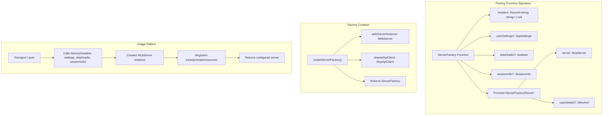

The `createServerFactory` function at [packages/app/src/server/mcp-server.ts:96-896]() is the entry point. It accepts a `WebServer` instance and `McpApiClient` and returns a factory function that produces `McpServer` instances.

Sources: [packages/app/src/server/mcp-server.ts:96-109]()

---

## Server Initialization and Metadata

Each server instance is initialized with metadata that identifies it to MCP clients.

**Server Metadata Structure**

| Property | Value | Purpose |
|----------|-------|---------|
| `name` | `@huggingface/mcp-services` | Package identifier |
| `version` | From package.json | Semantic version |
| `title` | `Hugging Face` | Display name |
| `websiteUrl` | `https://huggingface.co/mcp` | Documentation URL |
| `icons` | Hugging Face favicon | Client UI icon |
| `instructions` | Dynamic user context | Initial guidance for AI |

The instructions field dynamically includes authentication status, informing the AI whether the user is authenticated or anonymous with rate limits.

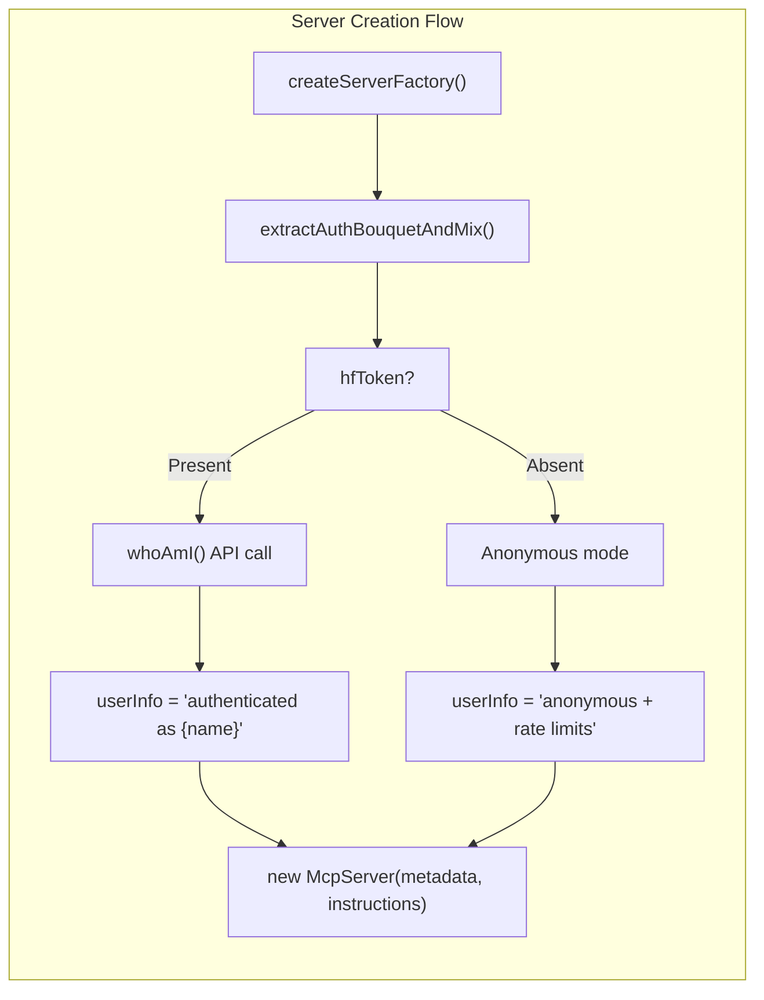

The server is instantiated at [packages/app/src/server/mcp-server.ts:151-172]() using the MCP SDK's `McpServer` class. Authentication is performed at [packages/app/src/server/mcp-server.ts:124-133]() using `@huggingface/hub`'s `whoAmI` function.

Sources: [packages/app/src/server/mcp-server.ts:96-172](), [packages/app/src/server/utils/auth-utils.ts]()

---

## Tool Registration System

Tools are registered using the MCP SDK's `.tool()` method, which accepts a name, description, schema, annotations, and handler function. All built-in tools are registered immediately, but only enabled tools are made available to clients based on the tool selection strategy.

**Tool Registration Pattern**

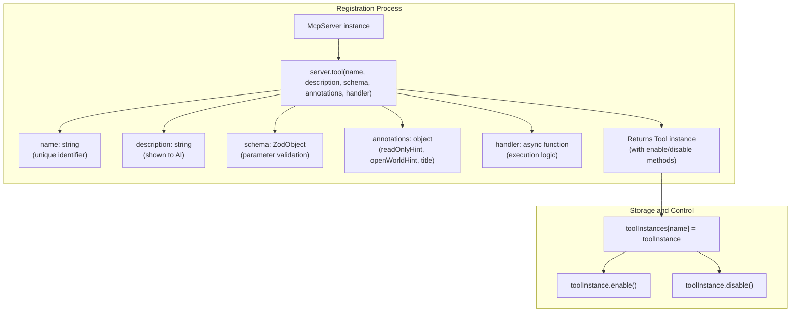

Each tool registration call returns a `Tool` object with `enable()` and `disable()` methods. These instances are stored in the `toolInstances` map at [packages/app/src/server/mcp-server.ts:191]() for dynamic state management.

**Built-in Tool Registration Examples**

The registration pattern is consistent across all tools:

1. **Search Tools** - e.g., `model_search` at [packages/app/src/server/mcp-server.ts:383-406]()
   - Uses `MODEL_SEARCH_TOOL_CONFIG` imported from `@llmindset/hf-mcp`
   - Instantiates `ModelSearchTool` with `hfToken`
   - Logs query metrics via `logSearchQuery()`
   - Returns formatted text response

2. **Detail Tools** - e.g., `model_detail` at [packages/app/src/server/mcp-server.ts:408-431]()
   - Uses `MODEL_DETAIL_TOOL_CONFIG`
   - Instantiates `ModelDetailTool` with `hfToken`
   - Fetches comprehensive model metadata
   - Returns structured markdown response

3. **Space Management Tools** - e.g., `duplicate_space` at [packages/app/src/server/mcp-server.ts:602-615]()
   - Uses dynamic config via `DuplicateSpaceTool.createToolConfig(username)`
   - Requires authentication (uses `username`)
   - Performs space duplication operation
   - Returns operation status

4. **Documentation Tools** - e.g., `hf_doc_search` at [packages/app/src/server/mcp-server.ts:563-586]()
   - Uses `DOCS_SEMANTIC_SEARCH_CONFIG`
   - Searches Hugging Face documentation
   - Returns ranked documentation results

5. **Dynamic Tools** - `use_space` at [packages/app/src/server/mcp-server.ts:699-815]()
   - Allows invoking any Gradio space by name
   - Supports `view_parameters` and `invoke` operations
   - Applies post-processing for images and OpenAI compatibility
   - Respects `gradio=none` header to disable invoke

**Special Tool: hub_repo_details**

The `hub_repo_details` tool has runtime-configurable schema based on the `README_INCLUDE` flag:

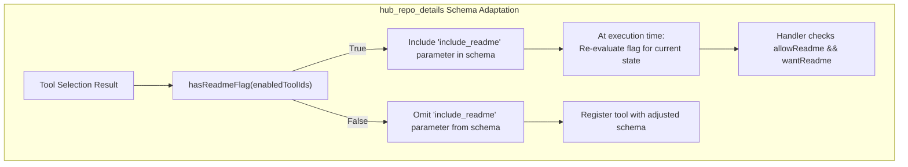

This adaptation occurs at [packages/app/src/server/mcp-server.ts:512-561](). The tool re-evaluates the flag at runtime to support UI-driven configuration changes without server restart.

Sources: [packages/app/src/server/mcp-server.ts:357-697](), [packages/mcp/src/tools/]()

---

## Prompt Registration

Prompts provide pre-configured conversation starters that bundle context and instructions for the AI. The server registers four built-in prompts.

**Prompt Registration Pattern**

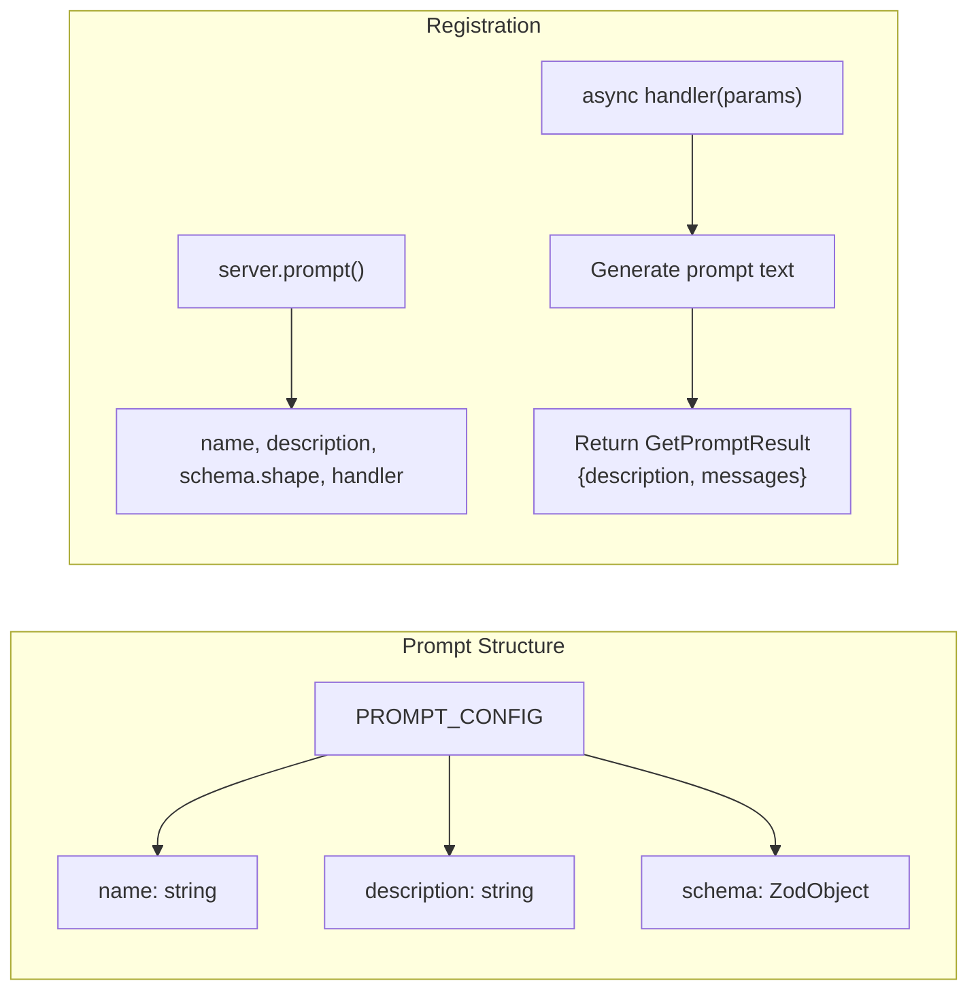

**Registered Prompts**

| Prompt Name | Purpose | Implementation |
|-------------|---------|----------------|
| `user_summary` | Summarize HF user profile | [packages/app/src/server/mcp-server.ts:221-253]() |
| `paper_summary` | Summarize research paper | [packages/app/src/server/mcp-server.ts:255-287]() |
| `model_detail_prompt` | Format model details | [packages/app/src/server/mcp-server.ts:289-321]() |
| `dataset_detail_prompt` | Format dataset details | [packages/app/src/server/mcp-server.ts:323-355]() |

Each prompt instantiates the appropriate tool class (e.g., `UserSummaryPrompt`, `ModelDetailTool`) and returns formatted content as messages with the `user` role. Prompts are logged via `logPromptQuery()` for analytics.

Sources: [packages/app/src/server/mcp-server.ts:221-355]()

---

## Resource Registration

Resources provide static or dynamic content referenced by URI. The server conditionally registers the Gradio widget resource for OpenAI MCP clients.

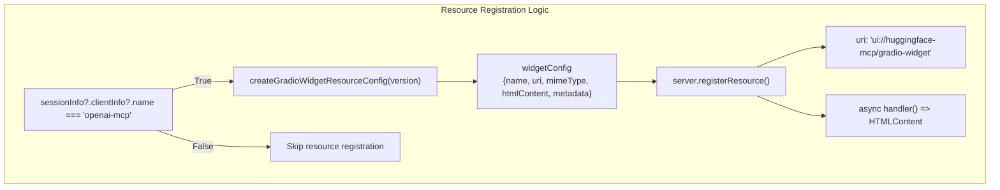

The widget provides an HTML template for rendering Gradio outputs in the OpenAI MCP client interface. Registration occurs at [packages/app/src/server/mcp-server.ts:818-831]().

Sources: [packages/app/src/server/mcp-server.ts:818-831](), [packages/app/src/server/resources/gradio-widget-resource.ts]()

---

## Authentication and User Context

Authentication is handled via Hugging Face API tokens passed in headers or environment variables.

**Authentication Flow**

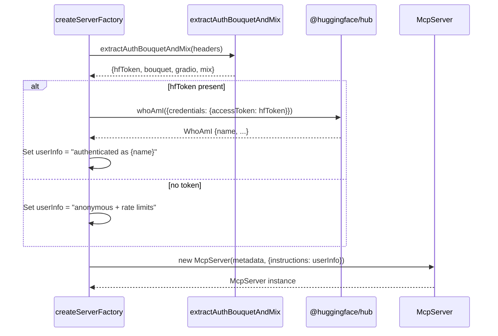

The `hf_whoami` tool is always registered at [packages/app/src/server/mcp-server.ts:198-206]() to provide authentication guidance. It returns either the username or configuration instructions for setting up authentication.

Sources: [packages/app/src/server/mcp-server.ts:111-133](), [packages/app/src/server/mcp-server.ts:198-206](), [packages/app/src/server/utils/auth-utils.ts]()

---

## Dynamic Tool State Management

Tools can be enabled or disabled dynamically without restarting the server, allowing the web UI and API to control tool availability.

**Tool State Control Architecture**

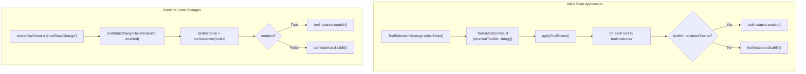

Initial tool states are applied at [packages/app/src/server/mcp-server.ts:839-859](). For stateful transports in internal API mode, an event listener is registered at [packages/app/src/server/mcp-server.ts:872-891]() to handle real-time tool state changes broadcasted by `McpApiClient`.

The event listener is cleaned up when the server closes via the `server.server.onclose` callback.

**Tool State Application Conditions**

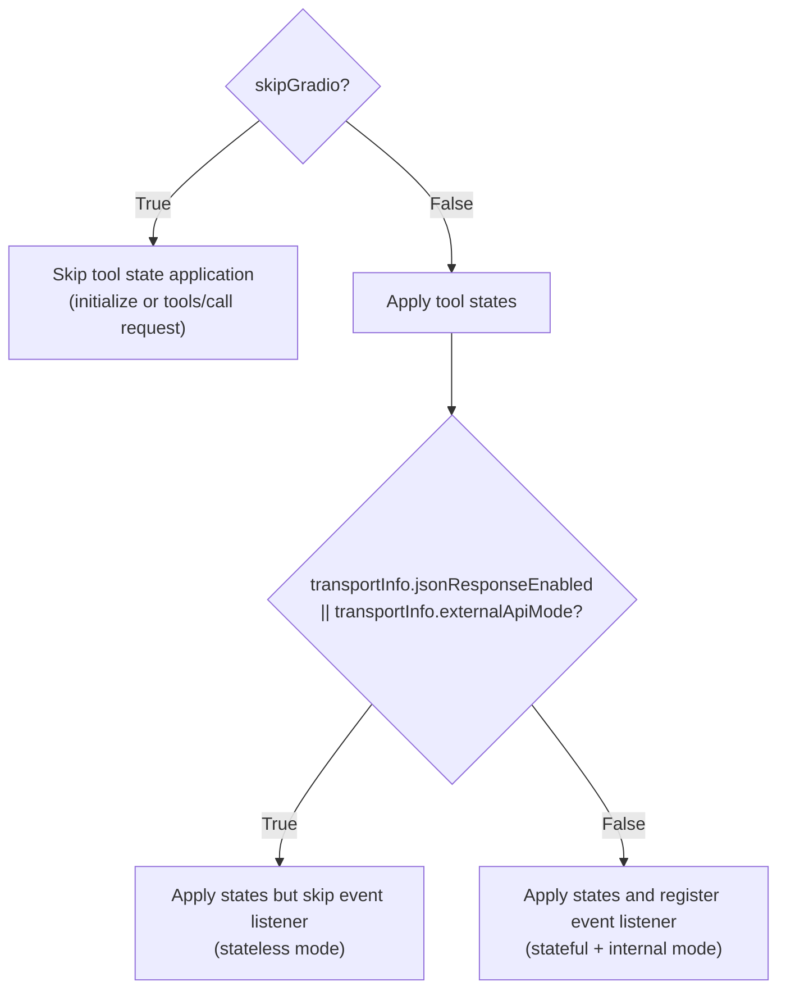

This logic ensures tool states are only applied when needed and event listeners are only registered for transports that support dynamic updates.

Sources: [packages/app/src/server/mcp-server.ts:839-892](), [packages/app/src/server/utils/mcp-api-client.ts]()

---

## Capability Declaration

The server declares its capabilities to inform clients about supported MCP features.

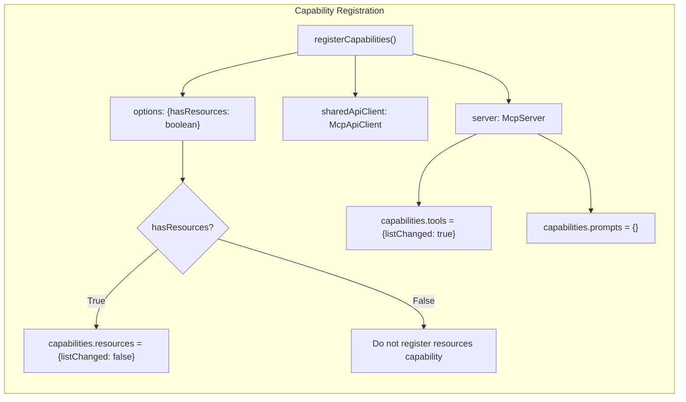

Capabilities are registered at [packages/app/src/server/mcp-server.ts:864-866]() using the `registerCapabilities` utility. The `listChanged: true` flag for tools indicates that the tool list can change dynamically during the session, which is essential for the dynamic Gradio tool registration system.

Resources are only declared if the client is OpenAI MCP (`sessionInfo?.clientInfo?.name === 'openai-mcp'`), as determined by the `hasResources` option.

Sources: [packages/app/src/server/mcp-server.ts:862-866](), [packages/app/src/server/utils/capability-utils.ts]()

---

## Integration with Proxy Factory

The server factory is wrapped by the proxy factory to inject Gradio tool discovery and registration.

**Factory Wrapping Pattern**

```mermaid
graph TB
    subgraph "Factory Creation Chain"
        CreateServer["createServerFactory(webServer, apiClient)"]
        CreateServer --> OriginalFactory["originalServerFactory: ServerFactory"]
        
        OriginalFactory --> Wrap["createProxyServerFactory(webServer, apiClient, originalServerFactory)"]
        Wrap --> ProxyFactory["proxyServerFactory: ServerFactory"]
    end
    
    subgraph "Proxy Invocation Flow"
        Transport["Transport calls proxyFactory()"]
        Transport --> Proxy["createProxyServerFactory execution"]
        
        Proxy --> CallOriginal["result = originalServerFactory(headers, settings, skipGradio, sessionInfo)"]
        CallOriginal --> OrigServer["Returns {server, userDetails}"]
        
        OrigServer --> CheckSkip{"skipGradio?"}
        CheckSkip -->|True| Return1["Return result immediately"]
        CheckSkip -->|False| Gradio["Discover and register Gradio tools"]
        
        Gradio --> Register["registerRemoteTools(server, ...)"]
        Register --> Return2["Return enhanced result"]
    end
```

The original server factory creates the base `McpServer` with all built-in tools registered. The proxy factory at [packages/app/src/server/mcp-proxy.ts:83-276]() then:

1. Calls the original factory to get a server instance
2. Checks if Gradio discovery should be skipped
3. If not skipped:
   - Parses Gradio space IDs from headers and settings
   - Fetches Gradio schemas via `getGradioSpaces()`
   - Registers remote tools via `registerRemoteTools()`
   - Conditionally registers special prompts (e.g., Qwen Image enhancer)

This separation allows the core server factory to focus on built-in tool registration while the proxy handles the dynamic, network-dependent Gradio integration.

Sources: [packages/app/src/server/mcp-server.ts:96-896](), [packages/app/src/server/mcp-proxy.ts:83-276](), [packages/app/src/server/gradio-endpoint-connector.ts]()

---

## Factory Return Value and Session Management

The factory returns a `ServerFactoryResult` containing the configured server and optional user details.

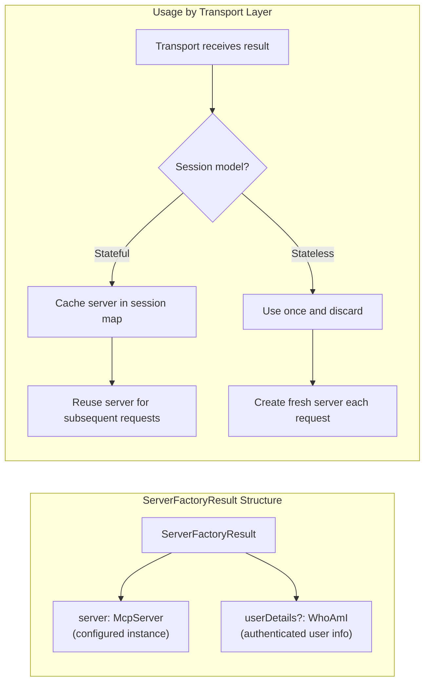

The `userDetails` object is returned at [packages/app/src/server/mcp-server.ts:894]() to provide the transport layer with authenticated user information for logging and session tracking purposes. Different transports use this information differently based on their session models (see [Transport Layer Architecture](#3.4)).

Sources: [packages/app/src/server/mcp-server.ts:894-896](), [packages/app/src/server/transport/base-transport.ts]()

---

