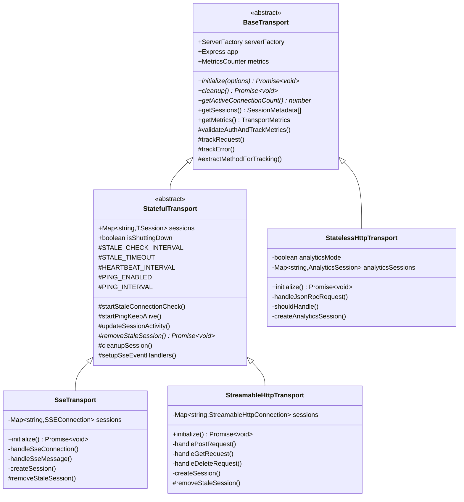
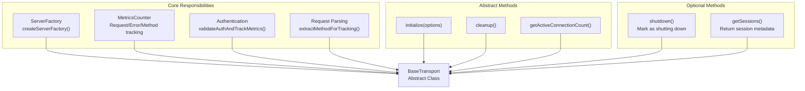
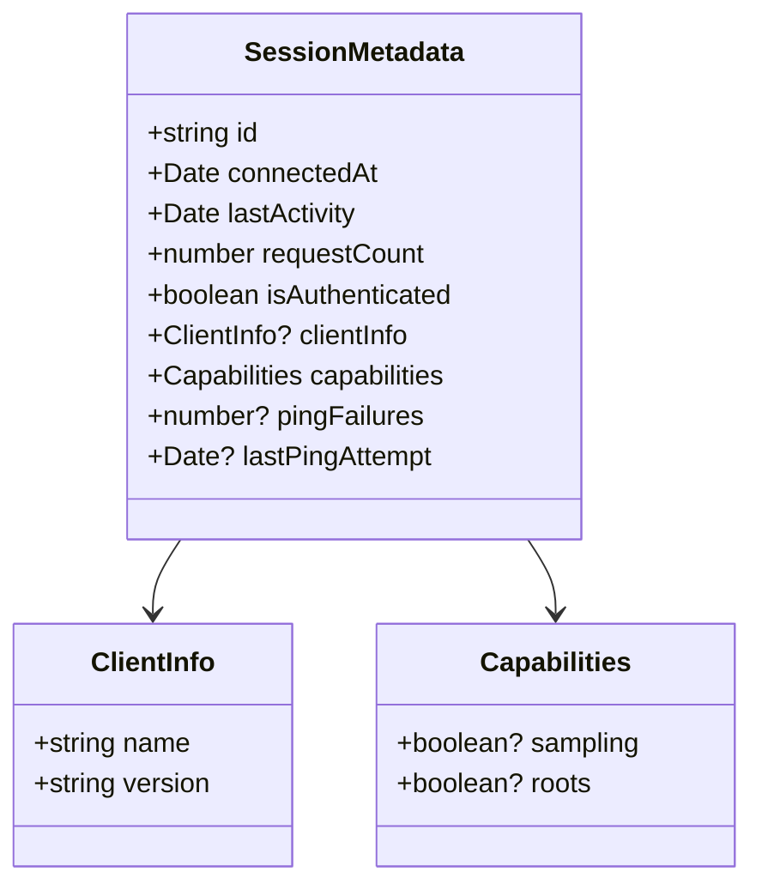
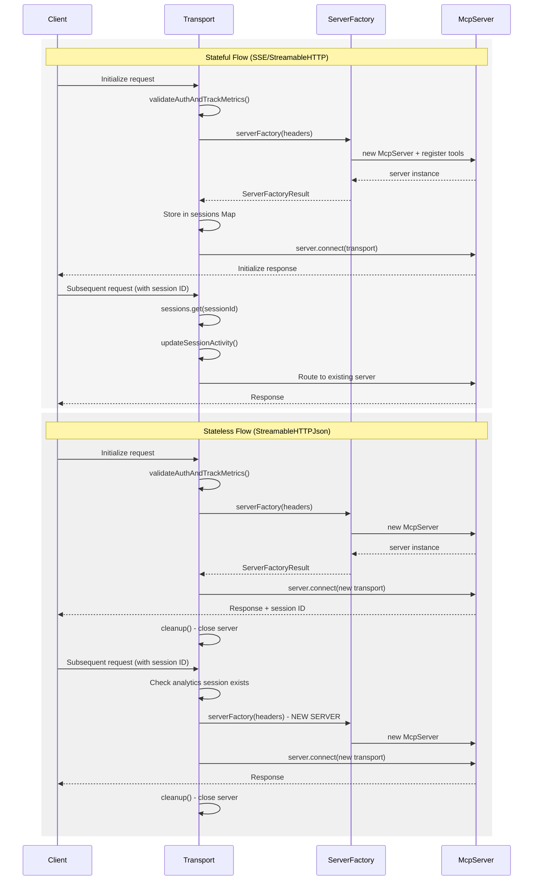
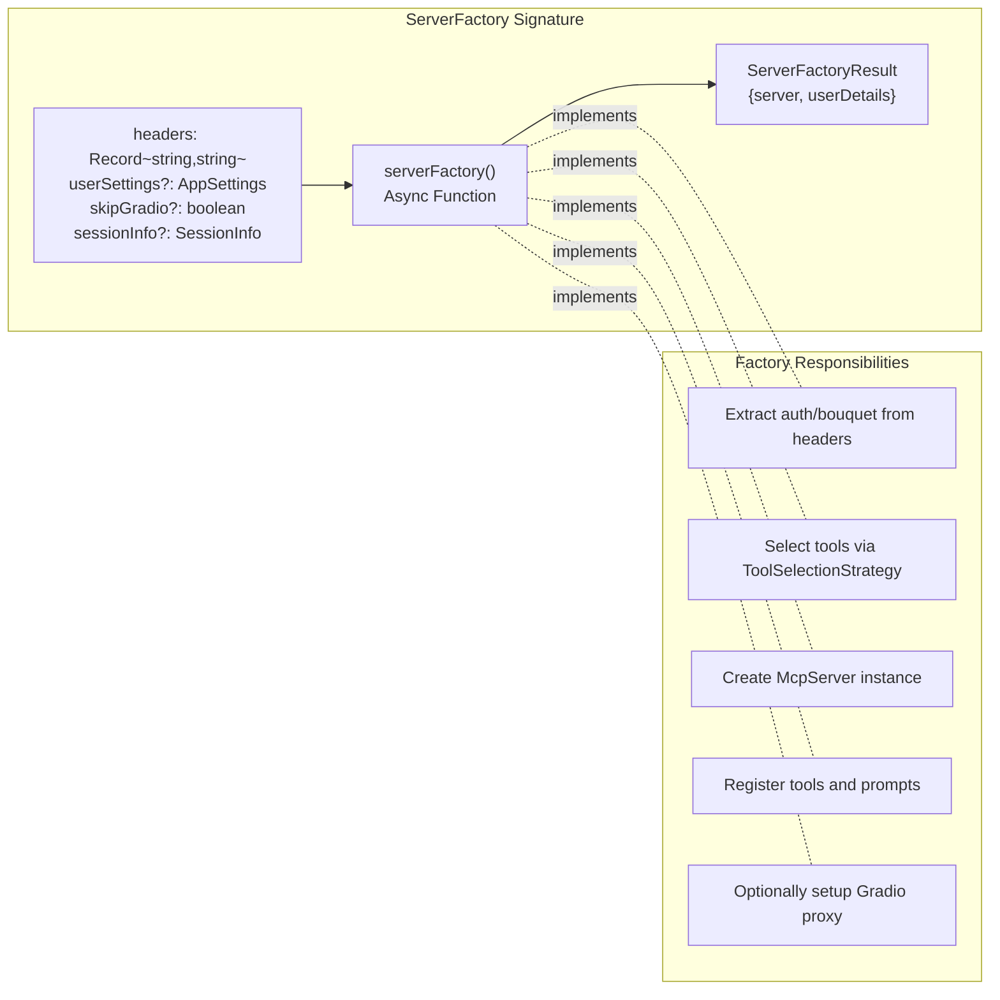
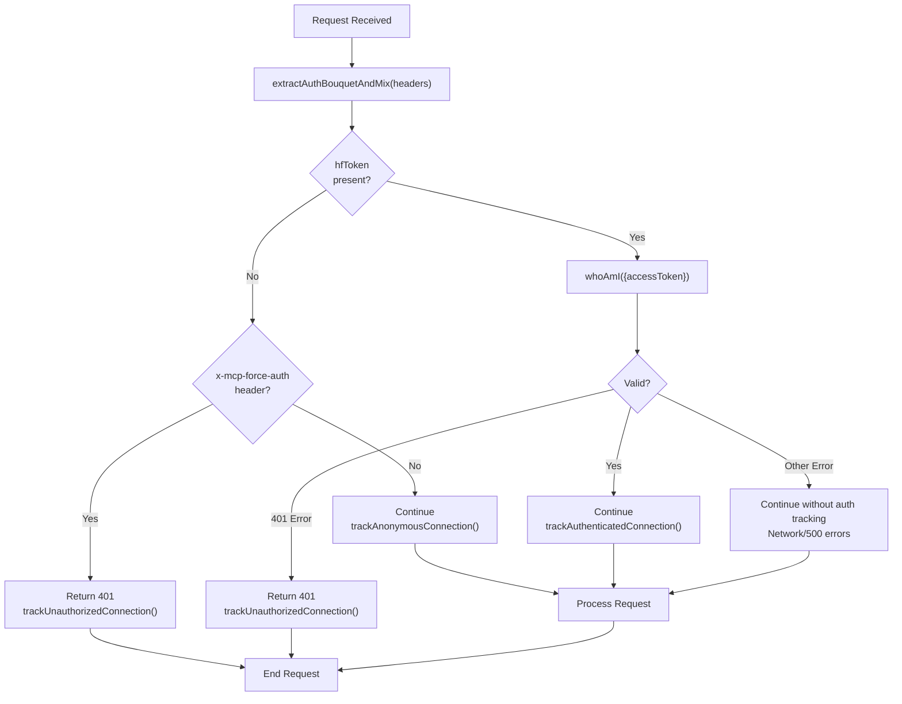
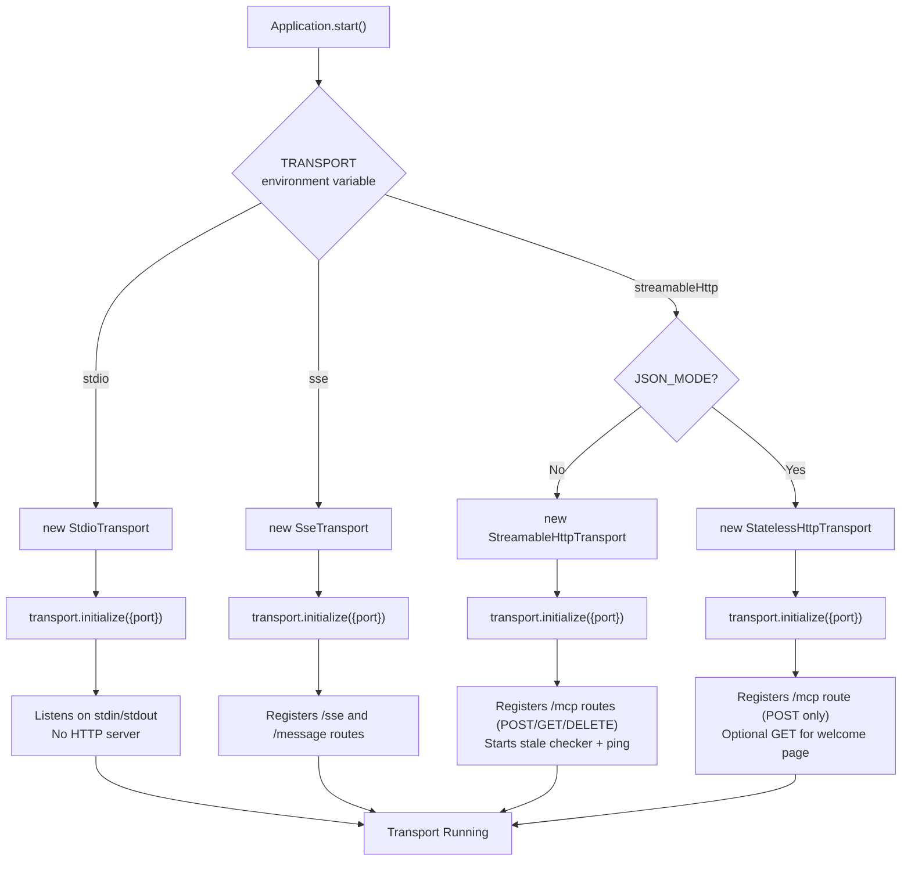
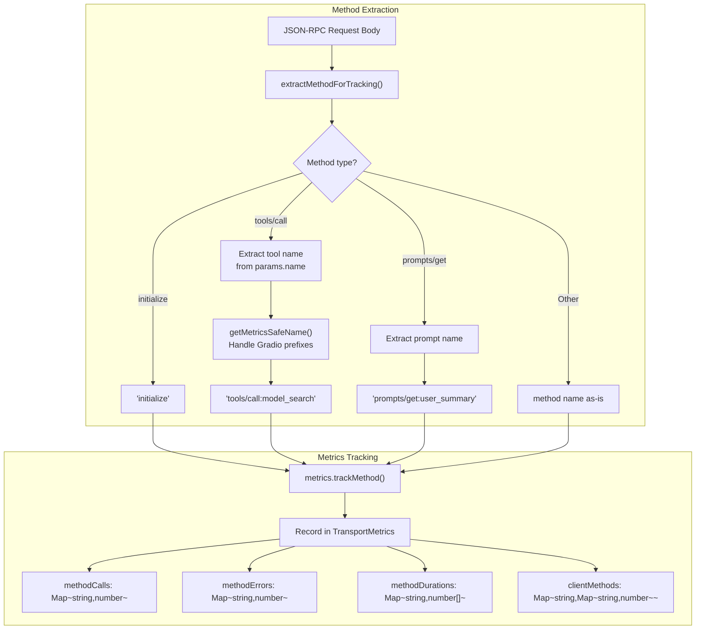
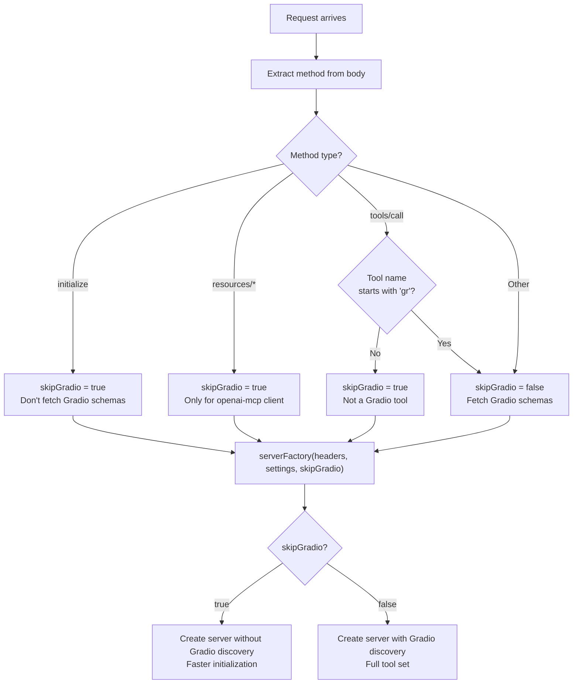
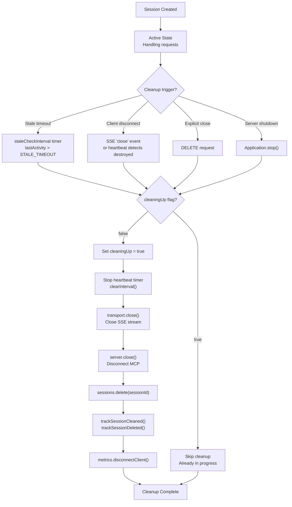

<!-- source: DeepWiki mcp.deepwiki.com · repo huggingface/hf-mcp-server · page 3.4 Transport Layer Architecture · fetched 2026-10-26 -->

# Transport Layer Architecture

Relevant source files

The following files were used as context for generating this wiki page:

- [.dockerignore](.dockerignore)
- [Dockerfile](Dockerfile)
- [README.md](README.md)
- [packages/app/src/server/transport/base-transport.ts](packages/app/src/server/transport/base-transport.ts)
- [packages/app/src/server/transport/sse-transport.ts](packages/app/src/server/transport/sse-transport.ts)
- [packages/app/src/server/transport/stateless-http-transport.ts](packages/app/src/server/transport/stateless-http-transport.ts)
- [packages/app/src/server/transport/streamable-http-transport.ts](packages/app/src/server/transport/streamable-http-transport.ts)
- [packages/app/vite.config.ts](packages/app/vite.config.ts)
- [packages/mcp/src/duplicate-space.ts](packages/mcp/src/duplicate-space.ts)
- [packages/mcp/src/error-messages.ts](packages/mcp/src/error-messages.ts)
- [start.sh](start.sh)

## Purpose and Scope

The Transport Layer provides an abstraction over different communication mechanisms between MCP clients and the server. This page describes the overall architecture, base classes, and the four transport implementations at a conceptual level.

For detailed implementation specifics of each transport, see [Transport Layer](#7). For information about how the Application orchestrates transport initialization, see [System Components](#3.1).

**Sources**: [README.md:123-131](), [packages/app/src/server/transport/base-transport.ts:1-100]()

## Overview

The HF MCP Server supports four distinct transport implementations, each optimized for different client integration patterns:

| Transport | Mode | Primary Use Case | Endpoint |
|-----------|------|------------------|----------|
| **STDIO** | Stateful | CLI tools (Claude Code, Gemini CLI) | stdin/stdout |
| **SSE** | Stateful | Legacy web clients | `/sse` + `/message` |
| **StreamableHTTP** | Stateful | Modern IDE integrations | `/mcp` |
| **StreamableHTTPJson** | Stateless | High-scale web apps, analytics | `/mcp` |

All transports share common responsibilities: authentication validation, metrics tracking, request routing, and server lifecycle management. The key architectural distinction is between **stateful transports** (which maintain persistent sessions) and **stateless transports** (which create fresh server instances per request).

**Sources**: [README.md:123-131](), [packages/app/src/server/transport/base-transport.ts:39-79]()

## Class Hierarchy

The transport layer uses a two-tier inheritance model. `BaseTransport` provides core functionality shared by all transports (metrics, authentication, method tracking). `StatefulTransport` extends this with session management capabilities (stale detection, ping keep-alive, activity tracking) required by SSE and StreamableHTTP. The stateless transport directly extends `BaseTransport` since it doesn't maintain persistent sessions.

**Sources**: [packages/app/src/server/transport/base-transport.ts:83-346](), [packages/app/src/server/transport/base-transport.ts:352-806](), [packages/app/src/server/transport/sse-transport.ts:14-20](), [packages/app/src/server/transport/streamable-http-transport.ts:12-18](), [packages/app/src/server/transport/stateless-http-transport.ts:39-59]()

## Base Transport Infrastructure

### BaseTransport Abstract Class

`BaseTransport` provides the foundation for all transport implementations:

**Key Components:**

- **ServerFactory**: A function type that creates `McpServer` instances with optional authentication and settings. Signature: `(headers, userSettings?, skipGradio?, sessionInfo?) => Promise<ServerFactoryResult>`
- **MetricsCounter**: Tracks requests, errors, method calls, connections, and authentication state
- **Authentication Validation**: Uses `whoAmI()` from `@huggingface/hub` to validate HF tokens, tracks authenticated/anonymous/unauthorized connections
- **Method Extraction**: Parses JSON-RPC request bodies to extract method names for metrics (e.g., `tools/call:model_search`)

**Sources**: [packages/app/src/server/transport/base-transport.ts:83-346]()

### StatefulTransport Abstract Class

`StatefulTransport` extends `BaseTransport` with session management capabilities:

| Feature | Configuration Variable | Default | Purpose |
|---------|----------------------|---------|---------|
| Stale Check Interval | `MCP_CLIENT_CONNECTION_CHECK` | 90000ms | How often to scan for stale sessions |
| Stale Timeout | `MCP_CLIENT_CONNECTION_TIMEOUT` | 600000ms (10min) | Inactivity threshold for removal |
| Heartbeat Interval | `MCP_CLIENT_HEARTBEAT_INTERVAL` | 30000ms | SSE connection health check frequency |
| Ping Enabled | `MCP_PING_ENABLED` | true | Enable ping keep-alive mechanism |
| Ping Interval | `MCP_PING_INTERVAL` | 30000ms | Frequency of ping requests |
| Ping Failure Threshold | `MCP_PING_FAILURE_THRESHOLD` | 1 | Failed pings before session considered distressed |

**Session Management Features:**

1. **Activity Tracking**: Updates `lastActivity` timestamp on every request via `updateSessionActivity()`
2. **Stale Detection**: Periodic timer checks `lastActivity` against `STALE_TIMEOUT`, removes inactive sessions
3. **Ping Keep-Alive**: Fire-and-forget ping requests to validate client connectivity, increment `pingFailures` on errors
4. **Heartbeat Monitoring**: For SSE connections, checks if response stream is destroyed/ended
5. **Client Info Capture**: Associates sessions with client identity (`name`, `version`) from initialize request

**Sources**: [packages/app/src/server/transport/base-transport.ts:352-806](), [README.md:224-235]()

## Session Metadata Structure

All transports use a standardized `SessionMetadata` interface for consistency:

This metadata is:
- Stored in session maps for stateful transports (`Map<string, TSession>`)
- Returned by `getSessions()` for monitoring dashboards
- Used for metrics tracking and client-specific behavior
- Logged in system events for analytics

**Sources**: [packages/app/src/server/transport/base-transport.ts:43-61](), [packages/app/src/server/transport/base-transport.ts:63-73]()

## Transport Implementations

### STDIO Transport

**Architecture**: Single long-lived session using stdin/stdout pipes. No HTTP server required.

**Key Characteristics:**
- Environment-based authentication (`HF_TOKEN` or `DEFAULT_HF_TOKEN`)
- Process-level lifecycle (one server instance per process)
- No session management or cleanup required
- Direct pipe communication with client

**Use Case**: CLI tools like Claude Code and Gemini CLI that spawn child processes.

**Sources**: [README.md:126-127](), [start.sh:35-36]()

### SSE Transport (Legacy)

**Architecture**: Stateful sessions with Server-Sent Events for server-to-client streaming.

**Endpoints:**
- `GET /sse?sessionId=<uuid>` - Establish SSE connection
- `POST /message?sessionId=<uuid>` - Send client messages

**Key Characteristics:**
- First client to connect creates session via `GET /sse`
- Separate POST endpoint for client-to-server messages
- Full session lifecycle management (stale detection, ping, heartbeat)
- Supports reconnection attempts but recreates session

**Use Case**: Legacy web clients, being phased out in favor of StreamableHTTP.

**Sources**: [README.md:128-129](), [packages/app/src/server/transport/sse-transport.ts:14-284]()

### StreamableHTTP Transport (Stateful)

**Architecture**: Stateful sessions using modern StreamableHTTP protocol with SSE-like streaming.

**Endpoints:**
- `POST /mcp` - Initialize new session or send requests
- `GET /mcp` - Establish SSE stream for existing session
- `DELETE /mcp` - Terminate session

**Key Characteristics:**
- Single endpoint (`/mcp`) for all operations
- Session ID passed via `Mcp-Session-Id` header
- Initialization detected via `isInitializeRequest()` check
- Full session management with heartbeat and ping
- Graceful shutdown support (503 during `isShuttingDown`)

**Use Case**: Modern IDE integrations (VS Code, Cursor), desktop apps (Claude Desktop).

**Sources**: [README.md:129-130](), [packages/app/src/server/transport/streamable-http-transport.ts:18-313]()

### StreamableHTTPJson Transport (Stateless)

**Architecture**: Stateless request-response model with optional analytics session tracking.

**Endpoint:**
- `POST /mcp` - Handle all JSON-RPC requests

**Key Characteristics:**
- Creates fresh `McpServer` + `StreamableHTTPServerTransport` per request
- Immediate cleanup after response (no persistent state)
- Optional analytics mode tracks sessions without maintaining server state
- Stub responder for simple requests (capabilities, ping) to avoid full server creation
- Static welcome page served on `GET /mcp` (or 405 if `MCP_STRICT_COMPLIANCE=true`)

**Analytics Mode** (`ANALYTICS_MODE=true`):
- Tracks sessions in `Map<string, AnalyticsSession>` where `server: null`
- Session ID returned in `Mcp-Session-Id` response header on initialize
- Client must send session ID in subsequent requests
- 404 error if session not found (tracks failed resumptions)
- Supports `DELETE /mcp` to explicitly delete analytics session

**Use Case**: High-scale web applications, serverless deployments, analytics tracking.

**Sources**: [README.md:130-131](), [packages/app/src/server/transport/stateless-http-transport.ts:39-555]()

## Request Flow Comparison

**Key Differences:**

1. **Server Lifecycle**: Stateful transports create one server per session that persists; stateless creates and destroys a server for each request
2. **Session Storage**: Stateful stores full `{ transport, server, metadata }` objects; stateless (analytics mode) stores only `{ transport: null, server: null, metadata }`
3. **Activity Tracking**: Stateful updates `lastActivity` on existing session; stateless validates session existence in analytics map
4. **Cleanup Timing**: Stateful cleanup on stale timeout or explicit close; stateless cleanup immediately after response

**Sources**: [packages/app/src/server/transport/streamable-http-transport.ts:92-170](), [packages/app/src/server/transport/stateless-http-transport.ts:141-408]()

## Server Factory Pattern

The `ServerFactory` type is the bridge between transports and MCP server creation:

**Factory Implementation Details:**

The factory is created by the Application layer (see [MCP Server Core](#3.3)) and passed to transport constructors. It encapsulates:

1. **Authentication Extraction**: Parses `Authorization` header or `HF_TOKEN` environment variable
2. **Tool Selection**: Uses bouquet system (`x-mcp-bouquet`, `x-mcp-mix` headers) or user settings
3. **Server Instantiation**: Creates `new McpServer()` with selected tool configurations
4. **Gradio Discovery**: Conditionally fetches and registers Gradio space tools (skipped for initialize requests)
5. **Session Logging**: Logs initialize events with session info for analytics

**Sources**: [packages/app/src/server/transport/base-transport.ts:14-35](), [packages/app/src/server/transport/streamable-http-transport.ts:223-227](), [packages/app/src/server/transport/stateless-http-transport.ts:294-309]()

## Authentication Flow

All transports use the shared `validateAuthAndTrackMetrics()` method which:

1. Extracts token from `Authorization: Bearer <token>` header or HF-specific headers
2. Calls `whoAmI()` API to validate token
3. Returns `{ shouldContinue: boolean, statusCode?: number, userIdentified: boolean }`
4. Tracks authentication state in metrics (authenticated/anonymous/unauthorized)

**Special Cases:**
- STDIO mode uses environment variable `HF_TOKEN` or `DEFAULT_HF_TOKEN`
- `x-mcp-force-auth` header forces authentication even if token is missing
- Non-401 errors (network, 500) continue processing without auth tracking

**Sources**: [packages/app/src/server/transport/base-transport.ts:301-345]()

## Stateful vs Stateless Trade-offs

| Aspect | Stateful Transports | Stateless Transport |
|--------|-------------------|-------------------|
| **Memory Usage** | One server instance per session | No persistent servers |
| **Startup Cost** | Per-session (less frequent) | Per-request (more frequent) |
| **State Management** | Complex (stale detection, ping) | Simple (no state) |
| **Session Resume** | Native support | Analytics mode only |
| **Scaling** | Limited by memory (sessions × server size) | Unlimited (no persistent state) |
| **Tool State Changes** | Notification via `tools/list` changed | Reflected on next request |
| **Analytics** | Full session tracking | Optional lightweight tracking |
| **Cleanup Complexity** | High (heartbeat, ping, timers) | Low (close after request) |

**When to Use Stateful:**
- Long-lived client connections (IDEs, desktop apps)
- Clients that benefit from persistent tool caching
- Need for real-time notifications (tool list changes)
- Moderate concurrent user count

**When to Use Stateless:**
- High-scale web applications
- Serverless deployments
- Analytics/telemetry collection
- Stateless client architecture

**Sources**: [packages/app/src/server/transport/base-transport.ts:76-78](), [packages/app/src/server/transport/stateless-http-transport.ts:32-58]()

## Transport Initialization

The Application layer selects and initializes the appropriate transport based on configuration:

**Configuration Sources:**
1. `TRANSPORT` environment variable: `stdio`, `sse`, `streamableHttp`, `streamableHttpJson`
2. `JSON_MODE=true` with `streamableHttp` enables stateless mode
3. Docker defaults to `streamableHttpJson` mode
4. CLI tools use `stdio` mode

**Sources**: [start.sh:34-57](), [README.md:239-240](), [Dockerfile:59]()

## Method Tracking and Metrics

All transports track method calls for observability:

**Metric Dimensions:**
- **Method Name**: Extracted method (e.g., `tools/call:model_search`)
- **Duration**: Time from request start to completion (stateless only)
- **Error Status**: Success or failure boolean
- **Client Info**: Associated client name/version if available

**Special Handling:**
- Gradio tools get sanitized names via `getMetricsSafeName()` to handle special characters
- Responses (JSON-RPC with `id` but no `method`) are not tracked
- Notifications are tracked but marked differently

**Sources**: [packages/app/src/server/transport/base-transport.ts:188-223](), [packages/app/src/server/transport/base-transport.ts:269-280]()

## Gradio Setup Optimization

Transports optimize Gradio endpoint discovery by conditionally skipping it:

This optimization significantly improves initialization performance by avoiding unnecessary Gradio API calls when:
- Client is establishing initial connection (initialize request)
- Client is only using built-in tools (non-Gradio tool calls)
- Client is requesting resources (for OpenAI MCP client only)

**Sources**: [packages/app/src/server/transport/base-transport.ts:228-267](), [packages/app/src/server/transport/stateless-http-transport.ts:290-299]()

## Error Handling and JSON-RPC Errors

All transports use standardized JSON-RPC error responses:

| Error Type | Method | Status Code | Use Case |
|-----------|---------|-------------|----------|
| Invalid Request | `JsonRpcErrors.invalidRequest()` | 400 | Malformed request body |
| Invalid Params | `JsonRpcErrors.invalidParams()` | 400 | Missing required parameter |
| Session Not Found | `JsonRpcErrors.sessionNotFound()` | 404 | Invalid session ID |
| Method Not Allowed | `JsonRpcErrors.methodNotAllowed()` | 405 | Wrong HTTP verb |
| Internal Error | `JsonRpcErrors.internalError()` | 500 | Unexpected error |
| Server Shutting Down | `JsonRpcErrors.serverShuttingDown()` | 503 | Graceful shutdown |

All error responses include:
- `jsonrpc: "2.0"` field
- `error` object with `code`, `message`, and optional `data`
- Request `id` for correlation (extracted via `extractJsonRpcId()`)

**Error Tracking:**
Each transport calls `trackError(statusCode?, error?)` which records:
- Total error count
- Errors by status code
- Error details in metrics

**Sources**: [packages/app/src/server/transport/json-rpc-errors.ts:1-100]() (not provided but referenced), [packages/app/src/server/transport/streamable-http-transport.ts:86-88](), [packages/app/src/server/transport/stateless-http-transport.ts:404-406]()

## Session Cleanup and Lifecycle

Stateful transports implement comprehensive cleanup:

**Cleanup Sources:**
1. **Stale Timeout**: `startStaleConnectionCheck()` timer scans sessions every `STALE_CHECK_INTERVAL`
2. **Heartbeat Detection**: SSE response stream monitoring detects destroyed/ended connections
3. **Client Disconnect**: SSE 'close' event or transport.onclose callback
4. **Explicit Close**: DELETE request from client
5. **Graceful Shutdown**: Application calls `transport.cleanup()` which cleans all sessions

**Cleanup Guarantees:**
- `cleaningUp` flag prevents recursive cleanup
- Errors during cleanup are caught and logged but don't prevent removal from map
- Metrics are always updated even if transport/server close fails
- Client info is disconnected from metrics to update active client counts

**Sources**: [packages/app/src/server/transport/base-transport.ts:681-724](), [packages/app/src/server/transport/base-transport.ts:726-740](), [packages/app/src/server/transport/streamable-http-transport.ts:290-303]()

---

