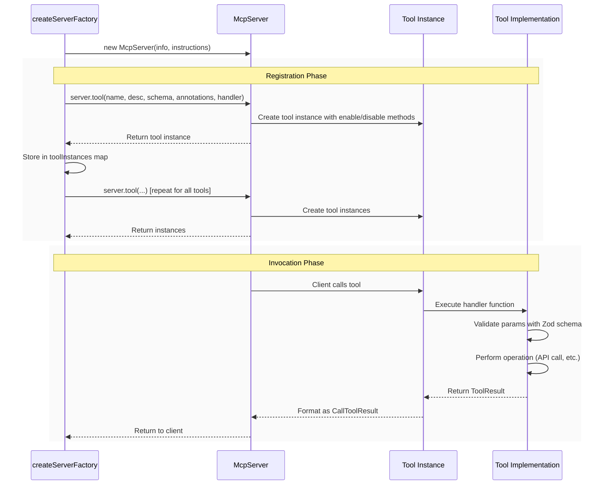
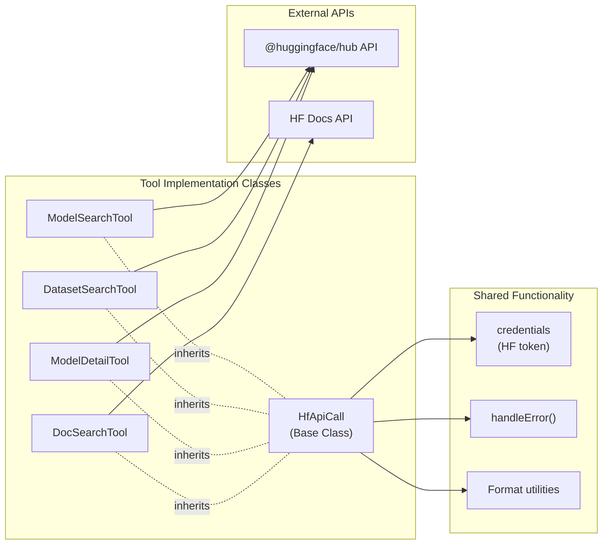
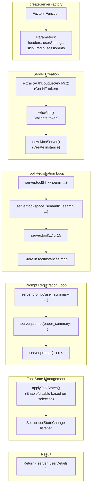
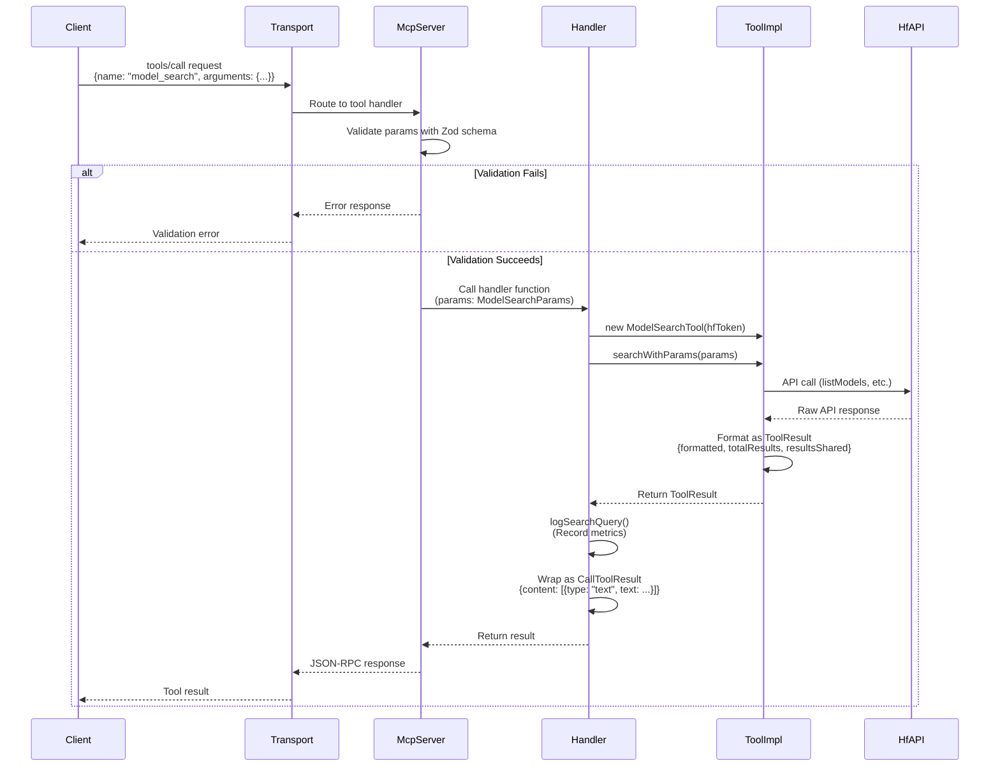

<!-- source: DeepWiki mcp.deepwiki.com · repo huggingface/hf-mcp-server · page 4 Tools and Prompts · fetched 2026-10-26 -->

# Tools and Prompts

<details>
<summary>Relevant source files</summary>

The following files were used as context for generating this wiki page:

- [packages/app/src/server/mcp-server.ts](packages/app/src/server/mcp-server.ts)
- [packages/app/src/shared/settings.ts](packages/app/src/shared/settings.ts)
- [packages/app/src/web/App.tsx](packages/app/src/web/App.tsx)
- [packages/mcp/src/index.ts](packages/mcp/src/index.ts)
- [packages/mcp/src/tool-ids.ts](packages/mcp/src/tool-ids.ts)

</details>


This document describes the tools and prompts available in the Hugging Face MCP Server. It covers the tool architecture, configuration patterns, registration process, and the complete catalog of built-in tools and prompts.

For information about how tools are selected and filtered for clients, see [Tool Selection System](#5). For details about dynamically-discovered Gradio tools, see [Gradio Integration](#6).

## Overview

The HF MCP Server provides two types of capabilities to connected clients:

**Tools** are callable functions that perform operations against the Hugging Face ecosystem. The server includes 15 built-in tools covering search, detail retrieval, space management, documentation access, and job management. Additionally, Gradio-based tools can be dynamically registered (covered in [Gradio Integration](#6)).

**Prompts** are pre-configured message templates that fetch and format data for insertion into AI assistant conversations. The server includes 4 prompts for summarizing users, papers, models, and datasets.

All tools and prompts follow a consistent configuration pattern using Zod schemas for parameter validation and type safety.

Sources: [packages/app/src/server/mcp-server.ts:1-896](), [packages/mcp/src/tool-ids.ts:1-105]()

## Tool Architecture

### Tool Configuration Structure

Every tool in the system follows a standardized configuration pattern. Each tool has a configuration object (`*_TOOL_CONFIG`) that defines its metadata and behavior.

```mermaid
graph TB
    subgraph "Tool Configuration Object"
        Config["TOOL_CONFIG"]
        Name["name: string<br/>(Tool ID)"]
        Desc["description: string<br/>(Tool Purpose)"]
        Schema["schema: ZodObject<br/>(Parameter Schema)"]
        Annotations["annotations: object<br/>(MCP Metadata)"]
    end
    
    subgraph "Zod Schema (Validation)"
        ZodSchema["z.object({...})"]
        Params["Parameter Definitions"]
        Validation["Runtime Validation"]
    end
    
    subgraph "Annotations (MCP Protocol)"
        Title["title: string"]
        ReadOnly["readOnlyHint: boolean"]
        OpenWorld["openWorldHint: boolean"]
    end
    
    subgraph "Tool Implementation"
        ToolClass["Tool Class<br/>(e.g., ModelSearchTool)"]
        Handler["Handler Function<br/>(async execution)"]
        Result["ToolResult<br/>(formatted response)"]
    end
    
    Config --> Name
    Config --> Desc
    Config --> Schema
    Config --> Annotations
    
    Schema --> ZodSchema
    ZodSchema --> Params
    ZodSchema --> Validation
    
    Annotations --> Title
    Annotations --> ReadOnly
    Annotations --> OpenWorld
    
    Config -.."used by"..- ToolClass
    ToolClass --> Handler
    Handler --> Result
```

**Tool Configuration Example Structure**

| Component | Purpose | Example |
|-----------|---------|---------|
| `name` | Unique tool identifier | `"model_search"` |
| `description` | Human-readable tool purpose | `"Search for models on Hugging Face Hub"` |
| `schema` | Zod schema for parameter validation | `z.object({ query: z.string() })` |
| `annotations.title` | Display name for UIs | `"Model Search"` |
| `annotations.readOnlyHint` | Whether tool modifies state | `true` |
| `annotations.openWorldHint` | Whether results are comprehensive | `false` |

Sources: [packages/app/src/server/mcp-server.ts:6-63](), [packages/mcp/src/tool-ids.ts:6-26]()

### Tool Registration Flow

Tools are registered with the MCP server during server instantiation using the `server.tool()` method from the `@modelcontextprotocol/sdk`.



The registration creates a `toolInstances` map that stores references to each registered tool, allowing dynamic enable/disable control:

```typescript
const toolInstances: { [name: string]: Tool } = {};

toolInstances[MODEL_SEARCH_TOOL_CONFIG.name] = server.tool(
  MODEL_SEARCH_TOOL_CONFIG.name,
  MODEL_SEARCH_TOOL_CONFIG.description,
  MODEL_SEARCH_TOOL_CONFIG.schema.shape,
  MODEL_SEARCH_TOOL_CONFIG.annotations,
  async (params: ModelSearchParams) => { /* handler */ }
);
```

Sources: [packages/app/src/server/mcp-server.ts:151-896](), [packages/app/src/server/mcp-server.ts:383-406]()

## Built-in Tools

The server provides 15 built-in tools organized into functional categories. Each tool is implemented as a class in `packages/mcp/src/` and registered in the server factory.

### Tool Categories and Groups

Tools are organized into logical groups defined in `TOOL_ID_GROUPS`:

```mermaid
graph TB
    subgraph "TOOL_ID_GROUPS"
        All["all<br/>(15 tools)"]
        
        Search["search<br/>(5 tools)"]
        Spaces["spaces<br/>(5 tools)"]
        Detail["detail<br/>(3 tools)"]
        Docs["docs<br/>(2 tools)"]
        HfApi["hf_api<br/>(7 tools)"]
    end
    
    subgraph "Search Tools"
        SpaceSearch["space_semantic_search"]
        ModelSearch["model_search"]
        DatasetSearch["dataset_search"]
        PaperSearch["paper_search"]
        DocSearch["hf_doc_search"]
    end
    
    subgraph "Space Management Tools"
        SpaceSearchDup["space_semantic_search"]
        DuplicateSpace["duplicate_space"]
        SpaceInfo["space_info"]
        SpaceFiles["space_files"]
        UseSpace["use_space"]
    end
    
    subgraph "Detail Tools"
        ModelDetail["model_detail"]
        DatasetDetail["dataset_detail"]
        HubInspect["hub_repo_details"]
    end
    
    subgraph "Documentation Tools"
        DocSearchDup["hf_doc_search"]
        DocFetch["hf_doc_fetch"]
    end
    
    Search --> SpaceSearch
    Search --> ModelSearch
    Search --> DatasetSearch
    Search --> PaperSearch
    Search --> DocSearch
    
    Spaces --> SpaceSearchDup
    Spaces --> DuplicateSpace
    Spaces --> SpaceInfo
    Spaces --> SpaceFiles
    Spaces --> UseSpace
    
    Detail --> ModelDetail
    Detail --> DatasetDetail
    Detail --> HubInspect
    
    Docs --> DocSearchDup
    Docs --> DocFetch
    
    HfApi --> SpaceSearch
    HfApi --> ModelSearch
    HfApi --> DatasetSearch
    HfApi --> PaperSearch
    HfApi --> HubInspect
    HfApi --> DocSearch
    
    All --> Search
    All --> Spaces
    All --> Detail
    All --> Docs
```



Sources: [packages/mcp/src/tool-ids.ts:67-96]()

### Complete Tool Catalog

| Tool ID | Tool Class | Config | Registration | Purpose |
|---------|-----------|--------|--------------|---------|
| `hf_whoami` | N/A (inline) | N/A | [mcp-server.ts:198-206]() | Display authentication status |
| `space_semantic_search` | `SpaceSearchTool` | `SEMANTIC_SEARCH_TOOL_CONFIG` | [mcp-server.ts:357-381]() | Semantic search across HF Spaces |
| `model_search` | `ModelSearchTool` | `MODEL_SEARCH_TOOL_CONFIG` | [mcp-server.ts:383-406]() | Search models with filters |
| `model_detail` | `ModelDetailTool` | `MODEL_DETAIL_TOOL_CONFIG` | [mcp-server.ts:408-431]() | Get comprehensive model information |
| `paper_search` | `PaperSearchTool` | `PAPER_SEARCH_TOOL_CONFIG` | [mcp-server.ts:433-459]() | Search academic papers on HF Hub |
| `dataset_search` | `DatasetSearchTool` | `DATASET_SEARCH_TOOL_CONFIG` | [mcp-server.ts:461-484]() | Search datasets with filters |
| `dataset_detail` | `DatasetDetailTool` | `DATASET_DETAIL_TOOL_CONFIG` | [mcp-server.ts:486-509]() | Get comprehensive dataset information |
| `hub_repo_details` | `HubInspectTool` | `HUB_INSPECT_TOOL_CONFIG` | [mcp-server.ts:524-561]() | Inspect repository structure and files |
| `hf_doc_search` | `DocSearchTool` | `DOCS_SEMANTIC_SEARCH_CONFIG` | [mcp-server.ts:563-586]() | Semantic search HF documentation |
| `hf_doc_fetch` | `DocFetchTool` | `DOC_FETCH_CONFIG` | [mcp-server.ts:588-600]() | Fetch and convert documentation pages |
| `duplicate_space` | `DuplicateSpaceTool` | `DUPLICATE_SPACE_TOOL_CONFIG` | [mcp-server.ts:602-615]() | Duplicate a Space to user's account |
| `space_info` | `SpaceInfoTool` | `SPACE_INFO_TOOL_CONFIG` | [mcp-server.ts:617-630]() | Get Space metadata and runtime info |
| `space_files` | `SpaceFilesTool` | `SPACE_FILES_TOOL_CONFIG` | [mcp-server.ts:632-645]() | List files in a Space repository |
| `use_space` | `UseSpaceTool` | `USE_SPACE_TOOL_CONFIG` | [mcp-server.ts:647-670]() | View or invoke Gradio Space endpoints |
| `hf_jobs` | `HfJobsTool` | `HF_JOBS_TOOL_CONFIG` | [mcp-server.ts:672-697]() | Manage training/inference jobs |
| `use-space` (dynamic) | `SpaceTool` | `DYNAMIC_SPACE_TOOL_CONFIG` | [mcp-server.ts:699-815]() | Dynamic Space invocation with operations |

Sources: [packages/app/src/server/mcp-server.ts:198-815](), [packages/mcp/src/tool-ids.ts:28-47]()

### Authentication Tool

The `hf_whoami` tool is always enabled and provides authentication guidance:

- **Authenticated users**: Displays username
- **Unauthenticated users**: Returns configuration guidance from `CONFIG_GUIDANCE`

An optional `Authenticate` tool can be enabled via `AUTHENTICATE_TOOL=true` environment variable for certain client workflows.

Sources: [packages/app/src/server/mcp-server.ts:193-219]()

### Tool Implementation Pattern

Most tools follow a consistent implementation pattern:



Each tool class:
1. Extends `HfApiCall` base class (for most tools)
2. Accepts `hfToken` for authentication
3. Implements a main execution method (e.g., `search()`, `getDetails()`)
4. Returns a `ToolResult` object with `{ formatted, totalResults, resultsShared }`

Sources: [packages/mcp/src/hf-api-call.ts:1-100]() (inferred), [packages/app/src/server/mcp-server.ts:383-509]()

## Prompts

The server provides 4 prompts that fetch and format data for AI assistant conversations. Prompts are registered using `server.prompt()` and return message objects with pre-formatted content.

### Prompt Catalog

| Prompt ID | Prompt Class | Config | Registration | Purpose |
|-----------|-------------|--------|--------------|---------|
| `user_summary` | `UserSummaryPrompt` | `USER_SUMMARY_PROMPT_CONFIG` | [mcp-server.ts:221-253]() | Summarize user's HF contributions |
| `paper_summary` | `PaperSummaryPrompt` | `PAPER_SUMMARY_PROMPT_CONFIG` | [mcp-server.ts:255-287]() | Summarize academic paper details |
| `model_detail_prompt` | `ModelDetailTool` | `MODEL_DETAIL_PROMPT_CONFIG` | [mcp-server.ts:289-321]() | Model details formatted for prompts |
| `dataset_detail_prompt` | `DatasetDetailTool` | `DATASET_DETAIL_PROMPT_CONFIG` | [mcp-server.ts:323-355]() | Dataset details formatted for prompts |

### Prompt Structure

Prompts follow the MCP protocol's message format:

```typescript
{
  description: "User summary for username",
  messages: [
    {
      role: "user",
      content: {
        type: "text",
        text: "formatted summary content"
      }
    }
  ]
}
```

Prompts differ from tools in that they:
- Return pre-formatted messages ready for conversation insertion
- Always use `role: "user"` to inject context into the conversation
- Typically aggregate multiple API calls into a single coherent summary
- Have logging that tracks `responseCharCount` instead of raw API metrics

Sources: [packages/app/src/server/mcp-server.ts:221-355](), [packages/mcp/src/user-summary.ts:1-100]() (inferred)

## Tool Configuration Pattern

### Configuration Object Structure

Each tool exports a configuration object with the following structure:

```mermaid
graph TB
    subgraph "Example: MODEL_SEARCH_TOOL_CONFIG"
        Config["Configuration Object"]
        
        NameField["name: 'model_search'"]
        DescField["description: 'Search for models...'"]
        SchemaField["schema: z.object({...})"]
        AnnotField["annotations: {...}"]
    end
    
    subgraph "schema (Zod Validation)"
        ZodObj["z.object({"])
        QueryParam["query: z.string().optional()"]
        LimitParam["limit: z.number().optional()"]
        SortParam["sort: z.enum([...]).optional()"]
        TagsParam["tags: z.array(...).optional()"]
        ZodClose["})"]
    end
    
    subgraph "annotations (MCP Metadata)"
        TitleAnn["title: 'Model Search'"]
        ReadOnlyAnn["readOnlyHint: true"]
        OpenWorldAnn["openWorldHint: false"]
    end
    
    Config --> NameField
    Config --> DescField
    Config --> SchemaField
    Config --> AnnotField
    
    SchemaField --> ZodObj
    ZodObj --> QueryParam
    ZodObj --> LimitParam
    ZodObj --> SortParam
    ZodObj --> TagsParam
    ZodObj --> ZodClose
    
    AnnotField --> TitleAnn
    AnnotField --> ReadOnlyAnn
    AnnotField --> OpenWorldAnn
```

### Parameter Schema Validation

All tool parameters are validated using Zod schemas. When a tool is invoked:

1. The MCP SDK automatically validates parameters against `schema.shape`
2. Invalid parameters result in immediate error responses
3. Valid parameters are passed to the handler function with TypeScript type safety

Example parameter types:

```typescript
// ModelSearchParams (inferred from schema)
type ModelSearchParams = {
  query?: string;
  limit?: number;
  sort?: "trendingScore" | "downloads" | "likes";
  tags?: string[];
  // ... additional parameters
}
```

Sources: [packages/app/src/server/mcp-server.ts:12-13](), [packages/mcp/src/model-search.ts:1-100]() (inferred)

### Annotations and Hints

The `annotations` field provides MCP protocol metadata:

| Annotation | Type | Purpose |
|------------|------|---------|
| `title` | `string` | Human-readable display name |
| `readOnlyHint` | `boolean` | Indicates if tool modifies state (false = writes data) |
| `openWorldHint` | `boolean` | Indicates if results are comprehensive (false = filtered/limited) |

These hints allow MCP clients to make informed decisions about tool usage and caching.

Sources: [packages/app/src/server/mcp-server.ts:202](), [packages/app/src/server/mcp-server.ts:360-361]()

## Tool Registration Process

### Server Factory Pattern

The `createServerFactory` function returns a factory that creates configured `McpServer` instances:



The factory is invoked by transport implementations whenever a new server instance is needed:
- **STDIO transport**: Once at startup
- **Stateful transports (SSE, HTTP)**: Once per session
- **Stateless transport**: Once per request

Sources: [packages/app/src/server/mcp-server.ts:96-896]()

### Tool Instance Storage

The `toolInstances` map stores references to all registered tools:

```typescript
const toolInstances: { [name: string]: Tool } = {};
```

Each entry has `enable()` and `disable()` methods that control tool visibility. This allows dynamic tool management based on:
- Tool selection strategy results
- User settings changes (via `toolStateChange` events)
- Runtime configuration flags

Sources: [packages/app/src/server/mcp-server.ts:174-191](), [packages/app/src/server/mcp-server.ts:839-893]()

### Dynamic Tool State Management

After registration, tool states are applied:

```typescript
const applyToolStates = async () => {
  // Apply the desired state to each tool
  for (const [toolName, toolInstance] of Object.entries(toolInstances)) {
    if (toolSelection.enabledToolIds.includes(toolName)) {
      toolInstance.enable();
    } else {
      toolInstance.disable();
    }
  }
};
```

For stateful transports, an event listener updates tool states dynamically:

```typescript
sharedApiClient.on('toolStateChange', (toolId: string, enabled: boolean) => {
  const toolInstance = toolInstances[toolId];
  if (toolInstance) {
    if (enabled) {
      toolInstance.enable();
    } else {
      toolInstance.disable();
    }
  }
});
```

This allows the web UI to toggle tools without requiring client reconnection.

Sources: [packages/app/src/server/mcp-server.ts:839-893]()

## Tool Invocation Lifecycle

When a client calls a tool, the following sequence occurs:



### Handler Function Pattern

Each tool handler follows this pattern:

1. **Instantiate tool class** with authentication token
2. **Execute operation** (search, fetch, etc.)
3. **Format result** as `ToolResult`
4. **Log query** with metrics
5. **Return** as `CallToolResult` with text content

Example handler structure:

```typescript
async (params: ModelSearchParams) => {
  const modelSearch = new ModelSearchTool(hfToken);
  const result = await modelSearch.searchWithParams(params);
  
  logSearchQuery(
    MODEL_SEARCH_TOOL_CONFIG.name,
    params.query || `sort:${params.sort}`,
    params,
    { ...loggingOptions, ...result }
  );
  
  return {
    content: [{ type: 'text', text: result.formatted }]
  };
}
```

Sources: [packages/app/src/server/mcp-server.ts:383-406]()

### Result Format

Tools return `CallToolResult` objects with:

```typescript
{
  content: [
    {
      type: "text",
      text: "formatted result string"
    }
  ],
  isError?: boolean  // Optional error flag
}
```

The `formatted` text is typically a human-readable markdown string summarizing the operation results.

Sources: [packages/app/src/server/mcp-server.ts:378-379](), [packages/app/src/server/mcp-server.ts:402-405]()

## Special Tool Behaviors

### Dynamic Schema Modification

The `hub_repo_details` tool conditionally modifies its schema based on the `README_INCLUDE_FLAG`:

```typescript
const hubInspectReadmeAllowed = hasReadmeFlag(toolSelection.enabledToolIds);
const hubInspectDescription = hubInspectReadmeAllowed
  ? `${HUB_INSPECT_TOOL_CONFIG.description} README file may be requested...`
  : HUB_INSPECT_TOOL_CONFIG.description;

const hubInspectSchemaShape = hubInspectReadmeAllowed
  ? hubInspectBaseShape
  : omitReadmeParameter(hubInspectBaseShape);
```

When the flag is disabled, the `include_readme` parameter is removed from the schema, preventing clients from requesting README content.

Sources: [packages/app/src/server/mcp-server.ts:512-523]()

### Runtime Feature Flags

The `use-space` dynamic tool checks the `gradio=none` header to disable invoke operations:

```typescript
if (params.operation === 'invoke' && gradio === 'none') {
  return {
    content: [{ type: 'text', text: 'The invoke operation is disabled...' }],
    isError: true,
  };
}
```

This allows fine-grained control over Gradio functionality without changing tool registration.

Sources: [packages/app/src/server/mcp-server.ts:706-716]()

### Logging and Metrics

All tool invocations are logged with:
- Tool name and query/operation
- Input parameters (sanitized)
- Session information (client ID, auth status, client name/version)
- Result metrics (total results, results shared, response character count)

Different logging functions are used based on tool type:
- `logSearchQuery()` for search tools
- `logPromptQuery()` for prompts and detail tools
- `logGradioEvent()` for Gradio tool invocations

Sources: [packages/app/src/server/mcp-server.ts:69](), [packages/app/src/server/mcp-server.ts:366-376]()

---

