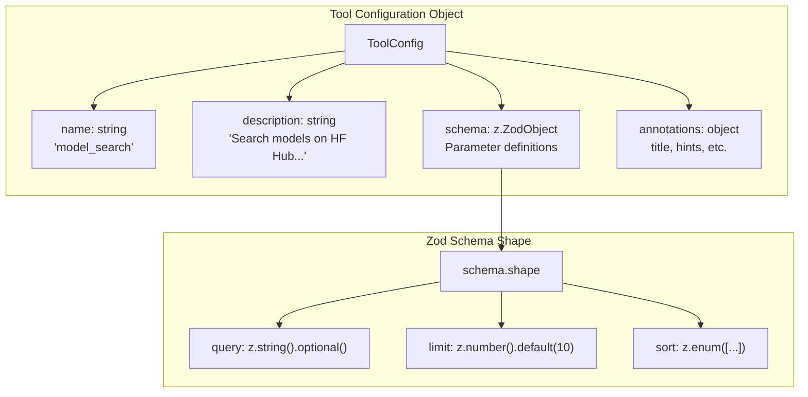
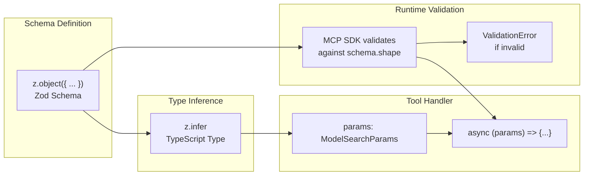
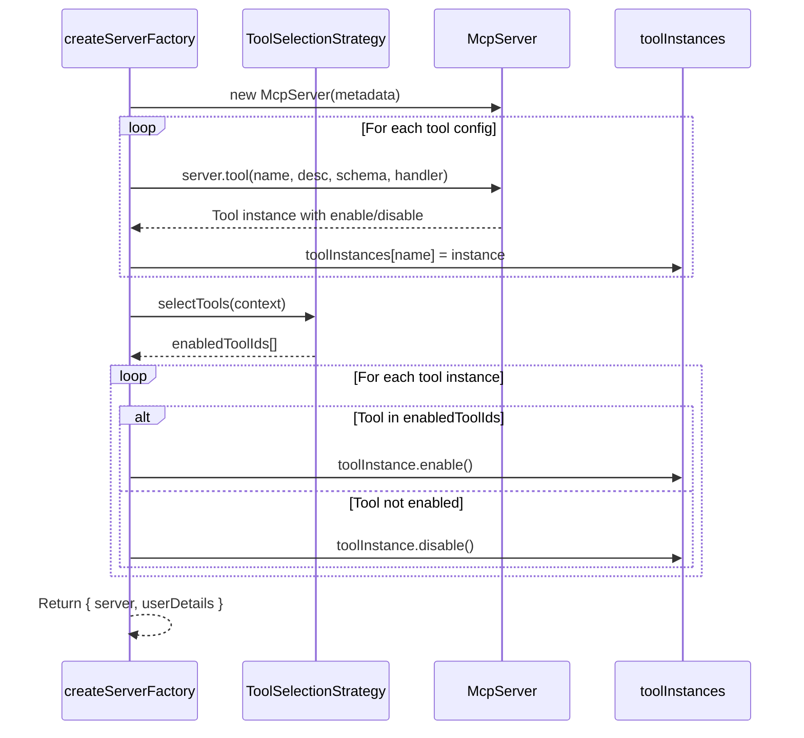
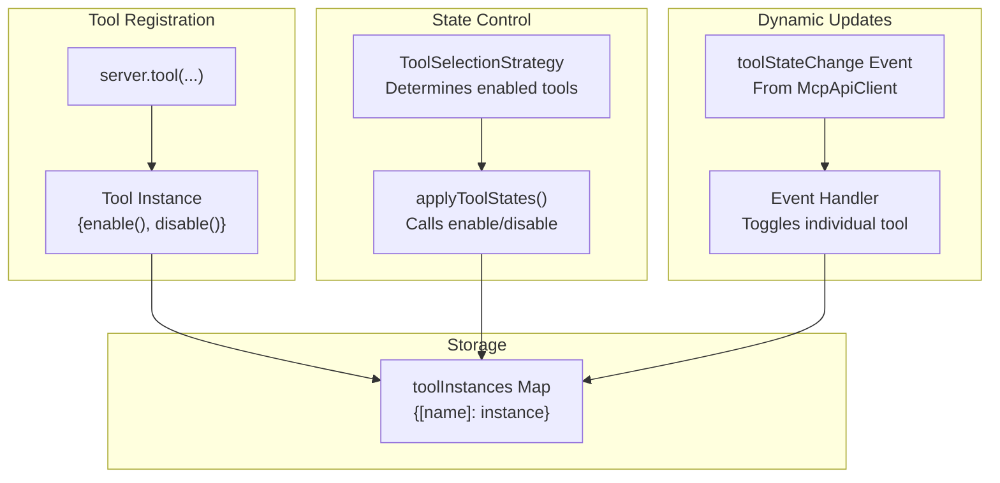
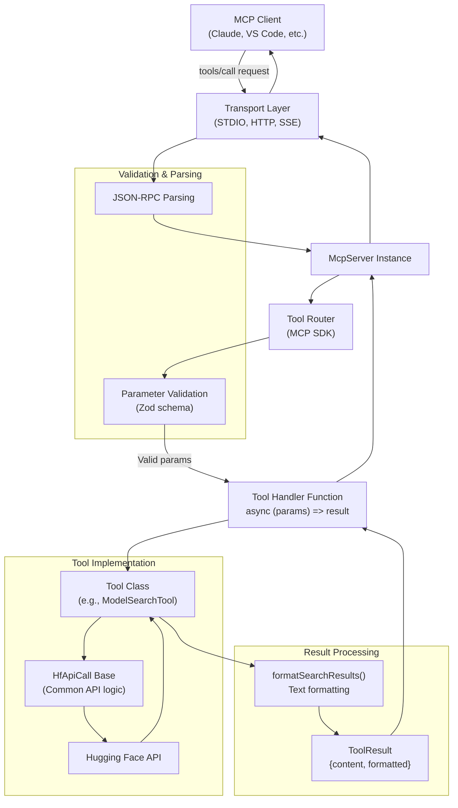
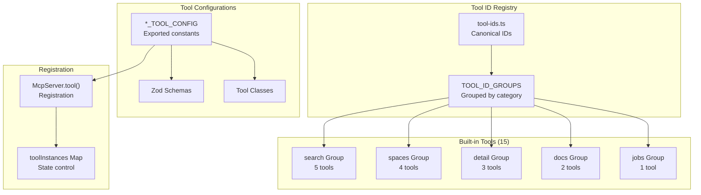

<!-- source: DeepWiki mcp.deepwiki.com · repo huggingface/hf-mcp-server · page 4.1 Tool System Overview · fetched 2026-10-26 -->

# Tool System Overview

<details>
<summary>Relevant source files</summary>

The following files were used as context for generating this wiki page:

- [packages/app/src/server/mcp-server.ts](packages/app/src/server/mcp-server.ts)
- [packages/app/src/shared/settings.ts](packages/app/src/shared/settings.ts)
- [packages/app/src/web/App.tsx](packages/app/src/web/App.tsx)
- [packages/mcp/src/index.ts](packages/mcp/src/index.ts)
- [packages/mcp/src/tool-ids.ts](packages/mcp/src/tool-ids.ts)

</details>


## Purpose and Scope

This page explains the tool system architecture in the Hugging Face MCP Server, covering how tools are defined, registered, validated, and invoked. It focuses on the configuration pattern, schema validation with Zod, and the tool execution lifecycle.

For information about specific built-in tools and their functionality, see [Built-in Tools](#4.2). For details on how tools are selected and filtered for clients, see [Tool Selection System](#5). For Gradio-specific tool mechanics, see [Gradio Integration](#6).

---

## Tool Configuration Pattern

Tools in this system follow a standardized configuration pattern where each tool is defined by a configuration object containing metadata and behavior specifications. This pattern ensures consistency across all tool implementations and provides the MCP Server with the information needed to register and expose tools to clients.

### Configuration Structure

Each tool configuration object includes four key components:

| Component | Type | Purpose |
|-----------|------|---------|
| `name` | `string` | Unique identifier for the tool (e.g., `"model_search"`) |
| `description` | `string` | Human-readable explanation of the tool's purpose |
| `schema` | `z.ZodObject` | Zod schema defining input parameters and validation rules |
| `annotations` | `object` | Metadata including `title`, `readOnlyHint`, `openWorldHint` |

**Example Tool Configuration Structure**



**Sources:** [packages/mcp/src/model-search.ts](), [packages/mcp/src/tool-ids.ts:6-26](), [packages/app/src/server/mcp-server.ts:383-406]()

### Configuration Constants

Tool configurations are exported as constants from the `@llmindset/hf-mcp` package, providing a single source of truth for tool definitions. These constants are imported and used during server initialization.

Examples from the codebase:
- `MODEL_SEARCH_TOOL_CONFIG` - Configuration for model search tool
- `DATASET_SEARCH_TOOL_CONFIG` - Configuration for dataset search tool
- `SEMANTIC_SEARCH_TOOL_CONFIG` - Configuration for space semantic search
- `DOC_FETCH_CONFIG` - Configuration for documentation fetch tool

**Sources:** [packages/app/src/server/mcp-server.ts:6-63](), [packages/mcp/src/tool-ids.ts:6-26]()

---

## Schema Validation with Zod

The system uses [Zod](https://github.com/colinhacks/zod) for runtime schema validation and TypeScript type inference. Each tool's input parameters are validated against a Zod schema before execution, ensuring type safety and providing automatic error messages for invalid inputs.

### Schema Definition Pattern

Tools define their schemas using Zod's schema builders, which provide both validation logic and TypeScript type information:

```typescript
// Example pattern (not actual code, for illustration)
const schema = z.object({
  query: z.string().describe("Search query text"),
  limit: z.number().min(1).max(100).default(10),
  sort: z.enum(["trending", "likes", "downloads"]).optional()
})
```

### Type Inference

Zod schemas enable automatic TypeScript type inference for tool parameters. The `z.infer<typeof schema>` utility extracts the TypeScript type from the schema, ensuring that tool handlers receive correctly typed parameters.

**Tool Parameter Type Flow**



**Sources:** [packages/app/src/server/mcp-server.ts:383-406](), [packages/mcp/src/model-search.ts]()

### Schema Shape for Registration

During tool registration, the MCP SDK requires the schema's `shape` property rather than the full Zod schema object. The shape is accessed via `schema.shape` and contains the raw Zod type definitions:

```typescript
// Registration pattern used in mcp-server.ts
server.tool(
  MODEL_SEARCH_TOOL_CONFIG.name,
  MODEL_SEARCH_TOOL_CONFIG.description,
  MODEL_SEARCH_TOOL_CONFIG.schema.shape,  // ← .shape property
  MODEL_SEARCH_TOOL_CONFIG.annotations,
  async (params: ModelSearchParams) => { /* ... */ }
)
```

**Sources:** [packages/app/src/server/mcp-server.ts:383-387]()

---

## Tool Registration and State Management

Tools are registered to `McpServer` instances during server creation. Each tool can be dynamically enabled or disabled without server restart, allowing runtime control over tool availability.

### Registration Process

The `createServerFactory` function creates new `McpServer` instances and registers all tools. Registration happens in [packages/app/src/server/mcp-server.ts:96-896]() and follows this pattern:

1. Create `McpServer` instance with server metadata
2. For each tool, call `server.tool()` with configuration and handler
3. Store returned tool instance in `toolInstances` map
4. Apply tool selection strategy to enable/disable tools

**Tool Registration Flow**



**Sources:** [packages/app/src/server/mcp-server.ts:96-896](), [packages/app/src/server/mcp-server.ts:839-893]()

### Tool Instances and State Management

Each call to `server.tool()` returns an object with `enable()` and `disable()` methods. These instances are stored in a map for dynamic state control:

```typescript
// From mcp-server.ts
const toolInstances: { [name: string]: Tool } = {};

interface Tool {
  enable(): void;
  disable(): void;
}

// Registration stores instance
toolInstances[MODEL_SEARCH_TOOL_CONFIG.name] = server.tool(
  /* ... config ... */
);

// Later, state can be changed
toolInstances["model_search"].disable();
toolInstances["model_search"].enable();
```

**Tool State Management Architecture**



**Sources:** [packages/app/src/server/mcp-server.ts:174-177](), [packages/app/src/server/mcp-server.ts:839-859](), [packages/app/src/server/mcp-server.ts:873-891]()

### Dynamic State Changes via Events

For stateful transport modes (non-JSON, non-external API), the server listens for `toolStateChange` events from `McpApiClient`. When a tool is toggled in the web UI, all connected server instances receive the event and update their state:

**Sources:** [packages/app/src/server/mcp-server.ts:873-891]()

---

## Tool Invocation Lifecycle

When a client invokes a tool, the request flows through multiple layers of validation, routing, and execution before returning results.

### Request Flow



**Sources:** [packages/app/src/server/mcp-server.ts:383-406](), [packages/mcp/src/model-search.ts](), [packages/mcp/src/hf-api-call.ts]()

### Handler Function Signature

Tool handlers are async functions that receive validated parameters and return MCP-compatible results. The return format follows the `CallToolResultSchema` from the MCP SDK:

```typescript
// Handler pattern
async (params: ToolParamsType) => {
  // 1. Create tool instance
  const tool = new ToolClass(hfToken, username);
  
  // 2. Execute tool logic
  const result = await tool.execute(params);
  
  // 3. Return MCP result format
  return {
    content: [{ type: 'text', text: result.formatted }],
    ...(result.isError && { isError: true })
  };
}
```

**Sources:** [packages/app/src/server/mcp-server.ts:388-405](), [packages/app/src/server/mcp-server.ts:461-484]()

### Parameter Extraction and Validation

The MCP SDK automatically validates incoming parameters against the registered schema before invoking the handler. If validation fails, an error is returned to the client without calling the handler function. This ensures handlers always receive well-typed, validated data.

**Sources:** [packages/app/src/server/mcp-server.ts:383-406]()

---

## Tool Categories

The system distinguishes between different types of tools based on their implementation and registration timing.

### Built-in Tools

Built-in tools are statically registered during server initialization. There are 15 core built-in tools:

| Category | Tools | Count |
|----------|-------|-------|
| Search | `model_search`, `dataset_search`, `paper_search`, `space_semantic_search`, `hf_doc_search` | 5 |
| Detail | `model_detail`, `dataset_detail`, `hub_repo_details` | 3 |
| Space Management | `duplicate_space`, `space_info`, `space_files`, `use_space` | 4 |
| Documentation | `hf_doc_fetch` | 1 |
| Jobs | `hf_jobs` | 1 |
| Dynamic Space | `hf_space` | 1 |

Plus the `hf_whoami` authentication/info tool.

**Tool Registry Structure**



**Sources:** [packages/mcp/src/tool-ids.ts:49-96](), [packages/app/src/server/mcp-server.ts:357-815]()

### Dynamic Gradio Tools

Dynamic Gradio tools are discovered and registered at runtime based on user configuration or header parameters. These are not included in the built-in tool count but are registered through the proxy factory pattern. See [Gradio Integration](#6) for details.

**Sources:** [packages/app/src/server/mcp-server.ts:699-815]()

### Prompts vs Tools

The MCP protocol distinguishes between tools and prompts:

- **Tools** (`server.tool()`): Execute actions and return results (e.g., search, fetch data)
- **Prompts** (`server.prompt()`): Return pre-formatted messages for the LLM context (e.g., summaries)

Prompts are registered using `server.prompt()` with a similar configuration pattern but return message arrays instead of tool results. The system includes 4 built-in prompts: `user_summary`, `paper_summary`, `model_detail_prompt`, and `dataset_detail_prompt`.

**Sources:** [packages/app/src/server/mcp-server.ts:221-355]()

---

## Tool Configuration Code Mapping

The following table maps natural language tool concepts to their code entities:

| Concept | Code Entity | File Location |
|---------|-------------|---------------|
| Tool configuration object | `*_TOOL_CONFIG` constants | `packages/mcp/src/` (various files) |
| Tool ID registry | `TOOL_ID_GROUPS` export | `packages/mcp/src/tool-ids.ts` |
| Tool registration | `server.tool()` calls | `packages/app/src/server/mcp-server.ts:357-815` |
| Tool state manager | `toolInstances: { [name: string]: Tool }` | `packages/app/src/server/mcp-server.ts:191` |
| Server factory | `createServerFactory()` | `packages/app/src/server/mcp-server.ts:96-896` |
| Tool selection logic | `ToolSelectionStrategy.selectTools()` | `packages/app/src/server/utils/tool-selection-strategy.ts` |
| State application | `applyToolStates()` | `packages/app/src/server/mcp-server.ts:839-859` |
| Settings service | `settingsService` | `packages/app/src/shared/settings.ts:50-95` |

**Sources:** [packages/app/src/server/mcp-server.ts:96-896](), [packages/mcp/src/tool-ids.ts:1-105](), [packages/app/src/shared/settings.ts:1-96]()

---

