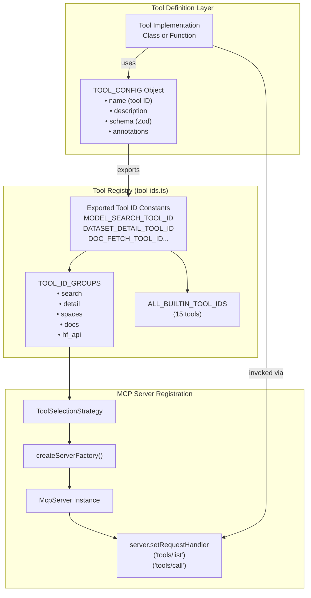
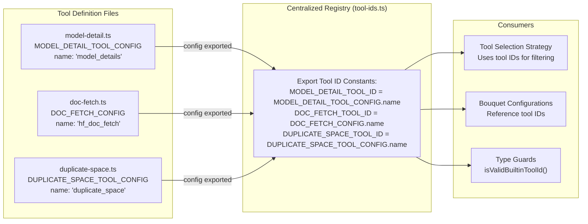
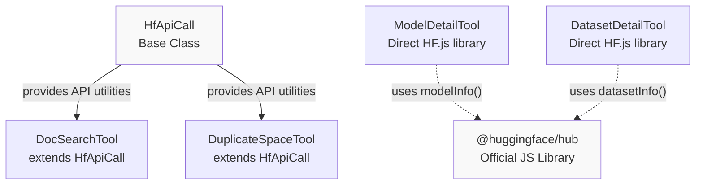
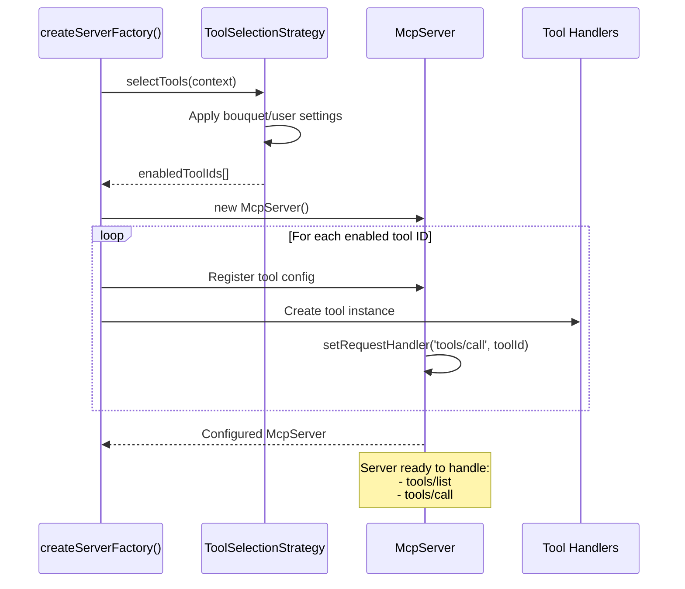

<!-- source: DeepWiki mcp.deepwiki.com · repo huggingface/hf-mcp-server · page 4.2 Built-in Tools · fetched 2026-10-26 -->

# Built-in Tools

<details>
<summary>Relevant source files</summary>

The following files were used as context for generating this wiki page:

- [.dockerignore](.dockerignore)
- [Dockerfile](Dockerfile)
- [README.md](README.md)
- [packages/app/src/shared/constants.ts](packages/app/src/shared/constants.ts)
- [packages/app/vite.config.ts](packages/app/vite.config.ts)
- [packages/e2e-python/prompts.py](packages/e2e-python/prompts.py)
- [packages/mcp/src/dataset-detail.ts](packages/mcp/src/dataset-detail.ts)
- [packages/mcp/src/docs-search/doc-fetch.test.ts](packages/mcp/src/docs-search/doc-fetch.test.ts)
- [packages/mcp/src/docs-search/doc-fetch.ts](packages/mcp/src/docs-search/doc-fetch.ts)
- [packages/mcp/src/docs-search/docs-semantic-search.test.ts](packages/mcp/src/docs-search/docs-semantic-search.test.ts)
- [packages/mcp/src/docs-search/docs-semantic-search.ts](packages/mcp/src/docs-search/docs-semantic-search.ts)
- [packages/mcp/src/duplicate-space.ts](packages/mcp/src/duplicate-space.ts)
- [packages/mcp/src/error-messages.ts](packages/mcp/src/error-messages.ts)
- [packages/mcp/src/index.ts](packages/mcp/src/index.ts)
- [packages/mcp/src/model-detail.ts](packages/mcp/src/model-detail.ts)
- [packages/mcp/src/tool-ids.ts](packages/mcp/src/tool-ids.ts)
- [start.sh](start.sh)

</details>


## Purpose and Scope

This page provides a comprehensive reference for all built-in tools in the Hugging Face MCP Server. Built-in tools are statically defined MCP tools that provide access to Hugging Face Hub APIs, documentation, and space management capabilities. These tools are distinct from dynamically-discovered Gradio tools (covered in [Gradio Integration](#6)).

For information about how tools are selected and enabled, see [Tool Selection System](#5). For details about the tool configuration pattern, schema validation, and invocation lifecycle, see [Tool System Overview](#4.1).

**Scope**: This page documents the 15 built-in tools, their organization into functional categories, registration patterns, and the tool ID system. Detailed documentation for each tool category is provided in subsections [4.2.1](#4.2.1) through [4.2.4](#4.2.4).

## Tool Architecture Overview

Built-in tools follow a consistent configuration and registration pattern. Each tool is defined by a `TOOL_CONFIG` object containing metadata, a Zod schema for parameters, and optional annotations. The tool IDs serve as canonical identifiers throughout the system.



**Diagram**: Tool configuration and registration architecture

Sources: [packages/mcp/src/tool-ids.ts:1-105](), [packages/mcp/src/index.ts:1-30]()

## Complete Tool Registry

The following table lists all 15 built-in tools with their canonical IDs, primary categories, and descriptions:

| Tool ID | Category | Description | Auth Required |
|---------|----------|-------------|---------------|
| `space_semantic_search` | Search, Spaces | Semantic search for Spaces on Hugging Face | No |
| `model_search` | Search | Search for models on the Hub | No |
| `dataset_search` | Search | Search for datasets on the Hub | No |
| `paper_search` | Search | Search for papers on Hugging Face Papers | No |
| `hf_doc_search` | Search, Docs | Semantic search in HF documentation | No |
| `model_details` | Detail | Get detailed model information | No* |
| `dataset_details` | Detail | Get detailed dataset information | No* |
| `hub_repo_details` | Detail | Get repository metadata and file lists | No* |
| `duplicate_space` | Spaces | Duplicate a Space to user's namespace | Yes |
| `space_info` | Spaces | Get Space runtime and configuration info | No* |
| `space_files` | Spaces | List files in a Space repository | No* |
| `use_space` | Spaces | Dynamically invoke any Gradio Space | No* |
| `hf_doc_fetch` | Docs | Fetch and convert documentation to Markdown | No |
| `hf_jobs` | HF API | Query Hugging Face compute jobs | Yes |
| `dynamic_space` | Dynamic | Runtime-generated Space endpoint tools | No* |

\* Authentication may be required for private or gated resources

Sources: [packages/mcp/src/tool-ids.ts:49-66](), [packages/mcp/src/index.ts:1-30]()

## Tool ID System

Tool IDs are the canonical identifiers used throughout the codebase. They are exported from individual tool configuration objects and centralized in `tool-ids.ts` for reference by other components.



**Diagram**: Tool ID centralization and usage pattern

The `tool-ids.ts` module provides:
- **Exported constants**: One for each tool (e.g., `MODEL_SEARCH_TOOL_ID`)
- **`ALL_BUILTIN_TOOL_IDS`**: Array of all 15 tool IDs
- **`TOOL_ID_GROUPS`**: Predefined groupings for bouquet configurations
- **`isValidBuiltinToolId()`**: Type guard function for validation

Sources: [packages/mcp/src/tool-ids.ts:1-105]()

## Tool Categories

Built-in tools are organized into five functional categories, each serving a distinct purpose within the Hugging Face ecosystem:

### 1. Search Tools (5 tools)

Tools for discovering content across the Hugging Face Hub and documentation. See [Search Tools](#4.2.1) for detailed documentation.

| Tool ID | Purpose |
|---------|---------|
| `space_semantic_search` | Find Spaces using semantic queries |
| `model_search` | Find models by name, tags, or metadata |
| `dataset_search` | Find datasets by name, tags, or task |
| `paper_search` | Search academic papers on HF Papers |
| `hf_doc_search` | Search HF product documentation |

### 2. Detail Tools (3 tools)

Tools for retrieving comprehensive information about Hub entities. See [Detail Tools](#4.2.2) for detailed documentation.

| Tool ID | Purpose |
|---------|---------|
| `model_details` | Full model card, stats, and metadata |
| `dataset_details` | Full dataset card, stats, and metadata |
| `hub_repo_details` | Repository metadata and file listings |

### 3. Space Management Tools (5 tools)

Tools for managing and interacting with Hugging Face Spaces. See [Space Management Tools](#4.2.3) for detailed documentation.

| Tool ID | Purpose |
|---------|---------|
| `duplicate_space` | Clone a Space to user's account |
| `space_info` | Get Space runtime configuration |
| `space_files` | List files in Space repository |
| `use_space` | Invoke any Gradio Space dynamically |
| `dynamic_space` | Runtime-generated Space endpoint |

### 4. Documentation Tools (2 tools)

Tools for discovering and retrieving Hugging Face documentation. See [Documentation Tools](#4.2.4) for detailed documentation.

| Tool ID | Purpose |
|---------|---------|
| `hf_doc_search` | Semantic documentation search |
| `hf_doc_fetch` | Fetch and convert docs to Markdown |

### 5. Additional Tools

| Tool ID | Category | Purpose |
|---------|----------|---------|
| `hf_jobs` | HF API | Query user's compute jobs |
| `hf_whoami` | Auth | Get authenticated user info |

Sources: [packages/mcp/src/tool-ids.ts:67-96]()

## Tool Configuration Pattern

Each built-in tool is defined using a consistent configuration object pattern. This pattern is detailed in [Tool System Overview](#4.1), but is summarized here for reference.

### Configuration Structure

```typescript
export const TOOL_CONFIG = {
    name: string,              // Tool ID (canonical identifier)
    description: string,       // User-facing description
    schema: ZodSchema,        // Parameter validation schema
    annotations: {            // MCP annotations
        title?: string,
        destructiveHint?: boolean,
        readOnlyHint?: boolean,
        openWorldHint?: boolean,
    },
} as const;
```

### Example: Documentation Fetch Tool

The `hf_doc_fetch` tool demonstrates this pattern:

```typescript
// Configuration object
export const DOC_FETCH_CONFIG = {
    name: 'hf_doc_fetch',
    description: 'Fetch a document from the Hugging Face or Gradio documentation library...',
    schema: z.object({
        doc_url: z.string().max(200).describe('Documentation URL'),
        offset: z.number().min(0).optional().describe('Token offset for large documents'),
    }),
    annotations: {
        title: 'Fetch a document from the Hugging Face documentation library',
        destructiveHint: false,
        readOnlyHint: true,
        openWorldHint: true,
    },
}

// Implementation class
export class DocFetchTool {
    async fetch(params: DocFetchParams): Promise<string> {
        // ... implementation
    }
}
```

Sources: [packages/mcp/src/docs-search/doc-fetch.ts:5-23](), [packages/mcp/src/docs-search/doc-fetch.ts:27-217]()

## Tool Implementation Patterns

Built-in tools follow two primary implementation patterns:

### Pattern 1: HfApiCall Base Class

Most tools that interact with Hugging Face APIs extend the `HfApiCall` base class, which provides:
- HTTP request handling with authentication
- Error handling and retry logic
- Timeout management
- Response parsing



**Diagram**: Tool implementation inheritance patterns

### Pattern 2: Direct Library Usage

Some tools (particularly detail tools) use the official `@huggingface/hub` JavaScript library directly:
- `ModelDetailTool` uses `modelInfo()`
- `DatasetDetailTool` uses `datasetInfo()`

This approach provides type-safe access to Hub APIs with proper error handling built-in.

Sources: [packages/mcp/src/hf-api-call.ts]() (referenced), [packages/mcp/src/model-detail.ts:1-6](), [packages/mcp/src/dataset-detail.ts:1-6]()

## Tool Registration Flow

Tools are registered with the MCP Server during server initialization. The process involves tool selection, instantiation, and handler registration.



**Diagram**: Tool registration sequence during server startup

The registration process:

1. **Tool Selection**: `ToolSelectionStrategy` determines which tools to enable based on bouquets, user settings, or defaults (see [Tool Selection System](#5))

2. **Tool Instantiation**: Tool implementation classes are instantiated with appropriate configuration (HF token, API URLs, etc.)

3. **Handler Registration**: Each tool's configuration and handler are registered with the `McpServer` instance

4. **Request Routing**: When clients call `tools/call`, the server routes to the appropriate tool handler based on tool ID

Sources: [packages/app/src/server/mcp-server-factory.ts]() (referenced from diagrams)

## Tool Groupings for Bouquets

Tool groupings defined in `TOOL_ID_GROUPS` are used by the bouquet system to enable predefined sets of tools. These groupings allow clients to request specific capabilities without listing individual tools.

| Bouquet | Tools Included | Use Case |
|---------|----------------|----------|
| `search` | 5 search tools | Discovery-focused workflows |
| `detail` | 3 detail tools | Information retrieval |
| `spaces` | 5 space tools | Space management and usage |
| `docs` | 2 documentation tools | Documentation lookup |
| `hf_api` | 7 core API tools | General Hub operations |
| `all` | All 15 tools | Full capability access |

Note: Some tools appear in multiple groupings (e.g., `space_semantic_search` is in both `search` and `spaces`).

For more information on how bouquets work and how to use them, see [Bouquet System](#5.1).

Sources: [packages/mcp/src/tool-ids.ts:67-96]()

## Tool Discovery and Listing

Clients discover available tools through the MCP `tools/list` request. The server returns tool configurations for all enabled tools based on the current tool selection strategy.

### Tool List Response Structure

Each tool in the response includes:
- **name**: The tool ID
- **description**: User-facing description (may be dynamically generated with user context)
- **inputSchema**: JSON Schema representation of the Zod validation schema
- **annotations**: MCP-specific metadata (destructive hints, read-only indicators, etc.)

### Dynamic Tool Descriptions

Some tools (e.g., `duplicate_space`) generate descriptions dynamically to include user-specific information:

```typescript
static createToolConfig(username?: string) {
    const description = username
        ? `Duplicate a Hugging Face Space. Target space will be created as ${username}/<new-space-name>.`
        : NO_TOKEN_INSTRUCTIONS;
    return {
        ...DUPLICATE_SPACE_TOOL_CONFIG,
        description,
    };
}
```

This allows the tool to provide context-aware guidance based on the authenticated user.

Sources: [packages/mcp/src/duplicate-space.ts:82-92]()

## Authentication Requirements

Most built-in tools operate without authentication, but some require or benefit from a Hugging Face token:

### Requires Authentication
- `duplicate_space`: Must have valid token to create Spaces
- `hf_jobs`: Must have token to query user's jobs

### Benefits from Authentication
- `model_details`, `dataset_details`: Required for private/gated content
- `space_info`, `space_files`: Required for private Spaces
- `hub_repo_details`: Required for private repositories

### No Authentication Needed
- Search tools: `model_search`, `dataset_search`, `paper_search`, `space_semantic_search`
- Documentation tools: `hf_doc_search`, `hf_doc_fetch`

Authentication is handled via the `Authorization: Bearer <token>` header on HTTP transports, or via the `HF_TOKEN` environment variable for STDIO transport.

Sources: [packages/mcp/src/duplicate-space.ts:124-129](), [packages/mcp/src/utilities.ts]() (referenced for NO_TOKEN_INSTRUCTIONS)

## Tool Result Format

All built-in tools return results in a consistent format defined by the `ToolResult` interface:

```typescript
interface ToolResult {
    formatted: string;      // Markdown-formatted output
    totalResults: number;   // Total items found/processed
    resultsShared: number;  // Items included in response
}
```

This structure allows tools to:
- Return human-readable Markdown output
- Indicate pagination or truncation (when `resultsShared < totalResults`)
- Provide metadata about the operation

### Markdown Formatting

Tools format their output as Markdown for optimal readability in LLM contexts:
- Headers for sections
- Lists for multiple items
- Tables for structured data
- Links to relevant Hub pages
- Code blocks for technical details

Example output structure from `model_details`:

```markdown
# model-name

## Overview
- **Author:** author-name
- **Task:** text-generation
- **Downloads:** 1.2M | **Likes:** 500

## Technical Details
- **Parameters:** 7B
- **Architecture:** transformer

**Link:** [https://hf.co/model-name](...)
```

Sources: [packages/mcp/src/types/tool-result.ts]() (referenced), [packages/mcp/src/model-detail.ts:304-462]()

## Special Features

### Document Chunking

The `hf_doc_fetch` tool implements automatic chunking for large documents:
- Maximum chunk size: 7,500 tokens
- Returns truncation message with offset for next chunk
- Allows progressive retrieval of long documents

```typescript
private applyChunking(markdownContent: string, offset: number): string {
    const totalTokens = estimateTokens(markdownContent);
    const maxTokensPerChunk = 7500;
    // ... chunking logic
    if (hasMore) {
        result += `\n\n=== DOCUMENT TRUNCATED. CALL ${DOC_FETCH_CONFIG.name} WITH AN OFFSET OF ${nextOffset} FOR THE NEXT CHUNK ===`;
    }
    return result;
}
```

Sources: [packages/mcp/src/docs-search/doc-fetch.ts:181-216]()

### HTML to Markdown Conversion

Documentation tools use TurndownService to convert HTML to Markdown:
- Removes navigation, scripts, SVG images
- Preserves code blocks and formatting
- Strips anchor-only links and decorative elements

Sources: [packages/mcp/src/docs-search/doc-fetch.ts:27-116]()

### README Inclusion

Detail tools can optionally include README content from repositories:

```typescript
async getDetails(modelId: string, includeReadme: boolean = false): Promise<ToolResult> {
    // ... fetch model data
    
    if (includeReadme) {
        const readmeContent = await fetchReadmeContent(modelDetails.name, 'models', false);
        if (readmeContent) {
            result.formatted += '\n\n## README\n<modelcard-readme>\n' + readmeContent.trim() + '\n</modelcard-readme>';
        }
    }
    
    return result;
}
```

This is particularly useful for the prompt-based invocations where full context is desired.

Sources: [packages/mcp/src/model-detail.ts:261-268](), [packages/mcp/src/dataset-detail.ts:164-173]()

## Next Steps

For detailed information about specific tool categories:
- [Search Tools](#4.2.1) - Comprehensive guide to the 5 search tools
- [Detail Tools](#4.2.2) - Model, dataset, and repository detail retrieval
- [Space Management Tools](#4.2.3) - Space duplication, info, and usage
- [Documentation Tools](#4.2.4) - Documentation search and retrieval

For information about how tools are selected and configured:
- [Tool Selection System](#5) - Bouquets, mixes, and user settings
- [Tool System Overview](#4.1) - Configuration patterns and schemas

---

