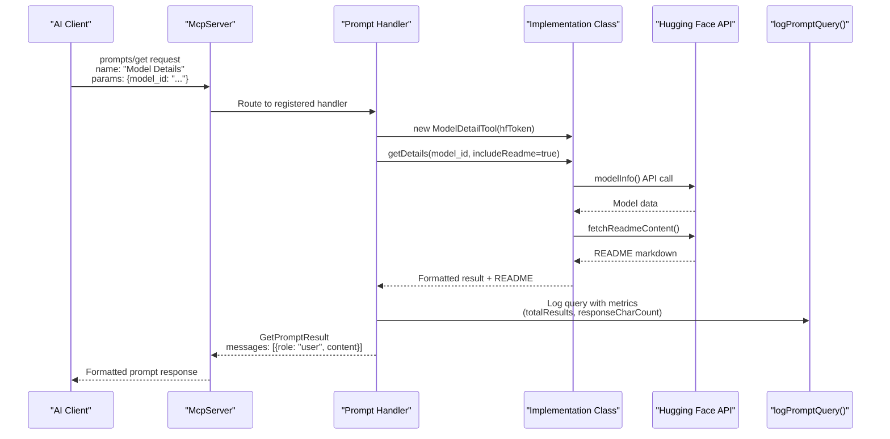
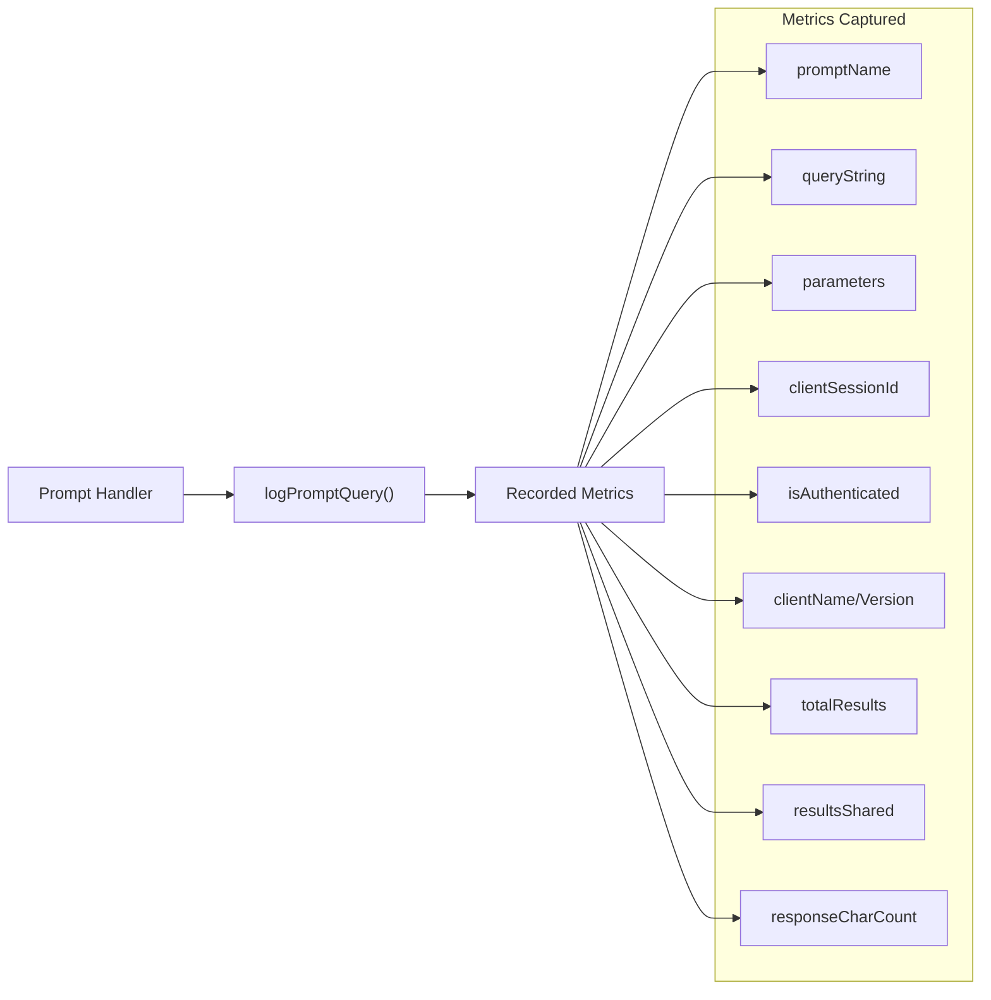
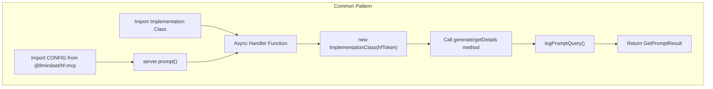

<!-- source: DeepWiki mcp.deepwiki.com · repo huggingface/hf-mcp-server · page 4.3 Prompts · fetched 2026-10-26 -->

# Prompts

<details>
<summary>Relevant source files</summary>

The following files were used as context for generating this wiki page:

- [packages/app/src/server/mcp-server.ts](packages/app/src/server/mcp-server.ts)
- [packages/app/src/shared/settings.ts](packages/app/src/shared/settings.ts)
- [packages/app/src/web/App.tsx](packages/app/src/web/App.tsx)
- [packages/e2e-python/prompts.py](packages/e2e-python/prompts.py)
- [packages/mcp/src/dataset-detail.ts](packages/mcp/src/dataset-detail.ts)
- [packages/mcp/src/model-detail.ts](packages/mcp/src/model-detail.ts)

</details>


## Purpose and Scope

This document explains the MCP prompt system and describes the four built-in prompts provided by the Hugging Face MCP Server. Prompts in the Model Context Protocol are pre-configured message templates that AI assistants can use to quickly access formatted information. This page covers prompt registration, parameter schemas, and the specific functionality of each prompt.

For information about tools (which perform actions and searches), see [Built-in Tools](#4.2). For the general tool and prompt architecture, see [Tool System Overview](#4.1).

---

## Prompts vs Tools

In the Model Context Protocol, **prompts** and **tools** serve different purposes:

| Aspect | Tools | Prompts |
|--------|-------|---------|
| **Purpose** | Perform actions, searches, or operations | Provide pre-formatted information as conversation context |
| **Return Type** | `ToolResult` with content array | `GetPromptResult` with messages array |
| **Invocation** | `tools/call` JSON-RPC method | `prompts/get` JSON-RPC method |
| **Client Experience** | Listed as available actions | Listed as template options for context injection |
| **Use Case** | Interactive operations by AI | Injecting rich context into conversations |

The key distinction is that prompts are designed to inject large amounts of formatted information directly into the conversation context, while tools are for executing discrete operations.

**Sources:** [packages/app/src/server/mcp-server.ts:221-355]()

---

## Prompt System Architecture

```mermaid
graph TB
    subgraph "Prompt Configuration Layer (packages/mcp)"
        UserConfig["USER_SUMMARY_PROMPT_CONFIG<br/>name, description, schema"]
        PaperConfig["PAPER_SUMMARY_PROMPT_CONFIG<br/>name, description, schema"]
        ModelConfig["MODEL_DETAIL_PROMPT_CONFIG<br/>name, description, schema"]
        DatasetConfig["DATASET_DETAIL_PROMPT_CONFIG<br/>name, description, schema"]
    end
    
    subgraph "Prompt Implementation Layer (packages/mcp)"
        UserImpl["UserSummaryPrompt<br/>generateSummary()"]
        PaperImpl["PaperSummaryPrompt<br/>generateSummary()"]
        ModelImpl["ModelDetailTool<br/>getDetails(includeReadme=true)"]
        DatasetImpl["DatasetDetailTool<br/>getDetails(includeReadme=true)"]
    end
    
    subgraph "Registration Layer (packages/app)"
        ServerReg["McpServer.prompt()<br/>Registration Method"]
        
        UserHandler["User Summary Handler<br/>lines 221-253"]
        PaperHandler["Paper Summary Handler<br/>lines 255-287"]
        ModelHandler["Model Details Handler<br/>lines 289-321"]
        DatasetHandler["Dataset Details Handler<br/>lines 323-355"]
    end
    
    subgraph "Logging & Metrics"
        LogPrompt["logPromptQuery()<br/>Track usage metrics"]
    end
    
    UserConfig --> UserHandler
    PaperConfig --> PaperHandler
    ModelConfig --> ModelHandler
    DatasetConfig --> DatasetHandler
    
    UserHandler --> UserImpl
    PaperHandler --> PaperImpl
    ModelHandler --> ModelImpl
    DatasetHandler --> DatasetImpl
    
    ServerReg --> UserHandler
    ServerReg --> PaperHandler
    ServerReg --> ModelHandler
    ServerReg --> DatasetHandler
    
    UserHandler --> LogPrompt
    PaperHandler --> LogPrompt
    ModelHandler --> LogPrompt
    DatasetHandler --> LogPrompt
```



**Diagram: Prompt Architecture Components**

Each prompt follows a three-layer pattern:

1. **Configuration Layer**: Defines the prompt's name, description, and Zod parameter schema
2. **Implementation Layer**: Contains the business logic for fetching and formatting data
3. **Registration Layer**: Registers the prompt with the MCP server and wires up handlers

**Sources:** [packages/app/src/server/mcp-server.ts:42-47, 221-355](), [packages/mcp/src/model-detail.ts:28-40](), [packages/mcp/src/dataset-detail.ts:22-34]()

---

## Built-in Prompts Overview

The Hugging Face MCP Server provides four built-in prompts:

| Prompt Name | Purpose | Primary Parameter | Implementation Class |
|-------------|---------|-------------------|---------------------|
| `user_summary` | User Summary | `user_id` | `UserSummaryPrompt` |
| `paper_summary` | Paper Summary | `paper_id` | `PaperSummaryPrompt` |
| `Model Details` | Model Details with README | `model_id` | `ModelDetailTool` |
| `Dataset Details` | Dataset Details with README | `dataset_id` | `DatasetDetailTool` |

All prompts return formatted markdown text suitable for injection into AI conversation context. Unlike their tool counterparts (which return concise information), prompts include comprehensive details like README content.

**Sources:** [packages/app/src/server/mcp-server.ts:221-355]()

---

## Prompt Invocation Flow



**Diagram: Prompt Execution Sequence**

The flow differs from tools in the final return format: prompts return a `GetPromptResult` with a `messages` array suitable for conversation injection, rather than a `ToolResult` with a `content` array.

**Sources:** [packages/app/src/server/mcp-server.ts:221-355]()

---

## User Summary Prompt

**Prompt Name:** `user_summary`  
**Configuration:** `USER_SUMMARY_PROMPT_CONFIG`

### Purpose

Generates a comprehensive summary of a Hugging Face user's profile, including their public repositories, contributions, and activity.

### Parameters

```typescript
{
  user_id: string  // Hugging Face user ID (e.g., "microsoft", "openai")
}
```

**Schema:** [packages/app/src/server/mcp-server.ts:43, 224]()

### Implementation

The prompt is handled by the `UserSummaryPrompt` class, which:

1. Fetches user profile information from Hugging Face
2. Retrieves user's models, datasets, and spaces
3. Formats the data into a comprehensive markdown summary
4. Returns as a conversation message

### Registration

```typescript
server.prompt(
  USER_SUMMARY_PROMPT_CONFIG.name,
  USER_SUMMARY_PROMPT_CONFIG.description,
  USER_SUMMARY_PROMPT_CONFIG.schema.shape,
  async (params: UserSummaryParams) => {
    const userSummary = new UserSummaryPrompt(hfToken);
    const summaryText = await userSummary.generateSummary(params);
    // Log metrics and return as message
    return {
      description: `User summary for ${params.user_id}`,
      messages: [{
        role: 'user' as const,
        content: { type: 'text' as const, text: summaryText }
      }]
    };
  }
);
```

### Logging

Logs include:
- Query parameters (`user_id`)
- Client session metadata
- Response character count
- Total results and results shared (always 1 for successful summary)

**Sources:** [packages/app/src/server/mcp-server.ts:221-253]()

---

## Paper Summary Prompt

**Prompt Name:** `paper_summary`  
**Configuration:** `PAPER_SUMMARY_PROMPT_CONFIG`

### Purpose

Provides a detailed summary of an academic paper from arXiv or other sources, including metadata and abstract information.

### Parameters

```typescript
{
  paper_id: string  // Paper identifier (e.g., "arxiv:2502.16161")
}
```

**Schema:** [packages/app/src/server/mcp-server.ts:46, 258]()

### Implementation

The prompt is handled by the `PaperSummaryPrompt` class, which:

1. Parses the paper identifier
2. Fetches paper metadata from Hugging Face Hub
3. Retrieves abstract and related information
4. Formats into a structured markdown summary
5. Returns as a conversation message

### Registration

```typescript
server.prompt(
  PAPER_SUMMARY_PROMPT_CONFIG.name,
  PAPER_SUMMARY_PROMPT_CONFIG.description,
  PAPER_SUMMARY_PROMPT_CONFIG.schema.shape,
  async (params: PaperSummaryParams) => {
    const paperSummary = new PaperSummaryPrompt(hfToken);
    const summaryText = await paperSummary.generateSummary(params);
    // Log metrics and return as message
    return {
      description: `Paper summary for ${params.paper_id}`,
      messages: [{
        role: 'user' as const,
        content: { type: 'text' as const, text: summaryText }
      }]
    };
  }
);
```

### Example Usage (Python)

```python
await agent.anon.apply_prompt("Paper Summary", {"paper_id": "arxiv:2502.16161"})
```

**Sources:** [packages/app/src/server/mcp-server.ts:255-287](), [packages/e2e-python/prompts.py:25]()

---

## Model Details Prompt

**Prompt Name:** `Model Details`  
**Configuration:** `MODEL_DETAIL_PROMPT_CONFIG`

### Purpose

Provides comprehensive model information **including the full README content** from the model repository. This differs from the `model_details` tool, which returns only metadata without the README.

### Parameters

```typescript
{
  model_id: string  // Model ID in author/model format (e.g., "openai/gpt-oss-120b")
}
```

**Schema Constraints:**
- Minimum length: 5 characters
- Maximum length: 50 characters

**Sources:** [packages/mcp/src/model-detail.ts:28-40]()

### Implementation

The prompt reuses the `ModelDetailTool` class but calls `getDetails()` with `includeReadme=true`:

```typescript
const modelDetail = new ModelDetailTool(hfToken, undefined);
const result = await modelDetail.getDetails(params.model_id, true);
```

This triggers:

1. Fetching model metadata via `modelInfo()` from `@huggingface/hub`
2. Fetching README content via `fetchReadmeContent()`
3. Appending README in XML tags: `<modelcard-readme>...</modelcard-readme>`

### README Inclusion

The README is appended to the formatted model details:

```typescript
result.formatted += '\n\n## README\n<modelcard-readme>\n\n' 
  + readmeContent.trim() 
  + '\n</modelcard-readme>';
```

The XML-style tags help AI clients parse and distinguish the README section from metadata.

**Sources:** [packages/app/src/server/mcp-server.ts:289-321](), [packages/mcp/src/model-detail.ts:127, 261-268]()

### Comparison with model_details Tool

| Aspect | `Model Details` (Prompt) | `model_details` (Tool) |
|--------|-------------------------|------------------------|
| README Included | ✅ Yes | ❌ No |
| Response Type | Message (prompt context) | Tool result |
| Use Case | Rich context injection | Quick metadata lookup |
| Character Count | Typically 5000-50000+ | Typically 500-2000 |

### Example Usage (Python)

```python
await agent.anon.apply_prompt("Model Details", {"model_id": "openai/gpt-oss-120b"})
```

**Sources:** [packages/e2e-python/prompts.py:20]()

---

## Dataset Details Prompt

**Prompt Name:** `Dataset Details`  
**Configuration:** `DATASET_DETAIL_PROMPT_CONFIG`

### Purpose

Provides comprehensive dataset information **including the full README content** from the dataset repository. This differs from the `dataset_details` tool, which returns only metadata without the README.

### Parameters

```typescript
{
  dataset_id: string  // Dataset ID (e.g., "Anthropic/hh-rlhf", "squad")
}
```

**Schema Constraints:**
- Minimum length: 3 characters
- Maximum length: 100 characters

**Sources:** [packages/mcp/src/dataset-detail.ts:22-34]()

### Implementation

The prompt reuses the `DatasetDetailTool` class but calls `getDetails()` with `includeReadme=true`:

```typescript
const datasetDetail = new DatasetDetailTool(hfToken, undefined);
const result = await datasetDetail.getDetails(params.dataset_id, true);
```

This triggers:

1. Fetching dataset metadata via `datasetInfo()` from `@huggingface/hub`
2. Fetching README content via `fetchReadmeContent()`
3. Appending README in XML tags: `<datasetcard-readme>...</datasetcard-readme>`

### README Inclusion

The README is appended to the formatted dataset details:

```typescript
result.formatted += '\n\n## README\n<datasetcard-readme>\n' 
  + readmeContent.trim() 
  + '\n</datasetcard-readme>';
```

**Sources:** [packages/app/src/server/mcp-server.ts:323-355](), [packages/mcp/src/dataset-detail.ts:98, 165-172]()

### Comparison with dataset_details Tool

| Aspect | `Dataset Details` (Prompt) | `dataset_details` (Tool) |
|--------|---------------------------|--------------------------|
| README Included | ✅ Yes | ❌ No |
| Response Type | Message (prompt context) | Tool result |
| Use Case | Rich context injection | Quick metadata lookup |
| Character Count | Typically 3000-30000+ | Typically 400-1500 |

### Example Usage (Python)

```python
await agent.anon.apply_prompt("Dataset Details", {"dataset_id": "Anthropic/hh-rlhf"})
```

**Sources:** [packages/e2e-python/prompts.py:21]()

---

## Prompt Metrics and Logging

All prompts use the `logPromptQuery()` function to record usage metrics:



**Diagram: Prompt Metrics Collection**

### Logged Information

Each prompt invocation logs:

```typescript
logPromptQuery(
  PROMPT_CONFIG.name,           // e.g., "Model Details"
  params.model_id,              // Primary identifier
  { model_id: params.model_id }, // Full parameters
  {
    clientSessionId: sessionInfo?.clientSessionId,
    isAuthenticated: sessionInfo?.isAuthenticated ?? !!hfToken,
    clientName: sessionInfo?.clientInfo?.name,
    clientVersion: sessionInfo?.clientInfo?.version,
    totalResults: result.totalResults,
    resultsShared: result.resultsShared,
    responseCharCount: summaryText.length
  }
);
```

The `responseCharCount` is particularly important for prompts, as they typically return much larger text payloads than tools (often 10-100x larger due to README inclusion).

**Sources:** [packages/app/src/server/mcp-server.ts:69, 228-238, 262-272, 296-306, 330-340]()

---

## Prompt Registration Pattern

All prompts follow a consistent registration pattern in `createServerFactory`:



**Diagram: Standard Prompt Registration Flow**

### Code Pattern

Each prompt follows this structure in [packages/app/src/server/mcp-server.ts]():

```typescript
server.prompt(
  PROMPT_CONFIG.name,                    // Prompt name from config
  PROMPT_CONFIG.description,             // Description from config
  PROMPT_CONFIG.schema.shape,            // Zod schema shape
  async (params: PromptParams) => {
    // 1. Create implementation instance
    const implementation = new ImplementationClass(hfToken);
    
    // 2. Execute the prompt logic
    const summaryText = await implementation.generateMethod(params);
    
    // 3. Log metrics
    logPromptQuery(PROMPT_CONFIG.name, identifier, params, metrics);
    
    // 4. Return as message
    return {
      description: `Description for ${identifier}`,
      messages: [{
        role: 'user' as const,
        content: { type: 'text' as const, text: summaryText }
      }]
    };
  }
);
```

This consistent pattern ensures all prompts:
- Accept validated parameters via Zod schemas
- Log comprehensive usage metrics
- Return properly formatted messages
- Support authentication when available

**Sources:** [packages/app/src/server/mcp-server.ts:221-355]()

---

## Prompt Selection and Availability

Unlike tools, prompts are **always enabled** and do not participate in the tool selection system (bouquets, mixes, or user settings). All four prompts are available to every client regardless of configuration.

This design decision reflects that prompts provide read-only context injection rather than performing actions, making them safe to expose universally.

**Sources:** [packages/app/src/server/mcp-server.ts:221-355]()

---

