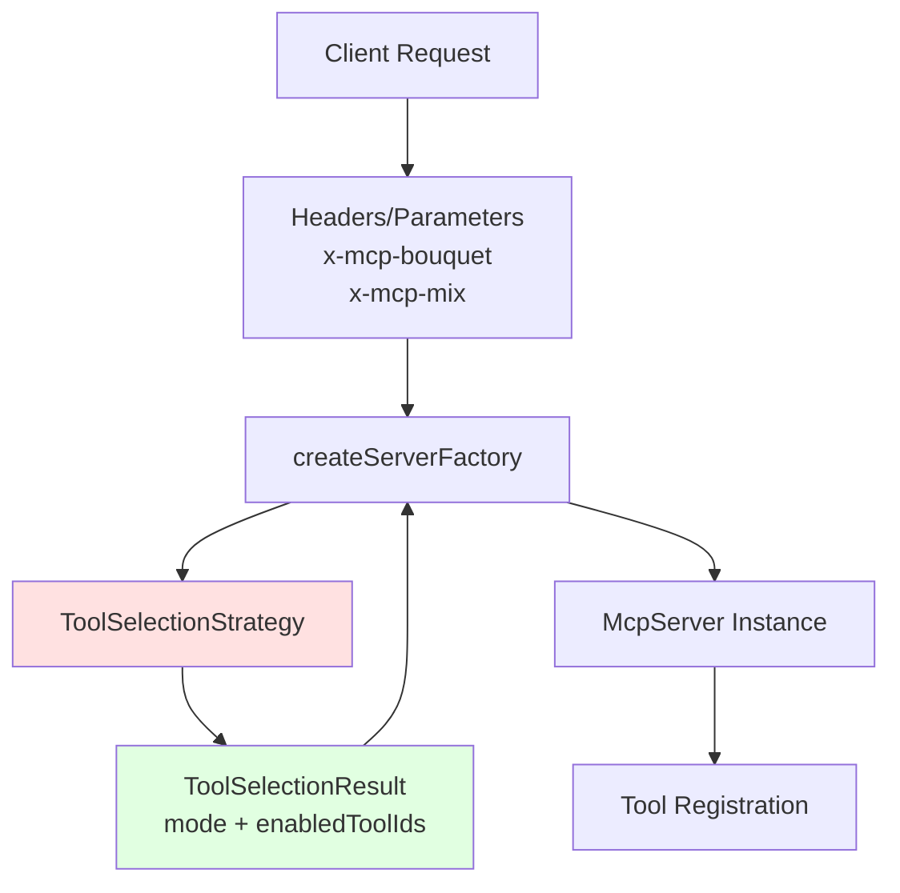
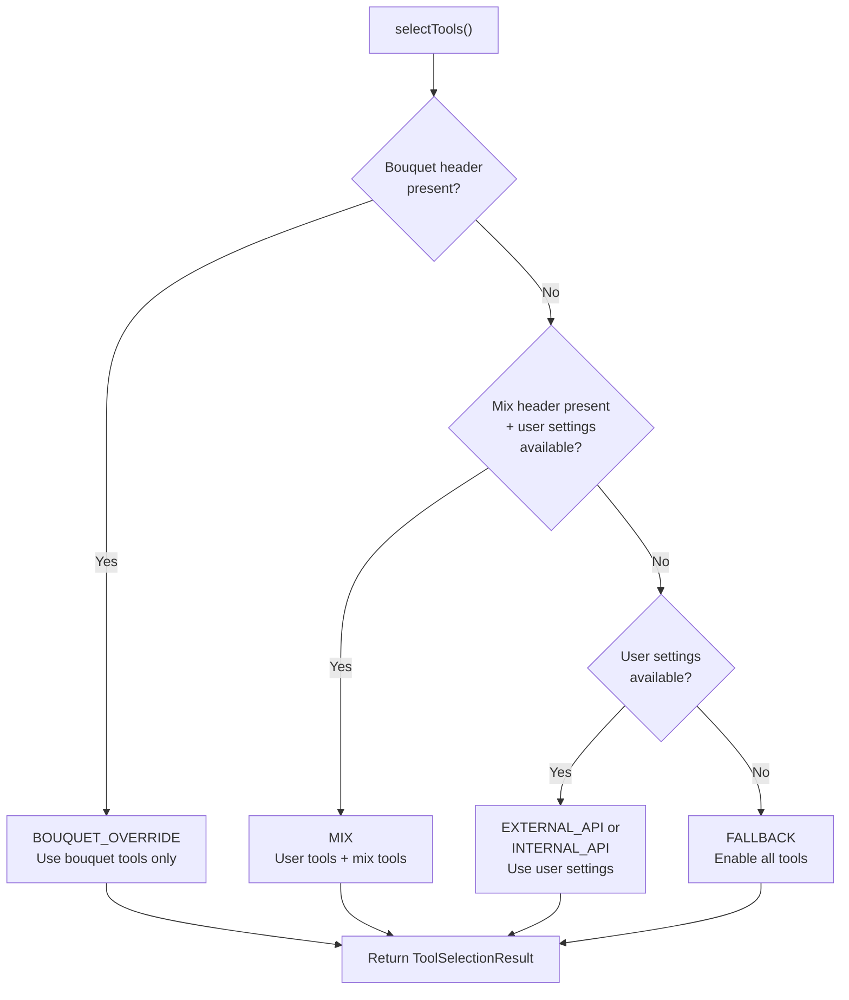
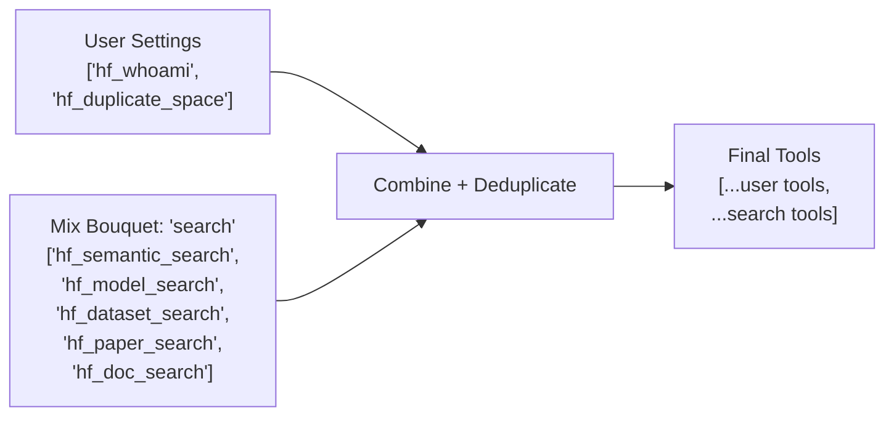
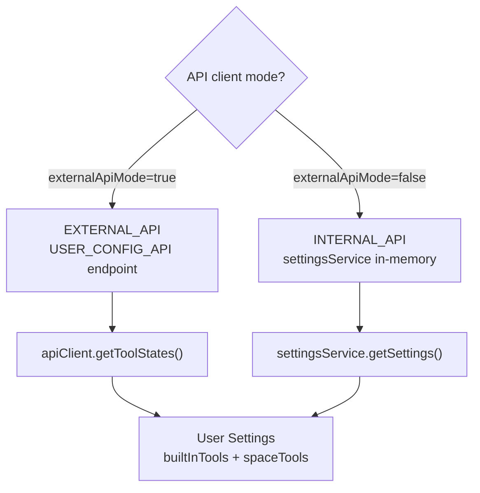
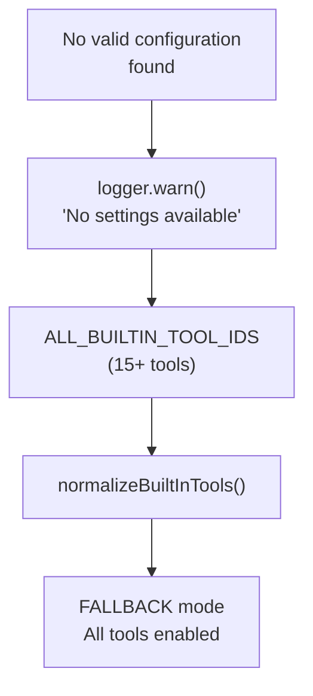
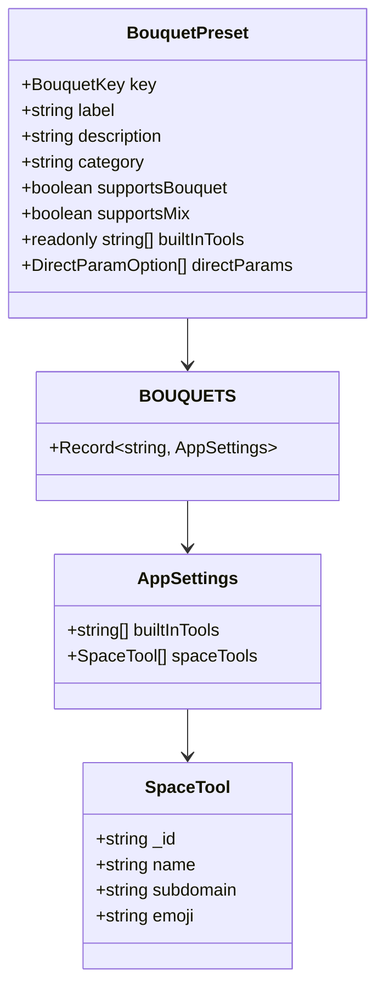
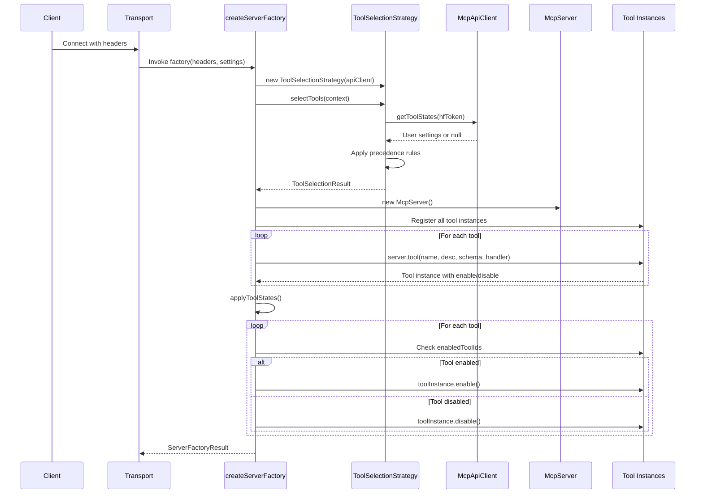
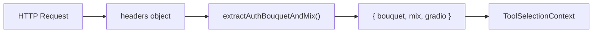
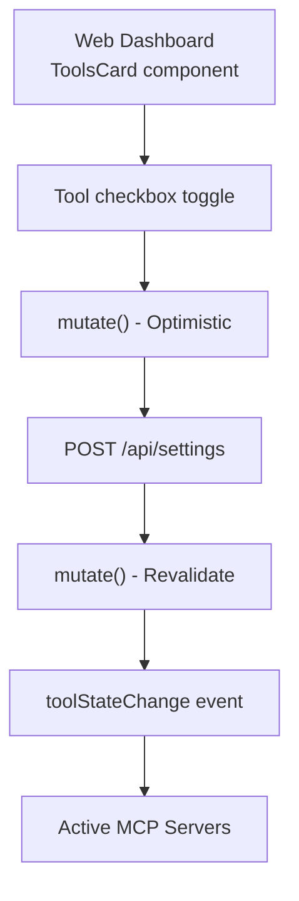

<!-- source: DeepWiki mcp.deepwiki.com · repo huggingface/hf-mcp-server · page 5 Tool Selection System · fetched 2026-10-26 -->

# Tool Selection System

<details>
<summary>Relevant source files</summary>

The following files were used as context for generating this wiki page:

- [packages/app/src/server/mcp-server.ts](packages/app/src/server/mcp-server.ts)
- [packages/app/src/server/utils/tool-selection-strategy.ts](packages/app/src/server/utils/tool-selection-strategy.ts)
- [packages/app/src/shared/bouquet-presets.ts](packages/app/src/shared/bouquet-presets.ts)
- [packages/app/src/shared/settings.ts](packages/app/src/shared/settings.ts)
- [packages/app/src/web/App.tsx](packages/app/src/web/App.tsx)
- [packages/app/src/web/components/SettingsCopyPage.tsx](packages/app/src/web/components/SettingsCopyPage.tsx)
- [packages/app/src/web/components/bouquets/ToolPresetsCard.tsx](packages/app/src/web/components/bouquets/ToolPresetsCard.tsx)
- [packages/app/test/server/utils/tool-selection-strategy.test.ts](packages/app/test/server/utils/tool-selection-strategy.test.ts)

</details>


The Tool Selection System determines which MCP tools are available to a client based on configuration headers, URL parameters, and user settings. It implements a clear precedence hierarchy to resolve conflicts between multiple configuration sources, enabling flexible tool management through bouquets (predefined tool groups), mixes (additive tool sets), and user-specific settings.

This system handles only built-in tool selection. For information about Gradio endpoint registration, see [Gradio Integration](#6). For details on how individual tools are implemented, see [Built-in Tools](#4.2).

## Overview

The Tool Selection System operates through the `ToolSelectionStrategy` class, which evaluates configuration sources in priority order and returns a `ToolSelectionResult` containing the list of enabled tool IDs. The system is invoked during MCP server instantiation by the `createServerFactory` function.

**Key Responsibilities:**
- Parse configuration from HTTP headers or URL parameters
- Resolve tool selection based on precedence rules
- Apply special features like `SEARCH_ENABLES_FETCH`
- Normalize and deduplicate tool lists
- Provide metadata about the selection mode and reasoning

**Architecture Position:**



Sources: [packages/app/src/server/utils/tool-selection-strategy.ts:1-260](), [packages/app/src/server/mcp-server.ts:96-186]()

## Precedence Rules

The system evaluates configuration sources in strict priority order, with higher-precedence sources completely overriding lower ones (except for Mix mode, which is additive).

| Priority | Mode | Header/Parameter | Behavior |
|----------|------|------------------|----------|
| 1 (Highest) | `BOUQUET_OVERRIDE` | `x-mcp-bouquet` | Completely replaces tool selection with predefined set |
| 2 | `MIX` | `x-mcp-mix` | Adds mix bouquet tools to user settings (additive) |
| 3 | `EXTERNAL_API` | (none) | Uses settings from external API endpoint |
| 3 | `INTERNAL_API` | (none) | Uses settings from internal settings service |
| 4 (Lowest) | `FALLBACK` | (none) | Enables all tools when no configuration available |

**Precedence Flow:**



Sources: [packages/app/src/server/utils/tool-selection-strategy.ts:119-221](), [packages/app/test/server/utils/tool-selection-strategy.test.ts:118-396]()

## Configuration Sources

### Bouquet Override

Bouquets are predefined tool groups that provide complete, curated tool sets for specific use cases. When a bouquet is specified via the `x-mcp-bouquet` header or `bouquet` URL parameter, it takes absolute precedence and replaces any other tool configuration.

**Code Flow:**


**Implementation:**

The bouquet system is implemented through:
- `BOUQUETS` constant defining available presets [packages/app/src/shared/bouquet-presets.ts:13-59]()
- `extractAuthBouquetAndMix()` parsing headers [packages/app/src/server/utils/auth-utils.ts]()
- `selectTools()` checking bouquet first [packages/app/src/server/utils/tool-selection-strategy.ts:136-148]()

**Example:**

```
x-mcp-bouquet: search
```

Results in:
- Mode: `BOUQUET_OVERRIDE`
- Tools: `['hf_semantic_search', 'hf_model_search', 'hf_dataset_search', 'hf_paper_search', 'hf_doc_search']`
- User settings are ignored

Sources: [packages/app/src/server/utils/tool-selection-strategy.ts:136-148](), [packages/app/src/shared/bouquet-presets.ts:13-59](), [packages/app/test/server/utils/tool-selection-strategy.test.ts:118-207]()

### Mix Mode

Mix mode provides additive tool selection, allowing clients to layer additional tools on top of their existing user settings or base configuration. The mix operates by combining the tools from a specified bouquet with the current user settings.

**Additive Behavior:**



**Implementation Logic:**

The mix logic is implemented in [packages/app/src/server/utils/tool-selection-strategy.ts:154-178]():

1. Check if mix header is present and valid bouquet name
2. Verify user settings are available (mix requires base settings)
3. Combine arrays: `[...baseSettings.builtInTools, ...BOUQUETS[mix].builtInTools]`
4. Deduplicate using `Set` and normalize
5. Apply `SEARCH_ENABLES_FETCH` if enabled

**Example:**

```
x-mcp-mix: hf_api
User Settings: ['hf_semantic_search', 'hf_dataset_search']
```

Results in:
- Mode: `MIX`
- Tools: User tools + all tools from `hf_api` bouquet (deduplicated)
- Reason: `"User settings + mix(hf_api)"`

Sources: [packages/app/src/server/utils/tool-selection-strategy.ts:154-178](), [packages/app/test/server/utils/tool-selection-strategy.test.ts:209-308]()

### User Settings

When no bouquet or mix is specified, the system falls back to user-specific settings. These settings can come from two sources: an external API endpoint or the internal settings service.

**Settings Sources:**



**External API Mode:**

When `externalApiMode` is enabled in the transport configuration, user settings are fetched from a remote endpoint specified by `USER_CONFIG_API` environment variable. This allows centralized user preference management.

Configuration:
- Environment: `USER_CONFIG_API=https://api.example.com/user/settings`
- Transport info: `externalApiMode: true`
- Mode: `EXTERNAL_API`

**Internal API Mode:**

The default mode uses the `settingsService` singleton, which maintains an in-memory map of user settings. Settings can be modified through the web dashboard.

Configuration:
- No external API configured
- Transport info: `externalApiMode: false`
- Mode: `INTERNAL_API`

**Code Integration:**

The user settings retrieval is implemented in [packages/app/src/server/utils/tool-selection-strategy.ts:226-258]():

```typescript
private async getUserSettings(context: ToolSelectionContext): Promise<AppSettings | null> {
    // Use provided user settings (from proxy mode)
    if (context.userSettings) {
        return context.userSettings;
    }
    
    // Fetch from API client
    const toolStates = await this.apiClient.getToolStates(context.hfToken);
    if (toolStates) {
        const builtInTools = Object.keys(toolStates).filter(id => toolStates[id]);
        const spaceTools = this.apiClient.getGradioEndpoints().map(...);
        return { builtInTools, spaceTools };
    }
    
    return null;
}
```

Sources: [packages/app/src/server/utils/tool-selection-strategy.ts:181-208](), [packages/app/src/server/utils/tool-selection-strategy.ts:226-258](), [packages/app/src/shared/settings.ts:50-95]()

### Fallback Mode

When no configuration is available from any source (no bouquet, no mix, no user settings), the system enters fallback mode and enables all built-in tools. This ensures the server remains functional even with missing configuration.

**Fallback Trigger Conditions:**

| Condition | Result |
|-----------|--------|
| Headers are `null` or empty | Fallback |
| No user settings available | Fallback |
| Invalid bouquet name with no settings | Fallback |
| API fetch failure | Fallback |

**Implementation:**



The fallback is implemented at [packages/app/src/server/utils/tool-selection-strategy.ts:210-221]():

```typescript
// Fallback - all tools enabled
logger.warn('No settings available, using fallback (all tools enabled)');
const enabledToolIds = normalizeBuiltInTools(
    this.applySearchEnablesFetch([...ALL_BUILTIN_TOOL_IDS])
);
return {
    mode: ToolSelectionMode.FALLBACK,
    enabledToolIds,
    reason: 'Fallback - no settings available',
};
```

**Fallback Constants:**

The system uses `BOUQUET_FALLBACK` and `BOUQUET_ANON_DEFAULT` constants for consistent fallback behavior [packages/app/src/server/mcp-server.ts:78-88]():

- `BOUQUET_FALLBACK`: Used when settings API fails
- `BOUQUET_ANON_DEFAULT`: Used for unauthenticated users with external API

Both enable the `hf_api` tool group by default.

Sources: [packages/app/src/server/utils/tool-selection-strategy.ts:210-221](), [packages/app/src/server/mcp-server.ts:78-88](), [packages/app/test/server/utils/tool-selection-strategy.test.ts:370-396]()

## Bouquet Presets

Bouquets are predefined tool collections designed for specific use cases. Each bouquet is defined in `BOUQUETS` and includes a list of tool IDs and (optionally) Gradio space tools.

### Available Bouquets

| Bouquet Key | Description | Tool Count | Category |
|-------------|-------------|------------|----------|
| `hf_api` | Balanced search plus repository details | 7 | Core |
| `search` | Semantic search across all content types | 5 | Core |
| `spaces` | Space management and interaction tools | 5 | Core |
| `docs` | Documentation search and fetch | 2 | Core |
| `all` | Every built-in tool | 15+ | Core |
| `hub_repo_details_readme` | Repository inspection with README | 2 | Advanced |
| `hub_repo_details` | Repository inspection without README | 1 | Advanced |
| `no_gradio_images` | Image filtering behavior flag | 1 | Advanced |
| `mcp_ui` | MCP UI preview tool | 1 | Advanced |
| `jobs` | Job management tools | 1 | Advanced |
| `dynamic_space` | Dynamic space discovery and invocation | 2 | Advanced |

### Bouquet Structure

**Data Model:**



**Definition Example:**

From [packages/app/src/shared/bouquet-presets.ts:13-33]():

```typescript
export const BOUQUETS: Record<string, AppSettings> = {
    hf_api: {
        builtInTools: [...TOOL_ID_GROUPS.hf_api],
        spaceTools: [],
    },
    search: {
        builtInTools: [...TOOL_ID_GROUPS.search],
        spaceTools: [],
    },
    spaces: {
        builtInTools: [...TOOL_ID_GROUPS.spaces],
        spaceTools: [],
    },
    // ... more bouquets
};
```

### Core Bouquets

#### hf_api Bouquet

The default balanced tool set, optimized for general Hugging Face Hub interaction.

**Tools Included:**
- `hf_semantic_search` - Semantic search across Spaces
- `hf_model_search` - Model repository search
- `hf_model_detail` - Model metadata and details
- `hf_dataset_search` - Dataset repository search
- `hf_dataset_detail` - Dataset metadata and details
- `hf_paper_search` - Research paper search
- `hub_repo_details` - Generic repository inspection

**Tool ID Group Definition:**

From [packages/mcp/src/tool-ids.ts]():

```typescript
export const TOOL_ID_GROUPS = {
    hf_api: [
        SEMANTIC_SEARCH_TOOL_ID,
        MODEL_SEARCH_TOOL_ID,
        MODEL_DETAIL_TOOL_ID,
        DATASET_SEARCH_TOOL_ID,
        DATASET_DETAIL_TOOL_ID,
        PAPER_SEARCH_TOOL_ID,
        HUB_INSPECT_TOOL_ID,
    ],
    // ...
};
```

#### search Bouquet

Focused on discovery and semantic search capabilities across all Hub content types.

**Tools Included:**
- `hf_semantic_search` - Space semantic search
- `hf_model_search` - Model search
- `hf_dataset_search` - Dataset search
- `hf_paper_search` - Paper search
- `hf_doc_search` - Documentation search

#### spaces Bouquet

Tools for managing and interacting with Hugging Face Spaces.

**Tools Included:**
- `duplicate_space` - Clone Spaces to user namespace
- `space_info` - List Spaces for users/orgs
- `space_files` - Browse Space repository files
- `hf_semantic_search` - Find Spaces by semantic query
- `use_space` - Interact with Gradio Spaces

#### docs Bouquet

Documentation-focused tools for searching and retrieving HF documentation.

**Tools Included:**
- `hf_doc_search` - Semantic search across documentation
- `hf_doc_fetch` - Retrieve full documentation pages

Sources: [packages/app/src/shared/bouquet-presets.ts:13-59](), [packages/app/src/shared/bouquet-presets.ts:80-179](), [packages/app/test/server/utils/tool-selection-strategy.test.ts:54-90]()

### Advanced Bouquets

Advanced bouquets enable specialized features, behavior flags, or experimental tools.

#### hub_repo_details_readme

Enables README content inclusion in repository inspection results. The README flag modifies the `hub_repo_details` tool schema and behavior.

**Tools Included:**
- `hub_repo_details` - Repository inspection tool
- `README_INCLUDE_FLAG` - Behavior flag allowing README access

**Flag Behavior:**

The README flag is checked at runtime in [packages/app/src/server/mcp-server.ts:512-534]():

```typescript
const hubInspectReadmeAllowed = hasReadmeFlag(toolSelection.enabledToolIds);
const hubInspectDescription = hubInspectReadmeAllowed
    ? `${HUB_INSPECT_TOOL_CONFIG.description} README file may be requested...`
    : HUB_INSPECT_TOOL_CONFIG.description;
```

#### no_gradio_images

Behavior flag that strips image content from Gradio tool responses, useful for reducing bandwidth or avoiding image processing.

**Implementation:**

The flag is checked during Gradio tool execution [packages/app/src/server/mcp-server.ts:731-732]():

```typescript
const stripImageContent = 
    noImageContentHeaderEnabled || 
    toolSelection.enabledToolIds.includes('NO_GRADIO_IMAGE_CONTENT');
```

#### jobs Bouquet

Enables job management tools for running, monitoring, and scheduling jobs on Hugging Face infrastructure.

**Tools Included:**
- `hf_jobs` - Job management tool with operations: create, list, status, cancel

#### dynamic_space Bouquet

Enables dynamic Space discovery and invocation without pre-registration.

**Tools Included:**
- `hf_semantic_search` - Find Spaces
- `dynamic_space_tool` - Invoke any Space dynamically

Sources: [packages/app/src/shared/bouquet-presets.ts:34-58](), [packages/app/src/shared/behavior-flags.ts](), [packages/app/src/server/mcp-server.ts:512-534]()

## Integration with MCP Server

The Tool Selection System integrates with the MCP server creation process through the `createServerFactory` function, which uses `ToolSelectionStrategy` to determine tool availability before registering tool instances.

### Server Factory Flow



### Registration and State Management

All tools are registered with the MCP server regardless of selection state. The system then enables or disables tools based on the `ToolSelectionResult`.

**Tool Instance Storage:**

From [packages/app/src/server/mcp-server.ts:190-191]():

```typescript
// Always register all tools and store instances for dynamic control
const toolInstances: { [name: string]: Tool } = {};
```

**Tool Registration Pattern:**

Each tool is registered and its instance is stored in the `toolInstances` map [packages/app/src/server/mcp-server.ts:357-381]():

```typescript
toolInstances[SEMANTIC_SEARCH_TOOL_CONFIG.name] = server.tool(
    SEMANTIC_SEARCH_TOOL_CONFIG.name,
    SEMANTIC_SEARCH_TOOL_CONFIG.description,
    SEMANTIC_SEARCH_TOOL_CONFIG.schema.shape,
    SEMANTIC_SEARCH_TOOL_CONFIG.annotations,
    async (params: SearchParams) => {
        // Tool implementation
    }
);
```

**State Application:**

After all tools are registered, the system applies the selection state [packages/app/src/server/mcp-server.ts:839-859]():

```typescript
const applyToolStates = async () => {
    logger.info({
        mode: toolSelection.mode,
        reason: toolSelection.reason,
        enabledCount: toolSelection.enabledToolIds.length,
        totalTools: Object.keys(toolInstances).length,
    }, 'Tool selection strategy applied');
    
    // Apply the desired state to each tool
    for (const [toolName, toolInstance] of Object.entries(toolInstances)) {
        if (toolSelection.enabledToolIds.includes(toolName)) {
            toolInstance.enable();
        } else {
            toolInstance.disable();
        }
    }
};
```

### Dynamic State Changes

In non-JSON response mode and non-external API mode, the system supports dynamic tool state changes via the `toolStateChange` event.

**Event Listener Setup:**

From [packages/app/src/server/mcp-server.ts:873-891]():

```typescript
const toolStateChangeHandler = (toolId: string, enabled: boolean) => {
    const toolInstance = toolInstances[toolId];
    if (toolInstance) {
        if (enabled) {
            toolInstance.enable();
        } else {
            toolInstance.disable();
        }
        logger.debug({ toolId, enabled }, 'Applied single tool state change');
    }
};

sharedApiClient.on('toolStateChange', toolStateChangeHandler);

// Clean up event listener when server closes
server.server.onclose = () => {
    sharedApiClient.removeListener('toolStateChange', toolStateChangeHandler);
};
```

This allows the web dashboard to toggle tools on/off for all active server instances without requiring reconnection.

Sources: [packages/app/src/server/mcp-server.ts:96-186](), [packages/app/src/server/mcp-server.ts:190-859](), [packages/app/src/server/mcp-server.ts:873-891]()

## Special Features

### SEARCH_ENABLES_FETCH

The `SEARCH_ENABLES_FETCH` feature automatically enables the `hf_doc_fetch` tool when `hf_doc_search` is enabled, creating a logical pairing of search and retrieval capabilities.

**Environment Variable:**
```
SEARCH_ENABLES_FETCH=true
```

**Implementation:**

The feature is implemented in [packages/app/src/server/utils/tool-selection-strategy.ts:108-116]():

```typescript
private applySearchEnablesFetch(enabledToolIds: string[]): string[] {
    if (process.env.SEARCH_ENABLES_FETCH === 'true') {
        if (enabledToolIds.includes('hf_doc_search') && 
            !enabledToolIds.includes('hf_doc_fetch')) {
            logger.debug('SEARCH_ENABLES_FETCH: Auto-enabling hf_doc_fetch...');
            return [...enabledToolIds, 'hf_doc_fetch'];
        }
    }
    return enabledToolIds;
}
```

**Application Points:**

The function is called at every tool selection decision point:
1. Bouquet override [line 139]()
2. Mix mode [line 157]()
3. User settings [lines 187, 213]()

**Behavior:**

| Scenario | Result |
|----------|--------|
| `hf_doc_search` enabled, `SEARCH_ENABLES_FETCH=true` | Both tools enabled |
| `hf_doc_search` disabled | No effect |
| `SEARCH_ENABLES_FETCH=false` or unset | No effect |
| `hf_doc_fetch` already in list | No duplication |

Sources: [packages/app/src/server/utils/tool-selection-strategy.ts:108-116](), [packages/app/test/server/utils/tool-selection-strategy.test.ts:516-683]()

### Behavior Flags

Behavior flags are special pseudo-tool IDs that modify system behavior rather than providing tools. They are included in tool lists but don't correspond to actual MCP tools.

#### README_INCLUDE_FLAG

**Constant:** `"README_INCLUDE"` [packages/app/src/shared/behavior-flags.ts]()

**Purpose:** Allows the `hub_repo_details` tool to include README content when explicitly requested by the client.

**Runtime Check:**

From [packages/app/src/server/mcp-server.ts:512-534]():

```typescript
const hubInspectReadmeAllowed = hasReadmeFlag(toolSelection.enabledToolIds);
// ...
const currentSelection = await toolSelectionStrategy.selectTools(toolSelectionContext);
const allowReadme = hasReadmeFlag(currentSelection.enabledToolIds);
const wantReadme = (params as { include_readme?: boolean }).include_readme === true;
const includeReadme = allowReadme && wantReadme;
```

The tool schema is modified to include or exclude the `include_readme` parameter based on this flag.

#### GRADIO_IMAGE_FILTER_FLAG

**Constant:** `"NO_GRADIO_IMAGE_CONTENT"` [packages/app/src/shared/behavior-flags.ts]()

**Purpose:** Strips image content from Gradio tool responses to reduce bandwidth.

**Runtime Check:**

From [packages/app/src/server/mcp-server.ts:731-738]():

```typescript
const stripImageContent = 
    noImageContentHeaderEnabled || 
    toolSelection.enabledToolIds.includes('NO_GRADIO_IMAGE_CONTENT');

const postProcessOptions: GradioToolCallOptions = {
    stripImageContent,
    // ...
};
```

This affects all Gradio tool invocations and applies the image filtering during result post-processing.

Sources: [packages/app/src/shared/behavior-flags.ts](), [packages/app/src/server/mcp-server.ts:512-534](), [packages/app/src/server/mcp-server.ts:731-738]()

### Tool Normalization

The `normalizeBuiltInTools` function ensures consistent tool lists by deduplicating and validating tool IDs.

**Function Signature:**

From [packages/app/src/shared/tool-normalizer.ts]():

```typescript
export function normalizeBuiltInTools(toolIds: string[]): string[]
```

**Normalization Steps:**

1. Deduplicate using `Set` conversion
2. Filter out invalid/unknown tool IDs (optional, based on implementation)
3. Return sorted array for consistent ordering

**Usage Points:**

The function is called at every tool selection result:
- Bouquet override results [line 138]()
- Mix mode results [line 157]()
- User settings results [line 186]()
- Fallback results [line 212]()

This ensures that regardless of the configuration source, the final tool list is consistent and deduplicated.

Sources: [packages/app/src/shared/tool-normalizer.ts](), [packages/app/src/server/utils/tool-selection-strategy.ts:108-221]()

## Header and Parameter Configuration

The Tool Selection System accepts configuration through HTTP headers and URL query parameters, with headers taking precedence when both are present.

### Configuration Headers

| Header Name | Parameter Name | Purpose | Example Value |
|-------------|----------------|---------|---------------|
| `x-mcp-bouquet` | `bouquet` | Override tool selection with bouquet | `search`, `hf_api`, `all` |
| `x-mcp-mix` | `mix` | Add bouquet tools to user settings | `docs`, `spaces` |
| `x-mcp-gradio` | `gradio` | Specify Gradio Space endpoints | `microsoft/Florence-2-large` |
| `x-mcp-no-image-content` | `no_image_content` | Disable Gradio images | `true` |

### Header Extraction

**Code Flow:**



**Implementation:**

From [packages/app/src/server/utils/auth-utils.ts]():

```typescript
export function extractAuthBouquetAndMix(headers: Record<string, string> | null): {
    hfToken?: string;
    bouquet?: string;
    mix?: string;
    gradio?: string;
} {
    if (!headers) return {};
    
    return {
        hfToken: headers['authorization']?.replace('Bearer ', ''),
        bouquet: headers['x-mcp-bouquet'],
        mix: headers['x-mcp-mix'],
        gradio: headers['x-mcp-gradio'],
    };
}
```

### URL Parameter Examples

**Basic Bouquet:**
```
https://huggingface.co/mcp?bouquet=search
```

**Mix with Bouquet:**
```
https://huggingface.co/mcp?bouquet=hf_api&mix=docs
```

**Gradio Spaces:**
```
https://huggingface.co/mcp?bouquet=search&gradio=microsoft/Florence-2-large,meta-llama/Llama-2-7b
```

**Disable Gradio Images:**
```
https://huggingface.co/mcp?bouquet=all&no_image_content=true
```

### Web Dashboard Integration

The web dashboard provides a UI for managing tool selection through the internal settings service. Changes made through the dashboard update the settings and trigger `toolStateChange` events for active server instances.

**Settings API Endpoints:**

| Method | Endpoint | Purpose |
|--------|----------|---------|
| GET | `/api/settings` | Retrieve current settings |
| POST | `/api/settings` | Update built-in tools and space tools |

**UI Component Flow:**



**Implementation:**

From [packages/app/src/web/App.tsx:111-153]():

```typescript
const handleToolToggle = async (toolId: string, checked: boolean) => {
    try {
        // Optimistic update
        const currentSettings = settings || { builtInTools: [] };
        const currentTools = normalizeBuiltInTools(currentSettings.builtInTools);
        const updatedTools = checked
            ? [...currentTools.filter(id => id !== toolId), toolId]
            : currentTools.filter(id => id !== toolId);
        
        mutate('/api/settings', optimisticSettings, false);
        
        // Make the API call
        const response = await fetch('/api/settings', {
            method: 'POST',
            headers: { 'Content-Type': 'application/json' },
            body: JSON.stringify({ builtInTools: newTools }),
        });
        
        // Revalidate
        mutate('/api/settings');
    } catch (err) {
        // Revert on error
        mutate('/api/settings');
    }
};
```

Sources: [packages/app/src/server/utils/auth-utils.ts](), [packages/app/src/web/App.tsx:111-153](), [packages/app/src/web/components/SettingsCopyPage.tsx:1-227]()

## ToolSelectionResult Structure

The `ToolSelectionResult` interface encapsulates the outcome of the tool selection process, providing both the enabled tool list and metadata about how the selection was made.

**Interface Definition:**

From [packages/app/src/server/utils/tool-selection-strategy.ts:24-31]():

```typescript
export interface ToolSelectionResult {
    mode: ToolSelectionMode;
    enabledToolIds: string[];
    reason: string;
    baseSettings?: AppSettings;
    mixedBouquet?: string;
    gradioSpaceTools?: SpaceTool[];
}
```

**Field Descriptions:**

| Field | Type | Purpose | Example |
|-------|------|---------|---------|
| `mode` | `ToolSelectionMode` | Indicates which precedence rule was applied | `BOUQUET_OVERRIDE` |
| `enabledToolIds` | `string[]` | List of enabled built-in tool IDs | `['hf_model_search', 'hf_dataset_search']` |
| `reason` | `string` | Human-readable explanation of selection | `"Bouquet override: search"` |
| `baseSettings` | `AppSettings?` | Original user settings (when applicable) | `{ builtInTools: [...], spaceTools: [...] }` |
| `mixedBouquet` | `string?` | Name of mix bouquet (in MIX mode) | `"docs"` |
| `gradioSpaceTools` | `SpaceTool[]?` | Gradio endpoints from header/parameter | `[{ name: "microsoft/Florence-2-large", ... }]` |

**Result Examples:**

**Bouquet Override:**
```typescript
{
    mode: ToolSelectionMode.BOUQUET_OVERRIDE,
    enabledToolIds: ['hf_semantic_search', 'hf_model_search', ...],
    reason: "Bouquet override: search",
    gradioSpaceTools: undefined
}
```

**Mix Mode:**
```typescript
{
    mode: ToolSelectionMode.MIX,
    enabledToolIds: ['hf_whoami', 'hf_model_search', 'hf_dataset_search', ...],
    reason: "User settings + mix(hf_api)",
    baseSettings: { builtInTools: ['hf_whoami'], spaceTools: [] },
    mixedBouquet: "hf_api"
}
```

**Gradio Included:**
```typescript
{
    mode: ToolSelectionMode.BOUQUET_OVERRIDE,
    enabledToolIds: ['hf_semantic_search', ...],
    reason: "Bouquet override: search + 2 gradio endpoints",
    gradioSpaceTools: [
        { _id: "gradio_metadata_microsoft-Florence-2-large", 
          name: "microsoft/Florence-2-large", ... },
        { _id: "gradio_metadata_meta-llama-Llama-2-7b-chat-hf",
          name: "meta-llama/Llama-2-7b-chat-hf", ... }
    ]
}
```

**Logging:**

The result is logged at server creation time [packages/app/src/server/mcp-server.ts:840-849]():

```typescript
logger.info({
    mode: toolSelection.mode,
    reason: toolSelection.reason,
    enabledCount: toolSelection.enabledToolIds.length,
    totalTools: Object.keys(toolInstances).length,
    mixedBouquet: toolSelection.mixedBouquet,
}, 'Tool selection strategy applied');
```

Sources: [packages/app/src/server/utils/tool-selection-strategy.ts:24-31](), [packages/app/src/server/mcp-server.ts:840-849]()

---

