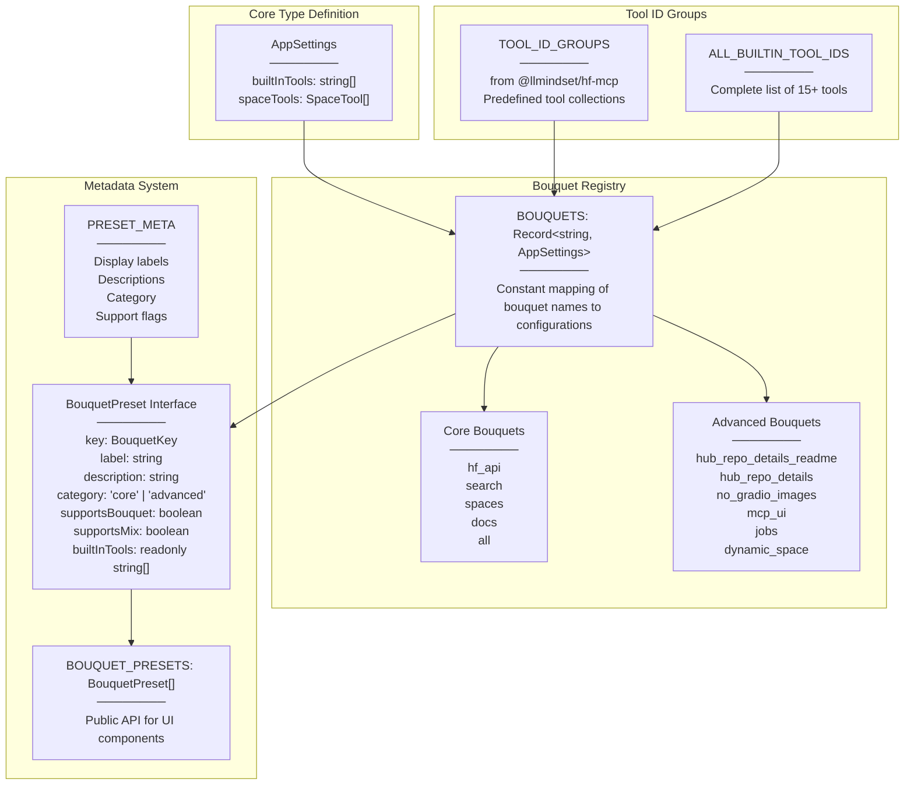
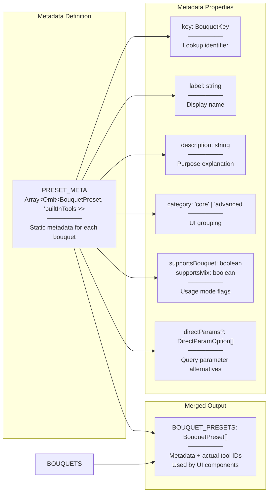
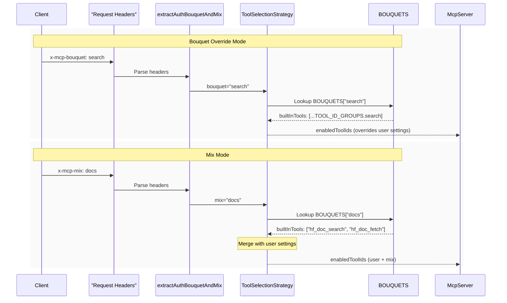
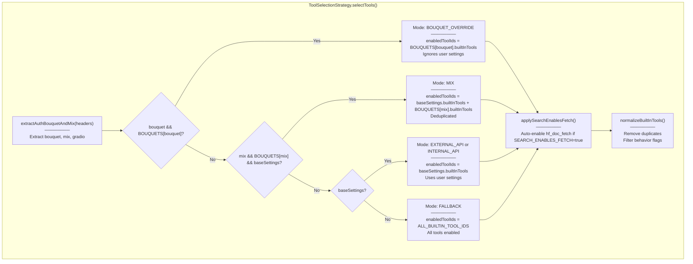
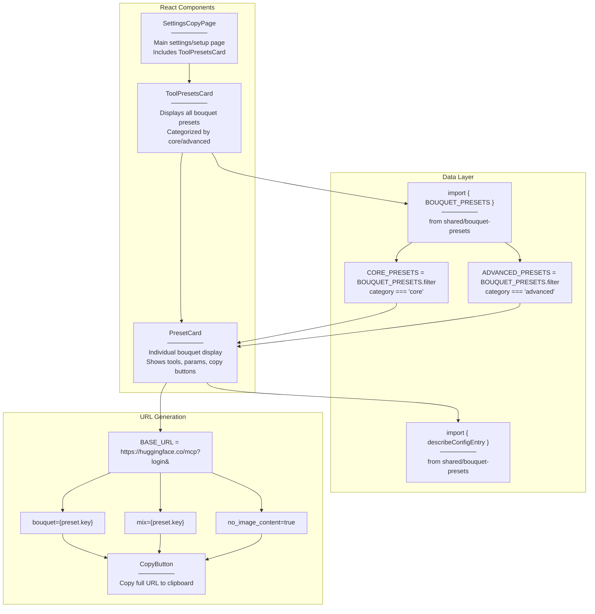

<!-- source: DeepWiki mcp.deepwiki.com · repo huggingface/hf-mcp-server · page 5.1 Bouquet System · fetched 2026-10-26 -->

# Bouquet System

<details>
<summary>Relevant source files</summary>

The following files were used as context for generating this wiki page:

- [packages/app/src/server/utils/tool-selection-strategy.ts](packages/app/src/server/utils/tool-selection-strategy.ts)
- [packages/app/src/shared/bouquet-presets.ts](packages/app/src/shared/bouquet-presets.ts)
- [packages/app/src/web/components/SettingsCopyPage.tsx](packages/app/src/web/components/SettingsCopyPage.tsx)
- [packages/app/src/web/components/bouquets/ToolPresetsCard.tsx](packages/app/src/web/components/bouquets/ToolPresetsCard.tsx)
- [packages/app/test/server/utils/tool-selection-strategy.test.ts](packages/app/test/server/utils/tool-selection-strategy.test.ts)

</details>


## Purpose and Scope

This document describes the **bouquet system**, which provides predefined tool groups (called "bouquets") that allow clients to quickly configure which MCP tools are available. Bouquets are static configurations defined in code that map friendly names (like `"search"` or `"spaces"`) to specific sets of built-in tools.

For information about how bouquets are used in the tool selection precedence system, see [Tool Selection Strategy](#5.2). For information about user-configurable tool settings, see [User Settings](#5.3).

---

## What are Bouquets?

A **bouquet** is a predefined, named configuration of tools stored in the `BOUQUETS` constant. Each bouquet consists of:
- A **key** (e.g., `"search"`, `"hf_api"`)
- A list of **built-in tool IDs** to enable
- An optional list of **space tools** (Gradio endpoints)

Bouquets serve two primary purposes:
1. **Override mode**: Replace user settings entirely with a specific tool set
2. **Mix mode**: Augment user settings by adding tools from a bouquet

The bouquet system is implemented as an `AppSettings` configuration, making it structurally identical to user settings but with predefined values that cannot be modified at runtime.

Sources: [packages/app/src/shared/bouquet-presets.ts:13-59]()

---

## Bouquet Definition Structure



**Diagram: Bouquet Definition Structure**

The `BOUQUETS` constant maps string keys to `AppSettings` configurations. Tool definitions come from `TOOL_ID_GROUPS` (predefined collections) or `ALL_BUILTIN_TOOL_IDS` (the complete set). The metadata system (`PRESET_META`, `BouquetPreset`) provides display information for UI components without modifying the core configuration.

Sources: [packages/app/src/shared/bouquet-presets.ts:1-12](), [packages/app/src/shared/bouquet-presets.ts:13-59](), [packages/app/src/shared/bouquet-presets.ts:69-78](), [packages/app/src/shared/bouquet-presets.ts:80-170]()

---

## Core Bouquets

The system defines five **core bouquets** intended for general use:

| Bouquet Key | Label | Tool Count | Tool IDs | Description |
|------------|-------|------------|----------|-------------|
| `hf_api` | Hugging Face MCP Defaults | 7 | `TOOL_ID_GROUPS.hf_api` | Balanced search plus repository details for models, datasets, and Spaces |
| `search` | Search Tools | 5 | `TOOL_ID_GROUPS.search` | Semantic search across models, datasets, papers, and docs |
| `spaces` | Spaces Toolkit | 5 | `TOOL_ID_GROUPS.spaces` | Launch, inspect, and manage Spaces |
| `docs` | Hugging Face Documentation | 2 | `TOOL_ID_GROUPS.docs` | Documentation search and fetch tools |
| `all` | All Built-in Tools | 15+ | `ALL_BUILTIN_TOOL_IDS` | Every MCP tool shipped with the server |

### Tool Group Composition

The `TOOL_ID_GROUPS` constant (imported from `@llmindset/hf-mcp`) defines predefined collections:

```typescript
// Example from packages/mcp
TOOL_ID_GROUPS.hf_api = [
  'hf_whoami',
  'hf_model_search', 
  'hf_model_detail',
  'hf_dataset_search',
  'hf_dataset_detail',
  'hf_hub_repo_details',
  'hf_paper_search'
]

TOOL_ID_GROUPS.search = [
  'hf_model_search',
  'hf_dataset_search', 
  'hf_paper_search',
  'hf_semantic_search',
  'hf_doc_search'
]

TOOL_ID_GROUPS.spaces = [
  'hf_semantic_search',
  'hf_duplicate_space',
  'hf_space_info',
  'hf_space_files',
  'hf_use_space'
]

TOOL_ID_GROUPS.docs = [
  'hf_doc_search',
  'hf_doc_fetch'
]
```

Sources: [packages/app/src/shared/bouquet-presets.ts:14-33](), [packages/app/src/shared/bouquet-presets.ts:80-121]()

---

## Advanced Bouquets

The system includes six **advanced bouquets** for specialized use cases:

| Bouquet Key | Label | Purpose | Tools/Flags |
|------------|-------|---------|-------------|
| `hub_repo_details_readme` | Hub Repo + README | Include README sections in responses | `HUB_INSPECT_TOOL_ID`, `README_INCLUDE_FLAG` |
| `hub_repo_details` | Hub Repo Details Only | Repository inspection without README | `HUB_INSPECT_TOOL_ID` |
| `no_gradio_images` | No Gradio Images | Disable image fetching from Gradio | `GRADIO_IMAGE_FILTER_FLAG` |
| `mcp_ui` | MCP UI Preview | Enable MCP-UI compatible tools | `USE_SPACE_TOOL_ID` |
| `jobs` | Run and Manage Jobs | Job scheduling and monitoring | `HF_JOBS_TOOL_ID` |
| `dynamic_space` | Dynamic Space Tools | Runtime Space invocation | `SPACE_SEARCH_TOOL_ID`, `DYNAMIC_SPACE_TOOL_ID` |

### Behavior Flags

Some advanced bouquets include **behavior flags** rather than tool IDs. These flags modify system behavior:

- **`README_INCLUDE_FLAG`** (`"_readme_include"`): Signals that README content should be included in `hub_repo_details` responses
- **`GRADIO_IMAGE_FILTER_FLAG`** (`"_no_gradio_images"`): Prevents image downloads from Gradio endpoints

Behavior flags are processed differently from tool IDs in the normalization pipeline (see `normalizeBuiltInTools` in [Tool Selection Strategy](#5.2)).

Sources: [packages/app/src/shared/bouquet-presets.ts:35-58](), [packages/app/src/shared/bouquet-presets.ts:138-170](), [packages/app/src/shared/behavior-flags.ts]()

---

## Bouquet Metadata System



**Diagram: Bouquet Metadata System**

The `PRESET_META` array defines display properties for each bouquet. The `BOUQUET_PRESETS` array merges metadata with actual tool configurations from `BOUQUETS`, creating a public API for UI components.

### BouquetPreset Interface

```typescript
interface BouquetPreset {
  key: BouquetKey;
  label: string;
  description: string;
  category: 'core' | 'advanced';
  supportsBouquet: boolean;  // Can be used with x-mcp-bouquet
  supportsMix: boolean;       // Can be used with x-mcp-mix
  builtInTools: readonly string[];
  directParams?: DirectParamOption[];
}
```

- **`supportsBouquet`**: If `true`, bouquet can be used in override mode via `x-mcp-bouquet` header
- **`supportsMix`**: If `true`, bouquet can be used in additive mode via `x-mcp-mix` header
- **`directParams`**: Alternative query parameters (e.g., `no_image_content=true` for `no_gradio_images`)

Sources: [packages/app/src/shared/bouquet-presets.ts:69-78](), [packages/app/src/shared/bouquet-presets.ts:80-170](), [packages/app/src/shared/bouquet-presets.ts:172-179]()

---

## Usage Patterns



**Diagram: Bouquet Usage Flow**

### Via HTTP Headers

Clients specify bouquets through custom headers:

```http
# Override mode - replaces user settings entirely
x-mcp-bouquet: search

# Mix mode - adds to user settings
x-mcp-mix: docs

# Both can be combined (bouquet takes precedence)
x-mcp-bouquet: hf_api
x-mcp-mix: spaces
```

The `extractAuthBouquetAndMix` function (in [packages/app/src/server/utils/auth-utils.ts]()) parses these headers:

```typescript
interface BouquetAndMixResult {
  bouquet?: string;
  mix?: string;
  gradio?: string;
}

function extractAuthBouquetAndMix(
  headers: Record<string, string> | null
): BouquetAndMixResult
```

### Via Query Parameters

Bouquets can also be specified as URL query parameters:

```
https://huggingface.co/mcp?login&bouquet=search
https://huggingface.co/mcp?login&mix=docs
https://huggingface.co/mcp?login&bouquet=hf_api&mix=spaces
```

Query parameters are converted to headers by the web server layer before reaching `ToolSelectionStrategy`.

### Direct Parameters

Some bouquets (like `no_gradio_images`) use alternative query parameters instead of bouquet/mix syntax:

```
https://huggingface.co/mcp?login&no_image_content=true
```

These are defined in `directParams` and do not use the standard bouquet resolution logic.

Sources: [packages/app/src/server/utils/auth-utils.ts](), [packages/app/src/server/utils/tool-selection-strategy.ts:129-148](), [packages/app/src/web/components/bouquets/ToolPresetsCard.tsx:9-32]()

---

## Bouquet Resolution in Tool Selection



**Diagram: Bouquet Resolution Flow in ToolSelectionStrategy**

The `ToolSelectionStrategy.selectTools()` method implements a clear precedence hierarchy:

1. **BOUQUET_OVERRIDE** (highest): If `x-mcp-bouquet` header specifies a valid bouquet, use its tools exclusively
2. **MIX**: If `x-mcp-mix` header specifies a valid bouquet AND user settings exist, merge the bouquet's tools with user settings
3. **USER_SETTINGS**: Use user settings from external or internal API
4. **FALLBACK** (lowest): Enable all tools if no configuration is available

### Precedence Example

```typescript
// Test case showing precedence
const context: ToolSelectionContext = {
  headers: {
    'x-mcp-bouquet': 'search',  // This wins
    'x-mcp-mix': 'hf_api'       // This is ignored
  },
  userSettings: {
    builtInTools: ['hf_whoami'] // This is ignored
  }
};

const result = await strategy.selectTools(context);
// result.mode === ToolSelectionMode.BOUQUET_OVERRIDE
// result.enabledToolIds === TOOL_ID_GROUPS.search
```

The complete precedence rules are documented in [Tool Selection Strategy](#5.2).

Sources: [packages/app/src/server/utils/tool-selection-strategy.ts:129-221](), [packages/app/test/server/utils/tool-selection-strategy.test.ts:118-206]()

---

## Configuration Entry Descriptions

The `describeConfigEntry()` function provides human-readable metadata for tool IDs and behavior flags:

```typescript
interface ConfigEntryDescription {
  id: string;
  label: string;
  description?: string;
  kind: 'tool' | 'behavior-flag';
}

function describeConfigEntry(id: string): ConfigEntryDescription;
```

### Tool Descriptions

```typescript
const TOOL_DESCRIPTIONS: Record<string, Omit<ConfigEntryDescription, 'id' | 'kind'>> = {
  space_search: {
    label: 'Space Search',
    description: 'Semantic search across public Spaces on the Hugging Face Hub.'
  },
  model_search: {
    label: 'Model Search',
    description: 'Find models on the Hub by keyword or capability.'
  },
  // ... additional tool descriptions
};
```

### Behavior Flag Descriptions

```typescript
const BEHAVIOR_FLAG_DESCRIPTIONS: Record<string, ...> = {
  [README_INCLUDE_FLAG]: {
    label: 'Allow README Include',
    description: 'Permit README sections to be returned in responses (advanced).'
  },
  [GRADIO_IMAGE_FILTER_FLAG]: {
    label: 'Skip Gradio Images',
    description: 'Prevent image downloads from Gradio endpoints (advanced).'
  }
};
```

These descriptions are used by UI components (like `ToolPresetsCard`) to display user-friendly information about each tool or flag in a bouquet.

Sources: [packages/app/src/shared/bouquet-presets.ts:181-282](), [packages/app/src/web/components/bouquets/ToolPresetsCard.tsx:34-139]()

---

## UI Integration



**Diagram: Bouquet System UI Integration**

The `ToolPresetsCard` component displays all available bouquets with copy-to-clipboard functionality for URLs. Each bouquet is rendered as a `PresetCard` showing:

1. **Metadata**: Label, description, key, category
2. **Usage modes**: Bouquet and/or mix parameters with color-coded badges
3. **Tool list**: Expanded view of included tools with descriptions
4. **Copy buttons**: One-click copying of pre-configured URLs

### Example URLs Generated

```
Core Preset - Spaces Toolkit:
  Bouquet: https://huggingface.co/mcp?login&bouquet=spaces
  Mix:     https://huggingface.co/mcp?login&mix=spaces

Advanced Preset - No Gradio Images:
  Query:   https://huggingface.co/mcp?login&no_image_content=true
```

Sources: [packages/app/src/web/components/bouquets/ToolPresetsCard.tsx:1-226](), [packages/app/src/web/components/SettingsCopyPage.tsx:1044]()

---

## Testing

The test suite verifies bouquet behavior across all precedence scenarios:

### Test Coverage

| Test Category | Test Cases | File |
|--------------|-----------|------|
| Bouquet Override | 6 tests (search, hf_api, spaces, all, invalid, precedence) | [test/server/utils/tool-selection-strategy.test.ts:118-206]() |
| Mix Mode | 6 tests (hf_api mix, search mix, deduplication, no settings, invalid) | [test/server/utils/tool-selection-strategy.test.ts:209-308]() |
| Gradio Endpoints | 8 tests (bouquet + gradio, mix + gradio, multiple formats) | [test/server/utils/tool-selection-strategy.test.ts:685-799]() |
| SEARCH_ENABLES_FETCH | 7 tests (feature flag behavior with bouquets) | [test/server/utils/tool-selection-strategy.test.ts:516-683]() |

### Example Test Case

```typescript
it('should use bouquet override for search bouquet', async () => {
  const context: ToolSelectionContext = {
    headers: { 'x-mcp-bouquet': 'search' },
    hfToken: 'test-token',
  };

  const result = await strategy.selectTools(context);

  expect(result.mode).toBe(ToolSelectionMode.BOUQUET_OVERRIDE);
  expect(result.enabledToolIds).toEqual(TOOL_ID_GROUPS.search);
  expect(result.reason).toBe('Bouquet override: search');
  expect(result.baseSettings).toBeUndefined();
  expect(result.mixedBouquet).toBeUndefined();
});
```

Sources: [packages/app/test/server/utils/tool-selection-strategy.test.ts:54-90](), [packages/app/test/server/utils/tool-selection-strategy.test.ts:92-514]()

---

