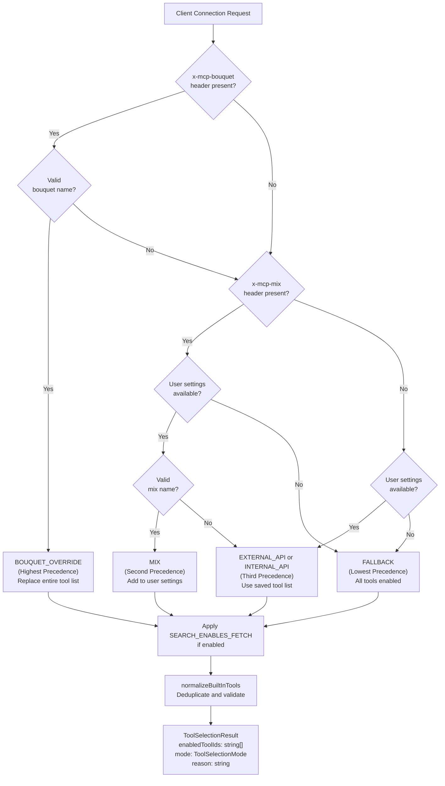
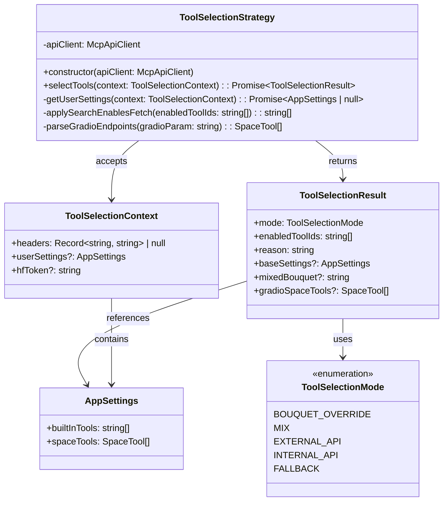
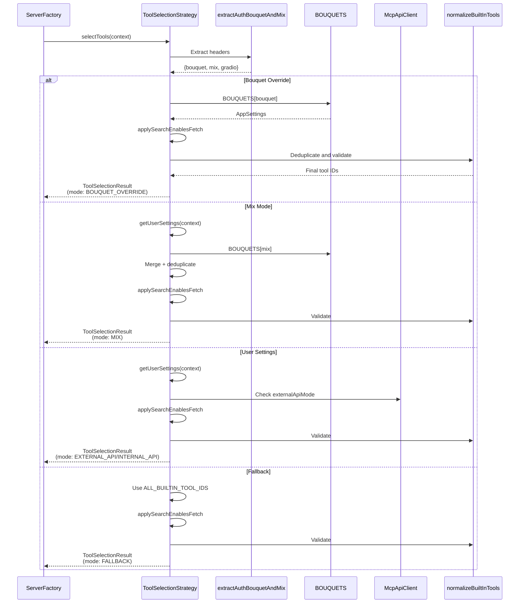
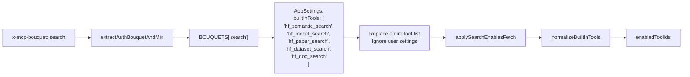
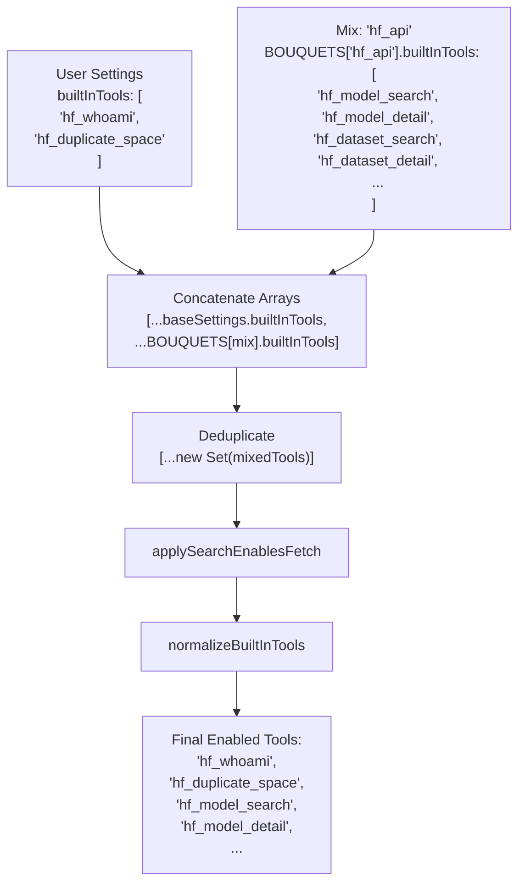
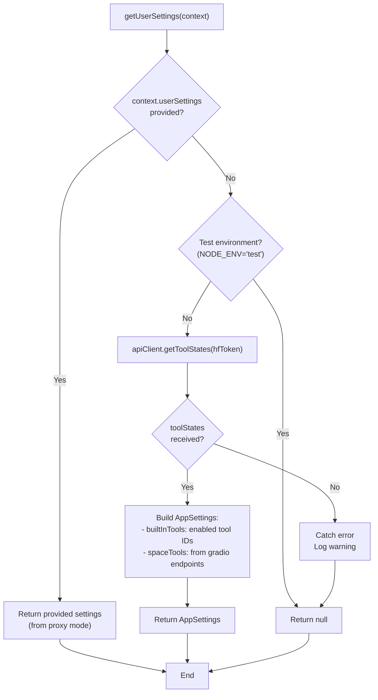
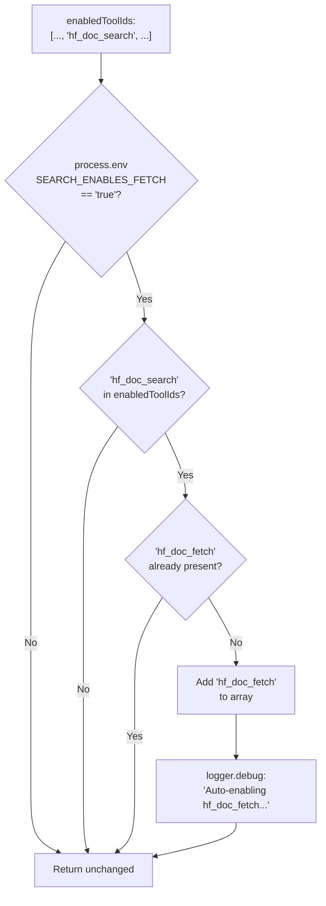
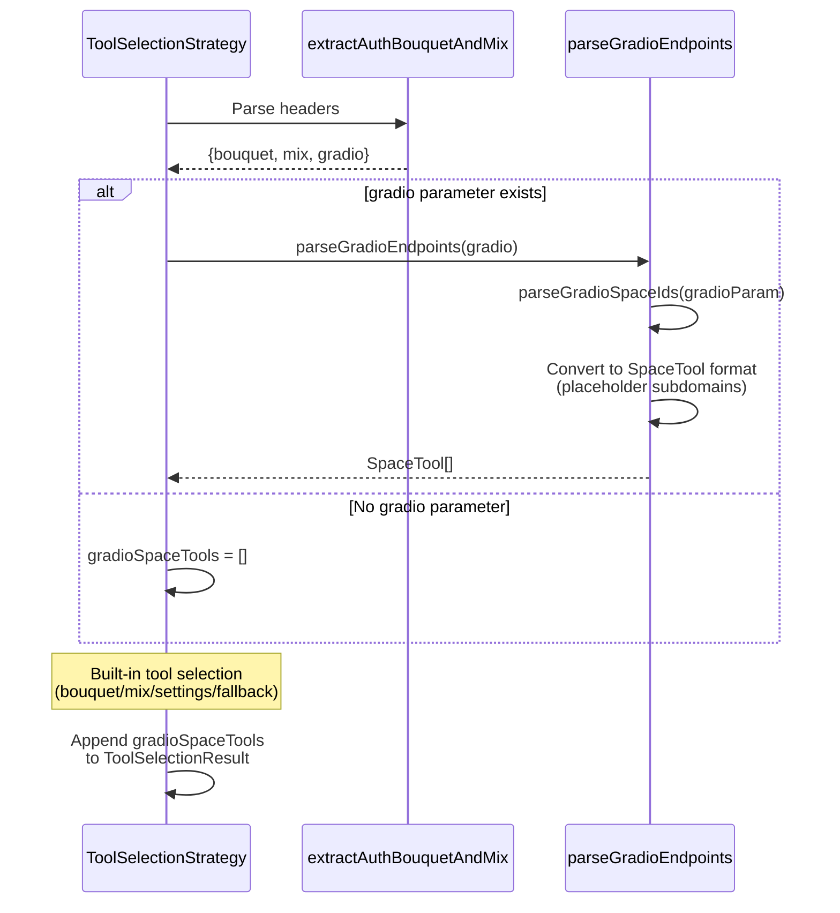
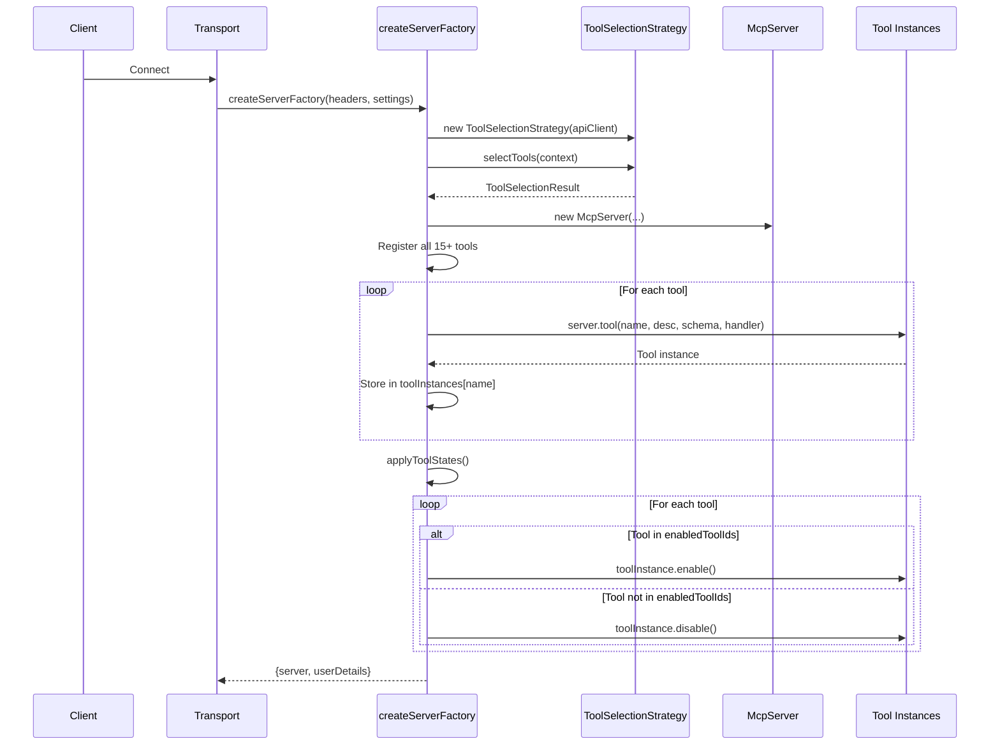
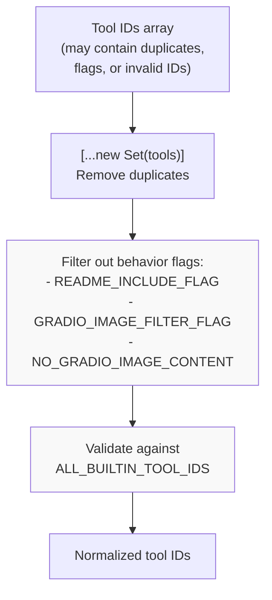

<!-- source: DeepWiki mcp.deepwiki.com · repo huggingface/hf-mcp-server · page 5.2 Tool Selection Strategy · fetched 2026-10-26 -->

# Tool Selection Strategy

<details>
<summary>Relevant source files</summary>

The following files were used as context for generating this wiki page:

- [packages/app/src/server/mcp-server.ts](packages/app/src/server/mcp-server.ts)
- [packages/app/src/server/utils/tool-selection-strategy.ts](packages/app/src/server/utils/tool-selection-strategy.ts)
- [packages/app/src/shared/bouquet-presets.ts](packages/app/src/shared/bouquet-presets.ts)
- [packages/app/src/shared/settings.ts](packages/app/src/shared/settings.ts)
- [packages/app/src/web/App.tsx](packages/app/src/web/App.tsx)
- [packages/app/src/web/components/SettingsCopyPage.tsx](packages/app/src/web/components/SettingsCopyPage.tsx)
- [packages/app/src/web/components/bouquets/ToolPresetsCard.tsx](packages/app/src/web/components/bouquets/ToolPresetsCard.tsx)
- [packages/app/test/server/utils/tool-selection-strategy.test.ts](packages/app/test/server/utils/tool-selection-strategy.test.ts)

</details>


## Purpose and Scope

This document explains the tool selection system that determines which MCP tools are available to a client connection. The `ToolSelectionStrategy` class implements a precedence-based system for selecting built-in tools using bouquets, mixes, and user settings.

For information about:
- Predefined bouquet configurations, see [Bouquet System](#5.1)
- User-configurable settings storage, see [User Settings](#5.3)
- Tool registration and invocation, see [Tool System Overview](#4.1)

## Overview

When a client connects to the MCP server, the system must determine which of the 15+ built-in tools should be available. The `ToolSelectionStrategy` class resolves this by evaluating multiple configuration sources in a strict precedence order, ultimately producing a list of enabled tool IDs.

The strategy is invoked during server instantiation in [packages/app/src/server/mcp-server.ts:114-185]() and returns a `ToolSelectionResult` containing the enabled tools and metadata about how they were selected.

**Sources:** [packages/app/src/server/utils/tool-selection-strategy.ts:1-260](), [packages/app/src/server/mcp-server.ts:96-186]()

## Precedence System



**Precedence Order (highest to lowest):**

| Priority | Mode | Header/Source | Behavior |
|----------|------|---------------|----------|
| 1 | `BOUQUET_OVERRIDE` | `x-mcp-bouquet` | Completely replaces tool list with predefined bouquet |
| 2 | `MIX` | `x-mcp-mix` + user settings | Adds mix bouquet tools to existing user settings |
| 3 | `EXTERNAL_API` / `INTERNAL_API` | User settings from API | Uses saved tool preferences |
| 4 | `FALLBACK` | None | Enables all built-in tools |

The implementation enforces this precedence in [packages/app/src/server/utils/tool-selection-strategy.ts:129-221]() where each level is checked sequentially.

**Sources:** [packages/app/src/server/utils/tool-selection-strategy.ts:34-69](), [packages/app/test/server/utils/tool-selection-strategy.test.ts:92-459]()

## Core Data Structures



The `ToolSelectionStrategy` class is instantiated in [packages/app/src/server/mcp-server.ts:115]() and invoked immediately after with the `ToolSelectionContext` at [packages/app/src/server/mcp-server.ts:180-185]().

**Sources:** [packages/app/src/server/utils/tool-selection-strategy.ts:10-31](), [packages/app/src/shared/settings.ts:9-20]()

## The ToolSelectionStrategy Class

### Initialization

```typescript
// Instantiated once per server instance
const toolSelectionStrategy = new ToolSelectionStrategy(sharedApiClient);
```

The strategy requires a `McpApiClient` instance ([packages/app/src/server/utils/tool-selection-strategy.ts:73-75]()) which provides:
- Access to transport information (`externalApiMode` flag)
- Tool state fetching capabilities
- Gradio endpoint information

### selectTools Method

The core method signature:

```typescript
async selectTools(context: ToolSelectionContext): Promise<ToolSelectionResult>
```

**Execution flow:**



**Sources:** [packages/app/src/server/utils/tool-selection-strategy.ts:129-221](), [packages/app/src/server/mcp-server.ts:180-186]()

## Bouquet Override Mode

### Detection and Application

Bouquets are detected via the `x-mcp-bouquet` header, extracted using `extractAuthBouquetAndMix` utility ([packages/app/src/server/utils/auth-utils.ts]()).



The bouquet lookup occurs at [packages/app/src/server/utils/tool-selection-strategy.ts:136-147]() where it checks if `BOUQUETS[bouquet]` exists. Valid bouquet names are defined in [packages/app/src/shared/bouquet-presets.ts:13-59]().

**Key behavior:** Bouquet override completely ignores user settings, providing a deterministic tool set. This is useful for:
- URL-based tool configuration
- Testing specific tool combinations
- Overriding user preferences temporarily

**Sources:** [packages/app/src/server/utils/tool-selection-strategy.ts:136-148](), [packages/app/src/shared/bouquet-presets.ts:13-59]()

## Mix Mode

### Additive Tool Selection

Mix mode combines a bouquet's tools with existing user settings:

```typescript
// Implementation from tool-selection-strategy.ts:154-177
if (mix && BOUQUETS[mix] && baseSettings) {
    const mixedTools = [...baseSettings.builtInTools, ...BOUQUETS[mix].builtInTools];
    const enabledToolIds = normalizeBuiltInTools(
        applySearchEnablesFetch([...new Set(mixedTools)])
    );
    // ...
}
```

**Mix operation visualization:**



**Requirements:** Mix mode requires user settings to be available. If no settings exist, it falls through to fallback mode ([packages/app/src/server/utils/tool-selection-strategy.ts:280-288]()).

**Sources:** [packages/app/src/server/utils/tool-selection-strategy.ts:154-177](), [packages/app/test/server/utils/tool-selection-strategy.test.ts:209-308]()

## User Settings Mode

### Internal vs External API

The mode determination depends on the `McpApiClient` configuration:

| Mode | Trigger | Settings Source |
|------|---------|----------------|
| `INTERNAL_API` | `externalApiMode=false` | In-memory `settingsService` |
| `EXTERNAL_API` | `externalApiMode=true` | External HTTP endpoint |

Detection occurs at [packages/app/src/server/utils/tool-selection-strategy.ts:182-184]():

```typescript
const mode = this.apiClient.getTransportInfo()?.externalApiMode
    ? ToolSelectionMode.EXTERNAL_API
    : ToolSelectionMode.INTERNAL_API;
```

### getUserSettings Implementation



The implementation at [packages/app/src/server/utils/tool-selection-strategy.ts:226-258]() handles three cases:
1. Pre-provided settings (from stateless proxy mode)
2. Test environment (skip API call)
3. Normal operation (fetch from API client)

**Sources:** [packages/app/src/server/utils/tool-selection-strategy.ts:180-208](), [packages/app/src/server/utils/tool-selection-strategy.ts:226-258]()

## Fallback Mode

### All Tools Enabled

Fallback mode activates when no configuration is available:

```typescript
// From tool-selection-strategy.ts:210-220
logger.warn('No settings available, using fallback (all tools enabled)');
const enabledToolIds = normalizeBuiltInTools(
    applySearchEnablesFetch([...ALL_BUILTIN_TOOL_IDS])
);
return {
    mode: ToolSelectionMode.FALLBACK,
    enabledToolIds,
    reason: `Fallback - no settings available...`,
    gradioSpaceTools: gradioSpaceTools.length > 0 ? gradioSpaceTools : undefined,
};
```

**When fallback occurs:**
- No bouquet header specified
- No mix header specified
- No user settings available (API call failed or not configured)
- Invalid bouquet/mix names provided

The `ALL_BUILTIN_TOOL_IDS` constant is imported from `@llmindset/hf-mcp` package and contains all 15+ built-in tool IDs.

**Sources:** [packages/app/src/server/utils/tool-selection-strategy.ts:210-220](), [packages/app/test/server/utils/tool-selection-strategy.test.ts:370-396]()

## SEARCH_ENABLES_FETCH Feature

### Automatic Tool Enhancement

The `SEARCH_ENABLES_FETCH` environment variable enables automatic addition of `hf_doc_fetch` when `hf_doc_search` is enabled:



**Implementation:**

The logic is contained in [packages/app/src/server/utils/tool-selection-strategy.ts:108-116]():

```typescript
private applySearchEnablesFetch(enabledToolIds: string[]): string[] {
    if (process.env.SEARCH_ENABLES_FETCH === 'true') {
        if (enabledToolIds.includes('hf_doc_search') && !enabledToolIds.includes('hf_doc_fetch')) {
            logger.debug('SEARCH_ENABLES_FETCH: Auto-enabling hf_doc_fetch because hf_doc_search is enabled');
            return [...enabledToolIds, 'hf_doc_fetch'];
        }
    }
    return enabledToolIds;
}
```

This method is called in every precedence mode before returning the result:
- Bouquet override: [packages/app/src/server/utils/tool-selection-strategy.ts:139]()
- Mix mode: [packages/app/src/server/utils/tool-selection-strategy.ts:157]()
- User settings: [packages/app/src/server/utils/tool-selection-strategy.ts:187]()
- Fallback: [packages/app/src/server/utils/tool-selection-strategy.ts:213]()

**Sources:** [packages/app/src/server/utils/tool-selection-strategy.ts:104-116](), [packages/app/test/server/utils/tool-selection-strategy.test.ts:516-683]()

## Gradio Endpoint Handling

### Independent from Built-in Tool Selection

The `gradio` parameter is parsed independently and included in all selection modes:



**Important distinction:** The `parseGradioEndpoints` method at [packages/app/src/server/utils/tool-selection-strategy.ts:85-102]() only creates **metadata** with placeholder subdomains. Actual Gradio endpoint registration with real subdomains happens separately in the proxy factory.

From the class documentation ([packages/app/src/server/utils/tool-selection-strategy.ts:36-68]()):

```
## Two Independent Systems

1. **Built-in Tool Selection** (handled by this class):
   - Controlled by: bouquet, mix, and user settings
   - Affects: Built-in HuggingFace MCP tools only
   - Returns: enabledToolIds array

2. **Gradio Endpoint Registration** (handled by mcp-proxy.ts):
   - Controlled by: gradio parameter + user settings spaceTools
   - Affects: Dynamic Gradio Space endpoints
   - Works with any bouquet when explicitly specified via gradio=
   - Special: gradio="none" disables all Gradio endpoints
```

**Sources:** [packages/app/src/server/utils/tool-selection-strategy.ts:36-68](), [packages/app/src/server/utils/tool-selection-strategy.ts:78-102](), [packages/app/test/server/utils/tool-selection-strategy.test.ts:685-799]()

## Integration with MCP Server

### Server Factory Usage

The `ToolSelectionStrategy` is integrated into the server creation flow:



**Key implementation points:**

1. Strategy creation at [packages/app/src/server/mcp-server.ts:115]()
2. Tool selection at [packages/app/src/server/mcp-server.ts:180-185]()
3. All tools are registered regardless of selection ([packages/app/src/server/mcp-server.ts:191]())
4. Tool states are applied at [packages/app/src/server/mcp-server.ts:839-859]()

This approach allows dynamic enabling/disabling of tools without recreating the server instance.

**Sources:** [packages/app/src/server/mcp-server.ts:96-186](), [packages/app/src/server/mcp-server.ts:839-894]()

## Normalization and Validation

### normalizeBuiltInTools Function

Every tool selection result passes through `normalizeBuiltInTools` for consistency:



The normalization function is imported from [packages/app/src/shared/tool-normalizer.ts]() and called in every precedence mode:
- Bouquet: [packages/app/src/server/utils/tool-selection-strategy.ts:138-140]()
- Mix: [packages/app/src/server/utils/tool-selection-strategy.ts:156-158]()
- Settings: [packages/app/src/server/utils/tool-selection-strategy.ts:186-188]()
- Fallback: [packages/app/src/server/utils/tool-selection-strategy.ts:212-214]()

**Sources:** [packages/app/src/shared/tool-normalizer.ts](), [packages/app/src/server/utils/tool-selection-strategy.ts:138-214]()

## Testing Strategy

### Comprehensive Test Coverage

The test suite at [packages/app/test/server/utils/tool-selection-strategy.test.ts]() validates all precedence modes:

| Test Category | Coverage |
|--------------|----------|
| Bouquet Override | Valid/invalid bouquets, all bouquet types, precedence over mix |
| Mix Mode | Additive behavior, deduplication, invalid mix handling |
| User Settings | Internal/external API modes, empty settings |
| Fallback Mode | No config, null headers, failed API calls |
| SEARCH_ENABLES_FETCH | Enabled/disabled states, all modes |
| Gradio Endpoints | Independent parsing, all modes |

**Example test structure:**

```typescript
describe('Bouquet Override (Highest Precedence)', () => {
    it('should use bouquet override for search bouquet', async () => {
        const context: ToolSelectionContext = {
            headers: { 'x-mcp-bouquet': 'search' },
            hfToken: 'test-token',
        };
        const result = await strategy.selectTools(context);
        expect(result.mode).toBe(ToolSelectionMode.BOUQUET_OVERRIDE);
        expect(result.enabledToolIds).toEqual(TOOL_ID_GROUPS.search);
    });
});
```

**Sources:** [packages/app/test/server/utils/tool-selection-strategy.test.ts:1-801]()

---

