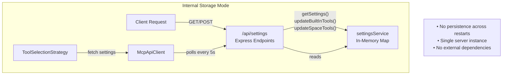
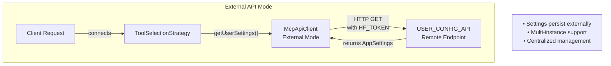
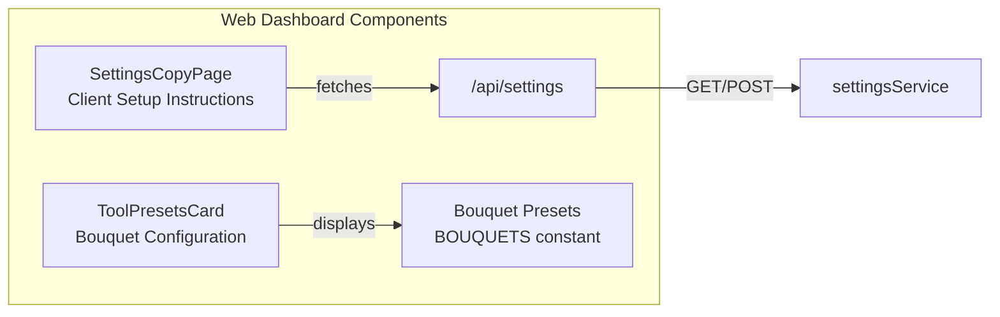
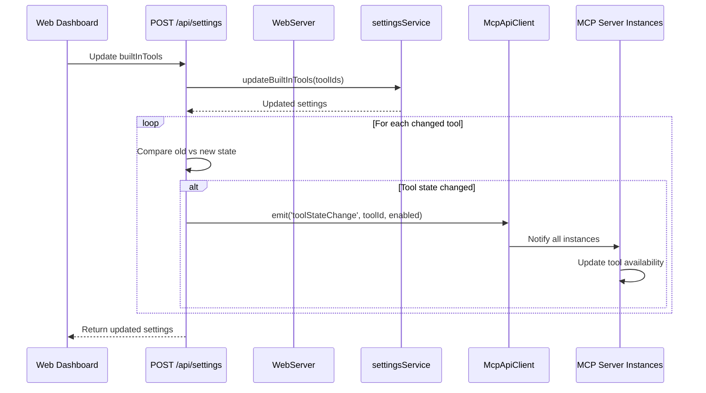
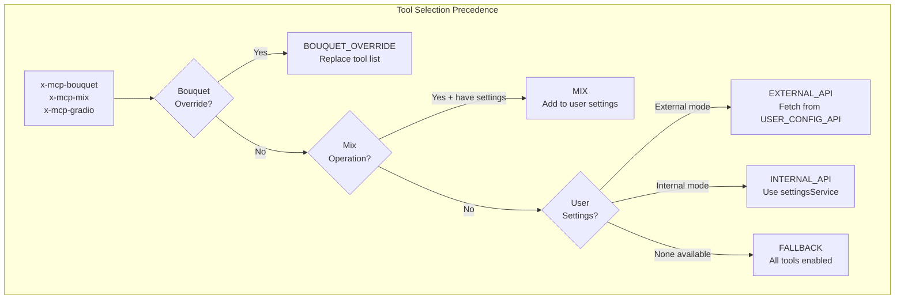
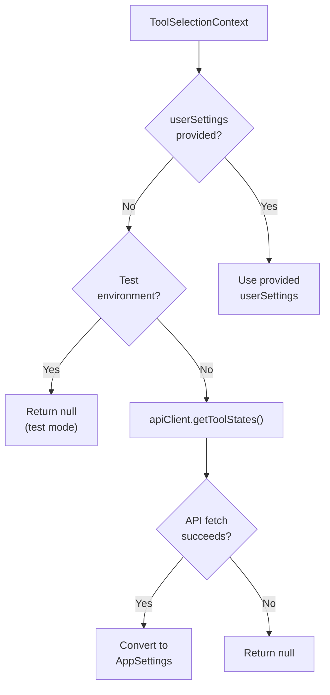
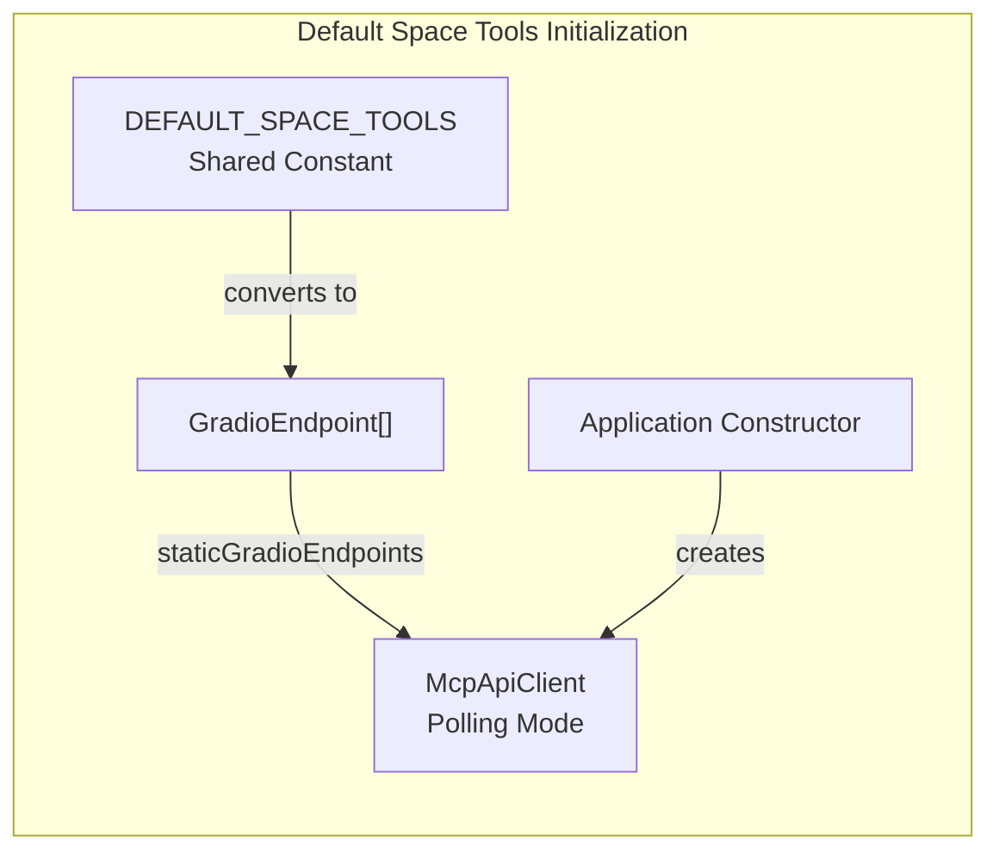

<!-- source: DeepWiki mcp.deepwiki.com · repo huggingface/hf-mcp-server · page 5.3 User Settings · fetched 2026-10-26 -->

# User Settings

<details>
<summary>Relevant source files</summary>

The following files were used as context for generating this wiki page:

- [packages/app/src/server/application.ts](packages/app/src/server/application.ts)
- [packages/app/src/server/utils/tool-selection-strategy.ts](packages/app/src/server/utils/tool-selection-strategy.ts)
- [packages/app/src/server/web-server.ts](packages/app/src/server/web-server.ts)
- [packages/app/src/shared/bouquet-presets.ts](packages/app/src/shared/bouquet-presets.ts)
- [packages/app/src/web/components/SettingsCopyPage.tsx](packages/app/src/web/components/SettingsCopyPage.tsx)
- [packages/app/src/web/components/bouquets/ToolPresetsCard.tsx](packages/app/src/web/components/bouquets/ToolPresetsCard.tsx)
- [packages/app/test/server/utils/tool-selection-strategy.test.ts](packages/app/test/server/utils/tool-selection-strategy.test.ts)

</details>


User settings define which built-in tools and Gradio Space endpoints are available to clients connecting to the MCP server. Settings can be stored internally (in-memory) or fetched from an external API, providing flexibility for different deployment scenarios. This page covers settings structure, storage modes, management interfaces, and integration with the tool selection system.

For information about how user settings interact with bouquets and mix parameters in the tool selection precedence hierarchy, see [Tool Selection Strategy](#5.2). For details on available tool presets, see [Bouquet System](#5.1).

---

## Settings Storage Modes

The MCP server supports two storage modes for user settings, controlled by the `USER_CONFIG_API` environment variable.

### Internal Storage Mode

When `USER_CONFIG_API` is not set, settings are stored in-memory using `settingsService`. This mode provides a simple local storage solution suitable for single-instance deployments.



**Sources:** [packages/app/src/server/web-server.ts:375-413](), [packages/app/src/server/application.ts:67-86]()

### External API Mode

When `USER_CONFIG_API` is set to a remote endpoint URL, the server fetches settings from that external API. This enables centralized configuration management across multiple server instances.



**Sources:** [packages/app/src/server/application.ts:67-77](), [packages/app/src/server/utils/tool-selection-strategy.ts:226-258]()

---

## Settings Structure

User settings conform to the `AppSettings` interface with two primary configuration arrays.

### Built-in Tools Configuration

The `builtInTools` array contains tool IDs for standard MCP tools. Valid tool IDs are defined in `ALL_BUILTIN_TOOL_IDS` from the `@llmindset/hf-mcp` package.

| Field | Type | Description | Example |
|-------|------|-------------|---------|
| `builtInTools` | `string[]` | Array of enabled tool IDs | `["hf_model_search", "hf_dataset_search"]` |

**Common Tool ID Groups:**
- **Search Tools**: `hf_model_search`, `hf_dataset_search`, `hf_paper_search`, `hf_doc_search`, `hf_semantic_search`
- **Detail Tools**: `model_details`, `dataset_details`, `hub_repo_details`
- **Space Tools**: `duplicate_space`, `space_info`, `space_files`, `use_space`
- **Documentation**: `hf_doc_search`, `hf_doc_fetch`

**Sources:** [packages/app/src/shared/settings.ts]() (referenced), [packages/app/src/server/web-server.ts:382-393]()

### Space Tools Configuration

The `spaceTools` array defines custom Gradio Space endpoints that will be dynamically registered as MCP tools.

| Field | Type | Required | Description |
|-------|------|----------|-------------|
| `name` | `string` | Yes | Display name for the Space tool |
| `subdomain` | `string` | Yes | HuggingFace subdomain (e.g., `user-space-name`) |
| `_id` | `string` | Yes | Unique identifier for this endpoint |
| `emoji` | `string` | No | Optional emoji for UI display |

**Example SpaceTool:**
```typescript
{
  name: "Florence-2 Vision",
  subdomain: "microsoft-Florence-2-large",
  _id: "gradio_florence2",
  emoji: "👁️"
}
```

**Sources:** [packages/app/src/shared/settings.ts:8]() (type reference), [packages/app/src/server/application.ts:52-60]()

---

## Managing Settings

Settings can be managed through the web dashboard UI or directly via API endpoints.

### Web Dashboard

The web dashboard provides two primary interfaces for settings management:



- **SettingsCopyPage**: Displays setup instructions for connecting various clients (Claude, VS Code, Cursor, Gemini CLI, etc.) with pre-configured URLs and authentication options
- **ToolPresetsCard**: Shows available bouquet presets with copy buttons for quick URL generation

**Sources:** [packages/app/src/web/components/SettingsCopyPage.tsx:1-835](), [packages/app/src/web/components/bouquets/ToolPresetsCard.tsx:1-227]()

### API Endpoints

The server exposes REST endpoints for programmatic settings management:

#### GET /api/settings

Returns current user settings.

**Response:**
```json
{
  "builtInTools": ["hf_model_search", "hf_dataset_search"],
  "spaceTools": [
    {
      "name": "WebSearch",
      "subdomain": "victor-websearch",
      "_id": "websearch",
      "emoji": "🔍"
    }
  ]
}
```

#### POST /api/settings

Updates user settings. Supports partial updates - only specify fields to change.

**Request Body:**
```json
{
  "builtInTools": ["hf_model_search", "hf_doc_search"],
  "spaceTools": []
}
```

**Response:** Returns updated settings (same format as GET).

**Sources:** [packages/app/src/server/web-server.ts:375-413]()

### Gradio Endpoints Management

Separate endpoints manage Gradio Space tool configurations:

#### GET /api/gradio-endpoints

Returns list of registered Gradio endpoints with current state.

#### POST /api/gradio-endpoints/:index

Updates enabled state for a specific endpoint.

**Request Body:**
```json
{
  "enabled": true
}
```

#### PUT /api/gradio-endpoints/:index

Updates endpoint metadata (name, subdomain, id, emoji).

**Sources:** [packages/app/src/server/web-server.ts:415-488]()

---

## Event System

Settings changes trigger events that propagate to all active MCP server instances, enabling dynamic tool availability updates without requiring client reconnection.



**Key Implementation Details:**

1. **State Tracking**: WebServer maintains `localSharedToolStates` map to track previous tool states
2. **Change Detection**: Only tools whose enabled state actually changed trigger events
3. **Event Broadcasting**: `McpApiClient.emit('toolStateChange')` notifies all server instances
4. **No Disruption**: Active client connections continue working with updated tool sets

**Sources:** [packages/app/src/server/web-server.ts:129-136](), [packages/app/src/server/web-server.ts:395-410]()

---

## Integration with Tool Selection

User settings integrate into the tool selection precedence hierarchy as the third-priority source, after bouquet overrides and mix operations.



### Mode Determination

The `ToolSelectionStrategy` determines which mode to use based on configuration and context:

| Mode | Trigger | Tool Source |
|------|---------|-------------|
| `BOUQUET_OVERRIDE` | `x-mcp-bouquet` header present | Predefined bouquet from `BOUQUETS` |
| `MIX` | `x-mcp-mix` header + user settings | User settings + bouquet tools (deduplicated) |
| `EXTERNAL_API` | `USER_CONFIG_API` set, no override/mix | External API endpoint |
| `INTERNAL_API` | No `USER_CONFIG_API`, no override/mix | `settingsService` in-memory storage |
| `FALLBACK` | No settings available | All built-in tools enabled |

**Sources:** [packages/app/src/server/utils/tool-selection-strategy.ts:10-31](), [packages/app/src/server/utils/tool-selection-strategy.ts:129-221]()

### getUserSettings Flow

The `ToolSelectionStrategy.getUserSettings()` method resolves settings from multiple sources:



**Sources:** [packages/app/src/server/utils/tool-selection-strategy.ts:226-258]()

---

## Default Space Tools

The system provides a shared set of default Space tools when external settings are unavailable.



**Conversion Logic:**
- SpaceTool `_id` → GradioEndpoint `id`
- SpaceTool `subdomain` → GradioEndpoint `subdomain`
- SpaceTool `name` → GradioEndpoint `name`
- SpaceTool `emoji` → GradioEndpoint `emoji`

**Sources:** [packages/app/src/server/application.ts:52-64]()

---

## Practical Examples

### Example 1: Internal Mode with Custom Tools

Configure a minimal set of search tools for focused workflows:

```typescript
// POST /api/settings
{
  "builtInTools": [
    "hf_model_search",
    "hf_dataset_search"
  ],
  "spaceTools": []
}
```

### Example 2: External API Mode Setup

```bash
# Set environment variable
export USER_CONFIG_API="https://config.example.com/api/mcp-settings"
export DEFAULT_HF_TOKEN="hf_..."

# Server fetches settings from external API on each request
# Settings persist across server restarts
```

### Example 3: Adding Custom Gradio Spaces

```typescript
// POST /api/settings
{
  "spaceTools": [
    {
      "name": "Custom GPT Assistant",
      "subdomain": "myorg-custom-gpt",
      "_id": "custom_gpt_1",
      "emoji": "🤖"
    },
    {
      "name": "Document Analyzer",
      "subdomain": "myteam-doc-analyzer",
      "_id": "doc_analyzer",
      "emoji": "📄"
    }
  ]
}
```

### Example 4: Mix Mode with User Settings

User has minimal settings saved but wants to temporarily add search tools:

```
# User settings stored: ["hf_whoami", "duplicate_space"]
# Request URL: https://huggingface.co/mcp?login&mix=search

# Result: User tools + search bouquet tools (deduplicated)
# Final tools: ["hf_whoami", "duplicate_space", "hf_model_search", 
#               "hf_dataset_search", "hf_paper_search", "hf_doc_search", 
#               "hf_semantic_search"]
```

**Sources:** [packages/app/test/server/utils/tool-selection-strategy.test.ts:210-253](), [packages/app/test/server/utils/tool-selection-strategy.test.ts:461-513]()

---

## Testing User Settings

The test suite validates all settings modes and precedence rules:

### Key Test Scenarios

| Test Case | Location | Purpose |
|-----------|----------|---------|
| Provided user settings | [test file:311-329]() | Verifies INTERNAL_API mode with explicit settings |
| External API mode | [test file:331-367]() | Validates EXTERNAL_API mode configuration |
| Empty user settings | [test file:399-416]() | Confirms empty arrays are preserved |
| Mix with empty settings | [test file:418-435]() | Tests additive mix on empty base |
| Gradio endpoint preservation | [test file:461-513]() | Ensures spaceTools survive mix operations |
| SEARCH_ENABLES_FETCH | [test file:516-683]() | Auto-enable doc_fetch with doc_search |

**Sources:** [packages/app/test/server/utils/tool-selection-strategy.test.ts:92-683]()

---

