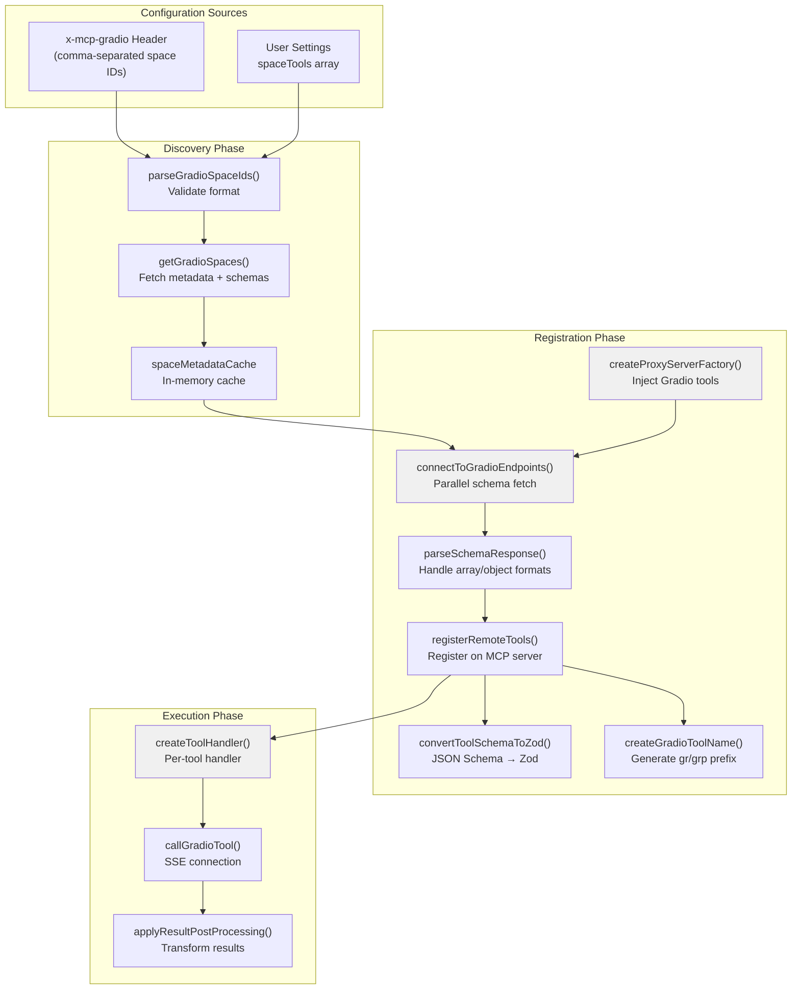
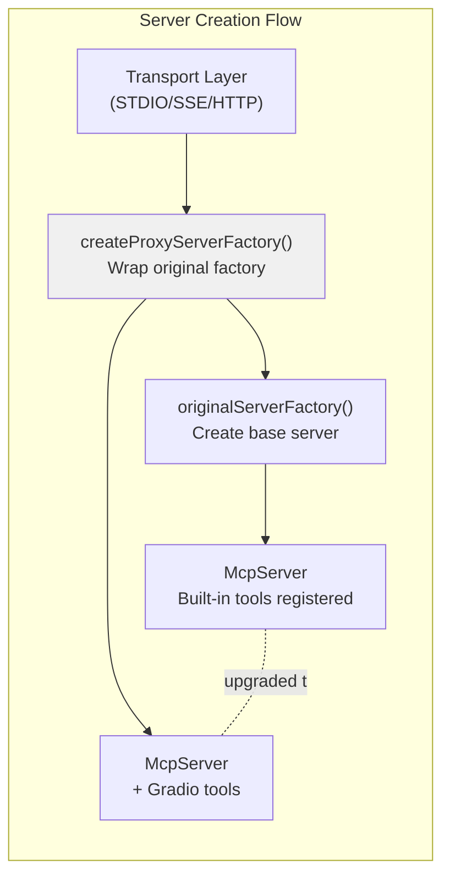
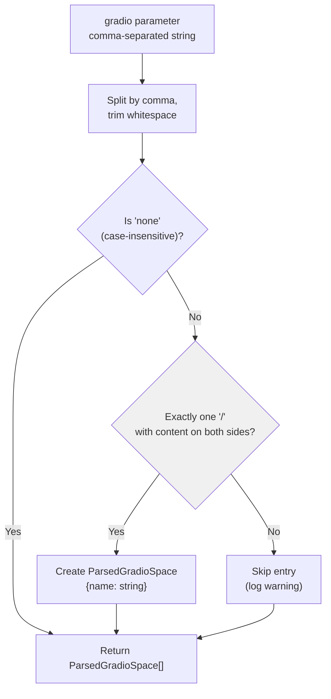
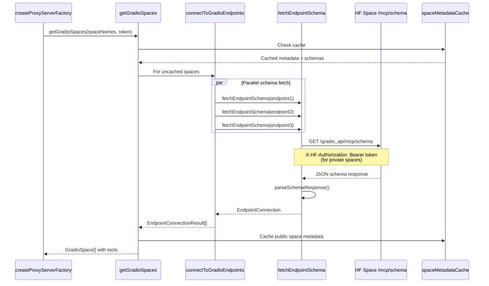
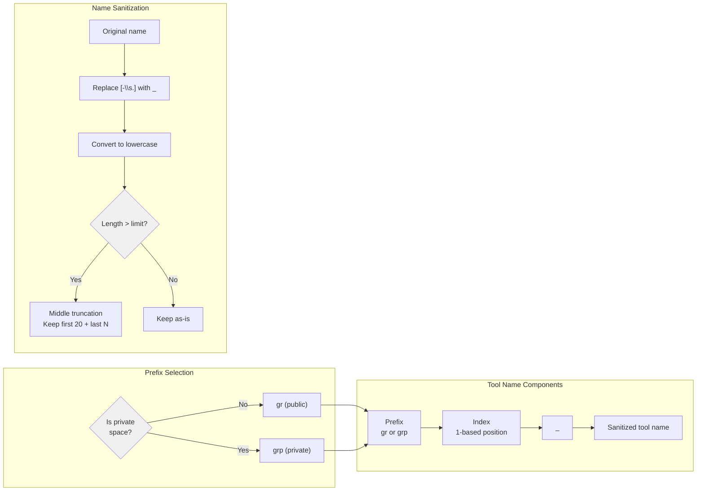
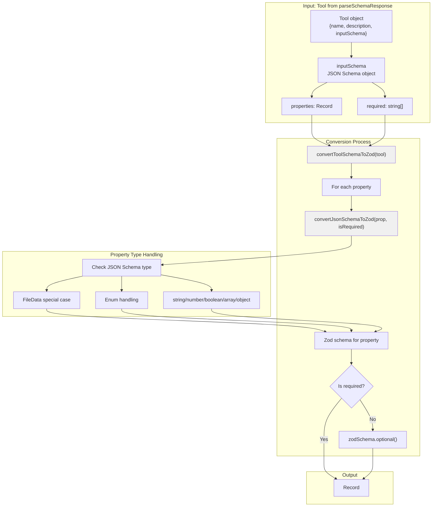
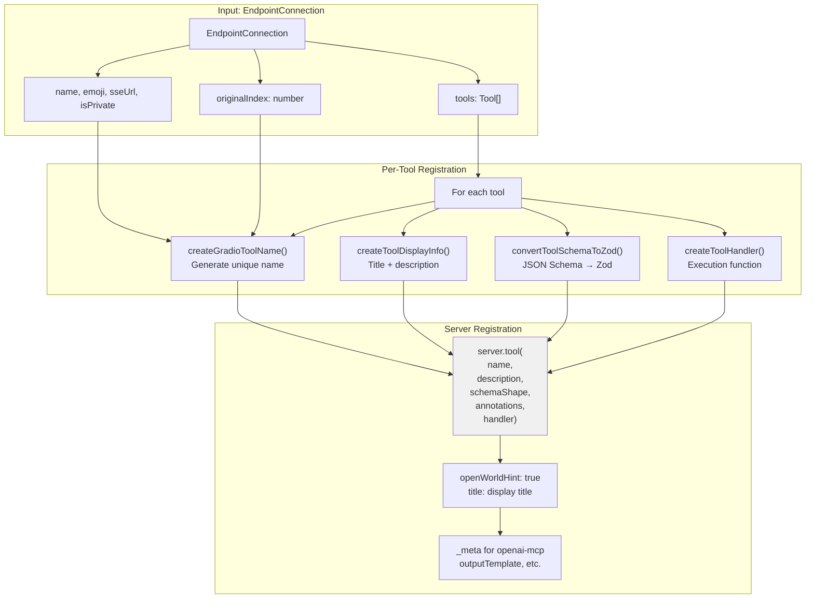
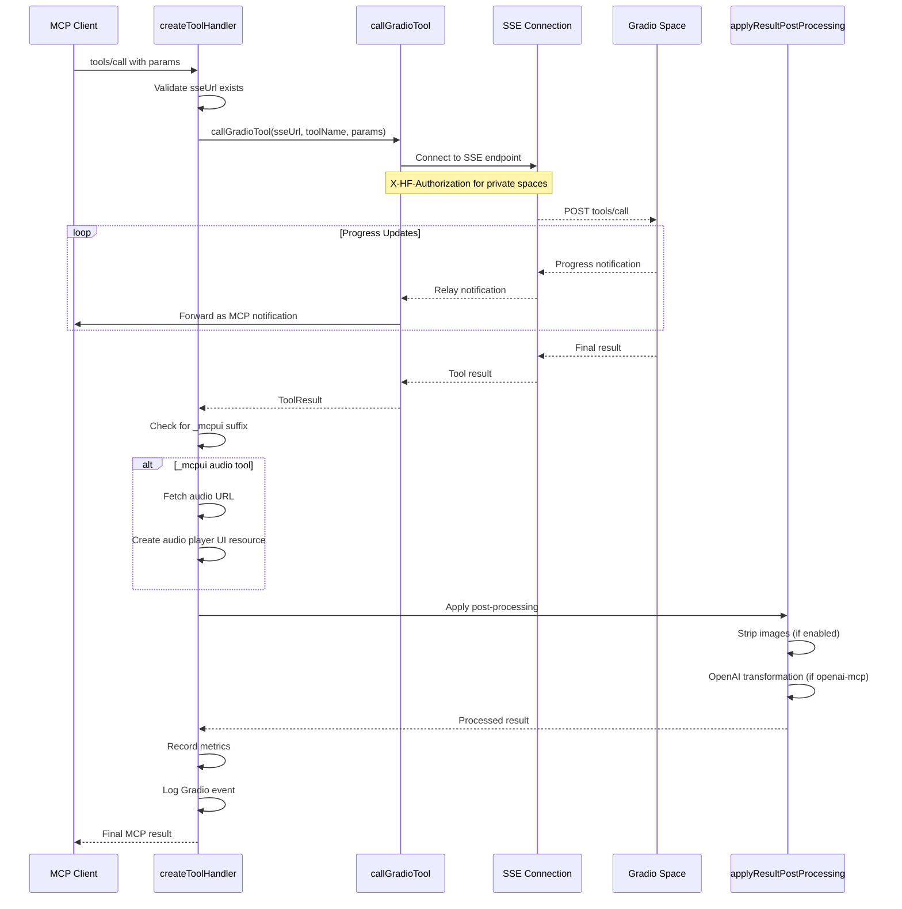
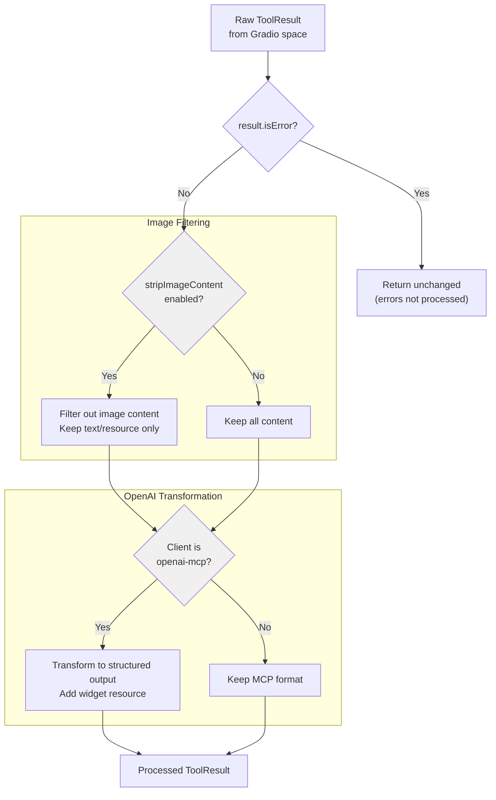

<!-- source: DeepWiki mcp.deepwiki.com · repo huggingface/hf-mcp-server · page 6 Gradio Integration · fetched 2026-10-26 -->

# Gradio Integration

<details>
<summary>Relevant source files</summary>

The following files were used as context for generating this wiki page:

- [packages/app/src/server/gradio-endpoint-connector.ts](packages/app/src/server/gradio-endpoint-connector.ts)
- [packages/app/src/server/mcp-proxy.ts](packages/app/src/server/mcp-proxy.ts)
- [packages/app/src/server/utils/gradio-utils.ts](packages/app/src/server/utils/gradio-utils.ts)
- [packages/app/test/server/utils/gradio-utils.test.ts](packages/app/test/server/utils/gradio-utils.test.ts)

</details>


The Gradio Integration system enables the HuggingFace MCP Server to dynamically discover, register, and execute tools from Gradio applications hosted on HuggingFace Spaces. This allows AI clients to access thousands of AI models and tools without pre-registration, expanding the MCP server's capabilities at runtime.

**Scope**: This page covers the complete Gradio integration lifecycle from space ID parsing through tool execution and post-processing. For information about the overall tool system, see [Tool System Overview](#4.1). For details on transport-level execution, see [Transport Layer](#7).

---

## System Overview

The Gradio integration follows a **lazy connection pattern** where tool schemas are fetched eagerly but SSE connections are established only when tools are invoked. This reduces overhead and enables parallel schema discovery.



**Sources**: [packages/app/src/server/mcp-proxy.ts:1-277](), [packages/app/src/server/gradio-endpoint-connector.ts:1-755](), [packages/app/src/server/utils/gradio-utils.ts:1-212]()

---

## Proxy Factory Pattern

The Gradio integration uses a **proxy factory pattern** to inject dynamic tools into the MCP server without modifying the core server creation logic. The `createProxyServerFactory` function wraps the original `ServerFactory` and adds Gradio tools after the base server is created.



The proxy factory executes the following sequence:

1. Extract authentication token and Gradio parameter from headers
2. Fetch user settings if not provided and no bouquet specified
3. Call original server factory to create base MCP server with built-in tools
4. Skip Gradio integration if `skipGradio=true` or `gradio="none"`
5. Parse space IDs from header parameter and user settings
6. Discover Gradio spaces and fetch schemas in parallel
7. Register remote tools on the existing server instance

**Key Implementation Details**:

| Aspect | Implementation | Location |
|--------|---------------|----------|
| Factory signature | `ServerFactory = (headers, userSettings?, skipGradio?, sessionInfo?) => Promise<ServerFactoryResult>` | [packages/app/src/server/transport/base-transport.ts:30-40]() |
| Proxy creation | `createProxyServerFactory(webServer, apiClient, originalFactory)` | [packages/app/src/server/mcp-proxy.ts:83-87]() |
| Gradio skipping | Checked for `initialize` calls and bouquet overrides | [packages/app/src/server/mcp-proxy.ts:124-143]() |
| Settings merge | Combines header param and user settings, deduplicates | [packages/app/src/server/mcp-proxy.ts:150-165]() |

**Sources**: [packages/app/src/server/mcp-proxy.ts:83-276](), [packages/app/src/server/transport/base-transport.ts:30-40]()

---

## Endpoint Discovery

Gradio endpoint discovery converts space IDs (e.g., `microsoft/Florence-2-large`) into fully-qualified endpoints with schemas. The process validates space ID format, fetches metadata from the HuggingFace API, and retrieves tool schemas from each space's `/gradio_api/mcp/schema` endpoint.

### Space ID Parsing

The `parseGradioSpaceIds` function validates space IDs and returns parsed structures. It enforces the `username/space-name` format with exactly one slash:



**Format Validation Rules**:

| Rule | Valid Examples | Invalid Examples |
|------|---------------|------------------|
| Exactly one slash | `microsoft/Florence-2-large` | `microsoft-Florence`, `a/b/c` |
| Content on both sides | `user/space`, `org/model-v2` | `/space`, `user/`, `/` |
| Special sentinel | Returns `[]` for `none` (case-insensitive) | N/A |
| Character preservation | Preserves dots, dashes, underscores | N/A |

**Sources**: [packages/app/src/server/utils/gradio-utils.ts:107-144](), [packages/app/test/server/utils/gradio-utils.test.ts:268-449]()

### Schema Fetching

The `connectToGradioEndpoints` function fetches schemas from multiple spaces in parallel with timeout protection:



**Connection Details**:

| Parameter | Value | Description |
|-----------|-------|-------------|
| Timeout | `12000ms` (12 seconds) | Per-space connection timeout |
| Max concurrent | Unlimited | All spaces fetched in parallel |
| Auth header | `X-HF-Authorization: Bearer {token}` | Only sent for private spaces |
| Schema URL | `https://{subdomain}.hf.space/gradio_api/mcp/schema` | Standard Gradio MCP endpoint |
| Retry logic | None | Failures are logged and skipped |

The `fetchEndpointSchema` function performs the following steps:

1. Check if space is private using `isSpacePrivate()` with cache
2. Build schema URL: `https://{subdomain}.hf.space/gradio_api/mcp/schema`
3. Add `X-HF-Authorization` header for private spaces
4. Fetch with `AbortController` timeout (12.5 seconds)
5. Parse response with `parseSchemaResponse()`
6. Filter out tools containing `<lambda>` in name
7. Store SSE URL for lazy connection: `https://{subdomain}.hf.space/gradio_api/mcp/sse`

**Sources**: [packages/app/src/server/gradio-endpoint-connector.ts:200-267](), [packages/app/src/server/gradio-endpoint-connector.ts:273-337]()

### Schema Response Formats

The `parseSchemaResponse` function handles two schema formats returned by Gradio spaces:

**Array Format** (preferred):
```typescript
[
  {
    name: "toolName",
    description: "Tool description",
    inputSchema: {
      type: "object",
      properties: { ... },
      required: [ ... ]
    }
  }
]
```

**Object Format** (legacy):
```typescript
{
  "toolName": {
    type: "object",
    properties: { ... },
    required: [ ... ],
    description: "Tool description"
  }
}
```

Both formats are converted to a normalized structure: `Array<{ name: string; description?: string; inputSchema: JsonSchema }>`.

**Sources**: [packages/app/src/server/gradio-endpoint-connector.ts:84-137]()

---

## Tool Naming Conventions

Gradio tools use a standardized naming convention to ensure uniqueness and identify their source. The naming system distinguishes between public and private spaces and enforces a 49-character limit.

### Naming Pattern



**Function**: `createGradioToolName(toolName, index, isPrivate, toolIndex?)`

**Parameters**:

| Parameter | Type | Description |
|-----------|------|-------------|
| `toolName` | `string` | Original tool name from schema |
| `index` | `number` | Zero-based space index (converted to 1-based) |
| `isPrivate` | `boolean \| undefined` | Whether space is private |
| `toolIndex` | `number` (optional) | Tool index within space for collision resolution |

**Naming Rules**:

1. **Prefix Selection**: `gr` for public spaces, `grp` for private spaces
2. **Index**: Zero-based index + 1 (first space = 1, second space = 2, etc.)
3. **Sanitization**: Replace `-`, `.`, and spaces with `_`, then lowercase
4. **Length Limit**: Maximum 49 characters total
5. **Truncation**: If over limit, keep first 20 chars + `_` + last N chars to fill
6. **Collision Resolution**: If `toolIndex` provided and truncating, prepend `{toolIndex}_` to name

**Examples**:

| Input | Index | Private | Tool Index | Output | Notes |
|-------|-------|---------|------------|--------|-------|
| `flux1_schnell` | 0 | false | - | `gr1_flux1_schnell` | Basic public tool |
| `EasyGhibli` | 1 | false | - | `gr2_easyghibli` | Lowercase conversion |
| `private-model` | 2 | true | - | `grp3_private_model` | Private prefix |
| `very_long_tool_name_that_exceeds_forty_nine_characters_total` | 0 | false | - | `gr1_very_long_tool_name__haracters_total_and_more` | Middle truncation |
| `image_utilities_mcp_update_text_image________` | 29 | false | 0 | `gr30_0_image_utilities_mcp__te_text_image________` | With tool index |

**Sources**: [packages/app/src/server/utils/gradio-utils.ts:45-86](), [packages/app/test/server/utils/gradio-utils.test.ts:113-266]()

---

## Schema Conversion

The schema conversion system transforms JSON Schema definitions from Gradio spaces into Zod schemas compatible with the MCP protocol. This enables type validation and documentation for dynamically-discovered tools.

### Conversion Flow



### Type Mapping Table

The `convertJsonSchemaToZod` function maps JSON Schema types to Zod types with special handling for common patterns:

| JSON Schema Type | Conditions | Zod Schema | Notes |
|-----------------|------------|------------|-------|
| FileData object | `title === 'FileData'` or special format | `z.object({path, url?, size?, ...})` | Gradio file upload schema |
| Enum | `enum: [...]` with all strings | `z.enum([...])` | String enum |
| Enum | `enum: [...]` with mixed types | `z.union([z.literal(...), ...])` | Union of literals |
| `string` | - | `z.string()` | Basic string |
| `number` | - | `z.number()` | Basic number |
| `boolean` | - | `z.boolean()` | Basic boolean |
| `array` | - | `z.array(z.any())` | Simplified array |
| `object` | - | `z.object({})` | Simplified object |
| Unknown | - | `z.any()` | Fallback |

**FileData Detection**: A property is considered FileData if:
- `jsonSchemaProperty.title === 'FileData'`, OR
- `jsonSchemaProperty.format === 'a http or https url to a file'` AND `default` is an object

**Default Value Handling**:

1. Required fields: Defaults are **skipped** (`skipDefault=true`) to force users to provide values
2. Optional fields: Defaults are **applied** via `zodSchema.default(value)`
3. String fields with object defaults: Extract `url` property unless FileData type
4. FileData fields: Keep full object as default

**Description Enhancement**:

File input fields get enhanced descriptions:
```typescript
description = description 
  ? `${description} (File input: provide URL or file path)` 
  : 'a http or https url to a file'
```

**Sources**: [packages/app/src/server/gradio-endpoint-connector.ts:615-754]()

---

## Tool Registration

The `registerRemoteTools` function registers Gradio tools on an existing MCP server instance. Each tool from each space gets registered with a unique name, converted schema, and execution handler.

### Registration Process



### Display Information

The `createToolDisplayInfo` function generates human-readable titles and descriptions:

**Title Format**: `{Space Name} - {Tool Name} {Emoji}`
- Example: `microsoft/Florence-2-large - image_caption 🔧`

**Description Format**: `{Tool Description} (from {Space Name})`
- Example: `Generate image captions (from microsoft/Florence-2-large)`
- Fallback if no description: `{Tool Name} tool from {Space Name}`

### Registration Annotations

Registered tools include these MCP annotations:

| Annotation | Value | Purpose |
|------------|-------|---------|
| `openWorldHint` | `true` | Indicates tool can be used with unknown future inputs |
| `title` | Display title string | Human-readable tool identification |

**OpenAI MCP Client Metadata** (`sessionInfo?.clientInfo?.name === 'openai-mcp'`):

```typescript
tool._meta = {
  'openai/outputTemplate': gradioWidgetUri,
  'openai/toolInvocation/invoking': `Calling the Hugging Face Space ${spaceName}`,
  'openai/toolInvocation/invoked': `Your content is being generated`
}
```

This enables custom UI rendering for OpenAI clients when displaying Gradio tool results.

**Sources**: [packages/app/src/server/gradio-endpoint-connector.ts:544-613](), [packages/app/src/server/gradio-endpoint-connector.ts:342-349]()

---

## Tool Execution

Tool execution establishes an SSE connection to the Gradio space, invokes the remote tool, and relays progress notifications back to the MCP client. The `createToolHandler` function creates an async handler for each registered tool.

### Execution Flow



### Handler Components

The `createToolHandler` function captures the following in its closure:

| Captured Variable | Type | Source | Purpose |
|------------------|------|--------|---------|
| `connection` | `EndpointConnection` | Registration | Space metadata and SSE URL |
| `tool` | `Tool` | Registration | Tool name and schema |
| `outwardFacingName` | `string` | Registration | Generated `gr1_*` name |
| `hfToken` | `string \| undefined` | Headers | HF authentication |
| `sessionInfo` | `object` | Transport | Client details for logging |
| `options` | `RegisterRemoteToolsOptions` | Registration | Post-processing config |

**SSE Connection Details**:

- URL: `connection.sseUrl` (e.g., `https://{subdomain}.hf.space/gradio_api/mcp/sse`)
- Authentication: `X-HF-Authorization: Bearer {token}` for private spaces
- Protocol: Established by `@modelcontextprotocol/sdk/client/sse.js`
- Call method: `tools/call` with tool name and parameters

**Error Handling**:

1. Missing SSE URL → Throw error immediately
2. Remote tool errors → Extract error message from MCP content
3. Connection failures → Log and throw with meaningful message
4. All errors → Record in `gradioMetrics.recordFailure()`

**Metrics Tracking**:

```typescript
// Captured for each invocation:
- startTime: Date.now()
- success: !result.isError
- error: Extracted error message
- responseSizeBytes: JSON.stringify(result).length
- notificationCount: Progress updates relayed
- durationMs: endTime - startTime
```

Metrics are logged via `logGradioEvent()` in the `finally` block, ensuring all invocations are tracked regardless of success or failure.

**Sources**: [packages/app/src/server/gradio-endpoint-connector.ts:354-539]()

### MCP UI Audio Transform

Tools with names containing `_mcpui` receive special handling when they return a single text URL:

1. Check if result is single text item matching `https?://` pattern
2. Attempt to fetch audio from URL
3. Base64-encode audio if fetch succeeds
4. Create audio player UI resource with `createAudioPlayerUIResource()`
5. Append UI resource to result content array
6. Apply standard post-processing to decorated result

**Generated UI URI**: `ui://huggingface-mcp/{sanitizedSpaceName}/{timestamp}`

This enables rich audio playback in MCP clients that support UI resources.

**Sources**: [packages/app/src/server/gradio-endpoint-connector.ts:447-496]()

---

## Post-Processing

Result post-processing transforms raw Gradio outputs into client-appropriate formats. The `applyResultPostProcessing` function applies two optional transformations based on configuration.

### Processing Pipeline



### Image Content Filtering

When `stripImageContent` is enabled (via `x-mcp-no-image-content` header or `GRADIO_IMAGE_FILTER_FLAG` in settings), image content items are removed from results.

**Filtering Logic**:

```typescript
// Keep only if:
content.filter(item => {
  if (typeof item !== 'object' || !item) return true;
  if (item.type === 'image') return false;  // Filter images
  if (item.type === 'text') return true;     // Keep text
  if (item.type === 'resource') return true; // Keep resources
  return true; // Keep unknown types
})
```

**Use Cases**:
- Clients with limited image support
- Reducing response size for bandwidth-constrained connections
- Text-only processing workflows
- Cost optimization for token-based billing

### OpenAI Structured Output

When `sessionInfo.clientInfo.name === 'openai-mcp'`, results are transformed into OpenAI's structured output format with embedded widget resources.

**Transformation Structure**:

```typescript
{
  content: [
    {
      type: "text",
      text: JSON.stringify({
        result: <original result content>,
        widget: <widget resource URI>
      }, null, 2)
    }
  ]
}
```

**Widget Resource**: References the Gradio widget HTML resource registered on the MCP server. URI format: `ui://huggingface-mcp/gradio-widget/{version}`

**Purpose**: Enables OpenAI clients to:
1. Parse structured JSON output
2. Render custom UI via widget HTML
3. Display Gradio results with interactive elements

**Fallback**: If `gradioWidgetUri` is not provided in options, transformation is skipped.

**Sources**: [packages/app/src/server/utils/gradio-tool-caller.ts:1-150]() (referenced), [packages/app/src/server/gradio-endpoint-connector.ts:435-443]()

---

## Configuration and Caching

### Header Parameters

Gradio integration respects multiple HTTP headers for configuration:

| Header | Format | Purpose | Example |
|--------|--------|---------|---------|
| `x-mcp-gradio` | Comma-separated space IDs | Specify Gradio spaces to load | `microsoft/Florence-2-large,user/model` |
| `x-mcp-no-image-content` | `"true"` or `"false"` | Enable image filtering | `true` |
| `Authorization` | `Bearer {token}` | HF authentication (standard) | `Bearer hf_...` |

**Special Values**:
- `x-mcp-gradio: none` → Explicitly disable Gradio integration
- Empty/missing `x-mcp-gradio` → Use user settings only

### User Settings Integration

User settings provide persistent Gradio space configuration via `AppSettings.spaceTools`:

```typescript
interface SpaceTool {
  _id: string;        // Unique identifier
  name: string;       // Space ID (e.g., 'microsoft/Florence-2-large')
  subdomain: string;  // Subdomain for API access
  emoji?: string;     // Display emoji
}
```

**Settings Priority**:
1. Header `x-mcp-gradio` parameter
2. User settings `spaceTools` array
3. Both are merged and deduplicated

**Emoji Override**: If a space appears in both header and settings, the emoji from settings is used.

### Metadata Caching

The `spaceMetadataCache` stores space metadata to reduce API calls:

**Cache Configuration** (`CACHE_CONFIG`):

| Setting | Value | Purpose |
|---------|-------|---------|
| `METADATA_TTL` | 5 minutes | How long cached entries are valid |
| `SCHEMA_TTL` | 5 minutes | How long schemas are cached |
| `SPACE_INFO_TIMEOUT` | 10 seconds | Timeout for `spaceInfo()` API calls |

**Cache Structure**:

```typescript
interface CachedSpaceMetadata {
  _id: string;
  name: string;
  subdomain: string;
  emoji: string;
  private: boolean;
  sdk: string;
  fetchedAt: number;  // Timestamp for TTL calculation
}
```

**Cache Behavior**:

- **Public spaces**: Cached for full TTL
- **Private spaces**: **Never cached** (always fresh to respect auth changes)
- **Cache miss**: Falls back to `spaceInfo()` API call with timeout
- **API timeout**: Assumed private for safety

**Cache Benefits**:

1. Reduces latency for repeated space access
2. Minimizes HF API rate limit impact
3. Improves parallel discovery performance
4. Decreases server load

**Sources**: [packages/app/src/server/utils/gradio-cache.ts:1-50]() (referenced), [packages/app/src/server/gradio-endpoint-connector.ts:142-196]()

---

## Integration with Other Systems

### Tool Selection Strategy

Gradio tools interact with the tool selection system (see [Tool Selection Strategy](#5.2)):

- **Bouquet precedence**: When `bouquet` is specified (except `"all"`), Gradio tools from settings are skipped unless explicit `gradio` parameter is provided
- **Mix mode**: Gradio tools are additive and not affected by built-in tool filtering
- **Settings mode**: Gradio spaces from `spaceTools` are loaded automatically

### Dynamic Space Tool

The `use_space` tool (see [Space Management Tools](#4.2.3)) provides an alternative way to invoke Gradio spaces without pre-registration. This complements the pre-registered Gradio tools by allowing ad-hoc space invocation.

### Metrics and Logging

Gradio operations are tracked through multiple systems:

1. **Gradio Metrics** (`gradioMetrics`): Success/failure rates per tool
2. **Query Logger** (`logGradioEvent`): Detailed invocation logs with session info
3. **Transport Metrics**: Connection-level statistics

**Sources**: [packages/app/src/server/utils/gradio-metrics.ts:1-100]() (referenced), [packages/app/src/server/utils/query-logger.ts:1-150]() (referenced)

---

