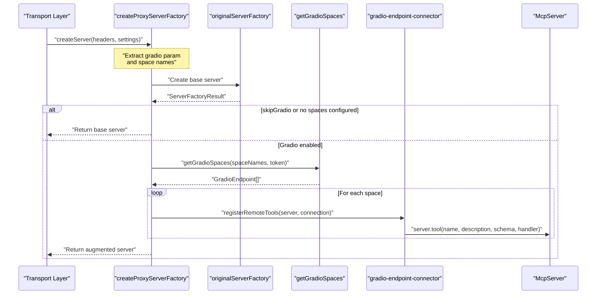
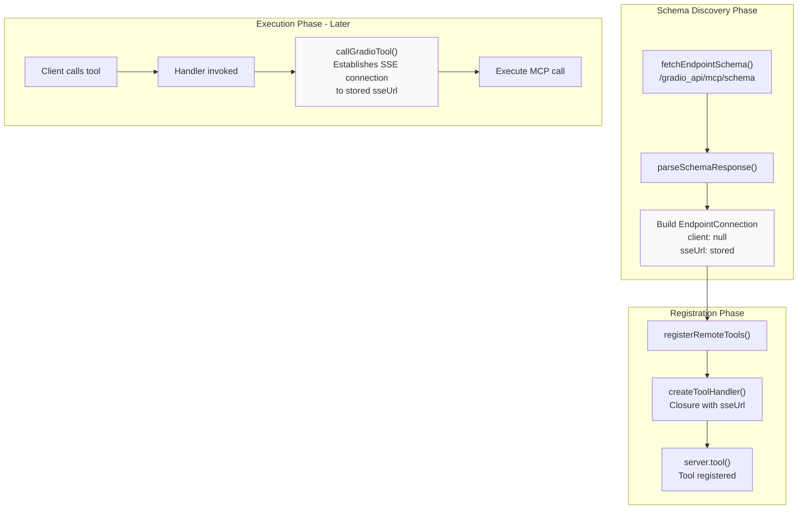
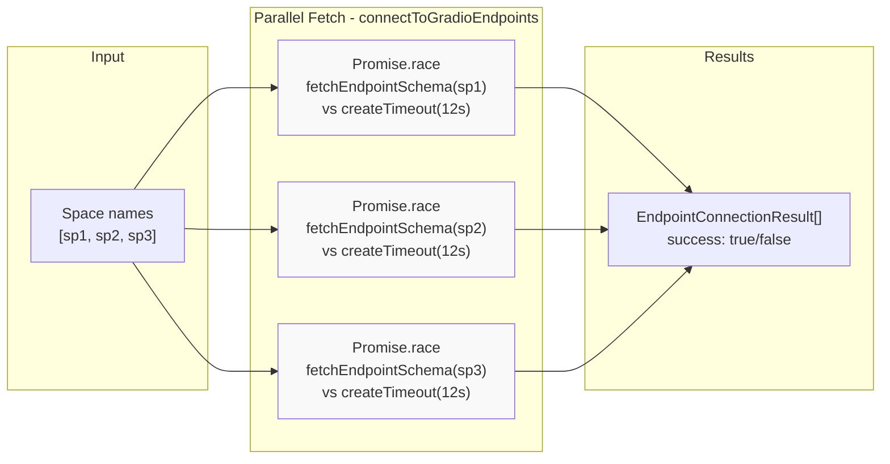
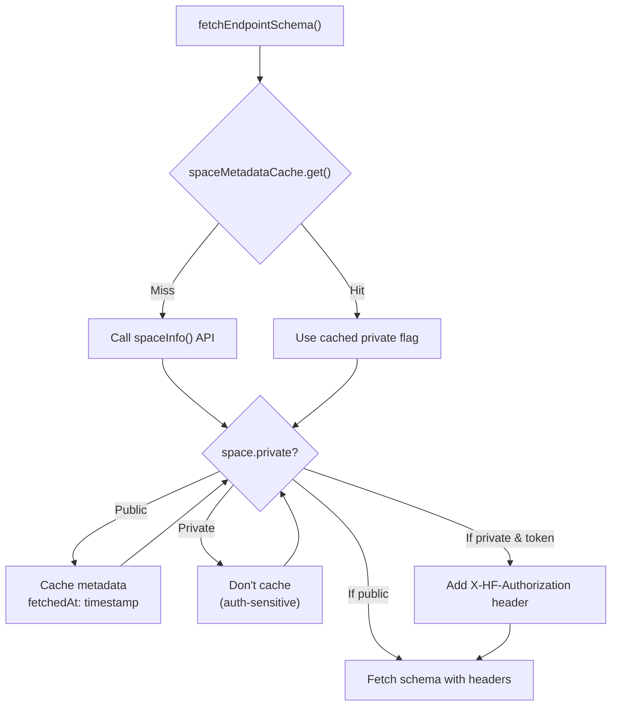
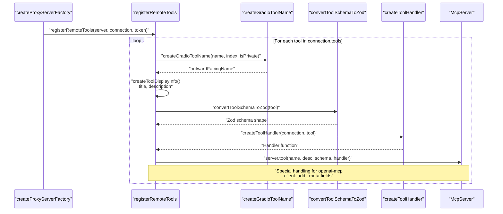
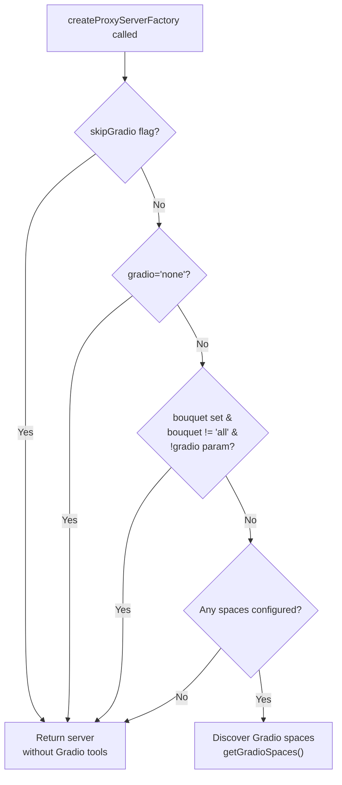
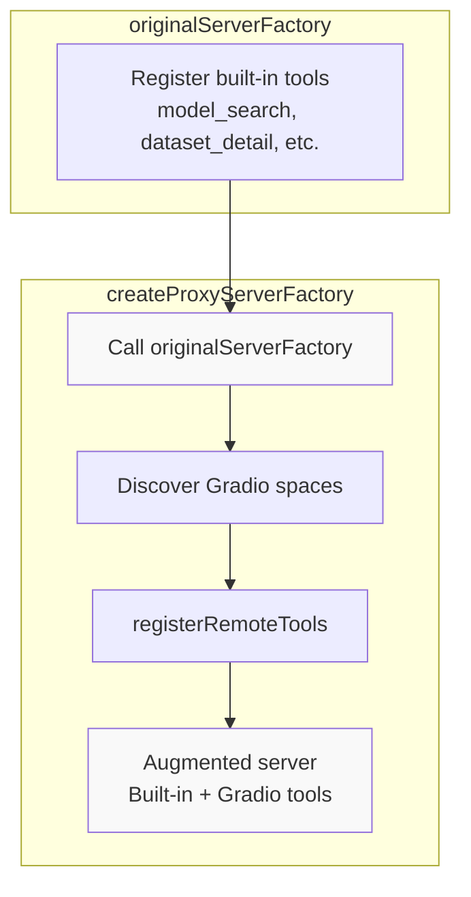

<!-- source: DeepWiki mcp.deepwiki.com · repo huggingface/hf-mcp-server · page 6.1 Gradio Overview · fetched 2026-10-26 -->

# Gradio Overview

<details>
<summary>Relevant source files</summary>

The following files were used as context for generating this wiki page:

- [packages/app/src/server/gradio-endpoint-connector.ts](packages/app/src/server/gradio-endpoint-connector.ts)
- [packages/app/src/server/mcp-proxy.ts](packages/app/src/server/mcp-proxy.ts)

</details>


This document introduces the Gradio integration system, which enables dynamic discovery and registration of Gradio applications as MCP tools. It explains the proxy factory pattern used to inject Gradio tools into the server, the lazy connection model, and how Gradio spaces are configured and registered.

For details on the endpoint discovery process, see [Endpoint Discovery](#6.2). For schema conversion specifics, see [Schema Conversion](#6.3). For tool execution mechanics, see [Tool Execution and Post-Processing](#6.4).

## What Gradio Integration Enables

The Gradio integration system allows any Gradio application hosted on Hugging Face Spaces to be dynamically discovered and exposed as an MCP tool. This enables:

- **Dynamic tool expansion**: Tools are not hardcoded but discovered at runtime from Space metadata
- **Zero-configuration tool creation**: Any Gradio Space that exposes an MCP schema endpoint becomes available as a tool
- **Private space support**: Authenticated users can access tools from their private Spaces
- **Unified interface**: Gradio applications appear as regular MCP tools alongside built-in tools

The key differentiator is that Gradio tools are not statically defined in the codebase but are registered dynamically based on Space configuration and schema endpoints.

**Sources:** [packages/app/src/server/gradio-endpoint-connector.ts:1-755](), [packages/app/src/server/mcp-proxy.ts:1-277]()

## Architecture: The Proxy Factory Pattern

The Gradio integration uses a **proxy factory pattern** to intercept server creation and augment it with dynamically discovered tools.

### Proxy Factory Flow



The `createProxyServerFactory` function wraps the original `ServerFactory` and adds Gradio tool registration after the base server is created. This separation allows the core MCP server logic to remain unchanged while adding dynamic tool discovery as a layer.

**Sources:** [packages/app/src/server/mcp-proxy.ts:83-276]()

### Key Components

| Component | Location | Purpose |
|-----------|----------|---------|
| `createProxyServerFactory` | [mcp-proxy.ts:83-276]() | Wraps original factory, orchestrates Gradio discovery |
| `connectToGradioEndpoints` | [gradio-endpoint-connector.ts:273-337]() | Fetches schemas from multiple endpoints in parallel |
| `registerRemoteTools` | [gradio-endpoint-connector.ts:544-613]() | Registers discovered tools on MCP server |
| `parseSchemaResponse` | [gradio-endpoint-connector.ts:84-137]() | Parses schema formats (array or object) |
| `createToolHandler` | [gradio-endpoint-connector.ts:354-539]() | Creates tool execution handler with SSE connection |

**Sources:** [packages/app/src/server/mcp-proxy.ts:83-276](), [packages/app/src/server/gradio-endpoint-connector.ts:1-755]()

## Endpoint Connection Model

The Gradio integration uses a **lazy connection model** that separates schema discovery from tool execution.

### EndpointConnection Interface

```typescript
interface EndpointConnection {
    endpointId: string;           // Unique identifier for logging
    originalIndex: number;         // Position in original space list
    client: Client | null;         // Always null in lazy model
    tools: Tool[];                 // Discovered tool schemas
    name?: string;                 // Space name (e.g., "user/space-name")
    emoji?: string;                // Display emoji from settings
    sseUrl?: string;               // SSE endpoint for lazy connection
    isPrivate?: boolean;           // Private space flag
}
```

This interface is defined at [gradio-endpoint-connector.ts:40-49]() and represents a connection to a Gradio space.

### Lazy Connection Pattern



The key insight is that the `EndpointConnection` stores the `sseUrl` but doesn't establish the SSE connection until a tool is actually invoked. This reduces startup time and avoids keeping connections open for unused tools.

**Sources:** [packages/app/src/server/gradio-endpoint-connector.ts:40-49](), [packages/app/src/server/gradio-endpoint-connector.ts:201-267](), [packages/app/src/server/gradio-endpoint-connector.ts:354-539]()

## Schema Discovery and Parsing

### Schema Endpoint Format

Gradio spaces expose their available tools via the `/gradio_api/mcp/schema` endpoint. This endpoint returns either an **array format** or **object format**:

**Array Format** (newer):
```json
[
  {
    "name": "generate_image",
    "description": "Generates an image from a prompt",
    "inputSchema": {
      "type": "object",
      "properties": { "prompt": { "type": "string" } },
      "required": ["prompt"]
    }
  }
]
```

**Object Format** (legacy):
```json
{
  "generate_image": {
    "type": "object",
    "properties": { "prompt": { "type": "string" } },
    "required": ["prompt"],
    "description": "Generates an image from a prompt"
  }
}
```

The `parseSchemaResponse` function at [gradio-endpoint-connector.ts:84-137]() handles both formats transparently.

### Parallel Schema Fetching



The `connectToGradioEndpoints` function at [gradio-endpoint-connector.ts:273-337]() fetches schemas from multiple spaces in parallel using `Promise.all()`. Each fetch is wrapped in a `Promise.race()` with a 12-second timeout (defined by `CONNECTION_TIMEOUT_MS` at [gradio-endpoint-connector.ts:68]()).

Failed fetches are logged but don't block other spaces from being registered.

**Sources:** [packages/app/src/server/gradio-endpoint-connector.ts:84-137](), [packages/app/src/server/gradio-endpoint-connector.ts:273-337](), [packages/app/src/server/gradio-endpoint-connector.ts:201-267]()

## Private Space Support

The system detects and handles private Gradio spaces by checking the space's privacy status and forwarding authentication.

### Privacy Detection Flow



The `isSpacePrivate` function at [gradio-endpoint-connector.ts:142-196]() implements this logic with intelligent caching:
- **Public spaces** are cached indefinitely (metadata won't change)
- **Private spaces** are never cached (auth-sensitive, always fetched fresh)
- Cache misses trigger a `spaceInfo()` API call with timeout

When a space is private and an HF token is available, the `X-HF-Authorization` header is added at [gradio-endpoint-connector.ts:219]() for both schema fetching and tool execution.

**Sources:** [packages/app/src/server/gradio-endpoint-connector.ts:142-196](), [packages/app/src/server/gradio-endpoint-connector.ts:201-267](), [packages/app/src/server/gradio-endpoint-connector.ts:214-221]()

## Tool Registration Flow

Once schemas are fetched, the `registerRemoteTools` function registers each discovered tool on the MCP server.

### Registration Process



The process involves:

1. **Tool Naming**: [gradio-endpoint-connector.ts:557-562]() - Uses `createGradioToolName` to generate unique names
2. **Display Info**: [gradio-endpoint-connector.ts:342-349]() - Creates human-readable title and description
3. **Schema Conversion**: [gradio-endpoint-connector.ts:615-639]() - Converts JSON Schema to Zod validation
4. **Handler Creation**: [gradio-endpoint-connector.ts:354-539]() - Creates closure with SSE URL and connection info
5. **Server Registration**: [gradio-endpoint-connector.ts:594-603]() - Registers tool with MCP server

**Sources:** [packages/app/src/server/gradio-endpoint-connector.ts:544-613]()

## Configuration Sources

Gradio tools can be configured through multiple sources, with specific precedence rules.

### Configuration Hierarchy

| Priority | Source | Format | Example |
|----------|--------|--------|---------|
| 1 | `x-mcp-gradio` header | Comma-separated space IDs | `user/space1,org/space2` |
| 2 | User settings | `spaceTools` array | `[{name: "user/space", emoji: "🎨"}]` |
| 3 | Fallback | Empty list | No Gradio tools |

The configuration logic at [mcp-proxy.ts:150-154]() merges both sources and deduplicates:

```typescript
const gradioSpaceNames = gradio ? parseGradioSpaceIds(gradio).map(s => s.name) : [];
const settingsSpaceNames = settings?.spaceTools?.map(s => s.name) || [];
const allSpaceNames = [...new Set([...gradioSpaceNames, ...settingsSpaceNames])];
```

### Conditional Skipping

Gradio discovery can be skipped under several conditions:



Key skip conditions:
- **`skipGradio=true`**: At [mcp-proxy.ts:124-127](), used for initialization and non-Gradio tool calls
- **`gradio="none"`**: At [mcp-proxy.ts:133-136](), explicitly disables Gradio
- **Bouquet without gradio param**: At [mcp-proxy.ts:140-143](), when a bouquet is specified (not "all") and no explicit gradio parameter is given

This optimization reduces latency for requests that don't need Gradio tools.

**Sources:** [packages/app/src/server/mcp-proxy.ts:98-143](), [packages/app/src/server/mcp-proxy.ts:150-165]()

## Integration with Built-in Tools

Gradio tools are registered alongside built-in tools and appear in the same tool list. The proxy factory ensures both sets of tools coexist:



The proxy pattern ensures:
- Built-in tools are always available (registered first)
- Gradio tools are added without modifying base server logic
- Tool selection strategy applies to built-in tools; Gradio tools are additive
- Both tool types use the same `McpServer.tool()` registration API

**Sources:** [packages/app/src/server/mcp-proxy.ts:83-276]()

## Post-Processing Options

The registration phase configures post-processing options that will be applied during tool execution:

| Option | Source | Purpose |
|--------|--------|---------|
| `stripImageContent` | `x-mcp-no-image-content` header or settings flag | Removes image content from results (see [Tool Execution](#6.4)) |
| `gradioWidgetUri` | OpenAI MCP client detection | Adds UI resource for embedded widgets |
| `sessionInfo` | Transport layer | Client identification and auth status |

These options are passed to `registerRemoteTools` at [mcp-proxy.ts:204-207]() and captured in the tool handler closure at [gradio-endpoint-connector.ts:364-444]().

**Sources:** [packages/app/src/server/mcp-proxy.ts:100-131](), [packages/app/src/server/mcp-proxy.ts:204-207](), [packages/app/src/server/gradio-endpoint-connector.ts:354-539]()

---

