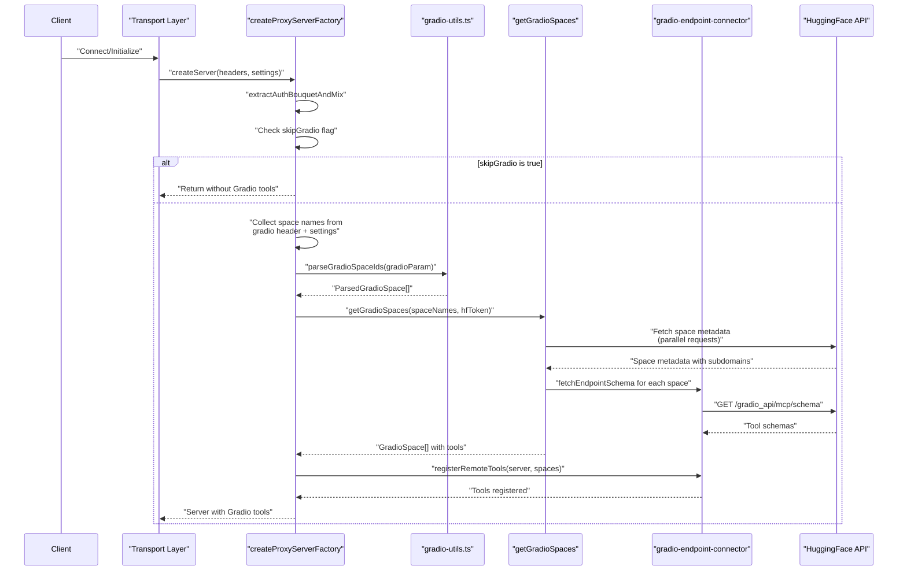
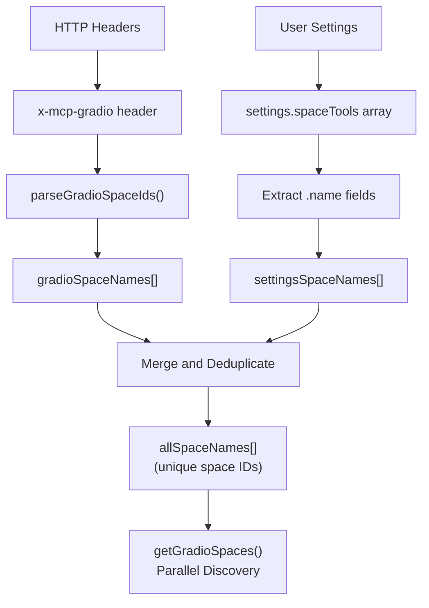
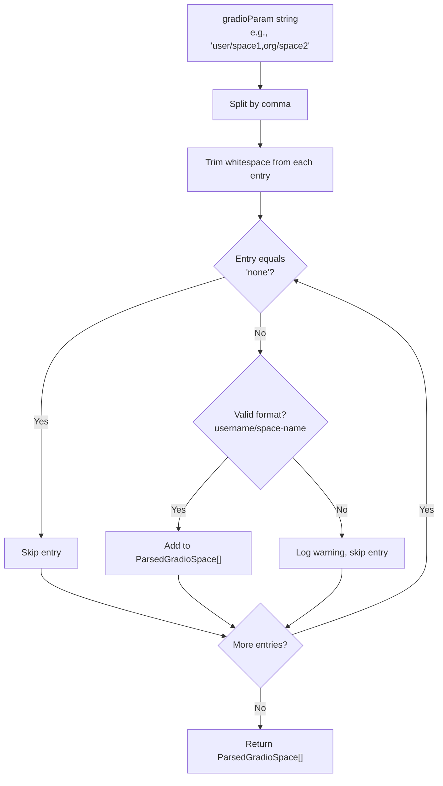
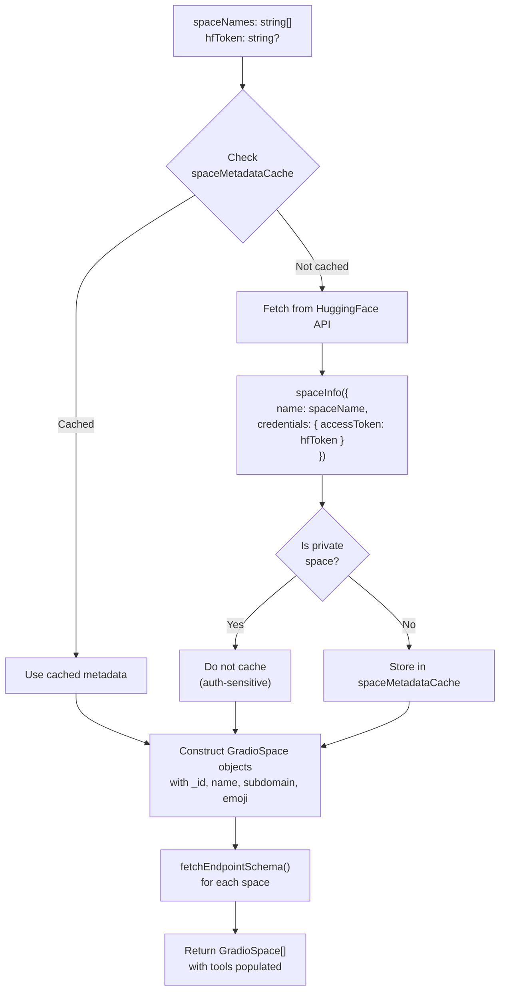
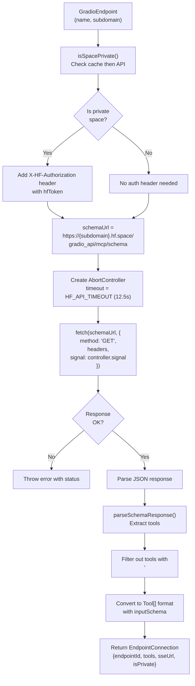
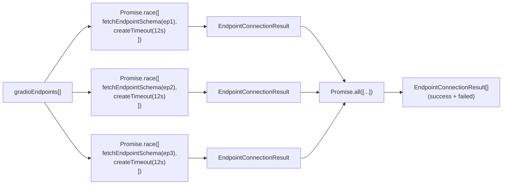
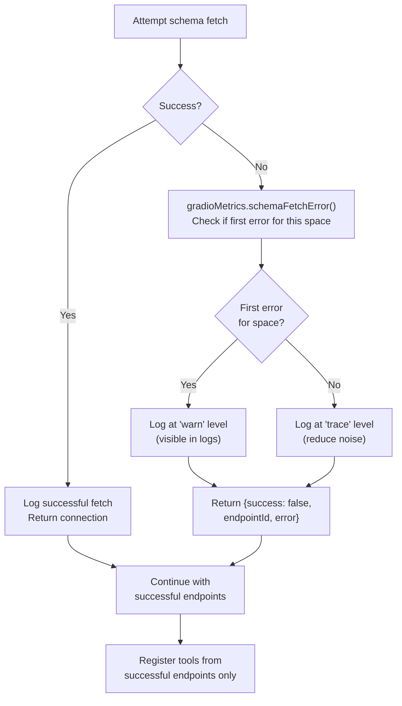
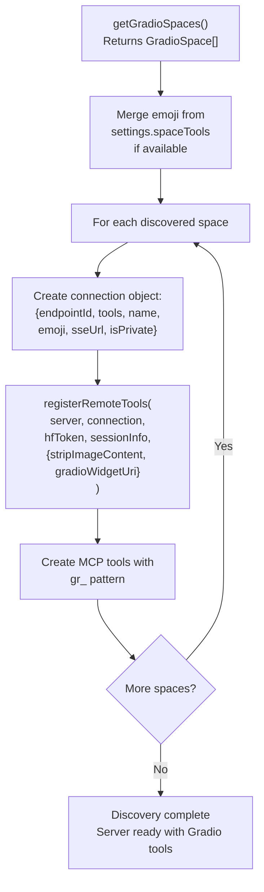

<!-- source: DeepWiki mcp.deepwiki.com · repo huggingface/hf-mcp-server · page 6.2 Endpoint Discovery · fetched 2026-10-26 -->

# Endpoint Discovery

<details>
<summary>Relevant source files</summary>

The following files were used as context for generating this wiki page:

- [packages/app/src/server/gradio-endpoint-connector.ts](packages/app/src/server/gradio-endpoint-connector.ts)
- [packages/app/src/server/mcp-proxy.ts](packages/app/src/server/mcp-proxy.ts)
- [packages/app/src/server/utils/gradio-utils.ts](packages/app/src/server/utils/gradio-utils.ts)
- [packages/app/test/server/utils/gradio-utils.test.ts](packages/app/test/server/utils/gradio-utils.test.ts)

</details>


## Purpose and Scope

This document describes how the HF MCP Server discovers and prepares Gradio spaces for use as dynamic tools. Endpoint discovery is the first phase of Gradio integration, responsible for identifying which Gradio spaces should be available, fetching their metadata and subdomains from the HuggingFace API, and retrieving their tool schemas. 

For information about converting these schemas into MCP tools, see [Schema Conversion](#6.3). For details on executing tools once discovered, see [Tool Execution and Post-Processing](#6.4). For the overall Gradio integration architecture, see [Gradio Overview](#6.1).

---

## Discovery Trigger Points

Endpoint discovery occurs during MCP server initialization in the proxy factory pattern. The `createProxyServerFactory` function intercepts server creation to inject Gradio tool discovery before the server becomes available to clients.

**Discovery Flow Sequence**



**Sources:** [packages/app/src/server/mcp-proxy.ts:83-276](), [packages/app/src/server/gradio-endpoint-connector.ts:273-337]()

---

## Discovery Sources

Gradio spaces can be specified through two channels, which are merged and deduplicated during discovery:

| Source | Format | Priority | Example |
|--------|--------|----------|---------|
| `x-mcp-gradio` Header | Comma-separated space IDs | Takes precedence when both exist | `microsoft/Florence-2-large,acme/foo` |
| User Settings (`spaceTools`) | Array of `SpaceTool` objects | Used if header not provided | `[{name: "user/space", emoji: "🔧"}]` |

The system collects space names from both sources and deduplicates them to avoid redundant API calls:



**Sources:** [packages/app/src/server/mcp-proxy.ts:150-164]()

---

## Space ID Parsing

The `parseGradioSpaceIds` function converts the comma-separated `x-mcp-gradio` header value into structured space identifiers. This function performs validation and handles special cases.

### Parsing Logic



### Validation Rules

The parser enforces strict formatting rules on each space ID:

| Rule | Description | Valid Example | Invalid Example |
|------|-------------|---------------|-----------------|
| Exactly one slash | Must contain `/` separating username and space name | `user/space` | `user/space/extra` or `noslash` |
| Non-empty parts | Content required on both sides of slash | `user/space` | `user/` or `/space` |
| Case preservation | Original casing is maintained | `Microsoft/Florence-2-Large` | N/A |
| Special chars allowed | Dots, dashes, underscores preserved | `user/model-v2.1_test` | N/A |

**Sources:** [packages/app/src/server/utils/gradio-utils.ts:107-144](), [packages/app/test/server/utils/gradio-utils.test.ts:268-449]()

### Parsed Output

The function returns an array of `ParsedGradioSpace` objects:

```typescript
interface ParsedGradioSpace {
  name: string; // e.g., "microsoft/Florence-2-large"
}
```

Note that at this stage, **no subdomain is constructed**. The subdomain must be fetched from the HuggingFace API to ensure accuracy, as it cannot be reliably derived from the space name alone.

**Sources:** [packages/app/src/server/utils/gradio-utils.ts:89-93]()

---

## Metadata Fetching and Caching

After parsing space IDs, the system fetches metadata from the HuggingFace API, including the actual subdomain (which cannot be reliably constructed client-side) and privacy status.

### Discovery API Integration

**getGradioSpaces Flow**



**Sources:** [packages/app/src/server/utils/gradio-discovery.ts]() (referenced but not in provided files), [packages/app/src/server/gradio-endpoint-connector.ts:142-196]()

### Cache Configuration

The `spaceMetadataCache` stores public space metadata to reduce API calls:

| Configuration | Value | Purpose |
|---------------|-------|---------|
| Cache Target | Public spaces only | Private spaces require fresh auth checks |
| Cache Duration | Based on `CACHE_CONFIG.SPACE_INFO_TIMEOUT` | Balances freshness vs. performance |
| Cache Key | Space name (e.g., `microsoft/Florence-2-large`) | Direct lookup by space ID |
| Stored Fields | `_id`, `name`, `subdomain`, `emoji`, `private`, `sdk`, `fetchedAt` | Complete metadata for reconstruction |

**Privacy-Aware Caching Strategy:**
- Public spaces are cached after first fetch
- Private spaces are **never cached** to ensure auth tokens are validated on every request
- Cache miss triggers immediate API call with timeout protection

**Sources:** [packages/app/src/server/utils/gradio-cache.ts:14]() (referenced), [packages/app/src/server/gradio-endpoint-connector.ts:142-196]()

---

## Schema Fetching

Once space metadata is retrieved, the system fetches tool schemas from each Gradio space's `/gradio_api/mcp/schema` endpoint.

### Schema Fetch Architecture

**fetchEndpointSchema Function**



**Sources:** [packages/app/src/server/gradio-endpoint-connector.ts:201-267]()

### Schema Response Formats

The system handles two different schema formats returned by Gradio endpoints:

**Format 1: Array Format (Newer)**
```typescript
[
  {
    name: "toolName",
    description: "Tool description",
    inputSchema: {
      type: "object",
      properties: { /* ... */ },
      required: []
    }
  },
  // ... more tools
]
```

**Format 2: Object Format (Legacy)**
```typescript
{
  "toolName": {
    type: "object",
    description: "Tool description",
    properties: { /* ... */ },
    required: []
  },
  // ... more tools
}
```

The `parseSchemaResponse` function detects which format is used and normalizes both into a common structure:

**Sources:** [packages/app/src/server/gradio-endpoint-connector.ts:84-137]()

### Parallel Schema Fetching

The system fetches schemas from multiple endpoints concurrently with timeout protection:



Each fetch operation races against a timeout, ensuring no single slow endpoint blocks the entire discovery process. Results include both successful connections and failures for logging.

**Sources:** [packages/app/src/server/gradio-endpoint-connector.ts:273-337]()

---

## Connection Results and Error Handling

### Result Structure

The `connectToGradioEndpoints` function returns an array of `EndpointConnectionResult`, where each result can be either successful or failed:

```typescript
type EndpointConnectionResult =
  | {
      success: true;
      endpointId: string;
      connection: EndpointConnection;
    }
  | {
      success: false;
      endpointId: string;
      error: Error;
    };
```

**EndpointConnection Structure:**

| Field | Type | Description |
|-------|------|-------------|
| `endpointId` | `string` | Unique identifier (e.g., `endpoint1`, `endpoint2`) |
| `originalIndex` | `number` | Zero-based position in request list |
| `client` | `Client \| null` | Always `null` in schema-only approach (lazy connection) |
| `tools` | `Tool[]` | Parsed tool schemas from endpoint |
| `name` | `string?` | Space name (e.g., `microsoft/Florence-2-large`) |
| `emoji` | `string?` | Optional emoji for tool display |
| `sseUrl` | `string?` | SSE endpoint URL for tool execution (stored for lazy connection) |
| `isPrivate` | `boolean?` | Whether the space requires authentication |

**Sources:** [packages/app/src/server/gradio-endpoint-connector.ts:40-49](), [packages/app/src/server/gradio-endpoint-connector.ts:56-66]()

### Error Handling Strategy

**Graceful Degradation with Metrics**



The system uses **progressive log level reduction** to avoid log spam from repeatedly failing endpoints while still capturing the first error for each space. This approach allows the server to start successfully even if some Gradio endpoints are unavailable.

**Sources:** [packages/app/src/server/gradio-endpoint-connector.ts:288-318]()

### Lazy Connection Model

The endpoint discovery phase **does not establish live SSE connections**. Instead, it:

1. Fetches only the schema via HTTP GET
2. Stores the SSE URL for later use
3. Sets `client: null` in the connection object

This "lazy connection" approach improves startup performance and reduces resource usage. The actual SSE connection is established only when a tool is invoked, as detailed in [Tool Execution and Post-Processing](#6.4).

**Sources:** [packages/app/src/server/gradio-endpoint-connector.ts:257-266]()

---

## Integration with Server Registration

After successful discovery, the proxy factory merges emoji data from user settings and registers all discovered tools with the MCP server:

**Registration Flow**



**Sources:** [packages/app/src/server/mcp-proxy.ts:168-213](), [packages/app/src/server/gradio-endpoint-connector.ts:544-613]()

---

