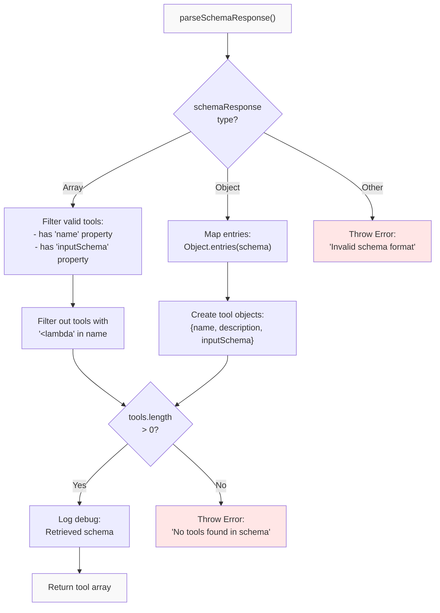
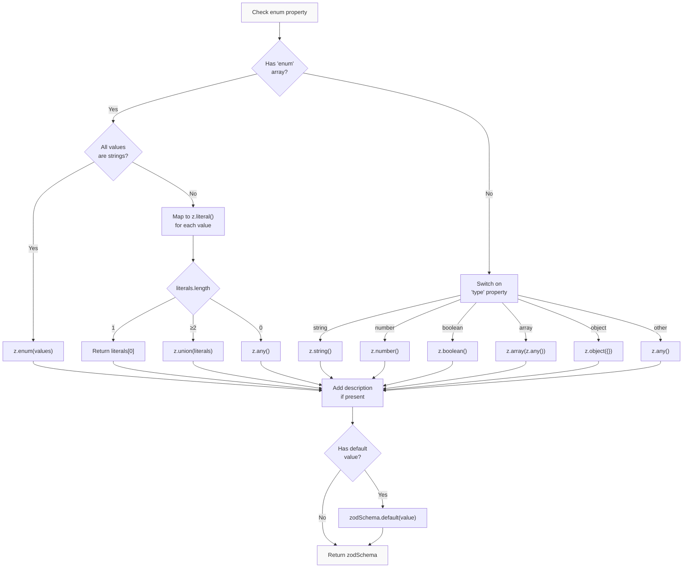
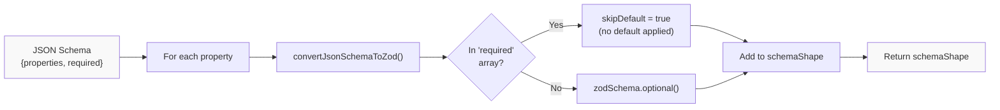
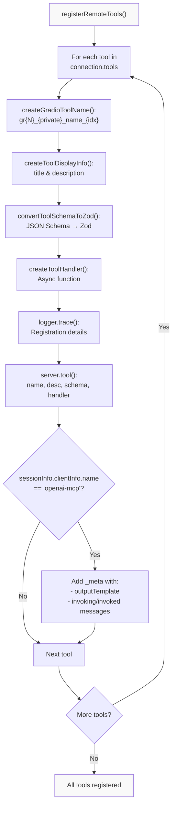
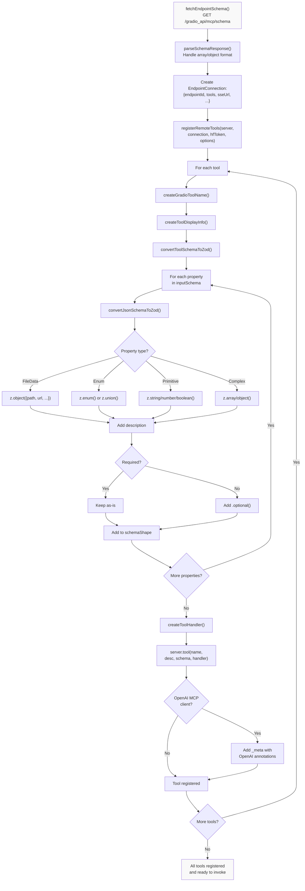

<!-- source: DeepWiki mcp.deepwiki.com · repo huggingface/hf-mcp-server · page 6.3 Schema Conversion · fetched 2026-10-26 -->

# Schema Conversion

<details>
<summary>Relevant source files</summary>

The following files were used as context for generating this wiki page:

- [packages/app/src/server/gradio-endpoint-connector.ts](packages/app/src/server/gradio-endpoint-connector.ts)
- [packages/app/src/server/mcp-proxy.ts](packages/app/src/server/mcp-proxy.ts)

</details>


## Purpose and Scope

This page explains how Gradio JSON schemas are converted to Zod schemas and registered as MCP tools. This conversion process is the bridge between Gradio's tool definitions and the MCP protocol's tool invocation system. For information about discovering and fetching these schemas from Gradio endpoints, see [Endpoint Discovery](#6.2). For details on how these tools are executed after registration, see [Tool Execution and Post-Processing](#6.4).

The conversion process handles multiple schema formats, complex type mappings, and special cases like file inputs and enumerations, ensuring that Gradio tools can be seamlessly invoked through the MCP protocol.

---

## Schema Response Formats

Gradio endpoints expose their tool schemas via a `/gradio_api/mcp/schema` endpoint. The response can be in two different formats, and the system handles both.

### Array Format

The array format provides a structured list of tools with explicit names, descriptions, and input schemas:

```json
[
  {
    "name": "generate_image",
    "description": "Generate an image from a text prompt",
    "inputSchema": {
      "type": "object",
      "properties": {
        "prompt": { "type": "string", "description": "The text prompt" }
      },
      "required": ["prompt"]
    }
  }
]
```

This format is detected when the response is an array, and each element must have `name` and `inputSchema` properties. Lambda functions (tools with names containing `"<lambda"`) are filtered out as they represent internal Gradio operations.

Sources: [packages/app/src/server/gradio-endpoint-connector.ts:92-109]()

### Object Format

The object format uses tool names as keys with schemas as values:

```json
{
  "generate_image": {
    "type": "object",
    "properties": {
      "prompt": { "type": "string", "description": "The text prompt" }
    },
    "required": ["prompt"],
    "description": "Generate an image from a text prompt"
  }
}
```

The system detects this format when the response is an object (not an array) and maps each key-value pair to a tool definition.

Sources: [packages/app/src/server/gradio-endpoint-connector.ts:110-125]()

### Schema Parsing Function



**Diagram: Schema Response Parsing Flow**

The `parseSchemaResponse` function normalizes both formats into a consistent array of tool definitions, validates their structure, and filters out invalid entries.

Sources: [packages/app/src/server/gradio-endpoint-connector.ts:84-137]()

---

## JSON Schema to Zod Conversion

The core conversion process transforms JSON Schema definitions into Zod schemas that can be used for runtime validation and type inference in the MCP server.

### Type Mapping Table

| JSON Schema Type | Zod Schema | Notes |
|-----------------|------------|-------|
| `"string"` | `z.string()` | Basic string validation |
| `"number"` | `z.number()` | Numeric values |
| `"boolean"` | `z.boolean()` | Boolean values |
| `"array"` | `z.array(z.any())` | Arrays with any element type |
| `"object"` | `z.object({})` | Empty object schema |
| `undefined` or other | `z.any()` | Fallback for unknown types |

Sources: [packages/app/src/server/gradio-endpoint-connector.ts:696-716]()

### Special Type Handling

#### FileData Type

Gradio uses a special `FileData` type for file inputs. The system detects this type through either:
- `jsonSchemaProperty.title === 'FileData'`
- `jsonSchemaProperty.format === 'a http or https url to a file'` with an object default value

When detected, it creates a structured Zod schema:

```typescript
z.object({
  path: z.string(),
  url: z.string().optional(),
  size: z.number().nullable().optional(),
  orig_name: z.string().optional(),
  mime_type: z.string().nullable().optional(),
  is_stream: z.boolean().optional(),
  meta: z.object({
    _type: z.string().optional(),
  }).optional(),
})
```

This allows clients to pass file references with metadata that Gradio can resolve.

Sources: [packages/app/src/server/gradio-endpoint-connector.ts:649-669]()

#### Enum Types

Enumeration types are handled based on their value types:

- **String enums**: Converted to `z.enum()` with type-safe string literal types
- **Mixed enums**: Converted to a union of `z.literal()` values for each enum member
- **Single-value enums**: Simplified to a single literal



**Diagram: JSON Schema Property to Zod Conversion Logic**

Sources: [packages/app/src/server/gradio-endpoint-connector.ts:670-695]()

### Default Values and Descriptions

The conversion process enhances schemas with default values and descriptions:

1. **Descriptions**: Copied from the JSON Schema's `description` property. For file inputs, a helpful hint is appended: `"(File input: provide URL or file path)"`

2. **Default values**: Applied using `.default()` unless the field is required. For string types with object defaults containing a `url` property, the URL is extracted as the default value instead of the full object (except for `FileData` types which keep the full object).

3. **File input enhancement**: Properties with `format === "a http or https url to a file"` get special description text to guide users.

Sources: [packages/app/src/server/gradio-endpoint-connector.ts:719-751]()

### Required vs Optional Fields

The conversion process respects the `required` array from JSON Schema:



**Diagram: Required Field Handling**

Required fields don't get the `.optional()` modifier and skip default value application to ensure clients must provide them explicitly.

Sources: [packages/app/src/server/gradio-endpoint-connector.ts:615-639]()

---

## Tool Registration Process

After schema conversion, tools are registered with the MCP server through a multi-step process that creates callable tools with proper metadata and handlers.

### Tool Name Generation

Each Gradio tool receives a unique outward-facing name using `createGradioToolName()`:

```
gr{originalIndex + 1}_{privacyMarker}_{toolName}_{toolIndex}
```

- `originalIndex`: Position in the Gradio endpoints list
- `privacyMarker`: `"private"` for private spaces, omitted for public
- `toolName`: Original tool name from Gradio
- `toolIndex`: Index within the endpoint's tools (only if multiple tools exist)

Examples:
- `gr1_generate_image` - First endpoint, public space, single tool
- `gr2_private_upscale_0` - Second endpoint, private space, first of multiple tools

Sources: [packages/app/src/server/gradio-endpoint-connector.ts:557-562](), [packages/app/src/server/utils/gradio-utils.ts]()

### Registration Flow



**Diagram: Tool Registration Pipeline**

Sources: [packages/app/src/server/gradio-endpoint-connector.ts:544-613]()

### Tool Handler Creation

The `createToolHandler()` function creates an async handler that:

1. **Validates parameters** against the Zod schema
2. **Establishes SSE connection** to the Gradio space (lazy connection)
3. **Invokes the tool** via `callGradioTool()`
4. **Applies post-processing** (image filtering, OpenAI transformations)
5. **Tracks metrics** (duration, success/failure, response size)
6. **Logs events** for monitoring and debugging

The handler has access to:
- `connection.sseUrl`: SSE endpoint for the Gradio space
- `tool.name`: Original Gradio tool name
- `hfToken`: For authenticated requests to private spaces
- `sessionInfo`: Client session metadata
- `options`: Post-processing options (image stripping, widget URI)

Sources: [packages/app/src/server/gradio-endpoint-connector.ts:354-539]()

### OpenAI MCP Client Enhancements

When the client is identified as `'openai-mcp'`, additional metadata is attached to the tool:

```typescript
theTool._meta = {
  'openai/outputTemplate': gradioWidgetUri || '',
  'openai/toolInvocation/invoking': `Calling the Hugging Face Space ${spaceName}`,
  'openai/toolInvocation/invoked': `Your content is being generated`,
}
```

This provides OpenAI-specific UI enhancements including:
- Custom output templates via resource URIs
- User-friendly invocation status messages
- Integration with OpenAI's structured content system

Sources: [packages/app/src/server/gradio-endpoint-connector.ts:605-611](), [packages/app/src/server/mcp-proxy.ts:103-106]()

---

## Complete Conversion Pipeline



**Diagram: End-to-End Schema Conversion and Registration**

This diagram shows the complete flow from fetching a schema to having fully registered, invokable MCP tools. The process ensures type safety through Zod validation, proper error handling, and client-specific enhancements.

Sources: [packages/app/src/server/gradio-endpoint-connector.ts:201-267](), [packages/app/src/server/gradio-endpoint-connector.ts:544-613](), [packages/app/src/server/mcp-proxy.ts:191-213]()

---

## Type Definitions

The schema conversion process uses several TypeScript interfaces to maintain type safety:

| Interface | Purpose | Key Properties |
|-----------|---------|----------------|
| `JsonSchemaProperty` | Represents a single property in JSON Schema | `type`, `description`, `default`, `enum` |
| `JsonSchema` | Complete JSON Schema definition | `type`, `properties`, `required` |
| `ArrayFormatTool` | Tool definition in array format | `name`, `description`, `inputSchema` |
| `EndpointConnection` | Connection metadata for a Gradio endpoint | `endpointId`, `tools`, `sseUrl`, `isPrivate` |

Sources: [packages/app/src/server/gradio-endpoint-connector.ts:18-49]()

---

## Error Handling

The conversion process includes robust error handling:

1. **Invalid schema format**: Throws error if response is neither array nor object
2. **Empty schemas**: Throws error if no valid tools are found after parsing
3. **Type conversion failures**: Falls back to `z.any()` for unrecognized types
4. **Lambda filtering**: Automatically excludes internal Gradio lambda functions

All errors are logged with context (endpoint ID, subdomain, schema type) to aid debugging.

Sources: [packages/app/src/server/gradio-endpoint-connector.ts:126-134]()

---

