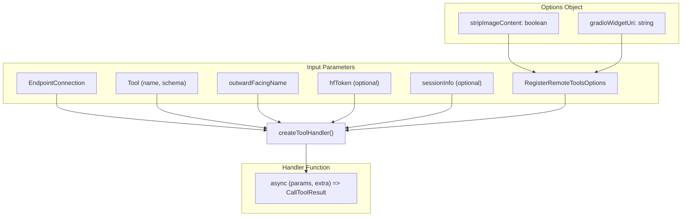
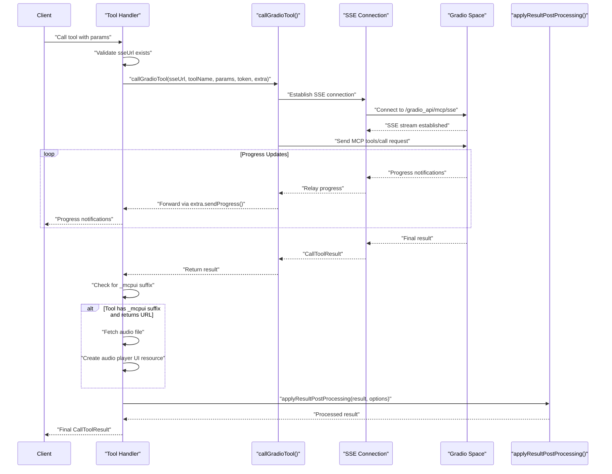
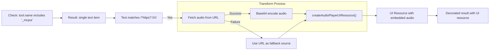
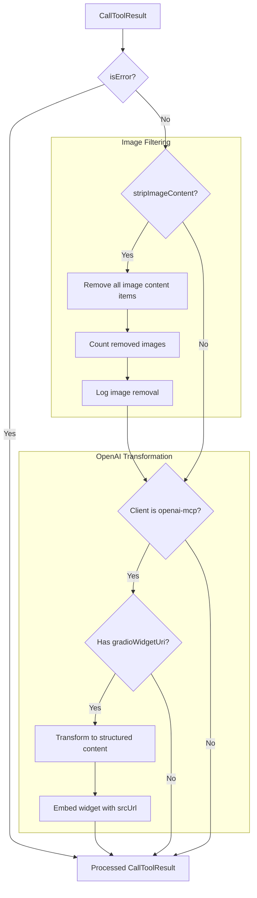
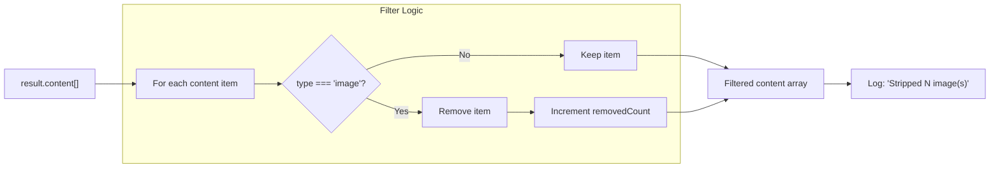
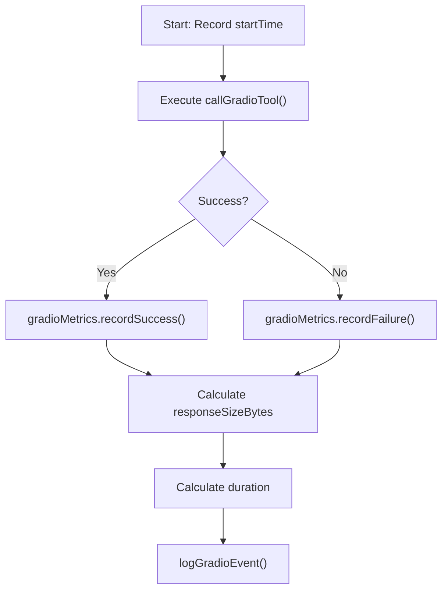
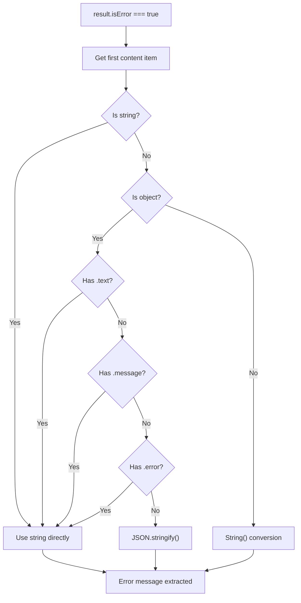
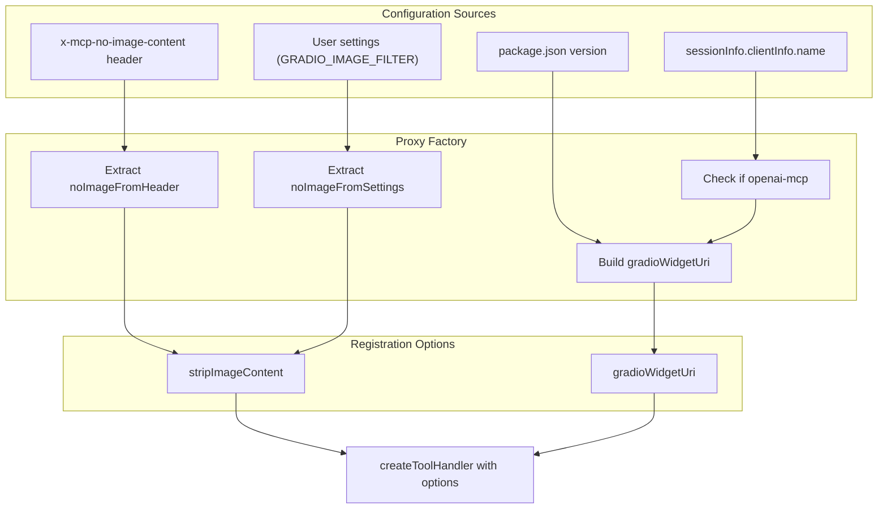

<!-- source: DeepWiki mcp.deepwiki.com · repo huggingface/hf-mcp-server · page 6.4 Tool Execution and Post-Processing · fetched 2026-10-26 -->

# Tool Execution and Post-Processing

<details>
<summary>Relevant source files</summary>

The following files were used as context for generating this wiki page:

- [packages/app/src/server/gradio-endpoint-connector.ts](packages/app/src/server/gradio-endpoint-connector.ts)
- [packages/app/src/server/mcp-proxy.ts](packages/app/src/server/mcp-proxy.ts)

</details>


This page describes how dynamically-discovered Gradio tools are invoked at runtime and how their results are processed before being returned to the client. It covers the SSE connection mechanism, result post-processing pipeline, image filtering capabilities, and client-specific transformations for OpenAI compatibility.

For information about discovering Gradio spaces and fetching schemas, see [Endpoint Discovery](#6.2). For information about converting JSON schemas to Zod schemas during registration, see [Schema Conversion](#6.3).

## Overview

When a Gradio tool is registered (via `registerRemoteTools`), the system creates a handler function that establishes an SSE connection to the Gradio space only when the tool is actually invoked. This lazy connection approach avoids unnecessary overhead during server initialization. The handler function coordinates tool execution, progress relay, result post-processing, and error handling.

**Sources:** [packages/app/src/server/gradio-endpoint-connector.ts:354-539]()

## Tool Handler Creation

The `createToolHandler` function creates the execution handler for each Gradio tool. This handler is registered with the MCP server and invoked when a client calls the tool.

### Handler Configuration



The `createToolHandler` function accepts:
- **connection**: `EndpointConnection` containing `sseUrl`, `name`, `isPrivate`, etc.
- **tool**: The `Tool` object with `name` and `inputSchema`
- **outwardFacingName**: The prefixed tool name (e.g., `gradio_1_image_gen`)
- **hfToken**: Hugging Face authentication token (forwarded to private spaces)
- **sessionInfo**: Client session metadata (session ID, client name/version)
- **options**: `RegisterRemoteToolsOptions` containing `stripImageContent` and `gradioWidgetUri`

**Sources:** [packages/app/src/server/gradio-endpoint-connector.ts:354-368]()

## Tool Execution Flow

When a client invokes a Gradio tool, the handler follows this execution sequence:



### SSE Connection and Tool Invocation

The actual SSE connection and MCP protocol communication is delegated to `callGradioTool` from `gradio-tool-caller.ts`. This function:
1. Establishes an SSE connection to the space's `/gradio_api/mcp/sse` endpoint
2. Sends the `tools/call` MCP request with the tool name and parameters
3. Relays progress notifications back to the client via `extra.sendProgress()`
4. Returns the final `CallToolResult`

**Sources:** [packages/app/src/server/gradio-endpoint-connector.ts:386](), [packages/app/src/server/utils/gradio-tool-caller.ts:15]()

### Error Handling During Execution

If the tool execution fails, the handler:
1. Extracts a meaningful error message from the result's content array
2. Records the failure in `gradioMetrics`
3. Logs the Gradio event with error details
4. Re-throws the error for upstream handling

**Sources:** [packages/app/src/server/gradio-endpoint-connector.ts:396-427](), [packages/app/src/server/gradio-endpoint-connector.ts:500-523]()

## Special UI Resource Handling

Before applying standard post-processing, the handler checks for special UI resource transformations.

### Audio Player UI Resource

If a tool name contains `_mcpui` and returns a single text URL, the handler wraps it as an embedded audio player UI resource:



The audio player resource is created with:
- **uri**: Generated as `ui://huggingface-mcp/{space-name}/{timestamp}`
- **title**: Space name
- **base64Audio**: Inlined audio data (if fetch succeeds)
- **srcUrl**: Original URL (if fetch fails)
- **mimeType**: Set to `audio/wav`

The decorated result includes both the original text content and the UI resource.

**Sources:** [packages/app/src/server/gradio-endpoint-connector.ts:447-496](), [packages/app/src/server/utils/ui/audio-player.ts:13]()

## Result Post-Processing Pipeline

After special UI handling, all results pass through `applyResultPostProcessing`, which applies transformations based on configuration options.

### Post-Processing Options

The `GradioToolCallOptions` object passed to post-processing contains:

| Option | Type | Source | Purpose |
|--------|------|--------|---------|
| `stripImageContent` | `boolean` | Header or user settings | Whether to remove image content from results |
| `toolName` | `string` | Tool metadata | Original tool name (not prefixed) |
| `outwardFacingName` | `string` | Tool metadata | Prefixed tool name for logging |
| `sessionInfo` | `object` | Session context | Client session metadata |
| `gradioWidgetUri` | `string` | Widget resource | URI for OpenAI widget embedding |
| `spaceName` | `string` | Space metadata | Name of the Gradio space |

**Sources:** [packages/app/src/server/gradio-endpoint-connector.ts:436-443](), [packages/app/src/server/utils/gradio-tool-caller.ts:19-26]()

### Post-Processing Flow



**Sources:** [packages/app/src/server/utils/gradio-tool-caller.ts:90-181]()

## Image Content Filtering

When `stripImageContent` is enabled (via `x-mcp-no-image-content: true` header or `GRADIO_IMAGE_FILTER` in user settings), the post-processor removes all image content items from the result.

### Image Removal Process

1. Iterate through `result.content` array
2. Identify items with `type: "image"`
3. Remove these items from the array
4. Track count of removed images
5. Log removal if any images were filtered



This filtering is useful for:
- Reducing response payload size
- Clients that cannot display images
- Analytics/monitoring scenarios where images are unnecessary

**Sources:** [packages/app/src/server/utils/gradio-tool-caller.ts:104-119]()

## OpenAI-Specific Transformations

When the client is identified as `openai-mcp` (via `sessionInfo.clientInfo.name`), results are transformed into OpenAI's structured content format.

### Structured Content Format

Standard MCP content items are transformed as follows:

| MCP Type | OpenAI Structured Type | Additional Fields |
|----------|------------------------|-------------------|
| `text` | `text` | `title`, `description` |
| `image` | `image` | `srcUrl` (from `data` or `url`) |

### Widget Embedding

If a `gradioWidgetUri` is provided, the post-processor embeds it in the result by adding a `widgetElement` field to each content item:

```json
{
  "type": "text",
  "text": "...",
  "widgetElement": {
    "srcUrl": "resource://huggingface-mcp-gradio-widget/v1.2.3"
  }
}
```

This allows the OpenAI client to render an interactive Gradio widget alongside the result.

**Sources:** [packages/app/src/server/utils/gradio-tool-caller.ts:124-181]()

### OpenAI Metadata Registration

During tool registration, if the client is `openai-mcp`, the tool is annotated with OpenAI-specific metadata:

```typescript
theTool._meta = {
  'openai/outputTemplate': gradioWidgetUri || '',
  'openai/toolInvocation/invoking': `Calling the Hugging Face Space ${spaceName}`,
  'openai/toolInvocation/invoked': `Your content is being generated`
};
```

This metadata provides progress messages that the OpenAI client displays during tool execution.

**Sources:** [packages/app/src/server/gradio-endpoint-connector.ts:605-611]()

## Metrics and Logging

### Metrics Tracking

The handler tracks metrics at multiple stages:

1. **Start time**: Captured before tool execution
2. **Success/Failure**: Recorded in `gradioMetrics` after execution
3. **Response size**: Estimated from JSON serialization
4. **Duration**: Calculated as `endTime - startTime`



**Sources:** [packages/app/src/server/gradio-endpoint-connector.ts:373-378](), [packages/app/src/server/gradio-endpoint-connector.ts:430-433](), [packages/app/src/server/gradio-endpoint-connector.ts:517-518]()

### Event Logging

All tool executions are logged via `logGradioEvent` with the following data:

| Field | Description |
|-------|-------------|
| `spaceName` | Name of the Gradio space |
| `sessionId` | Client session identifier |
| `durationMs` | Execution duration in milliseconds |
| `isAuthenticated` | Whether request had HF token |
| `clientName` | Client application name (e.g., "Claude") |
| `clientVersion` | Client version string |
| `success` | Whether execution succeeded |
| `error` | Error message (if failed) |
| `responseSizeBytes` | Estimated response payload size |
| `notificationCount` | Number of progress notifications sent |

This logging supports analytics, debugging, and monitoring of Gradio tool usage.

**Sources:** [packages/app/src/server/gradio-endpoint-connector.ts:524-537]()

## Error Handling

The handler implements comprehensive error handling at multiple levels:

### Error Message Extraction

When a tool returns `isError: true`, the handler extracts a meaningful error message by traversing the content array:



**Sources:** [packages/app/src/server/gradio-endpoint-connector.ts:396-424]()

### Exception Handling

All exceptions during execution are caught and processed:

1. Convert to `Error` object if not already
2. Log with full error details
3. Record failure in metrics
4. Set error message for event logging
5. Re-throw for upstream handling

This ensures that even unexpected failures are properly tracked and reported.

**Sources:** [packages/app/src/server/gradio-endpoint-connector.ts:500-523]()

## Configuration Sources

The post-processing behavior is configured from multiple sources, resolved via the proxy factory:



**Sources:** [packages/app/src/server/mcp-proxy.ts:109-110](), [packages/app/src/server/mcp-proxy.ts:129-130](), [packages/app/src/server/mcp-proxy.ts:101-105](), [packages/app/src/server/mcp-proxy.ts:204-207]()

---

