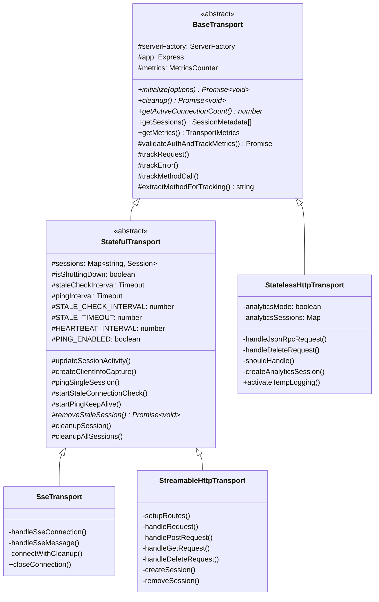
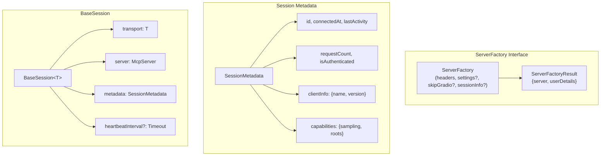
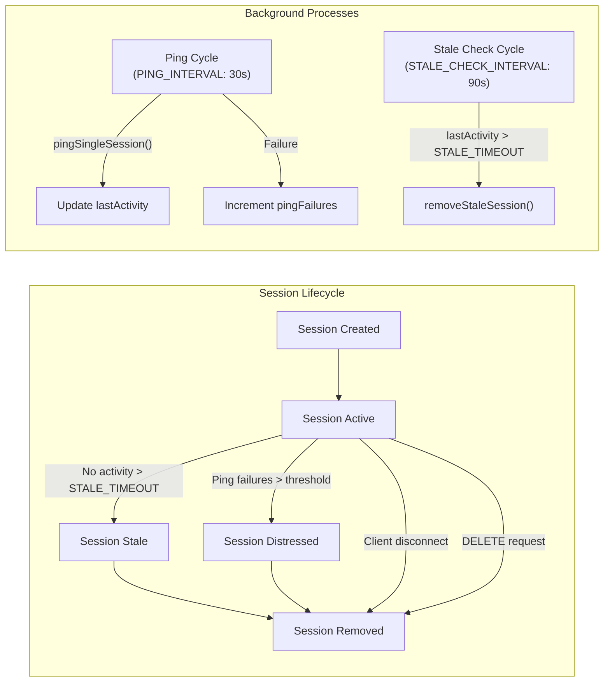
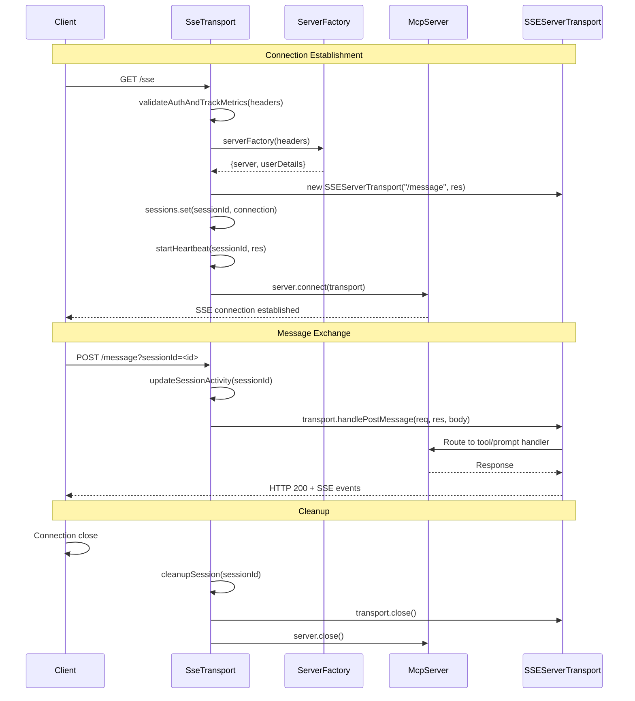
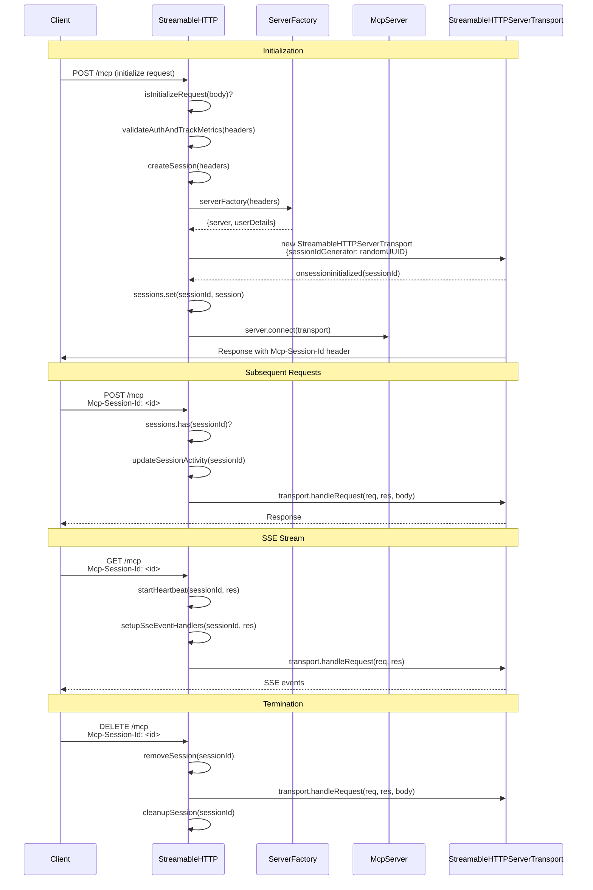
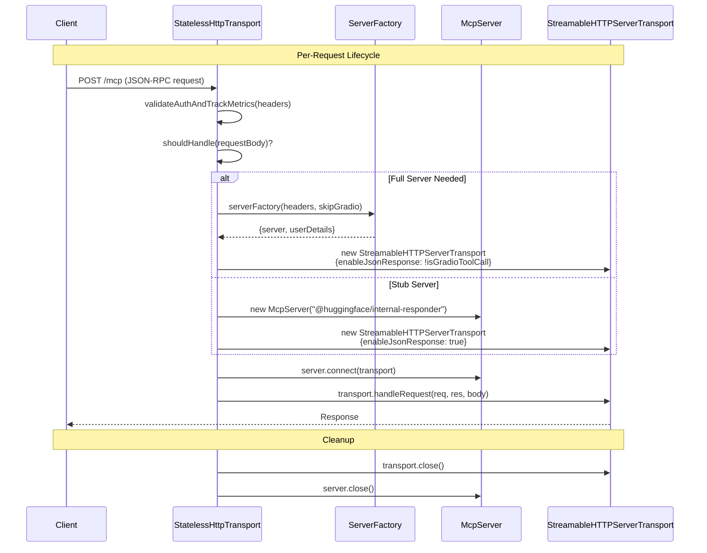
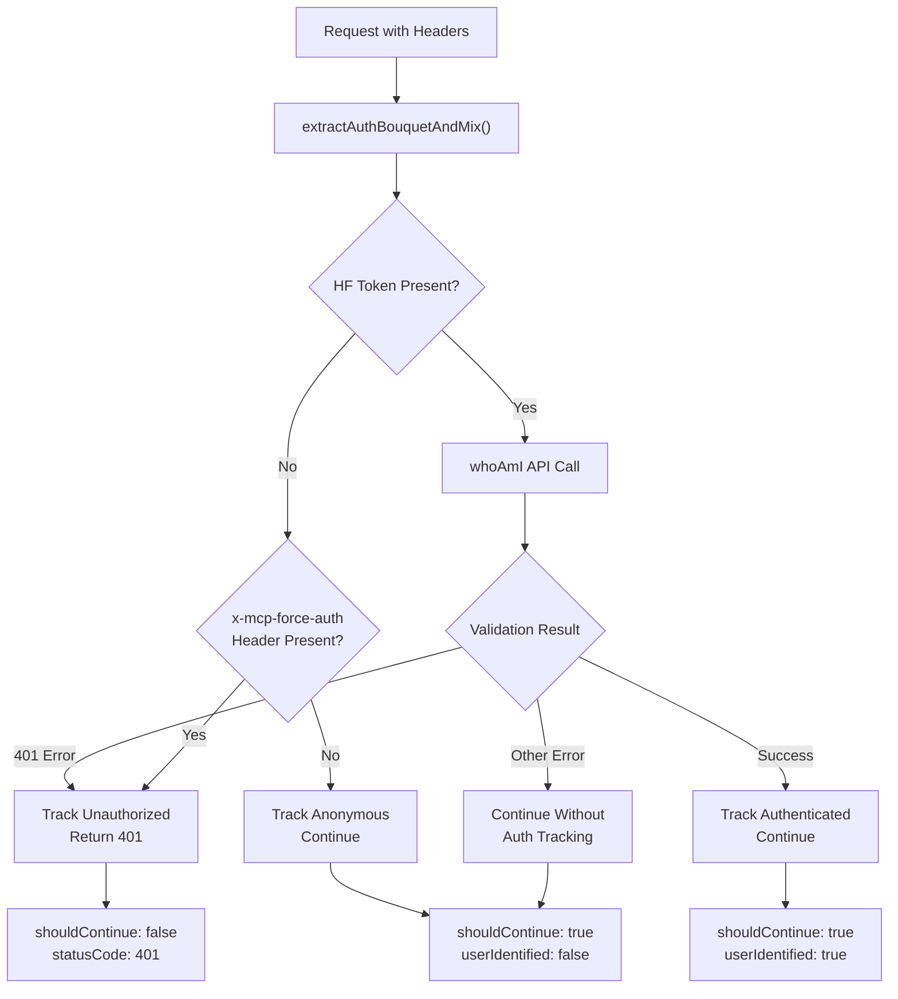
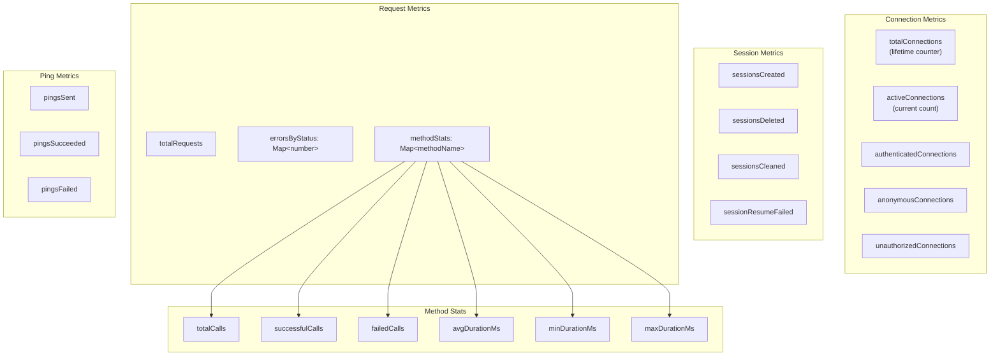

<!-- source: DeepWiki mcp.deepwiki.com · repo huggingface/hf-mcp-server · page 7 Transport Layer · fetched 2026-10-26 -->

# Transport Layer

<details>
<summary>Relevant source files</summary>

The following files were used as context for generating this wiki page:

- [.dockerignore](.dockerignore)
- [Dockerfile](Dockerfile)
- [README.md](README.md)
- [packages/app/src/server/transport/base-transport.ts](packages/app/src/server/transport/base-transport.ts)
- [packages/app/src/server/transport/sse-transport.ts](packages/app/src/server/transport/sse-transport.ts)
- [packages/app/src/server/transport/stateless-http-transport.ts](packages/app/src/server/transport/stateless-http-transport.ts)
- [packages/app/src/server/transport/streamable-http-transport.ts](packages/app/src/server/transport/streamable-http-transport.ts)
- [packages/app/vite.config.ts](packages/app/vite.config.ts)
- [packages/mcp/src/duplicate-space.ts](packages/mcp/src/duplicate-space.ts)
- [packages/mcp/src/error-messages.ts](packages/mcp/src/error-messages.ts)
- [start.sh](start.sh)

</details>


The Transport Layer provides multiple mechanisms for MCP clients to connect to and communicate with the server. It abstracts the low-level communication protocols (STDIO, Server-Sent Events, HTTP) while providing consistent session management, authentication, metrics tracking, and error handling.

This page covers the transport implementations, session management, and request handling. For information about the MCP Server instances created by these transports, see [MCP Server Core](#3.3). For client integration instructions, see [Client Integration](#2.2).

---

## Transport Architecture

The transport layer is organized into a class hierarchy with shared functionality in base classes and protocol-specific implementations in concrete classes. All transports use a `ServerFactory` to create MCP server instances either per-session (stateful) or per-request (stateless).

### Class Hierarchy



**Sources:** [packages/app/src/server/transport/base-transport.ts:83-346](), [packages/app/src/server/transport/base-transport.ts:348-806](), [packages/app/src/server/transport/sse-transport.ts:14](), [packages/app/src/server/transport/streamable-http-transport.ts:18](), [packages/app/src/server/transport/stateless-http-transport.ts:39]()

### Transport Selection by Client Type

Different clients use different transport mechanisms based on their execution environment and capabilities:

| Transport | Endpoints | Client Types | Session Model | Use Case |
|-----------|-----------|--------------|---------------|----------|
| **STDIO** | stdin/stdout | CLI tools (Claude Code, Gemini CLI) | Single long-lived | Local development, command-line tools |
| **SSE** | `GET /sse`, `POST /message` | Legacy web clients | Stateful sessions | Real-time updates, older implementations |
| **StreamableHTTP** | `POST /GET /DELETE /mcp` | Modern web clients (Claude Desktop, VSCode, Cursor) | Stateful sessions | Modern web-based clients |
| **StatelessHTTP** | `POST /mcp` | Serverless/analytics | Stateless (optional analytics tracking) | Serverless deployments, high-scale scenarios |

**Sources:** [README.md:126-131](), [README.md:217-223](), [start.sh:34-58]()

---

## Base Transport Classes

### BaseTransport

`BaseTransport` provides functionality shared by all transports: metrics tracking, authentication validation, and method call extraction.

#### Core Interfaces



**Sources:** [packages/app/src/server/transport/base-transport.ts:13-35](), [packages/app/src/server/transport/base-transport.ts:42-61](), [packages/app/src/server/transport/base-transport.ts:63-73]()

#### Key Methods

The `BaseTransport` class provides several protected methods for common transport operations:

**Authentication and Metrics**

- `validateAuthAndTrackMetrics(headers)` - Validates HF token using `whoAmI` API call, tracks authenticated/anonymous/unauthorized connection metrics [packages/app/src/server/transport/base-transport.ts:305-345]()

**Request Tracking**

- `extractMethodForTracking(requestBody)` - Extracts method name from JSON-RPC request, handles special cases for `tools/call:toolName` and `prompts/get:promptName` patterns [packages/app/src/server/transport/base-transport.ts:192-223]()
- `trackMethodCall(methodName, startTime, isError, clientInfo)` - Records method call duration and success/failure status [packages/app/src/server/transport/base-transport.ts:272-280]()

**Gradio Tool Detection**

- `isGradioToolCall(requestBody)` - Checks if a `tools/call` request targets a Gradio tool [packages/app/src/server/transport/base-transport.ts:234-247]()
- `skipGradioSetup(requestBody)` - Determines whether to skip Gradio endpoint discovery for initialization or non-Gradio requests [packages/app/src/server/transport/base-transport.ts:249-267]()

**Sources:** [packages/app/src/server/transport/base-transport.ts:83-346]()

### StatefulTransport

`StatefulTransport` extends `BaseTransport` to add session management, stale connection detection, and ping keep-alive functionality for transports that maintain persistent connections.

#### Session Management Features



**Configuration Environment Variables:**

| Variable | Default | Description |
|----------|---------|-------------|
| `MCP_CLIENT_HEARTBEAT_INTERVAL` | 30000ms | How often to check SSE connection health |
| `MCP_CLIENT_CONNECTION_CHECK` | 90000ms | How often to check for stale sessions |
| `MCP_CLIENT_CONNECTION_TIMEOUT` | 600000ms | Remove sessions inactive for this duration (10 min) |
| `MCP_PING_ENABLED` | true | Enable ping keep-alive for sessions |
| `MCP_PING_INTERVAL` | 30000ms | Interval between ping cycles |
| `MCP_PING_FAILURE_THRESHOLD` | 1 | Number of consecutive ping failures before marking session distressed |

**Sources:** [packages/app/src/server/transport/base-transport.ts:359-366](), [README.md:224-235]()

#### Session Management Methods

**Activity Tracking**
- `updateSessionActivity(sessionId)` - Updates `lastActivity` timestamp and client activity metrics [packages/app/src/server/transport/base-transport.ts:370-377]()

**Ping Keep-Alive**
- `pingSingleSession(sessionId)` - Sends fire-and-forget ping, updates activity on success or increments failure count [packages/app/src/server/transport/base-transport.ts:429-467]()
- `startPingKeepAlive()` / `stopPingKeepAlive()` - Manages periodic ping cycle [packages/app/src/server/transport/base-transport.ts:472-501]()

**Stale Detection**
- `startStaleConnectionCheck()` - Starts interval that removes sessions inactive beyond `STALE_TIMEOUT` [packages/app/src/server/transport/base-transport.ts:506-533]()
- `isSessionDistressed(session)` - Checks if ping failures exceed threshold [packages/app/src/server/transport/base-transport.ts:382-384]()

**Cleanup**
- `cleanupSession(sessionId)` - Stops heartbeat, closes transport/server, removes from map [packages/app/src/server/transport/base-transport.ts:685-724]()
- `cleanupAllSessions()` - Cleans up all sessions in parallel [packages/app/src/server/transport/base-transport.ts:729-740]()

**Sources:** [packages/app/src/server/transport/base-transport.ts:348-806]()

---

## STDIO Transport

The STDIO transport uses standard input/output streams for communication with CLI-based clients. It creates a single long-lived server instance and does not use HTTP endpoints.

### Characteristics

- **Protocol:** Standard input/output pipes
- **Server Instance:** Single server created at startup
- **Authentication:** Uses `HF_TOKEN` or `DEFAULT_HF_TOKEN` environment variable
- **Session Model:** Single session for the process lifetime
- **HTTP Server:** Not started (no web dashboard)

### Usage

```bash
# Start in STDIO mode
npx @llmindset/hf-mcp-server

# Or with Docker
docker run -i --rm -e TRANSPORT=stdio -e DEFAULT_HF_TOKEN=hf_xxx hf-mcp-server
```

### Implementation Notes

The STDIO transport is implemented in the `stdio.js` entry point and does not use the `BaseTransport` class hierarchy since it operates outside the HTTP request/response model.

**Sources:** [README.md:144](), [start.sh:35-37](), [README.md:210-213]()

---

## SSE Transport

The SSE (Server-Sent Events) transport provides real-time bidirectional communication using an SSE connection for server-to-client messages and HTTP POST for client-to-server messages.

### Endpoints

- `GET /sse` - Establishes SSE connection, accepts optional `?sessionId=` query parameter for reconnection
- `POST /message?sessionId=<id>` - Sends messages from client to server

### Request Flow



**Sources:** [packages/app/src/server/transport/sse-transport.ts:44-152](), [packages/app/src/server/transport/sse-transport.ts:154-208]()

### Key Implementation Details

**Session Creation** [packages/app/src/server/transport/sse-transport.ts:44-152]()
1. Validates authentication via `validateAuthAndTrackMetrics()`
2. Creates new `SSEServerTransport` instance with `/message` endpoint
3. Calls `serverFactory()` to create MCP server instance
4. Stores connection in `sessions` Map with metadata
5. Starts heartbeat monitoring and SSE event handlers
6. Connects server to transport with cleanup error handling

**Reconnection Handling** [packages/app/src/server/transport/sse-transport.ts:54-75]()
- If client provides `?sessionId=`, checks if session exists
- Cleans up old session before creating new one (no session resumption)
- Tracks failed resumption metric if session not found

**Message Handling** [packages/app/src/server/transport/sse-transport.ts:154-208]()
- Requires `sessionId` query parameter
- Updates session activity timestamp
- Increments request count for method calls (not responses/pings)
- Delegates to `transport.handlePostMessage()`

**Sources:** [packages/app/src/server/transport/sse-transport.ts]()

---

## StreamableHTTP Transport

The StreamableHTTP transport implements a modern stateful HTTP protocol where all communication (initialization, method calls, SSE streaming, and termination) happens on a single endpoint using different HTTP methods.

### Endpoints

- `POST /mcp` - Initialize session or send messages
- `GET /mcp` - Establish SSE stream for existing session
- `DELETE /mcp` - Terminate session

All requests include `Mcp-Session-Id` header (except initial POST for initialization).

### Request Flow



**Sources:** [packages/app/src/server/transport/streamable-http-transport.ts:63-221]()

### Session Lifecycle

**Creation** [packages/app/src/server/transport/streamable-http-transport.ts:223-288]()
- Only accepts `initialize` requests without session ID
- Creates `StreamableHTTPServerTransport` with `sessionIdGenerator: randomUUID`
- Uses `onsessioninitialized` callback to store session in map
- Sets up `onclose` handler and error tracking
- Configures client info capture via `oninitialized` hook

**Validation** [packages/app/src/server/transport/streamable-http-transport.ts:92-169]()
- Rejects new connections during shutdown (503)
- Non-initialization requests require valid `mcp-session-id` header
- Returns 404 if session not found
- Updates activity timestamp for all valid requests

**Termination** [packages/app/src/server/transport/streamable-http-transport.ts:203-221]()
- Accepts DELETE requests with session ID
- Calls `transport.handleRequest()` for graceful shutdown
- Removes session via `removeSession()` which calls `cleanupSession()`

**Sources:** [packages/app/src/server/transport/streamable-http-transport.ts]()

---

## Stateless HTTP Transport

The StatelessHTTP transport creates a new server and transport instance for each request, ensuring complete isolation between requests. It operates in pure stateless mode or optional analytics mode where session tracking is maintained for metrics without affecting request isolation.

### Characteristics

- **Server Instance:** New server created per request (or per request type)
- **Transport Instance:** New transport created per request  
- **Session Persistence:** None (optional analytics tracking only)
- **Cleanup:** Automatic after response completion
- **Scalability:** Suitable for serverless/high-scale deployments

### Endpoint

- `POST /mcp` - JSON-RPC requests
- `GET /mcp` - Serves MCP welcome page (or 405 if `MCP_STRICT_COMPLIANCE=true`)
- `DELETE /mcp` - Deletes analytics session (only in analytics mode)

### Request Flow



**Sources:** [packages/app/src/server/transport/stateless-http-transport.ts:141-408]()

### Request Optimization

The transport uses `shouldHandle()` to determine whether to create a full server instance or a minimal stub responder:

**Methods Requiring Full Server** [packages/app/src/server/transport/stateless-http-transport.ts:64-89]()
- `tools/list`
- `tools/call`
- `prompts/list`
- `prompts/get`
- `initialize`
- `resources/*` (only for `openai-mcp` client)

**Stub Responder** [packages/app/src/server/transport/stateless-http-transport.ts:313-315]()
- All other methods use minimal `McpServer` instance without tools/prompts
- Handles protocol-level methods like `ping`, `notifications`, etc.

### Analytics Mode

When `ANALYTICS_MODE=true`, the transport maintains a session map for analytics without affecting statelessness:

**Session Management** [packages/app/src/server/transport/stateless-http-transport.ts:165-244]()
- `initialize` request generates new session ID, returns it in `Mcp-Session-Id` header
- Subsequent requests must include `Mcp-Session-Id` header
- Session stores metadata but no server/transport instances
- `DELETE /mcp` removes analytics session
- Failed session resumption returns 404

**Temporary Logging** [packages/app/src/server/transport/stateless-http-transport.ts:535-554]()
- `activateTempLogging(count)` enables detailed logging for session resume failures
- Controlled by `TEMPLOG_MAX` environment variable
- Logs session ID, headers (with redacted token), client info
- Auto-disables after count is reached

**Sources:** [packages/app/src/server/transport/stateless-http-transport.ts:39-555]()

---

## Authentication and Authorization

All transports validate authentication using the `validateAuthAndTrackMetrics()` method inherited from `BaseTransport`.

### Authentication Flow



**Sources:** [packages/app/src/server/transport/base-transport.ts:305-345]()

### Token Sources

The authentication flow extracts tokens from multiple header sources via `extractAuthBouquetAndMix()`:

1. `Authorization: Bearer <token>` (standard)
2. `hf-token: <token>` (custom header)
3. `x-hf-token: <token>` (alternative custom header)
4. Query parameters converted to headers (via `extractQueryParamsToHeaders()`)

For STDIO transport, if no token is provided in headers, `DEFAULT_HF_TOKEN` or `HF_TOKEN` environment variables are used.

**Sources:** [packages/app/src/server/utils/auth-utils.ts](), [start.sh:12-15]()

### OAuth Challenge Response

When authentication fails (401), transports set the `WWW-Authenticate` header with an OAuth resource challenge:

```typescript
res.set('WWW-Authenticate', buildOAuthResourceHeader(req));
res.status(401).send('Unauthorized');
```

This allows compatible clients to initiate OAuth flows for authentication.

**Sources:** [packages/app/src/server/transport/stateless-http-transport.ts:159-161](), [packages/app/src/server/transport/streamable-http-transport.ts:134-136]()

---

## Metrics and Monitoring

All transports track detailed metrics through the `MetricsCounter` class, providing visibility into connection health, request performance, and error patterns.

### Metrics Categories



**Sources:** [packages/app/src/shared/transport-metrics.ts]()

### Method Tracking

Method calls are tracked with granular detail including tool names and prompt names:

**Method Name Extraction** [packages/app/src/server/transport/base-transport.ts:192-223]()
- `tools/call` → `tools/call:toolName` (e.g., `tools/call:model_search`, `tools/call:gr_image_gen`)
- `prompts/get` → `prompts/get:promptName` (e.g., `prompts/get:user_summary`)
- Other methods → method name only (e.g., `initialize`, `tools/list`)
- JSON-RPC responses (have `id` but no `method`) → not tracked

**Timing** [packages/app/src/server/transport/base-transport.ts:272-280]()
- **Stateless mode:** Measures full request-to-response time including server creation
- **Stateful mode:** Tracks HTTP dispatch time without timing (duration set to `undefined`)

**Per-Client Tracking**
When client info is available, metrics are also tracked per `clientInfo.name` for client-specific analysis.

**Sources:** [packages/app/src/shared/transport-metrics.ts](), [packages/app/src/server/transport/base-transport.ts:192-223]()

### Accessing Metrics

Metrics are exposed via the web dashboard and API endpoints:

- `GET /api/transport` - Transport type and basic configuration
- `GET /api/transport-metrics` - Detailed metrics with 3-second polling
- `GET /api/sessions` - Active session list with metadata

The web dashboard displays:
- **TransportMetricsCard** - Connection counts, error distribution, client breakdown
- **McpMethodsCard** - Per-method performance statistics, call counts, avg/min/max duration
- **StdioTransportMetrics** - Session details table for STDIO/SSE/StreamableHTTP

**Sources:** [packages/app/src/web/components/monitoring/TransportMetricsCard.tsx](), [packages/app/src/web/components/monitoring/McpMethodsCard.tsx](), [packages/app/src/web/components/monitoring/StdioTransportMetrics.tsx]()

---

## Configuration

### Transport Selection

The transport type is selected via the `TRANSPORT` environment variable:

```bash
# STDIO (default for npx)
TRANSPORT=stdio node dist/server/stdio.js

# SSE (legacy)
TRANSPORT=sse node dist/server/sse.js

# StreamableHTTP (stateful)
TRANSPORT=streamableHttp node dist/server/streamableHttp.js

# StreamableHTTPJson (stateless)
TRANSPORT=streamableHttpJson node dist/server/streamableHttp.js --json
```

**Sources:** [start.sh:4-58](), [README.md:238-246]()

### Environment Variables

#### Common Settings

| Variable | Default | Description |
|----------|---------|-------------|
| `TRANSPORT` | `stdio` | Transport type: `stdio`, `sse`, `streamableHttp`, `streamableHttpJson` |
| `PORT` | 3000 | HTTP server port (not used for STDIO) |
| `DEFAULT_HF_TOKEN` | - | ⚠️ Default token if no Authorization header provided (dev/test only) |
| `HF_TOKEN` | - | For STDIO mode, used as `DEFAULT_HF_TOKEN` if not set |
| `HF_API_TIMEOUT` | 12500 | Timeout for HF API requests in milliseconds |
| `MCP_STRICT_COMPLIANCE` | false | Return 405 for GET /mcp in stateless mode (vs. serving welcome page) |

**Sources:** [README.md:238-246](), [start.sh:4-27]()

#### Stateful Transport Settings

| Variable | Default | Description |
|----------|---------|-------------|
| `MCP_CLIENT_HEARTBEAT_INTERVAL` | 30000 | How often to check SSE connection health (ms) |
| `MCP_CLIENT_CONNECTION_CHECK` | 90000 | How often to check for stale sessions (ms) |
| `MCP_CLIENT_CONNECTION_TIMEOUT` | 600000 | Remove sessions inactive for this duration (ms, 10 min) |
| `MCP_PING_ENABLED` | true | Enable ping keep-alive for sessions |
| `MCP_PING_INTERVAL` | 30000 | Interval between ping cycles (ms) |
| `MCP_PING_FAILURE_THRESHOLD` | 1 | Consecutive ping failures before marking session distressed |

**Sources:** [README.md:224-235](), [packages/app/src/server/transport/base-transport.ts:359-366]()

#### Stateless Transport Settings

| Variable | Default | Description |
|----------|---------|-------------|
| `ANALYTICS_MODE` | false | Enable session tracking in stateless mode for analytics |
| `TEMPLOG_MAX` | 0 | Maximum number of session resume failures to log with full detail |

**Sources:** [packages/app/src/server/transport/stateless-http-transport.ts:48-58]()

### Docker Configuration

The Docker container defaults to `streamableHttpJson` mode and requires explicit transport override:

```bash
# Default (stateless JSON)
docker run --rm -p 3000:3000 ghcr.io/evalstate/hf-mcp-server:latest

# STDIO mode
docker run -i --rm -e TRANSPORT=stdio -e DEFAULT_HF_TOKEN=hf_xxx hf-mcp-server

# SSE mode
docker run --rm -p 3000:3000 -e TRANSPORT=sse hf-mcp-server

# StreamableHTTP mode (stateful)
docker run --rm -p 3000:3000 -e TRANSPORT=streamableHttp hf-mcp-server
```

**Sources:** [Dockerfile:58-60](), [README.md:199-216]()

---

## Transport Comparison Table

| Feature | STDIO | SSE | StreamableHTTP | StatelessHTTP |
|---------|-------|-----|----------------|---------------|
| **HTTP Endpoints** | None | `/sse`, `/message` | `/mcp` (all methods) | `/mcp` (POST only) |
| **Session Model** | Single process | Stateful | Stateful | Stateless (optional analytics) |
| **Server Instances** | 1 per process | 1 per session | 1 per session | 1 per request |
| **Stale Detection** | N/A | Yes | Yes | N/A |
| **Ping Keep-Alive** | N/A | Yes | Yes | N/A |
| **Dashboard** | No | Yes | Yes | Yes |
| **Reconnection** | N/A | Cleanup + new | Session resumption | Session resumption (analytics mode) |
| **Shutdown Behavior** | Process exit | Reject new, cleanup existing | Reject new, cleanup existing | Accept all (no state) |
| **Best For** | CLI tools | Legacy clients | Modern web clients | Serverless, high-scale |
| **Streaming Support** | Yes (native) | Yes (SSE) | Yes (SSE) | Yes (SSE, per-request) |

**Sources:** [README.md:126-131](), All transport implementation files

---

