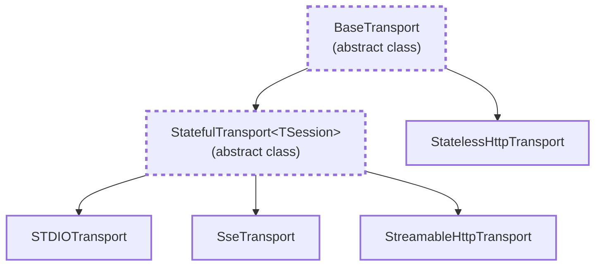
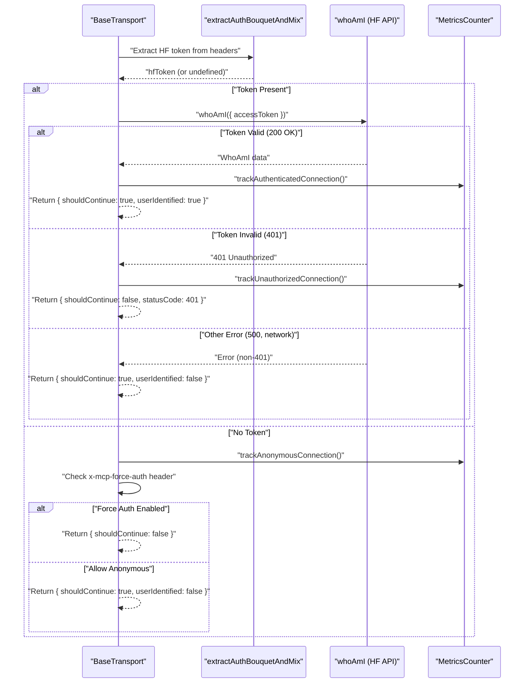
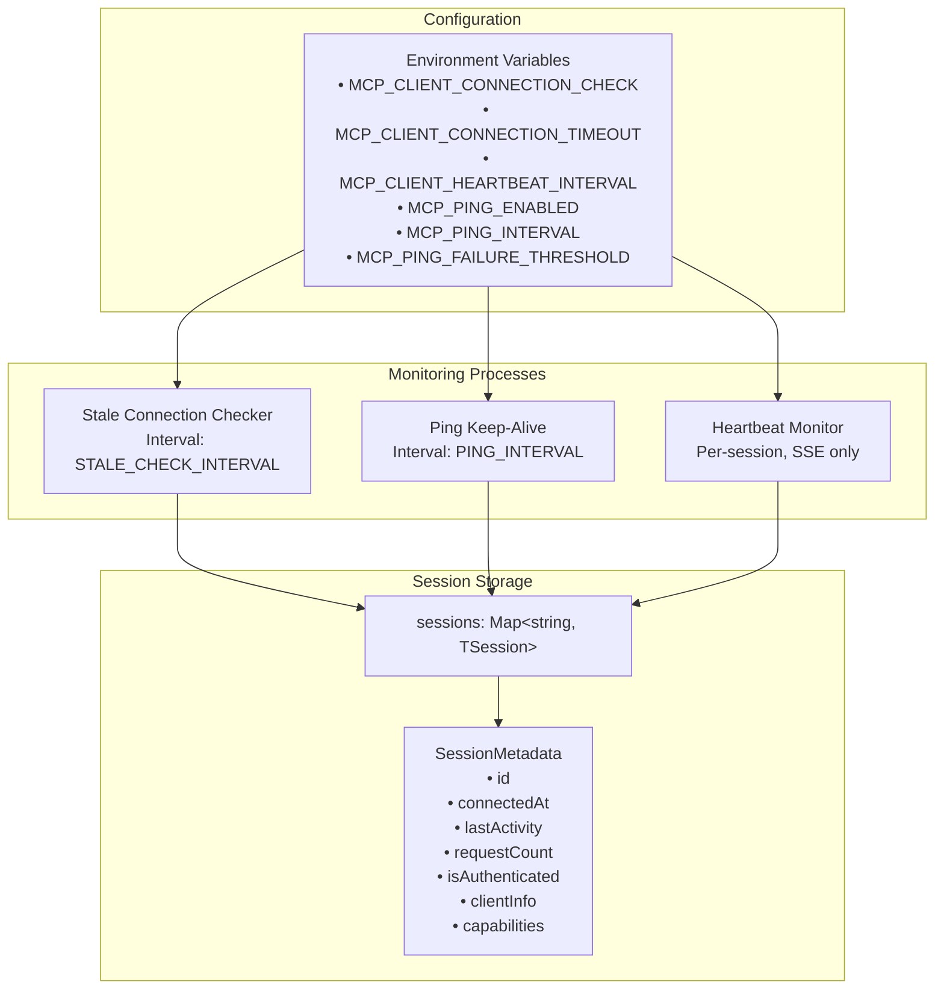
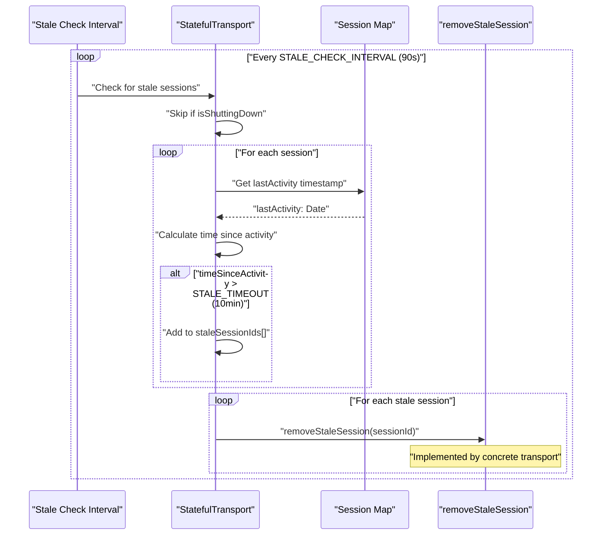
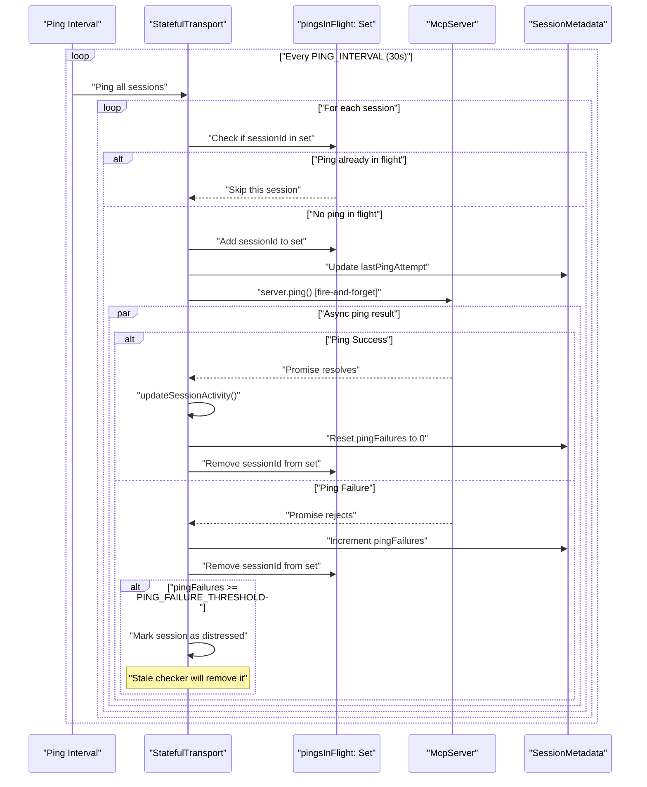
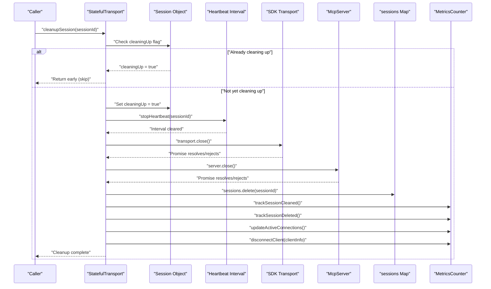

<!-- source: DeepWiki mcp.deepwiki.com · repo huggingface/hf-mcp-server · page 7.1 Base Transport Classes · fetched 2026-10-26 -->

# Base Transport Classes

<details>
<summary>Relevant source files</summary>

The following files were used as context for generating this wiki page:

- [packages/app/src/server/transport/base-transport.ts](packages/app/src/server/transport/base-transport.ts)
- [packages/app/src/server/transport/sse-transport.ts](packages/app/src/server/transport/sse-transport.ts)
- [packages/app/src/server/transport/stateless-http-transport.ts](packages/app/src/server/transport/stateless-http-transport.ts)
- [packages/app/src/server/transport/streamable-http-transport.ts](packages/app/src/server/transport/streamable-http-transport.ts)

</details>


## Purpose and Scope

This document describes the abstract base classes that provide common functionality for all transport implementations in the HF MCP Server. The `BaseTransport` and `StatefulTransport` classes define the core architecture for handling client connections, managing sessions, tracking metrics, and coordinating with the MCP server factory.

For information about specific transport implementations, see:
- [STDIO Transport](#7.2) - command-line integration
- [SSE Transport](#7.3) - Server-Sent Events transport
- [HTTP Transports](#7.4) - stateful and stateless HTTP implementations

For the overall transport layer architecture, see [Transport Layer Architecture](#3.4).

---

## Architecture Overview

The transport layer uses a two-tier inheritance hierarchy to share functionality while allowing customization:

**Class Hierarchy Diagram**



**Sources:** [packages/app/src/server/transport/base-transport.ts:82-346](), [packages/app/src/server/transport/base-transport.ts:352-806]()

---

## BaseTransport Abstract Class

The `BaseTransport` class provides core functionality shared by all transport implementations, regardless of whether they maintain session state.

### Core Responsibilities

| Responsibility | Description |
|---------------|-------------|
| **Server Factory Management** | Stores and invokes the `ServerFactory` to create MCP server instances |
| **Metrics Tracking** | Maintains `MetricsCounter` for requests, errors, connections, and method calls |
| **Authentication Validation** | Validates Hugging Face tokens and tracks authentication metrics |
| **Request Analysis** | Extracts method names, client info, and determines request types |
| **Express Integration** | Stores reference to Express app for route registration |

### Key Properties and Methods

```typescript
// Core properties (from base-transport.ts)
protected serverFactory: ServerFactory
protected app: Express
protected metrics: MetricsCounter

// Abstract methods - must be implemented by subclasses
abstract initialize(options: TransportOptions): Promise<void>
abstract cleanup(): Promise<void>
abstract getActiveConnectionCount(): number

// Optional shutdown method
shutdown?(): void
```

**Sources:** [packages/app/src/server/transport/base-transport.ts:83-108]()

### Authentication Flow

The `validateAuthAndTrackMetrics` method handles token validation and metrics tracking:

**Authentication Validation Flow**



**Sources:** [packages/app/src/server/transport/base-transport.ts:305-345]()

### Method Tracking

The `extractMethodForTracking` method converts JSON-RPC requests into trackable method names:

| Request Type | Tracking Name Format |
|-------------|---------------------|
| `tools/call` with `params.name="model_search"` | `tools/call:model_search` |
| `tools/call` with Gradio tool | `tools/call:gr1_toolname` (sanitized) |
| `prompts/get` with `params.name="user_summary"` | `prompts/get:user_summary` |
| `initialize` | `initialize` |
| JSON-RPC response (has `result` or `error` but no `method`) | `null` (not tracked) |

**Sources:** [packages/app/src/server/transport/base-transport.ts:192-223]()

### Gradio Detection

The base class provides methods to identify Gradio-related requests:

```typescript
// Check if a request is a Gradio tool call
protected isGradioToolCall(requestBody): boolean

// Determine if Gradio setup should be skipped
// Returns true for: initialize, resources/*, non-Gradio tools/call
protected skipGradioSetup(requestBody): boolean
```

**Sources:** [packages/app/src/server/transport/base-transport.ts:234-267]()

---

## StatefulTransport Abstract Class

The `StatefulTransport` class extends `BaseTransport` to provide session management capabilities for transports that maintain persistent connections.

### Session Management Architecture

**Session Lifecycle Components**



**Sources:** [packages/app/src/server/transport/base-transport.ts:352-366](), [packages/app/src/server/transport/base-transport.ts:506-533]()

### Session State Properties

```typescript
// Session management
protected sessions: Map<string, TSession>
protected isShuttingDown: boolean
protected staleCheckInterval?: NodeJS.Timeout
protected pingInterval?: NodeJS.Timeout
protected pingsInFlight: Set<string>

// Configuration from environment variables
protected readonly STALE_CHECK_INTERVAL: number    // Default: 90000ms (90s)
protected readonly STALE_TIMEOUT: number           // Default: 600000ms (10min)
protected readonly HEARTBEAT_INTERVAL: number      // Default: 30000ms (30s)
protected readonly PING_ENABLED: boolean           // Default: true
protected readonly PING_INTERVAL: number           // Default: 30000ms (30s)
protected readonly PING_FAILURE_THRESHOLD: number  // Default: 1
```

**Sources:** [packages/app/src/server/transport/base-transport.ts:353-365]()

### Stale Connection Detection

The stale checker runs periodically to identify and remove inactive sessions:

**Stale Connection Detection Flow**



**Sources:** [packages/app/src/server/transport/base-transport.ts:506-533]()

### Ping Keep-Alive System

The ping system actively probes session health using MCP's `ping` method:

**Ping Keep-Alive Architecture**



**Sources:** [packages/app/src/server/transport/base-transport.ts:429-467](), [packages/app/src/server/transport/base-transport.ts:472-500]()

### Client Information Capture

The `createClientInfoCapture` method creates a callback to extract client details after initialization:

```typescript
protected createClientInfoCapture(sessionId: string): () => void {
  return () => {
    const session = this.sessions.get(sessionId);
    // Extract from server.getClientVersion() and server.getClientCapabilities()
    // Update session metadata
    // Track metrics for client association
  };
}
```

This callback is typically registered as `server.server.oninitialized` to capture client info when the `initialize` method completes.

**Sources:** [packages/app/src/server/transport/base-transport.ts:389-423]()

### Session Cleanup

The base class provides standardized cleanup methods:

| Method | Purpose |
|--------|---------|
| `cleanupSession(sessionId)` | Clean up a single session: stop heartbeat, close transport, close server, remove from map |
| `cleanupAllSessions()` | Clean up all sessions in parallel during shutdown |
| `removeStaleSession(sessionId)` | Abstract method - concrete transports implement this to remove stale sessions |

**Cleanup Sequence**



**Sources:** [packages/app/src/server/transport/base-transport.ts:685-740]()

---

## Key Interfaces and Types

### ServerFactory and ServerFactoryResult

The `ServerFactory` type defines the function signature for creating MCP server instances:

```typescript
// Factory function signature
export type ServerFactory = (
  headers: Record<string, string> | null,
  userSettings?: AppSettings,
  skipGradio?: boolean,
  sessionInfo?: {
    clientSessionId?: string;
    isAuthenticated?: boolean;
    clientInfo?: { name: string; version: string };
  }
) => Promise<ServerFactoryResult>;

// Return type
export interface ServerFactoryResult {
  server: McpServer;
  userDetails?: WhoAmI;
}
```

The factory is called during session creation to instantiate a new MCP server with the appropriate tool selection and configuration.

**Sources:** [packages/app/src/server/transport/base-transport.ts:16-35]()

### SessionMetadata

The `SessionMetadata` interface provides a standardized structure for tracking session information across all transport types:

```typescript
export interface SessionMetadata {
  id: string;                    // Unique session identifier
  connectedAt: Date;             // When session was created
  lastActivity: Date;            // Last request or successful ping
  requestCount: number;          // Number of requests processed
  isAuthenticated: boolean;      // Whether HF token is present
  clientInfo?: {                 // Client identity (after initialization)
    name: string;                // e.g., "claude-desktop", "vscode"
    version: string;             // Client version string
  };
  capabilities: {                // MCP capabilities
    sampling?: boolean;
    roots?: boolean;
  };
  pingFailures?: number;         // Consecutive ping failures
  lastPingAttempt?: Date;        // Last time ping was sent
}
```

**Sources:** [packages/app/src/server/transport/base-transport.ts:45-61]()

### BaseSession

The `BaseSession` interface is the generic session container that all stateful transports extend:

```typescript
export interface BaseSession<T = unknown> {
  transport: T;                  // SDK transport instance (type varies)
  server: McpServer;             // MCP server instance
  metadata: SessionMetadata;     // Session tracking data
  heartbeatInterval?: NodeJS.Timeout;  // Heartbeat timer (SSE/StreamableHTTP)
  cleaningUp?: boolean;          // Cleanup guard flag
}
```

Concrete implementations extend this with transport-specific fields (e.g., `activeResponse` for StreamableHTTP, `cleanup` function for SSE).

**Sources:** [packages/app/src/server/transport/base-transport.ts:67-73]()

### TransportOptions

The `TransportOptions` interface defines initialization parameters:

```typescript
export interface TransportOptions {
  port?: number;
  onClientInfoUpdate?: (clientInfo: { name: string; version: string }) => void;
}
```

**Sources:** [packages/app/src/server/transport/base-transport.ts:37-40]()

### STATELESS_MODE Constant

The `STATELESS_MODE` constant (`-1`) is returned by `getActiveConnectionCount()` for stateless transports to distinguish them from transports with zero active connections:

```typescript
export const STATELESS_MODE = -1;
```

**Sources:** [packages/app/src/server/transport/base-transport.ts:78]()

---

## Metrics Tracking System

The base transport classes integrate tightly with the `MetricsCounter` to provide comprehensive tracking:

### Metrics Categories

| Metric Category | Tracked By | Examples |
|----------------|-----------|----------|
| **Requests** | `BaseTransport` | Total requests received, errors by status code |
| **Connections** | `BaseTransport` | Total connections, authenticated/anonymous/unauthorized counts |
| **Sessions** | `StatefulTransport` | Active sessions, session creation/deletion, resume failures |
| **Methods** | `BaseTransport` | Method call counts, durations, error rates per method |
| **Client Activity** | `StatefulTransport` | Per-client session counts, activity tracking, disconnections |
| **Ping Status** | `StatefulTransport` | Pings sent/succeeded/failed |

### Metrics Methods in BaseTransport

```typescript
// Request tracking
protected trackRequest(): void
protected trackError(statusCode?: number, error?: Error): void
protected trackNewConnection(): void

// Method tracking
protected trackMethodCall(methodName: string | null, startTime: number, 
                         isError: boolean, clientInfo?: ClientInfo): void

// Auth tracking (via validateAuthAndTrackMetrics)
metrics.trackAuthenticatedConnection()
metrics.trackAnonymousConnection()
metrics.trackUnauthorizedConnection()
```

**Sources:** [packages/app/src/server/transport/base-transport.ts:148-280]()

### Metrics Methods in StatefulTransport

```typescript
// Session lifecycle
protected trackSessionCreated(sessionId: string): void
protected trackSessionCleaned(session?: TSession): void

// Client tracking
protected associateSessionWithClient(clientInfo: ClientInfo): void
protected updateClientActivity(clientInfo?: ClientInfo): void
protected disconnectClient(clientInfo?: ClientInfo): void

// Ping tracking
metrics.trackPingSent()
metrics.trackPingSuccess()
metrics.trackPingFailed()
```

**Sources:** [packages/app/src/server/transport/base-transport.ts:576-601]()

---

## Configuration System

### Environment Variables

Stateful transports read configuration from environment variables with sensible defaults:

| Environment Variable | Default | Purpose |
|---------------------|---------|---------|
| `MCP_CLIENT_CONNECTION_CHECK` | `90000` (90s) | How often to check for stale connections |
| `MCP_CLIENT_CONNECTION_TIMEOUT` | `600000` (10min) | How long before connection is considered stale |
| `MCP_CLIENT_HEARTBEAT_INTERVAL` | `30000` (30s) | SSE heartbeat frequency |
| `MCP_PING_ENABLED` | `true` | Whether to enable ping keep-alive |
| `MCP_PING_INTERVAL` | `30000` (30s) | How often to send pings |
| `MCP_PING_FAILURE_THRESHOLD` | `1` | Consecutive failures before session is distressed |

### Configuration Access

The `getConfiguration()` method exposes these settings:

```typescript
getConfiguration(): {
  heartbeatInterval: number;
  staleCheckInterval: number;
  staleTimeout: number;
  pingEnabled: boolean;
  pingInterval: number;
  pingFailureThreshold: number;
}
```

This is used by the web dashboard to display current transport settings.

**Sources:** [packages/app/src/server/transport/base-transport.ts:360-365](), [packages/app/src/server/transport/base-transport.ts:613-629]()

---

## Abstract Methods Contract

Concrete transport implementations must provide:

### Required Methods

| Method | BaseTransport | StatefulTransport | Purpose |
|--------|---------------|-------------------|---------|
| `initialize(options)` | ✓ Required | Inherited | Set up routes, start intervals |
| `cleanup()` | ✓ Required | Inherited | Clean up resources on shutdown |
| `getActiveConnectionCount()` | ✓ Required | Implemented | Return session count or `STATELESS_MODE` |
| `removeStaleSession(sessionId)` | - | ✓ Required | Handle removal of stale session |

### Optional Methods

| Method | Purpose |
|--------|---------|
| `shutdown()` | Mark transport as shutting down (reject new connections) |
| `getSessions()` | Return array of `SessionMetadata` for dashboard |
| `getConfiguration()` | Return configuration settings |

**Sources:** [packages/app/src/server/transport/base-transport.ts:97-143](), [packages/app/src/server/transport/base-transport.ts:538-629]()

---

## Implementation Patterns

### Typical StatefulTransport Implementation

Concrete stateful transports follow this pattern:

```typescript
class ConcreteTransport extends StatefulTransport<ConcreteSession> {
  async initialize(options: TransportOptions): Promise<void> {
    // 1. Set up Express routes
    this.app.post('/endpoint', (req, res) => { ... });
    
    // 2. Start monitoring processes
    this.startStaleConnectionCheck();
    this.startPingKeepAlive();
    
    // 3. Log initialization
    logger.info({ config }, 'Transport initialized');
  }
  
  protected async removeStaleSession(sessionId: string): Promise<void> {
    // Use base class cleanupSession() method
    await this.cleanupSession(sessionId);
    
    // Add any transport-specific cleanup
    // ...
  }
  
  async cleanup(): Promise<void> {
    // 1. Stop monitoring processes
    this.stopStaleConnectionCheck();
    
    // 2. Clean up all sessions
    await this.cleanupAllSessions();
    
    // 3. Log completion
    logger.info('Cleanup complete');
  }
}
```

**Sources:** [packages/app/src/server/transport/sse-transport.ts:14-261](), [packages/app/src/server/transport/streamable-http-transport.ts:18-313]()

### Typical BaseTransport Implementation (Stateless)

Stateless transports directly extend `BaseTransport`:

```typescript
class StatelessTransport extends BaseTransport {
  async initialize(options: TransportOptions): Promise<void> {
    // Set up routes for request handling
    this.app.post('/endpoint', (req, res) => {
      this.trackRequest();
      void this.handleRequest(req, res);
    });
  }
  
  getActiveConnectionCount(): number {
    // Return STATELESS_MODE or analytics session count
    return this.analyticsMode ? this.analyticsSessions.size : STATELESS_MODE;
  }
  
  async cleanup(): Promise<void> {
    // Minimal cleanup - no persistent sessions
    logger.info('Cleanup complete');
  }
}
```

**Sources:** [packages/app/src/server/transport/stateless-http-transport.ts:39-555]()

---

## Summary

The base transport classes provide a robust foundation for MCP server connectivity:

- **`BaseTransport`** handles metrics, authentication, and request analysis for all transports
- **`StatefulTransport`** adds session management, health monitoring, and automatic cleanup
- **Standardized interfaces** (`SessionMetadata`, `BaseSession`) ensure consistency across implementations
- **Environment-driven configuration** allows tuning of timeouts and intervals
- **Comprehensive metrics** track every aspect of transport operation
- **Abstract method contract** enforces implementation requirements while maximizing code reuse

Concrete transport implementations (STDIO, SSE, StreamableHTTP, StatelessHTTP) build on these classes to provide specific connection mechanisms while inheriting all common functionality.

**Sources:** [packages/app/src/server/transport/base-transport.ts:1-807]()

---

