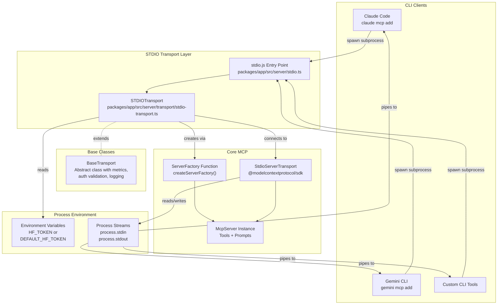
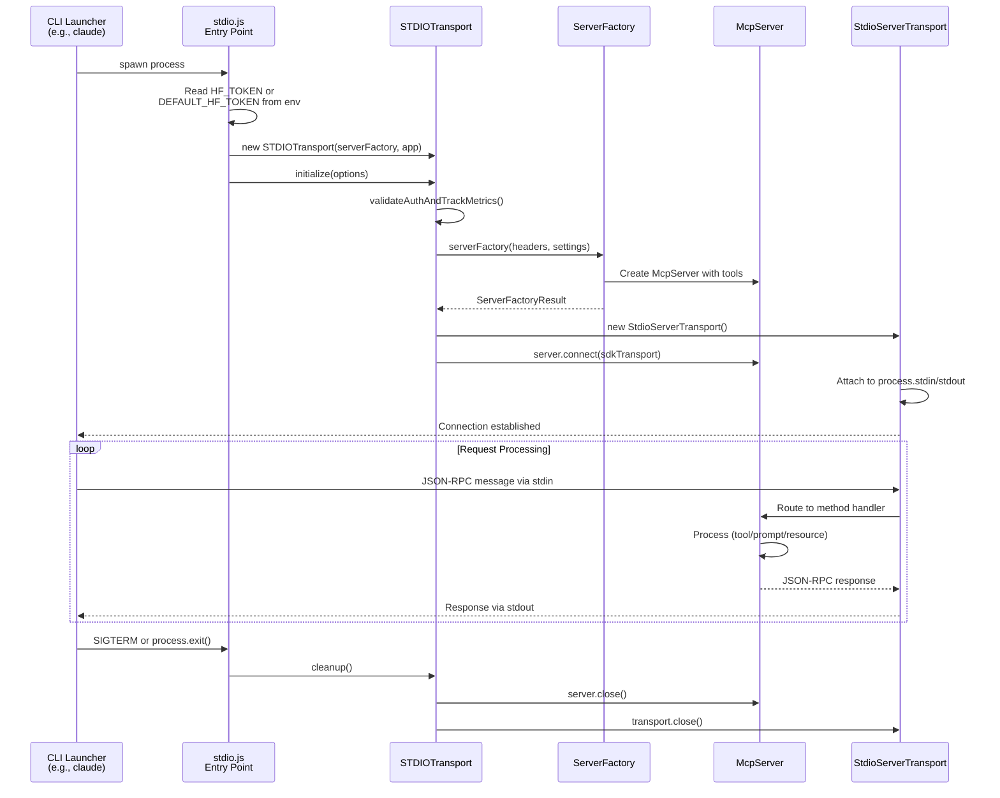
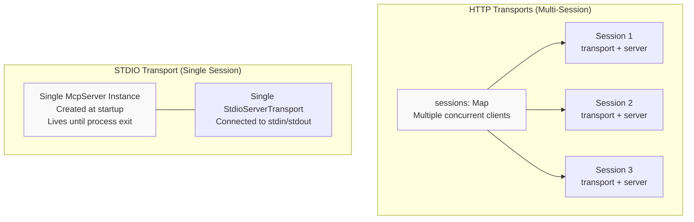
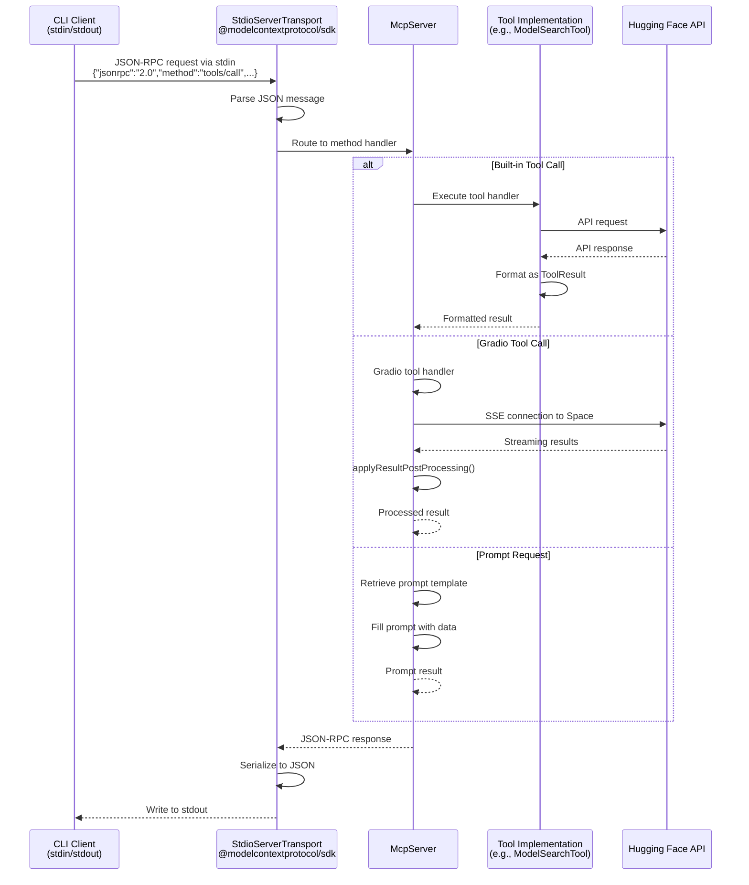
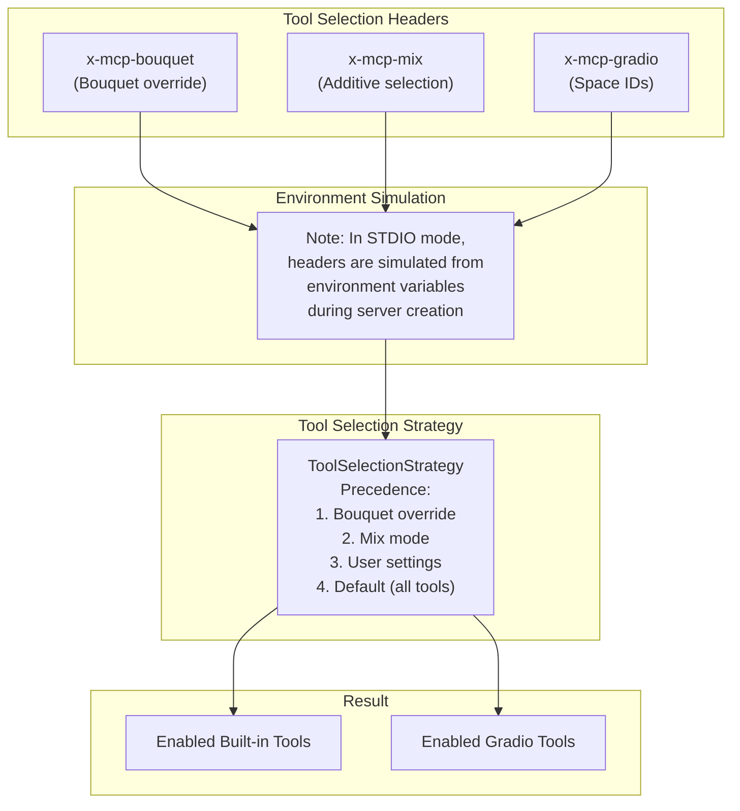
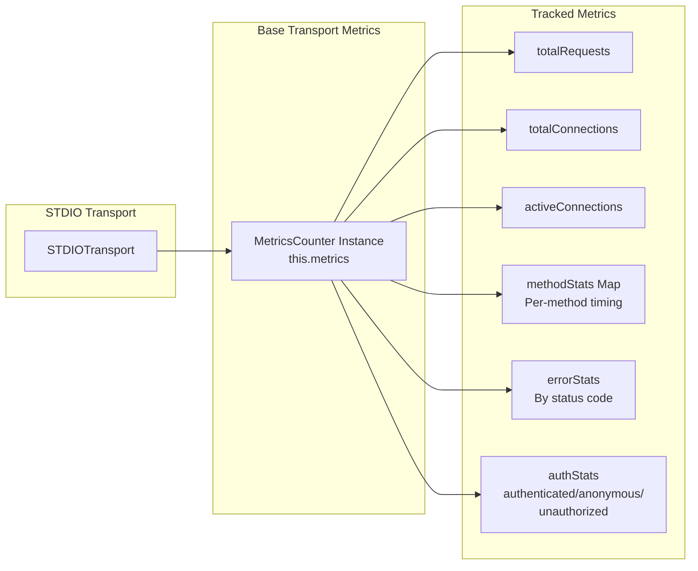

<!-- source: DeepWiki mcp.deepwiki.com · repo huggingface/hf-mcp-server · page 7.2 STDIO Transport · fetched 2026-10-26 -->

# STDIO Transport

<details>
<summary>Relevant source files</summary>

The following files were used as context for generating this wiki page:

- [.dockerignore](.dockerignore)
- [Dockerfile](Dockerfile)
- [README.md](README.md)
- [packages/app/src/server/transport/base-transport.ts](packages/app/src/server/transport/base-transport.ts)
- [packages/app/src/server/transport/stateless-http-transport.ts](packages/app/src/server/transport/stateless-http-transport.ts)
- [packages/app/vite.config.ts](packages/app/vite.config.ts)
- [packages/mcp/src/duplicate-space.ts](packages/mcp/src/duplicate-space.ts)
- [packages/mcp/src/error-messages.ts](packages/mcp/src/error-messages.ts)
- [start.sh](start.sh)

</details>


## Purpose and Scope

This document covers the STDIO (Standard Input/Output) transport implementation, which enables CLI-based clients to communicate with the MCP server through stdin/stdout pipes. This is one of four transport mechanisms supported by the system. For information about HTTP-based transports, see [HTTP Transports](#7.4). For information about SSE transport, see [SSE Transport](#7.3). For the base transport architecture, see [Base Transport Classes](#7.1).

## Overview

The STDIO transport implements the MCP protocol over standard input and output streams, making it suitable for command-line integration scenarios where the MCP server runs as a subprocess. Unlike HTTP-based transports, STDIO operates without a web server, communicating directly through process pipes.

**Key Characteristics:**

| Property | Value |
|----------|-------|
| **Communication** | stdin/stdout pipes |
| **Server Lifecycle** | Single long-lived instance |
| **Authentication** | Environment variables (`HF_TOKEN` or `DEFAULT_HF_TOKEN`) |
| **HTTP Server** | None |
| **Session Model** | Single persistent session |
| **Primary Clients** | Claude Code, Gemini CLI, other CLI tools |

The STDIO transport is particularly important for local development workflows and CLI-based AI assistants that spawn the MCP server as a child process.

**Sources:** [README.md:127-128](), [README.md:144](), [packages/app/src/server/transport/base-transport.ts:1-346]()

## Architecture Position



The STDIO transport sits at the CLI integration boundary, bridging subprocess communication with the MCP server core. Unlike stateful HTTP transports that extend `StatefulTransport`, STDIO extends `BaseTransport` directly since it doesn't require session management infrastructure.

**Sources:** [README.md:127-130](), [README.md:217-222](), [start.sh:34-37]()

## Initialization and Lifecycle

### Startup Sequence



The STDIO transport has a simpler lifecycle than HTTP transports because it manages only a single server instance for the lifetime of the process. The server is created during initialization and persists until the process terminates.

**Sources:** [start.sh:34-37](), [packages/app/src/server/transport/base-transport.ts:97-129]()

### Entry Point

The STDIO transport is launched via the `stdio.js` entry point, which is built from the source TypeScript:

```
packages/app/src/server/stdio.ts  →  compile  →  packages/app/dist/server/stdio.js
```

The entry point is invoked by the startup script:

[start.sh:35-37]()

**Sources:** [start.sh:1-58](), [README.md:144-146]()

## Authentication Model

### Environment-Based Token Resolution

```mermaid
graph LR
    subgraph "Environment Variables (Priority Order)"
        DEFAULT_HF["DEFAULT_HF_TOKEN<br/>(Explicit override)"]
        HF_TOKEN["HF_TOKEN<br/>(Standard token)"]
    end
    
    subgraph "Startup Logic"
        StartScript["start.sh<br/>Line 12-15"]
    end
    
    subgraph "Transport Layer"
        ValidateAuth["validateAuthAndTrackMetrics()<br/>base-transport.ts:305-345"]
        ExtractAuth["extractAuthBouquetAndMix()<br/>auth-utils.ts"]
    end
    
    subgraph "API Calls"
        WhoAmI["whoAmI() validation<br/>@huggingface/hub"]
        HFApi["Hugging Face API"]
    end
    
    subgraph "Metrics Tracking"
        AuthMetrics["Authentication Metrics<br/>- trackAuthenticatedConnection()<br/>- trackAnonymousConnection()<br/>- trackUnauthorizedConnection()"]
    end
    
    DEFAULT_HF -->|"Priority 1:<br/>If set"| StartScript
    HF_TOKEN -->|"Priority 2:<br/>If DEFAULT_HF_TOKEN not set<br/>in stdio mode"| StartScript
    
    StartScript -->|"Export DEFAULT_HF_TOKEN"| ValidateAuth
    ValidateAuth --> ExtractAuth
    ExtractAuth -->|"If token present"| WhoAmI
    WhoAmI --> HFApi
    HFApi -->|"200: Valid"| AuthMetrics
    HFApi -->|"401: Invalid"| AuthMetrics
    ExtractAuth -->|"No token"| AuthMetrics
```



The STDIO transport uses environment variables for authentication rather than HTTP headers. The startup script [start.sh:12-15]() implements special logic: if running in STDIO mode and `DEFAULT_HF_TOKEN` is not set, it copies `HF_TOKEN` to `DEFAULT_HF_TOKEN`.

**Token Validation:**

The `validateAuthAndTrackMetrics()` method [packages/app/src/server/transport/base-transport.ts:305-345]() validates tokens by calling the Hugging Face API's `whoAmI()` endpoint. This validation happens once at startup for STDIO, versus per-request for stateless HTTP.

**Metrics Tracked:**

| Condition | Metric Method |
|-----------|---------------|
| Valid token (200 from whoAmI) | `trackAuthenticatedConnection()` |
| Invalid token (401 from whoAmI) | `trackUnauthorizedConnection()` |
| No token provided | `trackAnonymousConnection()` |

**Security Note:**

The `DEFAULT_HF_TOKEN` environment variable should only be used in development/test environments or for local STDIO deployments, as stated in [README.md:241-242](). For production HTTP deployments, tokens should be provided via Authorization headers.

**Sources:** [start.sh:12-15](), [packages/app/src/server/transport/base-transport.ts:305-345](), [README.md:237-242]()

## Connection Model

### Single-Session Architecture

Unlike stateful HTTP transports that maintain a `Map<string, Session>` for multiple concurrent connections, the STDIO transport operates with a single, persistent server instance:



**No Session Management:**

The STDIO transport does not implement:
- Session ID generation
- Session maps or tracking
- Stale connection detection
- Heartbeat intervals
- Ping keep-alive mechanisms

These are handled by the `StatefulTransport` class [packages/app/src/server/transport/base-transport.ts:352-806](), which STDIO does not extend.

**`getActiveConnectionCount()` Implementation:**

For STDIO, this method returns either:
- `1` (if the server is running)
- `0` (if the server has been cleaned up)

This differs from HTTP transports which return the size of their session maps, or `STATELESS_MODE` (-1) for stateless HTTP [packages/app/src/server/transport/base-transport.ts:77-78]().

**Sources:** [packages/app/src/server/transport/base-transport.ts:352-806](), [packages/app/src/server/transport/base-transport.ts:113-122]()

## Request/Response Flow

### Message Processing Pipeline



**JSON-RPC Protocol:**

All communication follows the JSON-RPC 2.0 specification. Messages are newline-delimited JSON objects written to streams.

**Synchronous Processing:**

Unlike HTTP transports where multiple requests can be processed concurrently across sessions, STDIO processes requests sequentially on a single server instance. The MCP SDK's `StdioServerTransport` handles the stream reading/writing and message framing.

**No Session Context:**

Request handlers in STDIO mode cannot access:
- Session IDs
- Per-session state
- Client connection metadata (until after `initialize` is called)

This information is available in stateful HTTP transports via the session map [packages/app/src/server/transport/base-transport.ts:353]().

**Sources:** [packages/app/src/server/transport/base-transport.ts:192-223]()

## Configuration

### Environment Variables

The STDIO transport respects the following environment variables:

| Variable | Default | Description | Source |
|----------|---------|-------------|--------|
| `HF_TOKEN` | (none) | Standard Hugging Face authentication token | [README.md:242]() |
| `DEFAULT_HF_TOKEN` | (none) | Override token (inherits from `HF_TOKEN` in STDIO mode) | [start.sh:12-15]() |
| `PORT` | 3000 | Port for web dashboard (STDIO still launches dashboard) | [start.sh:8]() |
| `HF_API_TIMEOUT` | 12500 | Timeout for HF API requests (milliseconds) | [README.md:243]() |
| `USER_CONFIG_API` | (local) | URL for user settings service | [README.md:244]() |
| `SEARCH_ENABLES_FETCH` | false | Auto-enable `hf_doc_fetch` when `hf_doc_search` is enabled | [README.md:247]() |
| `AUTHENTICATE_TOOL` | (unset) | Include OAuth authentication tool | [README.md:246]() |

**STDIO-Specific Behavior:**

The startup script [start.sh:12-15]() implements special handling for STDIO:

```sh
if [ "$TRANSPORT" = "stdio" ] && [ -z "$DEFAULT_HF_TOKEN" ] && [ -n "$HF_TOKEN" ]; then
  export DEFAULT_HF_TOKEN="$HF_TOKEN"
fi
```

This ensures that the standard `HF_TOKEN` environment variable works correctly in STDIO mode.

**No Connection Management Variables:**

The following variables from [README.md:228-235]() do NOT apply to STDIO:
- `MCP_CLIENT_HEARTBEAT_INTERVAL`
- `MCP_CLIENT_CONNECTION_CHECK`
- `MCP_CLIENT_CONNECTION_TIMEOUT`
- `MCP_PING_ENABLED`
- `MCP_PING_INTERVAL`

These are only relevant for stateful transports (SSE and StreamableHTTP) that maintain session maps.

**Sources:** [README.md:237-248](), [start.sh:12-15](), [README.md:228-235]()

### Tool Selection

STDIO supports all tool selection mechanisms:



Since STDIO doesn't use HTTP requests, the "headers" for tool selection are constructed from environment variables or configuration files at startup. The tool selection logic is the same as HTTP transports (documented in [Tool Selection Strategy](#5.2)), but the input source differs.

**Sources:** [packages/app/src/server/transport/base-transport.ts:26-35]()

## Use Cases and Client Integration

### Claude Code Integration

Claude Code uses the STDIO transport to integrate with MCP servers. The installation command:

```bash
claude mcp add hf-mcp-server -t http https://huggingface.co/mcp?login
```

For authenticated access:

```bash
claude mcp add hf-mcp-server \
  -t http https://huggingface.co/mcp \
  -H "Authorization: Bearer <YOUR_HF_TOKEN>"
```

**Configuration Location:**

Claude Code stores MCP server configurations in its configuration file, which specifies how to spawn the subprocess and what environment variables to provide.

**Sources:** [README.md:24-40]()

### Gemini CLI Integration

Gemini CLI also supports STDIO transport:

```bash
gemini mcp add -t http huggingface https://huggingface.co/mcp?login
```

The Gemini CLI includes an extension system that bundles the MCP server with custom commands:

```bash
gemini extensions install https://github.com/huggingface/hf-mcp-server
gemini  # then run: /mcp auth huggingface
```

**Sources:** [README.md:45-65]()

### Local Development

For local testing and development, the STDIO transport can be started directly:

```bash
npx @llmindset/hf-mcp-server
```

This spawns the server in STDIO mode, reading JSON-RPC messages from stdin and writing responses to stdout. Developers can pipe input/output to test the protocol:

```bash
echo '{"jsonrpc":"2.0","method":"initialize",...}' | npx @llmindset/hf-mcp-server
```

**Sources:** [README.md:144]()

### Docker STDIO Deployment

STDIO mode can be run in Docker with interactive mode:

```bash
docker run -i --rm \
  -e TRANSPORT=stdio \
  -e DEFAULT_HF_TOKEN=hf_xxx \
  ghcr.io/evalstate/hf-mcp-server:latest
```

The `-i` flag is required to keep stdin open for the container. The `start.sh` script detects `TRANSPORT=stdio` and launches the appropriate entry point [start.sh:35-37]().

**Sources:** [README.md:210-213](), [start.sh:34-37]()

## Comparison with Other Transports

### Transport Comparison Matrix

| Feature | STDIO | SSE | StreamableHTTP | StatelessHTTP |
|---------|-------|-----|----------------|---------------|
| **Base Class** | `BaseTransport` | `StatefulTransport` | `StatefulTransport` | `BaseTransport` |
| **Server Instances** | Single | Per-session | Per-session | Per-request |
| **Communication** | stdin/stdout | HTTP SSE | HTTP streaming | HTTP POST |
| **Session Tracking** | None | Map-based | Map-based | Optional (analytics) |
| **Authentication** | Environment vars | HTTP headers | HTTP headers | HTTP headers |
| **Heartbeat** | No | Yes | Yes | No |
| **Stale Detection** | No | Yes | Yes | No |
| **Primary Use Case** | CLI tools | Legacy web clients | Modern web clients | Stateless/serverless |
| **Implementation** | `stdio-transport.ts` | `sse-transport.ts` | `streamable-http-transport.ts` | `stateless-http-transport.ts` |

**Key Architectural Differences:**

1. **Lifecycle Management:**
   - STDIO: Single server for process lifetime
   - Stateful (SSE/HTTP): Per-connection servers in session map
   - Stateless: New server for each request

2. **Connection Monitoring:**
   - STDIO: Relies on process signals
   - Stateful: Active monitoring via heartbeat/ping
   - Stateless: No monitoring needed

3. **Cleanup Strategy:**
   - STDIO: Process termination cleans up automatically
   - Stateful: Must track and clean up stale sessions [base-transport.ts:506-533]()
   - Stateless: Cleanup after each request [stateless-http-transport.ts:324-341]()

**Sources:** [packages/app/src/server/transport/base-transport.ts:82-346](), [packages/app/src/server/transport/base-transport.ts:352-806](), [packages/app/src/server/transport/stateless-http-transport.ts:39-555]()

### When to Use STDIO

**Choose STDIO when:**
- Building CLI tools or extensions
- Running MCP server as a subprocess
- Deploying locally on developer machines
- Integrating with tools that spawn child processes (Claude Code, Gemini CLI)
- Want simplest possible deployment (no HTTP server configuration)

**Choose HTTP transports when:**
- Multiple concurrent clients need to connect
- Running as a web service
- Need RESTful API access
- Want browser-based dashboard access
- Deploying to cloud environments
- Need stateless request handling for serverless

**Sources:** [README.md:123-136]()

## Metrics and Monitoring

### Metrics Collection

Despite operating without HTTP, the STDIO transport still collects metrics through the `MetricsCounter` class inherited from `BaseTransport`:



**Available Metrics Methods:**

From [packages/app/src/server/transport/base-transport.ts:148-280]():

- `trackRequest()` - Increment request counter
- `trackError(statusCode?, error?)` - Track errors by status code
- `trackNewConnection()` - Increment total connections
- `trackMethodCall(methodName, startTime, isError, clientInfo)` - Track method timing and success/failure
- `trackAuthenticatedConnection()` - Track authenticated requests
- `trackAnonymousConnection()` - Track requests without token
- `trackUnauthorizedConnection()` - Track invalid tokens

**Accessing Metrics:**

Even in STDIO mode, the web dashboard is available (by default on port 3000) and can display metrics:

```bash
npx @llmindset/hf-mcp-server  # STDIO server running
# In another terminal:
curl http://localhost:3000/api/transport-metrics
```

The dashboard polls `/api/transport-metrics` to display real-time statistics about the STDIO transport.

**Sources:** [packages/app/src/server/transport/base-transport.ts:83-130](), [packages/app/src/server/transport/base-transport.ts:148-280]()

---

