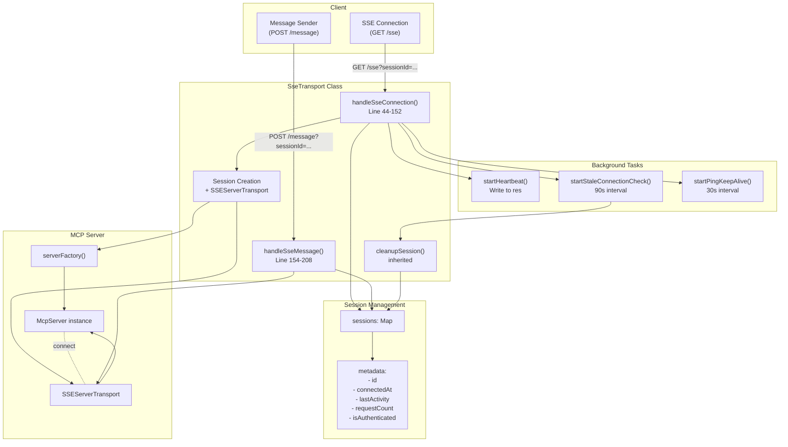
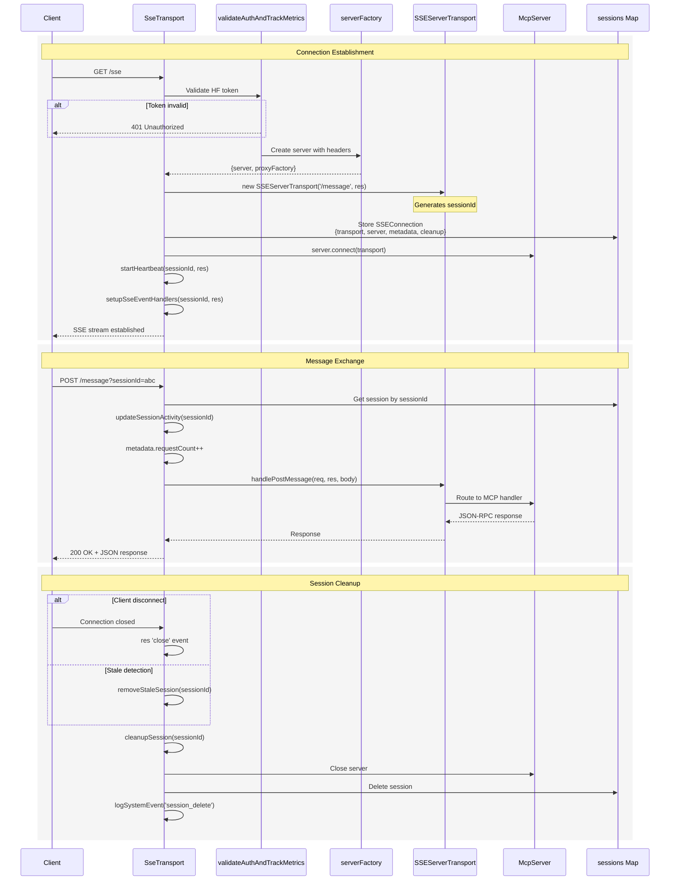
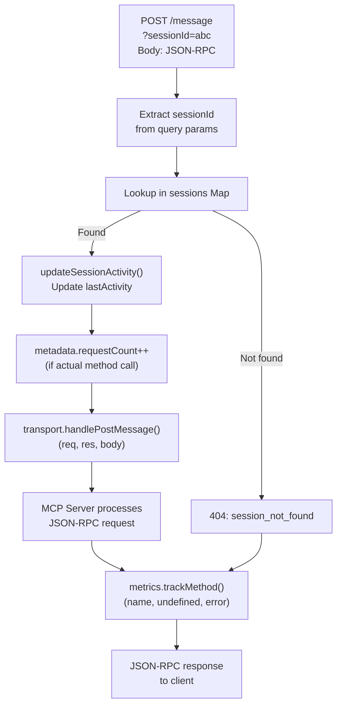
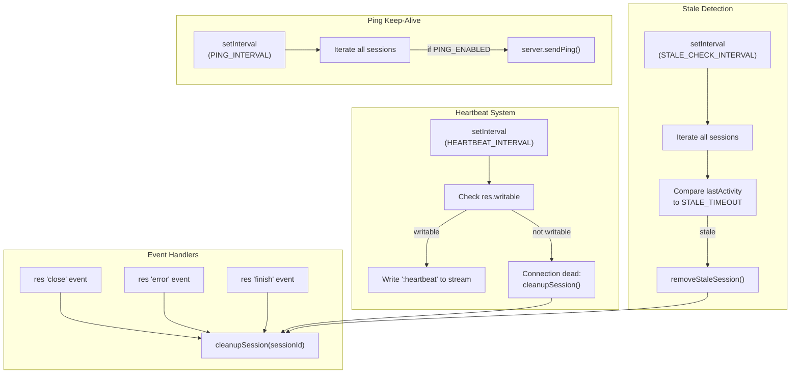

<!-- source: DeepWiki mcp.deepwiki.com · repo huggingface/hf-mcp-server · page 7.3 SSE Transport · fetched 2026-10-26 -->

# SSE Transport

<details>
<summary>Relevant source files</summary>

The following files were used as context for generating this wiki page:

- [.dockerignore](.dockerignore)
- [Dockerfile](Dockerfile)
- [README.md](README.md)
- [packages/app/src/server/transport/sse-transport.ts](packages/app/src/server/transport/sse-transport.ts)
- [packages/app/src/server/transport/streamable-http-transport.ts](packages/app/src/server/transport/streamable-http-transport.ts)
- [packages/app/vite.config.ts](packages/app/vite.config.ts)
- [packages/mcp/src/duplicate-space.ts](packages/mcp/src/duplicate-space.ts)
- [packages/mcp/src/error-messages.ts](packages/mcp/src/error-messages.ts)
- [start.sh](start.sh)

</details>


## Purpose and Scope

This document describes the Server-Sent Events (SSE) transport implementation used by the Hugging Face MCP Server for real-time, stateful client connections. The SSE transport maintains persistent sessions with clients through HTTP-based event streams and handles bidirectional communication via separate endpoints.

For information about the base transport abstractions that SSE extends, see [Base Transport Classes](#7.1). For comparison with other transport options, see [STDIO Transport](#7.2) and [HTTP Transports](#7.4).

**Note**: SSE transport is being deprecated in favor of StreamableHTTP but remains commonly deployed in production environments.

Sources: [packages/app/src/server/transport/sse-transport.ts:1-284](), [README.md:128-129]()

## Overview

The `SseTransport` class implements a stateful, session-based transport mechanism using Server-Sent Events for server-to-client communication and HTTP POST for client-to-server messages. It extends `StatefulTransport` to inherit session management, heartbeat monitoring, and stale connection detection capabilities.

### Key Characteristics

| Characteristic | Value |
|---------------|-------|
| Base Class | `StatefulTransport<SSEConnection>` |
| Session Model | Stateful with session ID tracking |
| Endpoints | `GET /sse` (event stream), `POST /message` (client messages) |
| Authentication | Per-session, validated on connection |
| Heartbeat | Enabled by default (30s interval) |
| Stale Detection | 90s check interval, 5min timeout |
| Use Cases | Desktop apps, persistent connections |

Sources: [packages/app/src/server/transport/sse-transport.ts:14-42](), [README.md:227-235]()

## Architecture and Data Flow



**SSE Transport Request Flow and Session Lifecycle**

This diagram maps the complete flow from client connection through message handling to session cleanup, showing how `SseTransport` coordinates between HTTP endpoints, session storage, and the underlying MCP server instance.

Sources: [packages/app/src/server/transport/sse-transport.ts:14-284]()

## Endpoints and Routing

The SSE transport exposes two HTTP endpoints that work together to enable bidirectional communication:

### Route Registration

The transport registers its routes during initialization:

```typescript
// GET /sse - Establishes SSE event stream
this.app.get('/sse', (req: Request, res: Response) => {
    this.trackRequest();
    void this.handleSseConnection(req, res);
});

// POST /message - Receives client messages
this.app.post('/message', (req: Request, res: Response) => {
    this.trackRequest();
    void this.handleSseMessage(req, res);
});
```

Sources: [packages/app/src/server/transport/sse-transport.ts:15-27]()

### Endpoint Details

| Endpoint | Method | Purpose | Headers/Query Params |
|----------|--------|---------|---------------------|
| `/sse` | GET | Establish SSE event stream | Query: `sessionId` (optional, for reconnect) |
| `/message` | POST | Send JSON-RPC messages to server | Query: `sessionId` (required) |

The `/sse` endpoint returns a persistent HTTP connection with `Content-Type: text/event-stream`, while `/message` accepts JSON-RPC payloads and returns JSON responses.

Sources: [packages/app/src/server/transport/sse-transport.ts:17-26](), [README.md:220]()

## Session Lifecycle



**SSE Session Lifecycle: Connection, Communication, and Cleanup**

This sequence diagram shows the three phases of an SSE session: establishing the connection with authentication and server creation, exchanging messages through the `/message` endpoint, and cleaning up when the connection ends or becomes stale.

Sources: [packages/app/src/server/transport/sse-transport.ts:44-152](), [packages/app/src/server/transport/sse-transport.ts:154-208](), [packages/app/src/server/transport/sse-transport.ts:236-244]()

## Connection Management

### Session Creation

When a client connects to `/sse`, the transport performs the following steps:

1. **Shutdown Check**: Rejects new connections if `isShuttingDown` is true
2. **Reconnection Handling**: If `sessionId` query parameter exists, cleans up old connection
3. **Authentication**: Validates HF token via `validateAuthAndTrackMetrics()`
4. **Server Creation**: Calls `serverFactory()` with request headers and session info
5. **Transport Instantiation**: Creates `SSEServerTransport` with `/message` endpoint
6. **Session Storage**: Stores `SSEConnection` object in `sessions` Map
7. **Connection Setup**: Establishes heartbeat, event handlers, and connects server to transport

Sources: [packages/app/src/server/transport/sse-transport.ts:44-152]()

### SSEConnection Interface

The session object stored in the `sessions` Map has the following structure:

```typescript
interface SSEConnection extends BaseSession<SSEServerTransport> {
    cleanup: () => Promise<void>;
}

// Where BaseSession includes:
interface BaseSession<T> {
    transport: T;                    // SSEServerTransport instance
    server: McpServer;               // MCP server instance
    metadata: {
        id: string;                  // Session ID
        connectedAt: Date;           // Connection timestamp
        lastActivity: Date;          // Last message timestamp
        requestCount: number;        // Total requests processed
        isAuthenticated: boolean;    // Has valid HF token
        capabilities: object;        // Client capabilities
    };
    cleaningUp: boolean;            // Cleanup in progress flag
}
```

Sources: [packages/app/src/server/transport/sse-transport.ts:10-12](), [packages/app/src/server/transport/base-transport.ts:44-66]()

### Reconnection Behavior

When a client attempts to reconnect with an existing `sessionId`:

1. The transport checks if the session still exists in `sessions` Map
2. If found, it logs a warning with session age and cleans up the old connection
3. If not found, it tracks a failed resume metric
4. A new session is always created for the reconnection attempt

This prevents duplicate sessions while allowing graceful reconnection after temporary network issues.

Sources: [packages/app/src/server/transport/sse-transport.ts:54-75]()

## Message Handling

### POST /message Endpoint

The `/message` endpoint handles all client-to-server communication after the SSE connection is established:



**Message Handling Flow in POST /message Endpoint**

The flow shows how each message updates session state before being processed by the MCP server through the `SSEServerTransport`.

Sources: [packages/app/src/server/transport/sse-transport.ts:154-208]()

### Request Tracking

The transport tracks method calls without timing information (unlike stateless mode) because stateful transports measure HTTP dispatch time rather than MCP processing time:

```typescript
// Track method call without timing
this.metrics.trackMethod(trackingName, undefined, false);
```

This is consistent across both SSE and StreamableHTTP transports.

Sources: [packages/app/src/server/transport/sse-transport.ts:193-194]()

### Error Handling

The message handler provides specific error responses for common failure cases:

| Error Code | Condition | Response |
|-----------|-----------|----------|
| 400 | Missing `sessionId` query parameter | `JsonRpcErrors.invalidParams()` |
| 404 | Session ID not found in Map | `JsonRpcErrors.sessionNotFound()` |
| 500 | Exception during message processing | `JsonRpcErrors.internalError()` |

Sources: [packages/app/src/server/transport/sse-transport.ts:160-177](), [packages/app/src/server/transport/sse-transport.ts:197-206]()

## Heartbeat and Stale Detection

The SSE transport inherits stateful connection management from `StatefulTransport` and configures three monitoring mechanisms:

### Configuration Parameters

The following environment variables control SSE connection health:

| Environment Variable | Default | Purpose |
|---------------------|---------|---------|
| `MCP_CLIENT_HEARTBEAT_INTERVAL` | 30000ms | Heartbeat write frequency |
| `MCP_CLIENT_CONNECTION_CHECK` | 90000ms | Stale session check interval |
| `MCP_CLIENT_CONNECTION_TIMEOUT` | 300000ms (5min) | Session inactivity timeout |
| `MCP_PING_ENABLED` | true | Enable ping keep-alive |
| `MCP_PING_INTERVAL` | 30000ms | Ping cycle interval |

These are logged at initialization time.

Sources: [packages/app/src/server/transport/sse-transport.ts:28-40](), [README.md:227-235]()

### Monitoring Mechanisms



**Three-Layer Connection Monitoring System**

This diagram shows how SSE transport monitors connection health through heartbeats (detect dead connections), stale detection (timeout inactive sessions), and ping keep-alive (maintain session state), along with event-driven cleanup.

Sources: [packages/app/src/server/transport/sse-transport.ts:28-42](), [packages/app/src/server/transport/base-transport.ts:325-368](), [packages/app/src/server/transport/base-transport.ts:370-407]()

### Heartbeat Implementation

The heartbeat is started per-session when the SSE connection is established:

```typescript
this.startHeartbeat(sessionId, res);
```

The `startHeartbeat()` method (inherited from `StatefulTransport`) writes a comment to the SSE stream periodically and checks if the response is still writable. If not, it triggers session cleanup.

Sources: [packages/app/src/server/transport/sse-transport.ts:137](), [packages/app/src/server/transport/base-transport.ts:325-368]()

### Stale Session Removal

The `removeStaleSession()` method is called by the background stale checker when a session exceeds the timeout:

```typescript
protected async removeStaleSession(sessionId: string): Promise<void> {
    logger.info({ sessionId }, 'Removing stale SSE connection');
    await this.cleanupSession(sessionId);
    
    logSystemEvent('session_delete', sessionId, {
        clientSessionId: sessionId,
    });
}
```

This ensures sessions that have stopped sending messages (but haven't closed the connection) are eventually cleaned up.

Sources: [packages/app/src/server/transport/sse-transport.ts:236-244]()

## Cleanup and Shutdown

### Session Cleanup

Session cleanup is triggered by multiple events:

1. **Client Disconnect**: SSE response `close`, `error`, or `finish` events
2. **Stale Detection**: Session inactive beyond `MCP_CLIENT_CONNECTION_TIMEOUT`
3. **Manual Closure**: `closeConnection()` method call
4. **Shutdown**: `cleanup()` method during server shutdown

The cleanup process:

```typescript
// Inherited cleanupSession() performs:
// 1. Check if already cleaning up (prevents double cleanup)
// 2. Mark session as cleaningUp = true
// 3. Clear heartbeat timer
// 4. Close MCP server
// 5. Close transport
// 6. Delete from sessions Map
// 7. Track session removal metrics
```

Sources: [packages/app/src/server/transport/sse-transport.ts:236-244](), [packages/app/src/server/transport/sse-transport.ts:265-283](), [packages/app/src/server/transport/base-transport.ts:417-475]()

### Global Cleanup

During server shutdown, the `cleanup()` method:

1. Stops the stale connection checker using `stopStaleConnectionCheck()`
2. Calls `cleanupAllSessions()` to close all active sessions
3. Logs completion

```typescript
async cleanup(): Promise<void> {
    logger.info(
        {
            activeConnections: this.sessions.size,
        },
        'Starting SSE transport cleanup'
    );

    this.stopStaleConnectionCheck();
    await this.cleanupAllSessions();

    logger.info('SSE transport cleanup completed');
}
```

Sources: [packages/app/src/server/transport/sse-transport.ts:246-261]()

### Force Close API

The `closeConnection()` method provides a programmatic way to terminate a specific session:

```typescript
async closeConnection(sessionId: string): Promise<boolean> {
    const session = this.sessions.get(sessionId);
    if (!session) {
        return false;
    }

    try {
        await this.cleanupSession(sessionId);
        logSystemEvent('session_delete', sessionId, {
            clientSessionId: sessionId,
        });
        return true;
    } catch (error) {
        logger.error({ error, sessionId }, 'Error closing connection');
        return false;
    }
}
```

This is used during reconnection attempts to clean up old sessions before establishing new ones.

Sources: [packages/app/src/server/transport/sse-transport.ts:266-283]()

## Integration with Base Classes

The SSE transport leverages significant functionality from its parent classes:

### From StatefulTransport

- `sessions: Map<string, SSEConnection>` - Session storage
- `startStaleConnectionCheck()` / `stopStaleConnectionCheck()` - Background monitoring
- `startPingKeepAlive()` - Session ping support
- `cleanupSession(sessionId)` - Individual session cleanup
- `cleanupAllSessions()` - Bulk cleanup during shutdown
- `updateSessionActivity(sessionId)` - Activity timestamp updates
- `setupSseEventHandlers(sessionId, res)` - Response event listeners
- `startHeartbeat(sessionId, res)` - Heartbeat monitoring

Sources: [packages/app/src/server/transport/base-transport.ts:73-475]()

### From BaseTransport

- `trackRequest()` - Request counting
- `trackError(statusCode?, error?)` - Error metrics
- `trackSessionCreated(sessionId)` - Session creation metrics
- `validateAuthAndTrackMetrics(headers)` - Authentication with metrics
- `extractMethodForTracking(body)` - Extract method name from JSON-RPC
- `serverFactory()` - Create MCP server instances
- `metrics` - Metrics collector instance
- `createClientInfoCapture(sessionId)` - Client info tracking

Sources: [packages/app/src/server/transport/base-transport.ts:109-311]()

## Comparison with Other Transports

| Feature | SSE | StreamableHTTP | STDIO |
|---------|-----|----------------|-------|
| Statefulness | Stateful | Stateful | Single session |
| Endpoints | `/sse` + `/message` | `/mcp` (POST/GET/DELETE) | stdin/stdout |
| Session tracking | Query param `sessionId` | Header `mcp-session-id` | N/A |
| Heartbeat | Yes | Yes | No |
| Use case | Legacy support | Modern web clients | CLI tools |
| Deprecation | Being deprecated | Recommended | Active |

The SSE transport is functionally similar to StreamableHTTP but uses separate endpoints for the event stream and messages, whereas StreamableHTTP unifies everything under `/mcp` with different HTTP methods.

Sources: [packages/app/src/server/transport/sse-transport.ts:1-284](), [packages/app/src/server/transport/streamable-http-transport.ts:1-314](), [README.md:127-134]()

---

