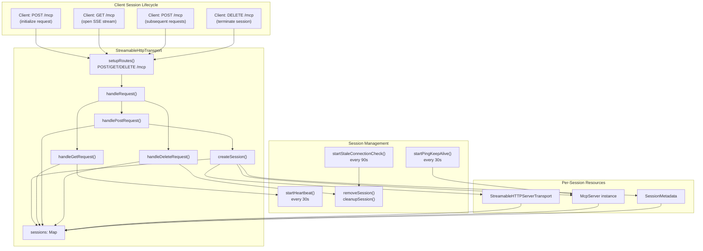
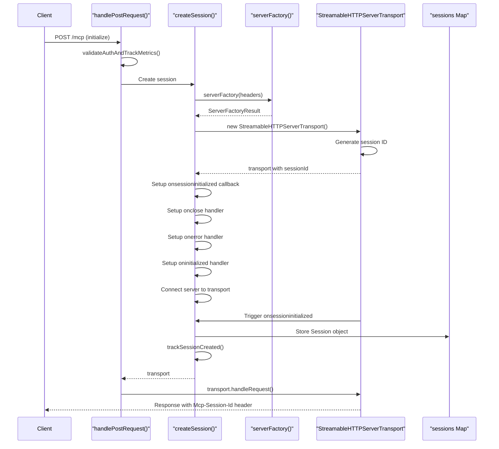
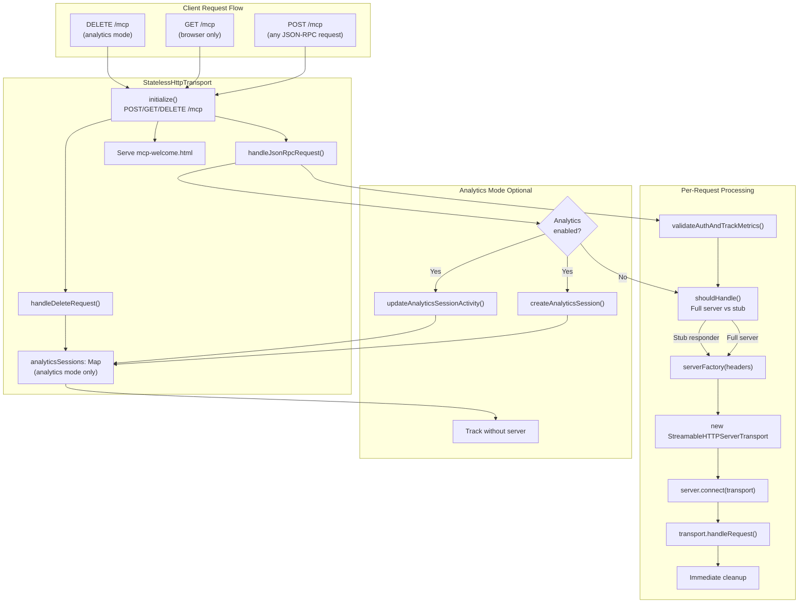
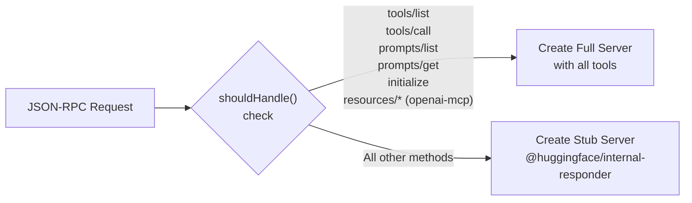
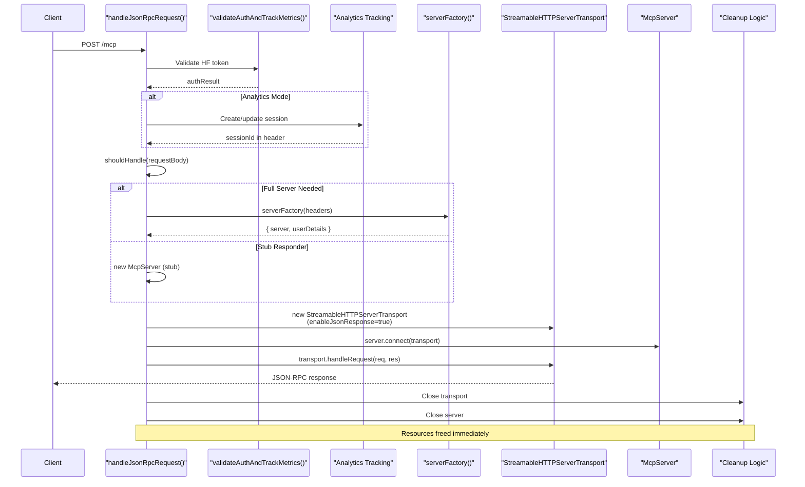

<!-- source: DeepWiki mcp.deepwiki.com · repo huggingface/hf-mcp-server · page 7.4 HTTP Transports · fetched 2026-10-26 -->

# HTTP Transports

<details>
<summary>Relevant source files</summary>

The following files were used as context for generating this wiki page:

- [packages/app/src/server/transport/base-transport.ts](packages/app/src/server/transport/base-transport.ts)
- [packages/app/src/server/transport/sse-transport.ts](packages/app/src/server/transport/sse-transport.ts)
- [packages/app/src/server/transport/stateless-http-transport.ts](packages/app/src/server/transport/stateless-http-transport.ts)
- [packages/app/src/server/transport/streamable-http-transport.ts](packages/app/src/server/transport/streamable-http-transport.ts)

</details>


This document covers the two HTTP transport implementations in the HF MCP Server: `StreamableHttpTransport` and `StatelessHttpTransport`. These transports enable web-based clients to connect to the MCP server using standard HTTP protocols. For information about the base transport classes and shared functionality, see [Base Transport Classes](#7.1). For information about the SSE transport which uses a different protocol pattern, see [SSE Transport](#7.3).

## Overview

The HF MCP Server provides two distinct HTTP transport implementations that serve different use cases:

- **StreamableHttpTransport** ([packages/app/src/server/transport/streamable-http-transport.ts]()): A stateful transport that maintains persistent sessions across multiple HTTP requests, suitable for interactive clients
- **StatelessHttpTransport** ([packages/app/src/server/transport/stateless-http-transport.ts]()): A stateless transport that creates fresh server instances per request, with optional analytics session tracking

Both transports use the MCP SDK's `StreamableHTTPServerTransport` internally but differ in their session management strategy and lifecycle.

Sources: [packages/app/src/server/transport/streamable-http-transport.ts:1-18](), [packages/app/src/server/transport/stateless-http-transport.ts:1-39]()

## Transport Comparison

### Feature Matrix

| Feature | StreamableHttpTransport | StatelessHttpTransport |
|---------|------------------------|------------------------|
| **Base Class** | `StatefulTransport` | `BaseTransport` |
| **Session Persistence** | Yes, across requests | No (per-request) |
| **Server Instance** | One per session | One per request |
| **HTTP Methods** | POST, GET, DELETE | POST, DELETE (analytics only) |
| **GET Endpoint** | SSE streaming | Static welcome page |
| **Session Tracking** | Always enabled | Optional (analytics mode) |
| **Memory Footprint** | Higher (persistent servers) | Lower (ephemeral servers) |
| **Stale Detection** | Active monitoring | None |
| **Ping Keep-Alive** | Supported | Not applicable |
| **Best For** | IDEs, interactive clients | Stateless integrations, high volume |

Sources: [packages/app/src/server/transport/streamable-http-transport.ts:18](), [packages/app/src/server/transport/stateless-http-transport.ts:39]()

## StreamableHttpTransport (Stateful)

### Architecture



Sources: [packages/app/src/server/transport/streamable-http-transport.ts:18-61](), [packages/app/src/server/transport/streamable-http-transport.ts:223-288]()

### Route Structure

The `StreamableHttpTransport` registers three routes on the `/mcp` endpoint:

**POST /mcp** - Request handling
- Creates new sessions (on initialize request with no session ID)
- Routes requests to existing sessions
- Validates session ID presence for non-initialize requests
- Rejects new connections during shutdown

**GET /mcp** - SSE streaming
- Opens Server-Sent Events stream for an existing session
- Requires `mcp-session-id` header
- Sets up heartbeat monitoring to detect stale connections
- Handles connection close/error events

**DELETE /mcp** - Session termination
- Explicitly terminates a session
- Cleans up transport and server resources
- Returns 404 if session not found

Sources: [packages/app/src/server/transport/streamable-http-transport.ts:37-61](), [packages/app/src/server/transport/streamable-http-transport.ts:63-90]()

### Session Creation Flow



Sources: [packages/app/src/server/transport/streamable-http-transport.ts:92-170](), [packages/app/src/server/transport/streamable-http-transport.ts:223-288]()

### Session Structure

The `StreamableHttpConnection` interface extends `BaseSession`:

```typescript
interface StreamableHttpConnection extends BaseSession<StreamableHTTPServerTransport> {
    activeResponse?: Response;
}
```

Each session contains:
- `transport`: `StreamableHTTPServerTransport` instance for this session
- `server`: `McpServer` instance with registered tools
- `metadata`: `SessionMetadata` with connection info, activity timestamps, request count
- `heartbeatInterval`: Timer for detecting stale SSE connections
- `activeResponse`: Current SSE response object (when GET endpoint is active)

Sources: [packages/app/src/server/transport/streamable-http-transport.ts:12-16]()

### Stale Connection Management

The stateful transport inherits comprehensive session health monitoring from `StatefulTransport`:

**Stale Checker** (every 90 seconds by default):
- Scans all sessions for inactivity
- Removes sessions with no activity for 10 minutes (default)
- Configurable via `MCP_CLIENT_CONNECTION_CHECK` and `MCP_CLIENT_CONNECTION_TIMEOUT`

**Heartbeat Monitor** (every 30 seconds):
- Checks if SSE response stream is still writable
- Detects client disconnects via `response.destroyed` or `response.writableEnded`
- Automatically cleans up abandoned connections

**Ping Keep-Alive** (every 30 seconds):
- Sends MCP ping messages to all sessions
- Updates `lastActivity` on successful ping
- Increments `pingFailures` counter on failure
- Removes sessions exceeding failure threshold

Sources: [packages/app/src/server/transport/base-transport.ts:360-533](), [packages/app/src/server/transport/streamable-http-transport.ts:19-35]()

## StatelessHttpTransport

### Architecture



Sources: [packages/app/src/server/transport/stateless-http-transport.ts:91-139](), [packages/app/src/server/transport/stateless-http-transport.ts:141-408]()

### Request Routing

The stateless transport provides three endpoints:

**POST /mcp** - JSON-RPC request handling
- Creates fresh server and transport for each request
- Validates auth with `validateAuthAndTrackMetrics()`
- Determines if full server is needed via `shouldHandle()`
- Supports analytics session tracking (optional)
- Immediate cleanup after response

**GET /mcp** - Static welcome page
- Serves `mcp-welcome.html` for browser clients only
- Returns 405 Method Not Allowed for non-browser clients or when `MCP_STRICT_COMPLIANCE=true`
- Redirects HTTP to HTTPS (except localhost)
- Not part of MCP protocol - UX enhancement

**DELETE /mcp** - Analytics session deletion
- Only available when `ANALYTICS_MODE=true`
- Removes session from analytics tracking
- Returns 404 if session not found
- Returns 405 if analytics disabled

Sources: [packages/app/src/server/transport/stateless-http-transport.ts:91-139](), [packages/app/src/server/transport/stateless-http-transport.ts:410-452]()

### Full Server vs Stub Responder

The `shouldHandle()` method optimizes resource usage by determining which requests need full MCP server initialization:



Methods requiring full server:
- `tools/list`, `tools/call`
- `prompts/list`, `prompts/get`
- `initialize`
- `resources/list`, `resources/read`, `resources/templates/list` (only for `openai-mcp` client)

All other requests (ping, completion, etc.) use a minimal stub responder created with `new McpServer({ name: '@huggingface/internal-responder', version: '0.0.1' })`.

Sources: [packages/app/src/server/transport/stateless-http-transport.ts:64-89](), [packages/app/src/server/transport/stateless-http-transport.ts:290-315]()

### Request Lifecycle



Sources: [packages/app/src/server/transport/stateless-http-transport.ts:141-408]()

### Analytics Mode

When `ANALYTICS_MODE=true`, the stateless transport maintains lightweight session tracking for metrics without persistent server instances:

**Session Initialization**:
- Client sends `initialize` request without `mcp-session-id` header
- Server generates new session ID and returns in `Mcp-Session-Id` response header
- Creates `AnalyticsSession` object: `{ transport: null, server: null, metadata }`

**Session Resumption**:
- Client includes `mcp-session-id` header in subsequent requests
- Server validates session exists and updates activity timestamp
- Returns 404 if session not found (client must reinitialize)

**Session Deletion**:
- Explicit: Client sends `DELETE /mcp` with session ID
- Implicit: No automatic cleanup (sessions persist indefinitely in map)

**Analytics Session Structure**:

```typescript
interface AnalyticsSession {
    transport: null;
    server: null;
    metadata: SessionMetadata;
}
```

The `transport` and `server` fields are always `null` because stateless mode doesn't maintain persistent connections. Only metadata is tracked for analytics purposes.

Sources: [packages/app/src/server/transport/stateless-http-transport.ts:25-30](), [packages/app/src/server/transport/stateless-http-transport.ts:46-59](), [packages/app/src/server/transport/stateless-http-transport.ts:165-245](), [packages/app/src/server/transport/stateless-http-transport.ts:410-452](), [packages/app/src/server/transport/stateless-http-transport.ts:495-528]()

### Temporary Session Resume Logging

The stateless transport includes a diagnostic feature for debugging session resume failures:

**Configuration**:
- `TEMPLOG_MAX`: Maximum number of failures to log (default: 0, disabled)
- Activated via `activateTempLogging(count)` method

**What Gets Logged**:
- Session ID that failed to resume
- Request headers (user-agent, origin, x-forwarded-for, etc.)
- HF token presence (last 5 characters only for security)
- Method being called
- Active session count

**Auto-Disable**:
- Counter decrements with each logged failure
- Automatically disables when counter reaches zero

This feature helps diagnose production issues where clients are failing to resume sessions, without the overhead of always-on verbose logging.

Sources: [packages/app/src/server/transport/stateless-http-transport.ts:42-59](), [packages/app/src/server/transport/stateless-http-transport.ts:196-232](), [packages/app/src/server/transport/stateless-http-transport.ts:535-554]()

## Transport Selection and Configuration

### Environment Variables

Both HTTP transports respect common configuration:

| Variable | Default | Description |
|----------|---------|-------------|
| `ANALYTICS_MODE` | `false` | Enable session tracking in stateless mode |
| `MCP_STRICT_COMPLIANCE` | `false` | Reject GET requests to /mcp (return 405) |
| `TEMPLOG_MAX` | `0` | Max session resume failures to log (stateless only) |

**Stateful Transport Only**:

| Variable | Default | Description |
|----------|---------|-------------|
| `MCP_CLIENT_CONNECTION_CHECK` | `90000` | Stale check interval (ms) |
| `MCP_CLIENT_CONNECTION_TIMEOUT` | `600000` | Session timeout (ms) |
| `MCP_CLIENT_HEARTBEAT_INTERVAL` | `30000` | SSE heartbeat interval (ms) |
| `MCP_PING_ENABLED` | `true` | Enable ping keep-alive |
| `MCP_PING_INTERVAL` | `30000` | Ping interval (ms) |
| `MCP_PING_FAILURE_THRESHOLD` | `1` | Max ping failures before cleanup |

Sources: [packages/app/src/server/transport/base-transport.ts:360-365](), [packages/app/src/server/transport/stateless-http-transport.ts:48-49]()

### Use Cases

**StreamableHttpTransport** is ideal for:
- IDE integrations (VS Code, Cursor) that maintain long-lived connections
- Desktop applications that need persistent state
- Clients that benefit from SSE streaming for real-time updates
- Scenarios where session reuse reduces server initialization overhead

**StatelessHttpTransport** is ideal for:
- Web-based clients that don't maintain WebSocket connections
- Serverless deployments where persistent state is problematic
- High-volume scenarios where per-request isolation prevents resource leaks
- Analytics tracking without the overhead of persistent servers
- When strict HTTP statelessness is required for scaling/load balancing

Sources: [packages/app/src/server/transport/streamable-http-transport.ts:1-35](), [packages/app/src/server/transport/stateless-http-transport.ts:32-39]()

## Implementation Details

### Transport Creation in Stateless Mode

The `StreamableHTTPServerTransport` is configured differently for stateless mode:

```typescript
transport = new StreamableHTTPServerTransport({
    sessionIdGenerator: undefined,  // No session ID generation needed
    enableJsonResponse: directResponse  // true for built-in tools, false for Gradio streaming
});
```

The `directResponse` flag controls whether the transport buffers and returns a single JSON response or streams partial results. For Gradio tool calls (detected via `isGradioToolCall()`), direct response is disabled to allow progress notifications.

Sources: [packages/app/src/server/transport/stateless-http-transport.ts:311-322]()

### Transport Creation in Stateful Mode

The `StreamableHTTPServerTransport` is configured with session callbacks:

```typescript
transport = new StreamableHTTPServerTransport({
    sessionIdGenerator: () => randomUUID(),
    onsessioninitialized: (sessionId: string) => {
        // Create and store Session object
        // Track session creation
        // Log initialize event
    }
});
```

The `onsessioninitialized` callback is triggered by the SDK when the client's initialize request is processed, allowing the transport to create the session entry in its map.

Sources: [packages/app/src/server/transport/streamable-http-transport.ts:229-259]()

### Cleanup Patterns

**Stateful**: Cleanup is deferred and managed by lifecycle hooks
- Heartbeat intervals detect stale SSE connections
- Stale checker removes inactive sessions periodically
- Explicit DELETE request triggers immediate cleanup
- Transport `onclose` handler triggers session removal

**Stateless**: Cleanup is immediate after response
- Resources freed synchronously after `transport.handleRequest()` completes
- Exception: early client disconnect triggers cleanup via `res.on('close')` handler
- No background processes or timers
- In analytics mode, sessions persist in map but don't hold resources

Sources: [packages/app/src/server/transport/streamable-http-transport.ts:261-295](), [packages/app/src/server/transport/stateless-http-transport.ts:324-341]()

### Error Handling

Both transports implement comprehensive error tracking:

**Authentication Errors**:
- 401: Invalid HF token
- WWW-Authenticate header includes OAuth resource hint

**Session Errors**:
- 404: Session not found (stateful mode or analytics resume failure)
- 400: Missing session ID for non-initialize request

**Server Errors**:
- 500: Internal error during request processing
- 503: Server shutting down (stateful mode only)
- 405: Method not allowed (GET on stateless when MCP_STRICT_COMPLIANCE enabled)

All errors are tracked via `this.trackError(statusCode, error)` and returned as JSON-RPC error responses using utilities from `json-rpc-errors.ts`.

Sources: [packages/app/src/server/transport/streamable-http-transport.ts:83-90](), [packages/app/src/server/transport/stateless-http-transport.ts:157-162](), [packages/app/src/server/transport/stateless-http-transport.ts:365-407]()

### Metrics Integration

Both transports inherit metrics tracking from `BaseTransport`:

**Request Metrics**:
- `trackRequest()`: Count total requests received
- `trackNewConnection()`: Count new connections established
- `trackMethodCall()`: Track method execution time and errors

**Session Metrics** (stateful only):
- `trackSessionCreated()`: New session added to map
- `trackSessionDeleted()`: Session removed from map
- `trackSessionCleaned()`: Session cleanup completed
- `updateActiveConnections()`: Current session count

**Authentication Metrics**:
- `trackAuthenticatedConnection()`: Valid HF token provided
- `trackAnonymousConnection()`: No token provided
- `trackUnauthorizedConnection()`: Invalid token provided

The stateless transport also tracks `trackSessionResumeFailed()` when analytics mode is enabled and a client attempts to resume a non-existent session.

Sources: [packages/app/src/server/transport/base-transport.ts:148-185](), [packages/app/src/server/transport/base-transport.ts:576-601](), [packages/app/src/server/transport/stateless-http-transport.ts:192-196]()

---

