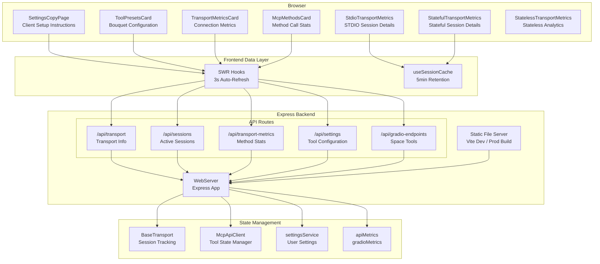
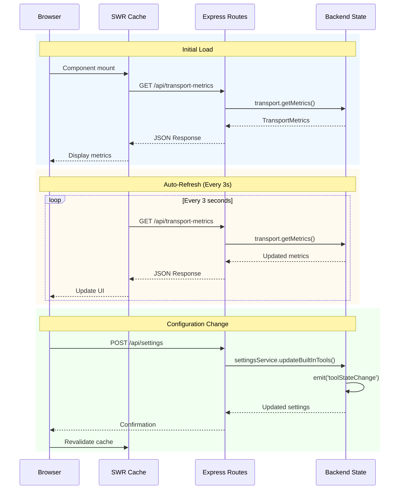
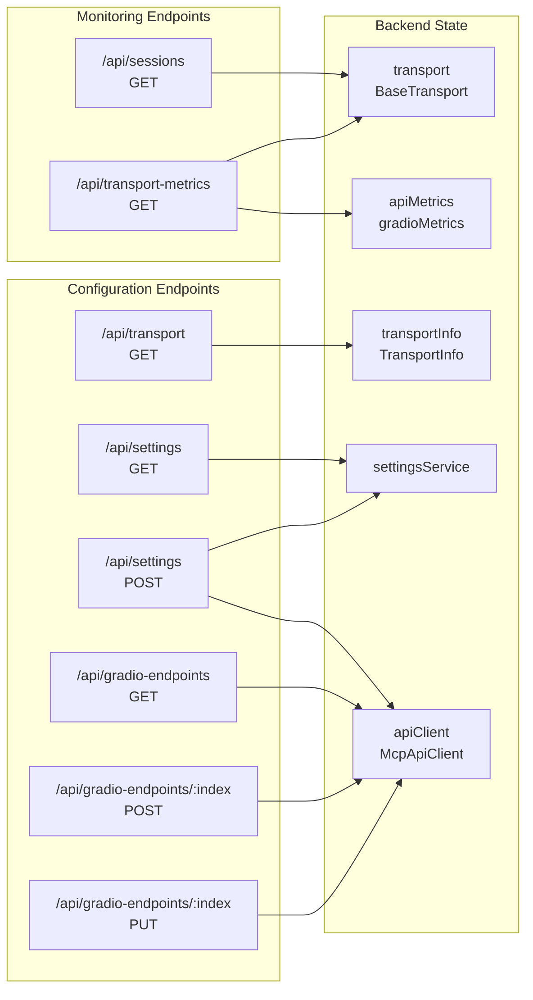
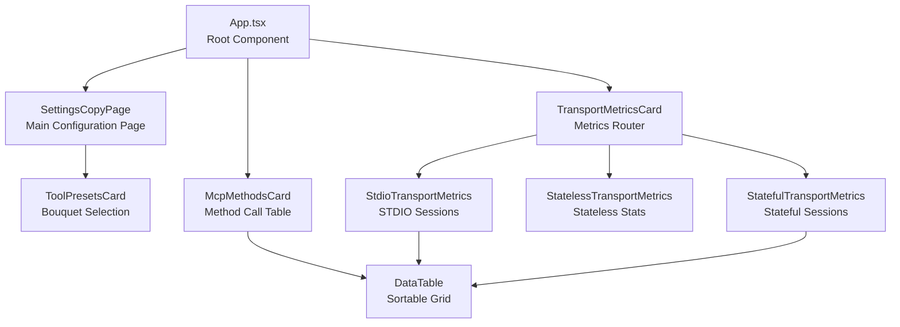
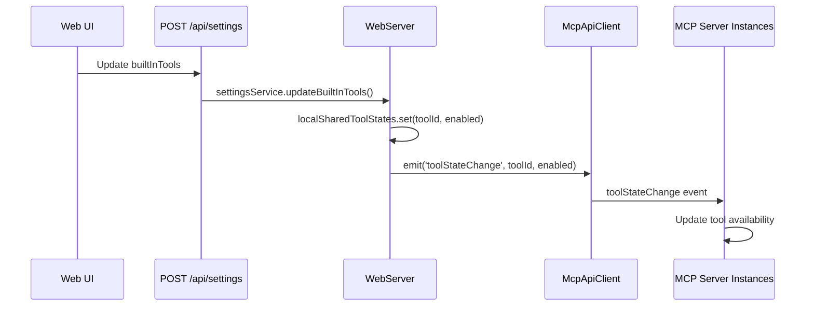

<!-- source: DeepWiki mcp.deepwiki.com · repo huggingface/hf-mcp-server · page 8 Web Interface · fetched 2026-10-26 -->

# Web Interface

<details>
<summary>Relevant source files</summary>

The following files were used as context for generating this wiki page:

- [packages/app/src/server/application.ts](packages/app/src/server/application.ts)
- [packages/app/src/server/utils/tool-selection-strategy.ts](packages/app/src/server/utils/tool-selection-strategy.ts)
- [packages/app/src/server/web-server.ts](packages/app/src/server/web-server.ts)
- [packages/app/src/shared/bouquet-presets.ts](packages/app/src/shared/bouquet-presets.ts)
- [packages/app/src/web/components/McpMethodsCard.tsx](packages/app/src/web/components/McpMethodsCard.tsx)
- [packages/app/src/web/components/SettingsCopyPage.tsx](packages/app/src/web/components/SettingsCopyPage.tsx)
- [packages/app/src/web/components/StdioTransportMetrics.tsx](packages/app/src/web/components/StdioTransportMetrics.tsx)
- [packages/app/src/web/components/TransportMetricsCard.tsx](packages/app/src/web/components/TransportMetricsCard.tsx)
- [packages/app/src/web/components/bouquets/ToolPresetsCard.tsx](packages/app/src/web/components/bouquets/ToolPresetsCard.tsx)
- [packages/app/src/web/components/data-table-utils.tsx](packages/app/src/web/components/data-table-utils.tsx)
- [packages/app/src/web/components/data-table.tsx](packages/app/src/web/components/data-table.tsx)
- [packages/app/src/web/hooks/useSessionCache.ts](packages/app/src/web/hooks/useSessionCache.ts)
- [packages/app/test/server/utils/tool-selection-strategy.test.ts](packages/app/test/server/utils/tool-selection-strategy.test.ts)

</details>


The Web Interface provides a browser-based dashboard for configuring the MCP server, setting up client connections, and monitoring real-time server metrics. It serves as the primary management interface for both configuration tasks (selecting tools, configuring Gradio endpoints) and operational visibility (viewing active sessions, tracking method call statistics).

For detailed information about API route implementation, see [Web Server and API Endpoints](#8.1). For client setup and tool configuration features, see [Configuration UI](#8.2). For metrics visualization and monitoring features, see [Monitoring Dashboard](#8.3).

---

## Purpose and Scope

The web interface serves three primary functions:

1. **Client Setup**: Provides platform-specific instructions and configuration examples for connecting Claude, VS Code, Cursor, Gemini CLI, and other MCP clients
2. **Tool Configuration**: Enables selection of built-in tools and Gradio Space endpoints through bouquet presets and custom configuration
3. **Real-time Monitoring**: Displays transport metrics, session status, method call statistics, and Gradio endpoint performance

The dashboard is accessible at `http://localhost:<port>` when the server is running and uses hot module replacement (HMR) in development mode for rapid iteration.

Sources: [packages/app/src/web/components/SettingsCopyPage.tsx:1-1143](), [packages/app/src/server/web-server.ts:1-491]()

---

## System Architecture

### Component Structure



**Diagram: Web Interface Component Architecture**

The web interface follows a traditional client-server architecture with React components on the frontend communicating with Express API routes on the backend. The `SWR` library handles data fetching with automatic 3-second refresh intervals, while the backend `WebServer` class coordinates access to transport state, settings, and metrics collectors.

Sources: [packages/app/src/web/components/SettingsCopyPage.tsx:1-50](), [packages/app/src/web/components/TransportMetricsCard.tsx:1-72](), [packages/app/src/web/components/McpMethodsCard.tsx:1-298](), [packages/app/src/server/web-server.ts:21-149]()

---

### Request Flow and Data Refresh



**Diagram: Data Flow and Refresh Cycle**

The frontend uses `useSWR` hooks with a 3-second refresh interval to poll API endpoints. Configuration changes trigger immediate updates via POST requests, followed by cache revalidation to reflect the new state. The `useSessionCache` hook retains disconnected session information for 5 minutes to provide visibility into recently terminated connections.

Sources: [packages/app/src/web/components/McpMethodsCard.tsx:36-40](), [packages/app/src/web/components/TransportMetricsCard.tsx:20-26](), [packages/app/src/web/hooks/useSessionCache.ts:23-111](), [packages/app/src/server/web-server.ts:381-413]()

---

## Web Server Implementation

### WebServer Class Structure

The `WebServer` class in [packages/app/src/server/web-server.ts:21-491]() manages the Express application lifecycle and coordinates access to backend state.

| Property | Type | Purpose |
|----------|------|---------|
| `app` | `Express` | Express application instance |
| `server` | `Server \| null` | HTTP server instance |
| `transportInfo` | `TransportInfo` | Transport configuration and status |
| `transport` | `BaseTransport` | Active transport for session access |
| `apiClient` | `McpApiClient` | Tool state management client |
| `localSharedToolStates` | `Map<string, boolean>` | Tool enable/disable tracking |

**Key Methods:**

- `setupMiddleware()` - Configures CORS, security headers, body parsing
- `setupApiRoutes()` - Registers API endpoints
- `setupStaticFiles()` - Configures Vite dev server or static file serving
- `start(port)` - Starts the HTTP server
- `initializeToolStates()` - Initializes tool state tracking

Sources: [packages/app/src/server/web-server.ts:21-149]()

---

### API Endpoint Mapping



**Diagram: API Route to Backend State Mapping**

Each API endpoint is implemented as an Express route handler in `setupApiRoutes()` and accesses specific backend state objects. Configuration endpoints modify state and emit events, while monitoring endpoints provide read-only access to current metrics.

Sources: [packages/app/src/server/web-server.ts:223-489]()

---

### API Endpoint Details

| Endpoint | Method | Purpose | Response Type |
|----------|--------|---------|---------------|
| `/api/transport` | GET | Returns transport type, port, token status | `TransportInfo` |
| `/api/sessions` | GET | Lists active and recent sessions | `SessionData[]` |
| `/api/transport-metrics` | GET | Method statistics, session details, Gradio metrics | `TransportMetricsResponse` |
| `/api/settings` | GET | Current built-in tools and space tools | `AppSettings` |
| `/api/settings` | POST | Updates tool configuration, emits events | `AppSettings` |
| `/api/gradio-endpoints` | GET | Lists configured Gradio Space endpoints | `GradioEndpoint[]` |
| `/api/gradio-endpoints/:index` | POST | Enables/disables a Gradio endpoint | `GradioEndpoint` |
| `/api/gradio-endpoints/:index` | PUT | Updates Gradio endpoint metadata | `GradioEndpoint` |

**Query Parameters:**

The `/api/transport-metrics` endpoint accepts an optional `?templog=<count>` parameter for stateless transports to temporarily enable session logging for debugging.

Sources: [packages/app/src/server/web-server.ts:225-489]()

---

## Frontend Components

### Component Hierarchy



**Diagram: React Component Hierarchy**

The UI is organized into three main sections: client setup instructions (`SettingsCopyPage`), transport metrics visualization (`TransportMetricsCard` with transport-specific child components), and method call statistics (`McpMethodsCard`). The `DataTable` component provides reusable sortable, filterable tables.

Sources: [packages/app/src/web/components/SettingsCopyPage.tsx:835-1143](), [packages/app/src/web/components/TransportMetricsCard.tsx:19-72](), [packages/app/src/web/components/McpMethodsCard.tsx:31-298]()

---

### Client Configuration Display

The `SettingsCopyPage` component [packages/app/src/web/components/SettingsCopyPage.tsx:835-1143]() provides client-specific setup instructions with collapsible configuration sections.

**Client Configurations:**

| Client ID | Name | Integration Method | Manual Config |
|-----------|------|-------------------|---------------|
| `claude` | Claude Desktop and Claude.ai | OAuth via connectors | N/A |
| `vscode` | Visual Studio Code | Deep link / settings.json | Bearer token in headers |
| `cursor` | Cursor | Deep link / mcp.json | Bearer token in headers |
| `lm-studio` | LM Studio | Deep link | Bearer token in headers |
| `gemini-cli` | Gemini CLI | CLI command | Extension install |
| `claude-code` | Claude Code | CLI command | Bearer token in headers |
| `codex-cli` | Codex CLI | config.toml | npx mcp-remote |

**Instruction Step Types:**

The `InstructionStep` interface [packages/app/src/web/components/SettingsCopyPage.tsx:28-33]() supports multiple step types:
- `text` - Plain text instructions
- `code` - Copyable code blocks
- `button` - Action buttons (copy, download, external link)
- `warning` - Warning messages with AlertTriangle icon
- `info` - Info messages with Info icon

Sources: [packages/app/src/web/components/SettingsCopyPage.tsx:28-833]()

---

### Tool Preset Configuration

The `ToolPresetsCard` component [packages/app/src/web/components/bouquets/ToolPresetsCard.tsx:141-226]() displays available bouquet presets organized by category.

**Bouquet Preset Structure:**

```typescript
interface BouquetPreset {
    key: BouquetKey;              // "search", "hf_api", "spaces", etc.
    label: string;                // Display name
    description: string;          // Purpose description
    category: 'core' | 'advanced';
    supportsBouquet: boolean;     // Can use ?bouquet= parameter
    supportsMix: boolean;         // Can use ?mix= parameter
    builtInTools: readonly string[];
    directParams?: DirectParamOption[];
}
```

**URL Generation:**

Each preset generates URLs with appropriate query parameters:
- **Bouquet Override**: `https://huggingface.co/mcp?login&bouquet=search`
- **Mix Mode**: `https://huggingface.co/mcp?login&mix=docs`
- **Direct Parameters**: `https://huggingface.co/mcp?login&no_image_content=true`

The component uses `describeConfigEntry()` [packages/app/src/shared/bouquet-presets.ts:260-282]() to map tool IDs to human-readable descriptions and distinguish between tools and behavior flags.

Sources: [packages/app/src/web/components/bouquets/ToolPresetsCard.tsx:1-227](), [packages/app/src/shared/bouquet-presets.ts:69-283]()

---

### Metrics Visualization

The metrics display system routes to transport-specific components based on the active transport type.

**Routing Logic:**

[packages/app/src/web/components/TransportMetricsCard.tsx:61-70]() implements conditional rendering:

```typescript
if (metrics.transport === 'stdio') {
    return <StdioTransportMetrics metrics={metrics} />;
}
if (metrics.isStateless) {
    return <StatelessTransportMetrics metrics={metrics} />;
}
return <StatefulTransportMetrics metrics={metrics} />;
```

**Session Display Features:**

The `useSessionCache` hook [packages/app/src/web/hooks/useSessionCache.ts:30-111]() maintains a 5-minute retention window for disconnected sessions:

1. **Active sessions** are updated continuously from API responses
2. **Disconnected sessions** are marked with `disconnectedAt` timestamp
3. **Expired sessions** (disconnected > 5 minutes) are removed via cleanup interval
4. **Connection status** is determined by recent activity and ping failures

| Status | Criteria |
|--------|----------|
| Connected | Activity within 5 minutes, no ping failures |
| Distressed | Recent activity but ≥1 ping failures |
| Disconnected | No activity within 5 minutes |

Sources: [packages/app/src/web/components/TransportMetricsCard.tsx:19-72](), [packages/app/src/web/hooks/useSessionCache.ts:1-112](), [packages/app/src/web/components/StdioTransportMetrics.tsx:1-181]()

---

### Method Call Statistics

The `McpMethodsCard` component [packages/app/src/web/components/McpMethodsCard.tsx:31-298]() displays detailed method call statistics with Gradio-specific enrichment.

**Data Processing Pipeline:**

1. **Fetch metrics** from `/api/transport-metrics` with SWR auto-refresh
2. **Enrich with Gradio data** by matching tool names to `gradioMetrics.byTool`
3. **Calculate combined error rates** including both transport and Gradio failures
4. **Filter optionally** to show only `tools/call` and `prompts/get` methods

**Column Definitions:**

| Column | Display | Sort Key |
|--------|---------|----------|
| Method | Colored syntax highlighting for tool/prompt calls | `method` |
| Calls | Total invocation count | `count` |
| Errors | Combined transport + Gradio errors in red | `errors` |
| Success/Failure | Gradio-specific success/failure breakdown | `gradioMetrics` |
| Error Rate | Percentage with red highlighting | `errorRate` |
| Avg Response | Milliseconds (stateless only) | `averageResponseTime` |
| Last Called | Relative time | `lastCalled` |

**Gradio Metrics Integration:**

[packages/app/src/web/components/McpMethodsCard.tsx:46-82]() merges Gradio metrics by extracting the tool name from `tools/call:toolName` and looking up corresponding success/failure counts in `metrics.gradioMetrics.byTool`.

Sources: [packages/app/src/web/components/McpMethodsCard.tsx:1-298]()

---

## Development and Production Modes

### Static File Serving

The `setupStaticFiles()` method [packages/app/src/server/web-server.ts:182-221]() configures different behaviors for development and production:

**Development Mode** (`NODE_ENV=development`):
- Creates Vite dev server with middleware mode
- Enables HMR (Hot Module Replacement)
- Serves from `packages/app/src/web` source directory
- Auto-rebuilds on file changes

**Production Mode**:
- Serves pre-built static files from `dist/web`
- Implements SPA fallback routing to `index.html`
- Skips fallback for `/api/*` routes

```typescript
if (isDevelopment) {
    const vite = await createViteServer({
        configFile: path.resolve(__dirname, '..', '..', '..', 'app', 'vite.config.ts'),
        server: { middlewareMode: true, hmr: true },
        appType: 'spa',
        root: rootDir,
    });
    this.app.use(vite.middlewares);
} else {
    const staticPath = path.join(__dirname, '..', 'web');
    this.app.use(express.static(staticPath));
    this.app.get('*', (req, res) => {
        if (!req.path.startsWith('/api/')) {
            res.sendFile(path.join(staticPath, 'index.html'));
        }
    });
}
```

Sources: [packages/app/src/server/web-server.ts:182-221]()

---

### CORS Configuration

CORS is configured in `setupMiddleware()` [packages/app/src/server/web-server.ts:39-115]() with support for exact-match allowlists and wildcard patterns:

**Supported Origin Formats:**
- **Exact match**: `https://huggingface.co`
- **Wildcard**: `*` (allows all origins)
- **Subdomain wildcard**: `https://*.use-mcp.dev` or `*.use-mcp.dev`

**Environment Override:**

The `CORS_ALLOWED_ORIGINS` environment variable accepts comma-separated origins:
```bash
CORS_ALLOWED_ORIGINS=https://example.com,https://*.custom-domain.com
```

**Exposed Headers:**

The `CORS_EXPOSED_HEADERS` constant [packages/app/src/shared/constants.ts]() defines which headers are accessible to client code. This includes custom MCP headers like `x-mcp-bouquet` and `x-mcp-gradio`.

Sources: [packages/app/src/server/web-server.ts:39-115]()

---

## Integration with Backend State

### Tool State Management

Tool state changes flow through the `WebServer` to all active MCP server instances via the `McpApiClient` event system.

**State Change Flow:**



**Diagram: Tool State Propagation**

When a user modifies tool settings through the web UI, the change is persisted to `settingsService` and broadcast to all connected MCP clients via the `toolStateChange` event. The `localSharedToolStates` map tracks previous states to avoid redundant event emissions.

Sources: [packages/app/src/server/web-server.ts:381-413]()

---

### Session Tracking Integration

Session data flows from the transport layer through the `WebServer` to the frontend via the `/api/sessions` endpoint.

**For STDIO Transport:**

[packages/app/src/server/web-server.ts:230-251]() includes special logic to update `stdioClient` info from session data:

```typescript
if (this.transportInfo.transport === 'stdio' && sessions.length > 0) {
    const stdioSession = sessions[0];
    if (stdioSession?.clientInfo && !this.transportInfo.stdioClient) {
        this.transportInfo.stdioClient = {
            name: stdioSession.clientInfo.name,
            version: stdioSession.clientInfo.version,
        };
    }
}
```

This ensures that client information is displayed in the UI even though STDIO doesn't maintain persistent HTTP sessions.

**For HTTP Transports:**

The `/api/sessions` endpoint calls `transport.getSessions()` which returns an array of session objects with:
- Session ID
- Connection timestamp
- Last activity timestamp
- Request count
- Client info (name, version)
- Connection status (Connected/Distressed/Disconnected)
- Ping statistics

Sources: [packages/app/src/server/web-server.ts:230-251]()

---

### Metrics Collection

The `/api/transport-metrics` endpoint [packages/app/src/server/web-server.ts:254-373]() aggregates data from multiple sources:

**Metrics Sources:**

| Source | Data Type | Purpose |
|--------|-----------|---------|
| `transport.getMetrics()` | Method call stats, session data | Transport-level metrics |
| `apiMetrics.getMetrics()` | External API call performance | API client metrics (external mode only) |
| `gradioMetrics.getMetrics()` | Gradio endpoint success/failure | Space tool execution metrics |
| `formatCacheMetricsForAPI()` | Cache hit rates, invalidations | Gradio subdomain cache performance |

**Response Structure:**

```typescript
interface TransportMetricsResponse {
    transport: TransportType;
    isStateless: boolean;
    uptimeSeconds: number;
    startupTime: string;
    sessions: SessionData[];
    methods: MethodMetric[];
    configuration?: TransportConfiguration;
    apiMetrics?: ApiMetricsData;
    gradioMetrics: GradioMetricsData;
    gradioCacheMetrics: CacheMetricsData;
    tempLogStatus?: TempLogStatus;  // Stateless only
}
```

The response is formatted by `formatMetricsForAPI()` [packages/app/src/shared/transport-metrics.ts]() which normalizes the structure across different transport types.

Sources: [packages/app/src/server/web-server.ts:254-373]()

---

## DataTable Component

The `DataTable` component [packages/app/src/web/components/data-table.tsx:35-163]() provides reusable table functionality with sorting, filtering, pagination, and column visibility controls.

**Props Interface:**

```typescript
interface DataTableProps<TData, TValue> {
    columns: ColumnDef<TData, TValue>[];
    data: TData[];
    searchColumn?: string;
    searchPlaceholder?: string;
    defaultColumnVisibility?: VisibilityState;
    pageSize?: number;
    defaultSorting?: SortingState;
}
```

**Features:**
- **TanStack Table**: Uses `@tanstack/react-table` for table state management
- **Column filtering**: Search box filters specified column
- **Column visibility**: Dropdown menu to show/hide columns
- **Sorting**: Click headers to toggle sort direction
- **Pagination**: Previous/Next buttons with configurable page size
- **Responsive**: Displays row count and page controls

**Sortable Headers:**

The `createSortableHeader()` utility [packages/app/src/web/components/data-table-utils.tsx:6-26]() generates header components with sort indicators:

```typescript
createSortableHeader(title: string, align?: 'left' | 'right' | 'center')
```

This displays chevron icons (▲/▼) to indicate current sort direction and allows click-to-sort functionality.

Sources: [packages/app/src/web/components/data-table.tsx:1-164](), [packages/app/src/web/components/data-table-utils.tsx:6-26]()

---

## Summary

The Web Interface provides a comprehensive dashboard for managing and monitoring the HF MCP Server through a React-based frontend and Express backend. Key capabilities include:

1. **Client Setup**: Platform-specific configuration instructions with copy-paste examples
2. **Tool Configuration**: Bouquet presets and direct URL parameter builders
3. **Real-time Monitoring**: Auto-refreshing metrics with 3-second polling intervals
4. **Session Tracking**: 5-minute retention window for disconnected sessions
5. **Gradio Integration**: Success/failure metrics merged into method call statistics

The architecture separates concerns cleanly with `WebServer` managing state access, React components handling presentation, and SWR providing efficient data fetching with automatic cache management. Development mode supports HMR for rapid iteration while production mode serves optimized static builds.

Sources: [packages/app/src/server/web-server.ts:1-491](), [packages/app/src/server/application.ts:99-170]()

---

