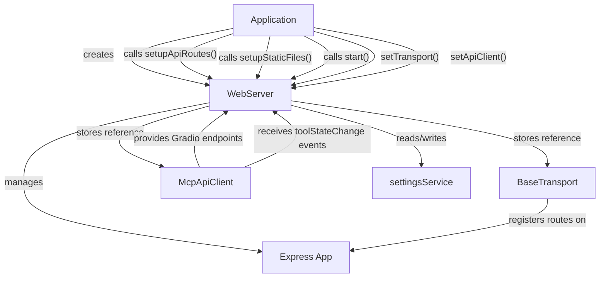
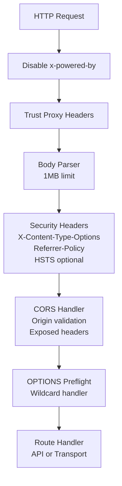
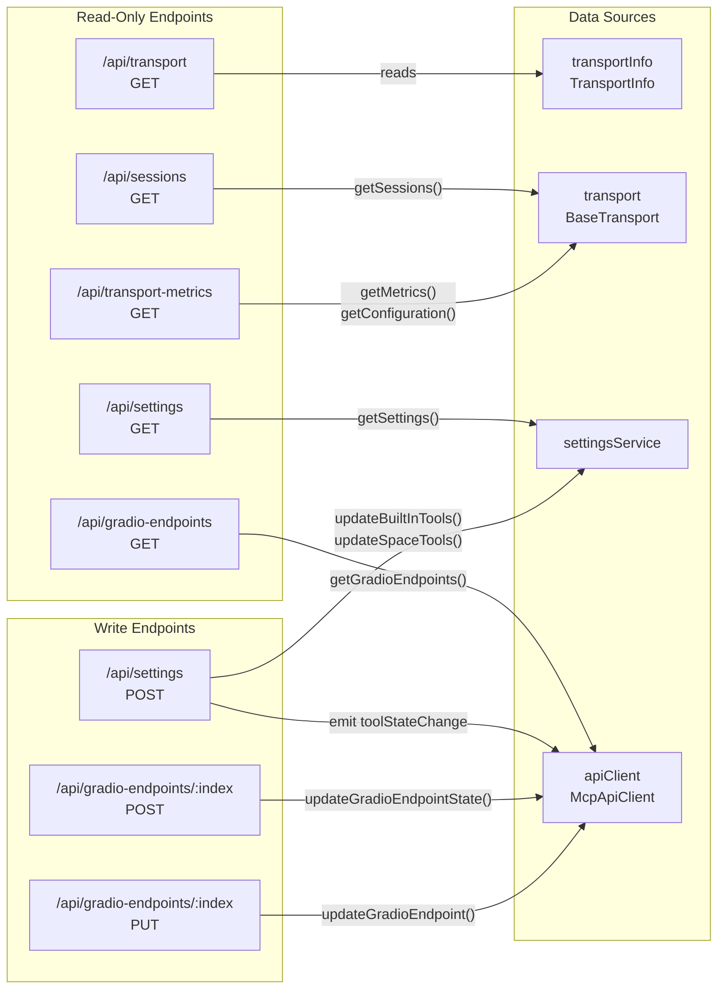
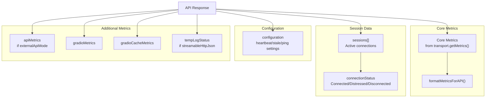
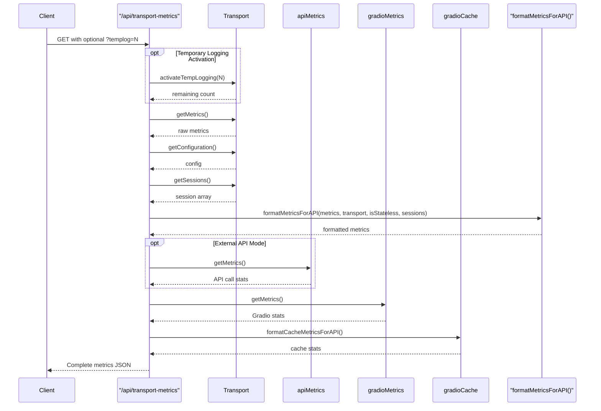
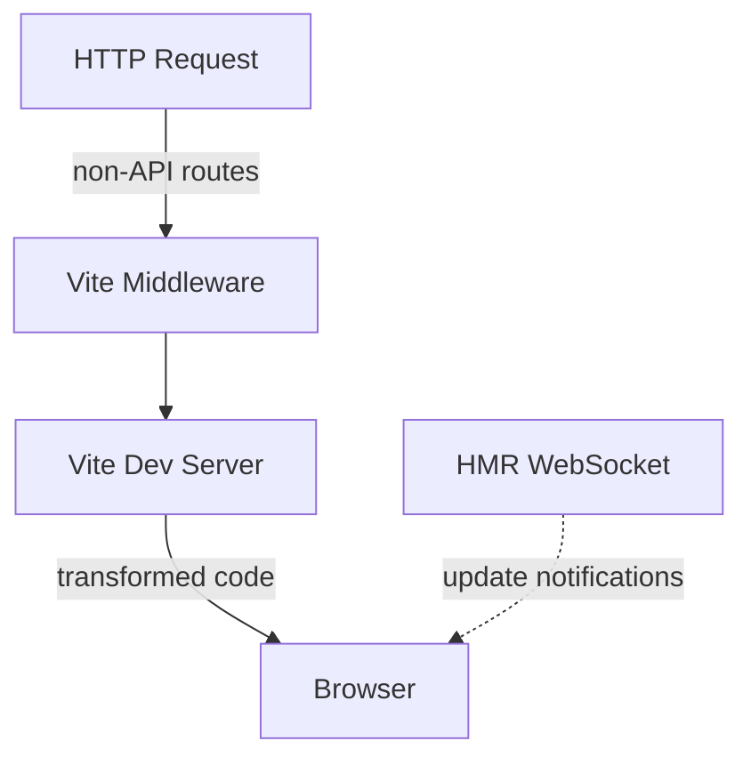
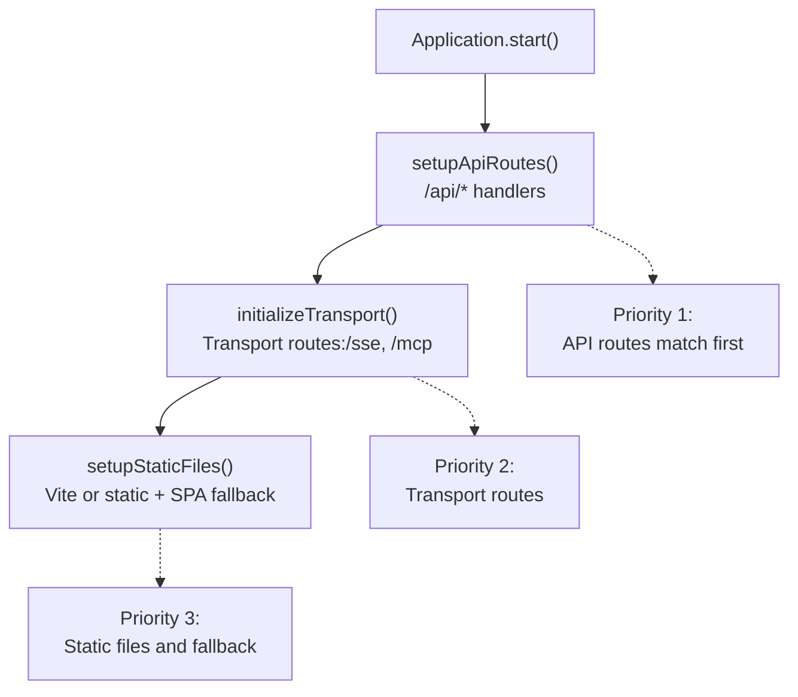
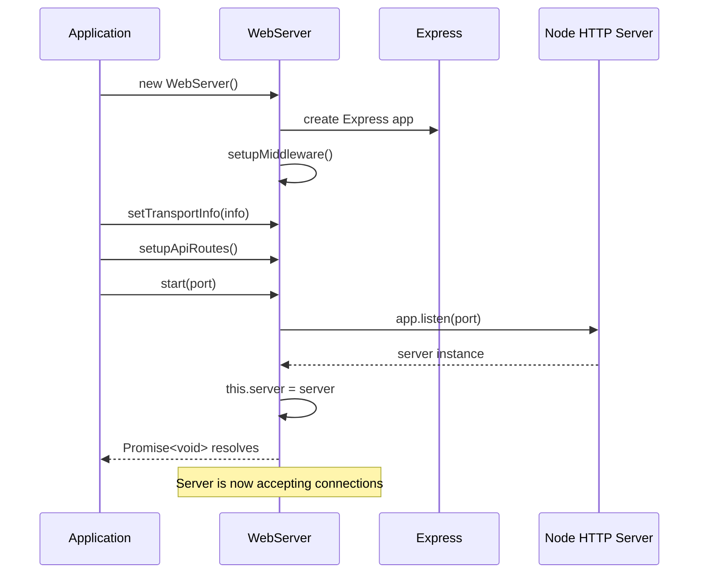
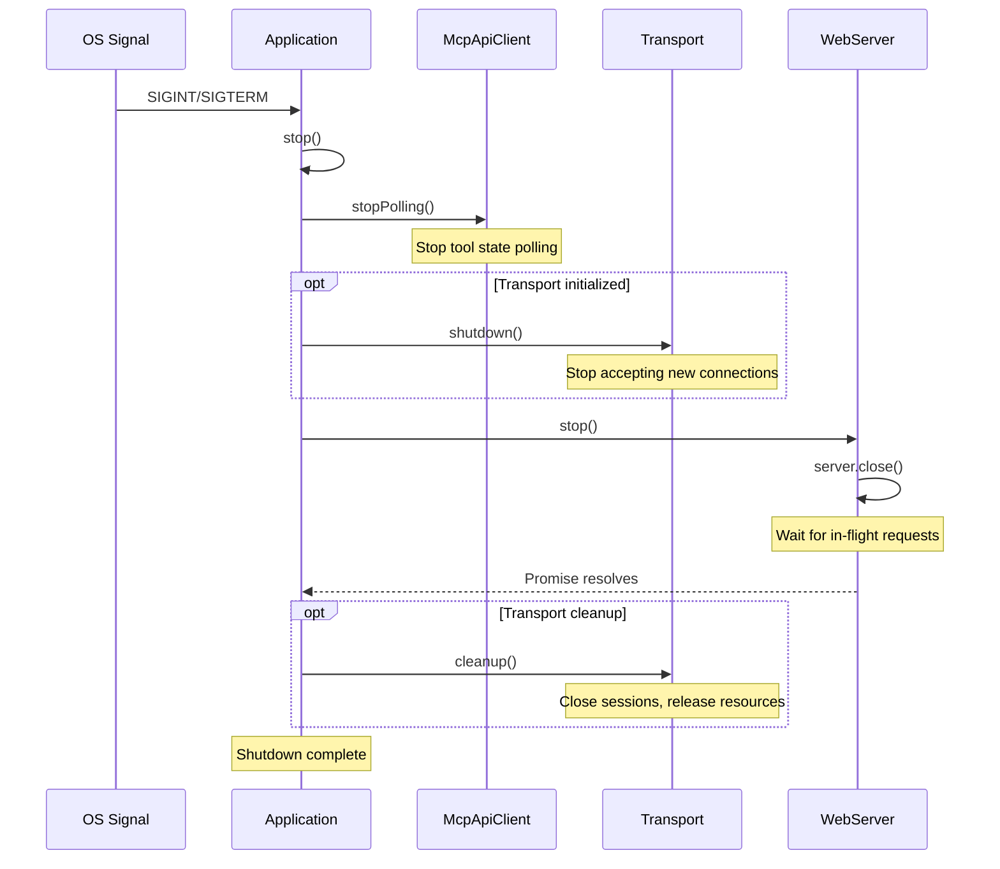

<!-- source: DeepWiki mcp.deepwiki.com · repo huggingface/hf-mcp-server · page 8.1 Web Server and API Endpoints · fetched 2026-10-26 -->

# Web Server and API Endpoints

<details>
<summary>Relevant source files</summary>

The following files were used as context for generating this wiki page:

- [packages/app/src/server/application.ts](packages/app/src/server/application.ts)
- [packages/app/src/server/web-server.ts](packages/app/src/server/web-server.ts)

</details>


## Purpose and Scope

This document describes the `WebServer` class and its Express-based HTTP server infrastructure, which serves three primary functions:

1. **API endpoints** for monitoring and configuration (transport metrics, sessions, settings)
2. **Static file serving** for the web dashboard UI
3. **Transport route registration** for MCP protocol communication

For information about the web UI components that consume these APIs, see [Configuration UI](#8.2) and [Monitoring Dashboard](#8.3). For details on the transport implementations that register routes on this server, see [Transport Layer Architecture](#3.4).

---

## WebServer Class Architecture

The `WebServer` class ([packages/app/src/server/web-server.ts:21-490]()) is the central HTTP server component that provides Express infrastructure for both the MCP protocol transports and the web dashboard.

### Core Responsibilities

| Responsibility | Description | Key Methods |
|----------------|-------------|-------------|
| **HTTP Server Management** | Creates and manages the Express app and HTTP server lifecycle | `start()`, `stop()`, `getApp()` |
| **Middleware Setup** | Configures CORS, security headers, body parsing | `setupMiddleware()` |
| **API Route Registration** | Exposes REST endpoints for monitoring and configuration | `setupApiRoutes()` |
| **Static File Serving** | Serves web UI in production, integrates Vite in development | `setupStaticFiles()` |
| **State Management** | Tracks transport info, tool states, and coordinates with ApiClient | `setTransportInfo()`, `setTransport()`, `setApiClient()` |

### Integration with Application Layer



**Sources:** [packages/app/src/server/web-server.ts:21-37](), [packages/app/src/server/application.ts:23-31]()

---

## Middleware Stack

The middleware is configured in the constructor via `setupMiddleware()` and processes all incoming requests before they reach route handlers.

### Middleware Execution Order



**Sources:** [packages/app/src/server/web-server.ts:39-115]()

### CORS Configuration

The CORS middleware supports three modes of origin validation:

| Mode | Configuration | Use Case |
|------|---------------|----------|
| **Wildcard** | `CORS_ALLOWED_ORIGINS="*"` | Development or public APIs |
| **Subdomain Wildcards** | `https://*.use-mcp.dev` | Multi-tenant deployments |
| **Exact Match** | `https://app.example.com` | Production with known origins |

The origin validation logic ([packages/app/src/server/web-server.ts:59-105]()):

1. Reads `CORS_ALLOWED_ORIGINS` environment variable (comma-separated)
2. Falls back to `CORS_ALLOWED_ORIGINS` constant from [packages/app/src/shared/constants.ts]()
3. Normalizes origins by removing trailing slashes
4. For patterns containing `*`, implements custom validation function
   - Supports leading wildcard: `*.domain.tld`
   - Validates scheme (http/https) if specified in pattern
   - Checks if request origin's hostname ends with the wildcard suffix

Example wildcard validation:
```
Pattern: "https://*.use-mcp.dev"
Matches: "https://demo.use-mcp.dev" ✓
Matches: "https://staging.use-mcp.dev" ✓
Rejects: "https://use-mcp.dev" ✗ (no subdomain)
Rejects: "http://demo.use-mcp.dev" ✗ (scheme mismatch)
```

Exposed headers are configured via `CORS_EXPOSED_HEADERS` constant ([packages/app/src/server/web-server.ts:14](), [packages/app/src/server/web-server.ts:109]()).

**Sources:** [packages/app/src/server/web-server.ts:57-115]()

### Security Headers

Basic security headers are applied to all responses ([packages/app/src/server/web-server.ts:46-53]()):

```
X-Content-Type-Options: nosniff
Referrer-Policy: no-referrer
Strict-Transport-Security: max-age=31536000; includeSubDomains (if HSTS=true)
```

The HSTS header is only added when `HSTS=true` environment variable is set, allowing deployment behind reverse proxies that handle TLS termination.

**Sources:** [packages/app/src/server/web-server.ts:46-53]()

### Body Parsing

JSON body parsing is configured with a 1MB limit to prevent abuse ([packages/app/src/server/web-server.ts:43]()):

```typescript
this.app.use(express.json({ limit: '1mb' }));
```

This limit applies to all POST/PUT requests to API and transport endpoints.

**Sources:** [packages/app/src/server/web-server.ts:43]()

---

## API Endpoints

All API endpoints are registered in `setupApiRoutes()` ([packages/app/src/server/web-server.ts:223-489]()) and use the `/api/` prefix to distinguish them from transport routes and static files.

### API Route Map



**Sources:** [packages/app/src/server/web-server.ts:223-489]()

### Transport Info Endpoint

**Route:** `GET /api/transport`

Returns the current transport configuration and server state.

**Response Schema:**
```typescript
{
  transport: 'stdio' | 'sse' | 'streamableHttp' | 'streamableHttpJson' | 'unknown',
  port?: number,
  defaultHfTokenSet: boolean,
  hfTokenMasked?: string,
  jsonResponseEnabled?: boolean,
  externalApiMode: boolean,
  stdioClient?: { name: string, version: string } | null
}
```

The `transportInfo` object is updated by the `Application` class during initialization and can be modified via `setTransportInfo()` and `setClientInfo()` methods.

**Sources:** [packages/app/src/server/web-server.ts:226-228](), [packages/app/src/server/web-server.ts:121-127](), [packages/app/src/server/web-server.ts:146-148]()

### Sessions Endpoint

**Route:** `GET /api/sessions`

Returns active MCP sessions from the transport layer. For STDIO transport, also updates `stdioClient` info in `transportInfo` if available.

**Response:** Array of session objects from `transport.getSessions()`

**Special Behavior for STDIO:** If a STDIO session exists and contains `clientInfo`, it's copied to `transportInfo.stdioClient` ([packages/app/src/server/web-server.ts:240-248]()).

**Sources:** [packages/app/src/server/web-server.ts:231-251]()

### Transport Metrics Endpoint

**Route:** `GET /api/transport-metrics?templog=<count>`

The most complex API endpoint, providing comprehensive metrics about transport performance, active sessions, and Gradio operations.

#### Query Parameters

| Parameter | Type | Description | Transport |
|-----------|------|-------------|-----------|
| `templog` | number | Activates temporary session logging for N requests | `streamableHttpJson` only |

#### Response Structure



#### Session Status Determination

Each session includes a `connectionStatus` field calculated based on activity and health ([packages/app/src/server/web-server.ts:296-322]()):

```
if (!hasRecentActivity within 5 minutes):
  status = "Disconnected"
else if (pingFailures >= 1):
  status = "Distressed"
else:
  status = "Connected"
```

#### Metrics Aggregation Flow



**Sources:** [packages/app/src/server/web-server.ts:254-373]()

### Settings Endpoints

#### Get Settings

**Route:** `GET /api/settings`

Returns current user settings from `settingsService.getSettings()`.

**Response Schema:**
```typescript
{
  builtInTools: string[],  // Array of enabled built-in tool IDs
  spaceTools: SpaceTool[]  // Array of Gradio space configurations
}
```

**Sources:** [packages/app/src/server/web-server.ts:376-378]()

#### Update Settings

**Route:** `POST /api/settings`

Updates tool configuration and emits `toolStateChange` events for modified tools.

**Request Body:**
```typescript
{
  builtInTools?: string[],
  spaceTools?: SpaceTool[]
}
```

**Tool State Change Detection:** The endpoint maintains `localSharedToolStates` map ([packages/app/src/server/web-server.ts:30]()) to track which tools are currently enabled. When settings are updated, it compares the new state with the current state and only emits events for tools that actually changed ([packages/app/src/server/web-server.ts:395-410]()):

```typescript
for (const toolId of ALL_BUILTIN_TOOL_IDS) {
  const shouldBeEnabled = builtInTools.includes(toolId);
  const currentlyEnabled = this.localSharedToolStates.get(toolId) ?? false;
  
  if (currentlyEnabled !== shouldBeEnabled) {
    this.localSharedToolStates.set(toolId, shouldBeEnabled);
    this.apiClient.emit('toolStateChange', toolId, shouldBeEnabled);
  }
}
```

This prevents redundant events and ensures MCP server instances only react to actual state transitions.

**Sources:** [packages/app/src/server/web-server.ts:381-413]()

### Gradio Endpoints

These endpoints manage dynamically-discovered Gradio space tools. The data is stored and managed by the `McpApiClient` instance.

#### List Gradio Endpoints

**Route:** `GET /api/gradio-endpoints`

Returns array of Gradio endpoints from `apiClient.getGradioEndpoints()`.

**Response Schema:**
```typescript
Array<{
  name: string,
  subdomain: string,
  id?: string,
  emoji?: string,
  enabled?: boolean
}>
```

**Sources:** [packages/app/src/server/web-server.ts:416-422]()

#### Update Endpoint Status

**Route:** `POST /api/gradio-endpoints/:index`

Enables or disables a Gradio endpoint at the specified index.

**Request Body:**
```typescript
{
  enabled: boolean
}
```

**Behavior:**
1. Validates index bounds against `apiClient.getGradioEndpoints()` array
2. Calls `apiClient.updateGradioEndpointState(index, enabled)`
3. Emits `toolStateChange` event with tool ID `gradio_{subdomain}`
4. Returns updated endpoint object

**Sources:** [packages/app/src/server/web-server.ts:425-454]()

#### Update Endpoint Configuration

**Route:** `PUT /api/gradio-endpoints/:index`

Updates the metadata for a Gradio endpoint.

**Request Body:**
```typescript
{
  name: string,       // Required
  subdomain: string,  // Required
  id?: string,
  emoji?: string
}
```

**Validation:** Returns 400 if `name` or `subdomain` is missing.

**Sources:** [packages/app/src/server/web-server.ts:457-488]()

---

## Static File Serving

The `setupStaticFiles()` method configures different serving strategies for development and production modes.

### Development Mode: Vite Middleware

In development (`NODE_ENV=development`), the server integrates Vite's dev server with Hot Module Replacement (HMR):



**Configuration ([packages/app/src/server/web-server.ts:185-207]()):**

```typescript
const vite = await createViteServer({
  configFile: path.resolve(__dirname, '..', '..', '..', 'app', 'vite.config.ts'),
  server: {
    middlewareMode: true,
    hmr: true
  },
  appType: 'spa',
  root: rootDir
});

this.app.use(vite.middlewares);
```

**Root Directory:** Resolves to `packages/app/src/web` ([packages/app/src/server/web-server.ts:187]())

**Benefits:**
- Instant hot reload of React components
- Source maps for debugging
- Fast TypeScript transpilation
- CSS hot reload without page refresh

**Sources:** [packages/app/src/server/web-server.ts:182-208]()

### Production Mode: Static Files

In production, pre-built files are served from the compiled `web` directory:

**Static Path:** `<dist>/web` ([packages/app/src/server/web-server.ts:211]())

**SPA Fallback:** All non-API routes are redirected to `index.html` for client-side routing ([packages/app/src/server/web-server.ts:214-219]()):

```typescript
this.app.get('*', (req, res) => {
  if (!req.path.startsWith('/api/')) {
    res.sendFile(path.join(staticPath, 'index.html'));
  }
});
```

This ensures URLs like `/settings` or `/monitoring` work correctly when accessed directly or after page refresh.

**Sources:** [packages/app/src/server/web-server.ts:210-220]()

### Route Priority

The order of route registration is critical to prevent conflicts:



This ordering ensures:
1. API endpoints (`/api/*`) are handled first
2. Transport routes (`/sse`, `/mcp`) are registered next
3. Static file serving and SPA fallback are last (catch-all)

**Sources:** [packages/app/src/server/application.ts:109-119]()

---

## Lifecycle Management

### Server Initialization Flow



**Sources:** [packages/app/src/server/web-server.ts:150-163](), [packages/app/src/server/application.ts:99-123]()

### Start Method

**Signature:** `async start(port: number): Promise<void>`

**Behavior:**
1. Validates server is not already running ([packages/app/src/server/web-server.ts:151-153]())
2. Calls `app.listen(port)` and wraps in Promise
3. Stores server instance in `this.server`
4. Updates `transportInfo.port` on successful start
5. Rejects promise on error

**Sources:** [packages/app/src/server/web-server.ts:150-163]()

### Stop Method

**Signature:** `async stop(): Promise<void>`

**Behavior:**
1. Returns immediately if server is not running
2. Calls `server.close()` to stop accepting new connections
3. Waits for existing connections to complete
4. Sets `this.server = null`
5. Rejects promise on error

**Note:** This is a graceful shutdown that allows in-flight requests to complete. The `Application` class coordinates this with transport shutdown ([packages/app/src/server/application.ts:172-187]()).

**Sources:** [packages/app/src/server/web-server.ts:165-180]()

### Shutdown Sequence



**Sources:** [packages/app/src/server/application.ts:172-187]()

---

## Integration Points

### Application Class Coordination

The `Application` class ([packages/app/src/server/application.ts]()) orchestrates the `WebServer` and other components:

| Phase | Method | WebServer Interaction |
|-------|--------|----------------------|
| **Construction** | `constructor()` | Creates `WebServer` instance |
| **Configuration** | `start()` | Calls `setTransportInfo()`, `setApiClient()` |
| **API Setup** | `start()` | Calls `setupApiRoutes()` |
| **Server Start** | `startWebServer()` | Calls `start(port)` |
| **Transport Init** | `initializeTransport()` | Calls `setTransport()` |
| **Static Files** | `start()` | Calls `setupStaticFiles()` |
| **Shutdown** | `stop()` | Calls `stop()` |

**Sources:** [packages/app/src/server/application.ts:99-187]()

### Transport Integration

Transports access the Express app via `getApp()` to register their protocol-specific routes:

```typescript
const app = webServerInstance.getApp();

// Example: SSE Transport registers /sse and /message routes
app.get('/sse', handleSSE);
app.post('/message', handleMessage);
```

The `WebServer` stores a reference to the active transport via `setTransport()` ([packages/app/src/server/web-server.ts:138-140]()) to enable session and metrics queries.

**Sources:** [packages/app/src/server/web-server.ts:117-119](), [packages/app/src/server/web-server.ts:138-140]()

### ApiClient Integration

The `McpApiClient` is injected via `setApiClient()` ([packages/app/src/server/web-server.ts:142-144]()) and used for:

1. **Gradio Endpoint Management:** Reading/updating Gradio space configurations
2. **Event Emission:** Broadcasting `toolStateChange` events to MCP server instances
3. **Tool State Coordination:** Ensuring consistent tool availability across all sessions

**Sources:** [packages/app/src/server/web-server.ts:142-144](), [packages/app/src/server/web-server.ts:404-406](), [packages/app/src/server/web-server.ts:417-421]()

---

