<!-- source: DeepWiki mcp.deepwiki.com · repo huggingface/hf-mcp-server · page 8.2 Configuration UI · fetched 2026-10-26 -->

# Configuration UI

<details>
<summary>Relevant source files</summary>

The following files were used as context for generating this wiki page:

- [packages/app/src/server/utils/tool-selection-strategy.ts](packages/app/src/server/utils/tool-selection-strategy.ts)
- [packages/app/src/shared/bouquet-presets.ts](packages/app/src/shared/bouquet-presets.ts)
- [packages/app/src/web/components/SettingsCopyPage.tsx](packages/app/src/web/components/SettingsCopyPage.tsx)
- [packages/app/src/web/components/bouquets/ToolPresetsCard.tsx](packages/app/src/web/components/bouquets/ToolPresetsCard.tsx)
- [packages/app/test/server/utils/tool-selection-strategy.test.ts](packages/app/test/server/utils/tool-selection-strategy.test.ts)

</details>


## Overview

The Configuration UI provides a web-based interface for setting up MCP clients and understanding tool configuration options. This page documents the React components and user workflows that guide users through connecting AI clients (Claude, VS Code, Cursor, etc.) and selecting tool presets via URL parameters.

For the backend API endpoints that serve this UI, see [Web Server and API Endpoints](#8.1). For runtime metrics and monitoring interfaces, see [Monitoring Dashboard](#8.3). For the underlying tool selection logic, see [Tool Selection Strategy](#5.2).

---

## Component Architecture

The Configuration UI consists of two primary React components that work together to provide setup instructions and configuration options.

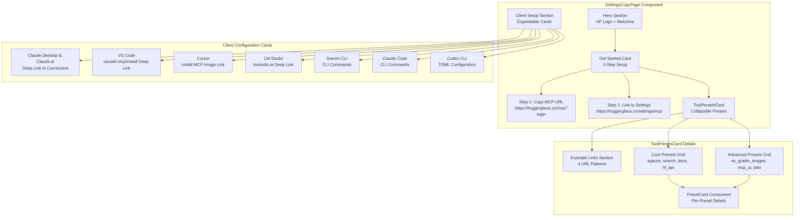

**Sources:** [packages/app/src/web/components/SettingsCopyPage.tsx:1-1095](), [packages/app/src/web/components/bouquets/ToolPresetsCard.tsx:1-227]()

---

## SettingsCopyPage Component

### Purpose and Layout

The `SettingsCopyPage` component serves as the primary entry point for users configuring MCP clients. It provides a two-step setup process followed by detailed client-specific instructions.

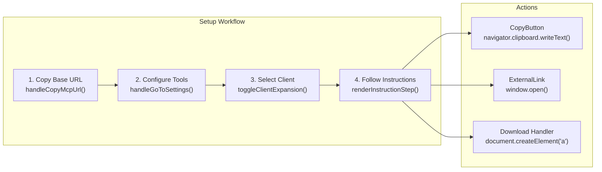

**Sources:** [packages/app/src/web/components/SettingsCopyPage.tsx:835-961]()

### Client Configuration Data Structure

Each client is defined by a `ClientConfig` interface that specifies the setup workflow:

| Field | Type | Purpose |
|-------|------|---------|
| `id` | `string` | Unique identifier (e.g., "claude", "vscode") |
| `name` | `string` | Display name shown in UI |
| `icon` | `React.ReactNode` | SVG icon component |
| `description` | `string` (optional) | Brief client description |
| `instructions` | `(string \| InstructionStep)[]` | Ordered setup steps |
| `actionButtons` | `ActionButton[]` (optional) | External documentation links |
| `manualConfig` | `object` (optional) | Alternative configuration method |

**Sources:** [packages/app/src/web/components/SettingsCopyPage.tsx:35-47]()

### Instruction Step Types

The `renderInstructionStep` function handles five step types:

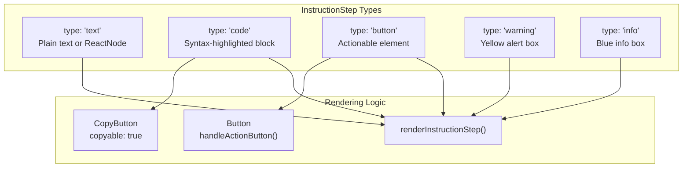

**Sources:** [packages/app/src/web/components/SettingsCopyPage.tsx:28-33, 898-959]()

### Client Setup Examples

#### VS Code Configuration

The VS Code setup uses a deep link protocol to trigger automatic installation:

```
vscode:mcp/install?%7B%22name%22%3A%22huggingface%22%2C%22type%22%3A%22http%22%2C%22url%22%3A%22https%3A%2F%2Fhuggingface.co%2Fmcp%3Flogin%22%7D
```

Manual configuration provides an alternative using `settings.json`:

```json
{
  "servers": {
    "huggingface": {
      "url": "https://huggingface.co/mcp",
      "headers": {
        "Authorization": "Bearer <HF_TOKEN>"
      }
    }
  }
}
```

**Sources:** [packages/app/src/web/components/SettingsCopyPage.tsx:237-396]()

#### Cursor Configuration

Cursor uses an external service endpoint to handle installation:

```
https://cursor.com/en/install-mcp?name=huggingface&config=eyJ1cmwiOiJodHRwczovL2h1Z2dpbmdmYWNlLmNvL21jcD9sb2dpbiJ9
```

**Sources:** [packages/app/src/web/components/SettingsCopyPage.tsx:470-525]()

#### CLI-Based Clients

Gemini CLI and Claude Code use command-line installation:

```bash
# Gemini CLI
gemini mcp add -t http huggingface https://huggingface.co/mcp?login

# Claude Code
claude mcp add hf-mcp-server -t http https://huggingface.co/mcp?login
```

**Sources:** [packages/app/src/web/components/SettingsCopyPage.tsx:650-658, 730-736]()

---

## ToolPresetsCard Component

### Purpose

The `ToolPresetsCard` component displays collapsible documentation for bouquet presets and URL customization options. It serves as a reference for users who want to override their saved settings via URL parameters.

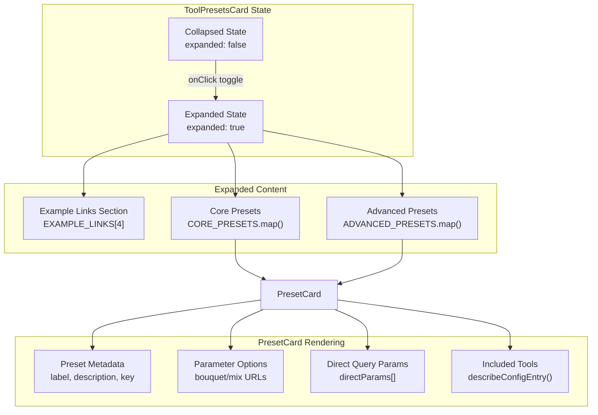

**Sources:** [packages/app/src/web/components/bouquets/ToolPresetsCard.tsx:141-226]()

### Bouquet Preset Display

Each preset is rendered by the `PresetCard` component, which reads from `BOUQUET_PRESETS`:

| Field | Source | Purpose |
|-------|--------|---------|
| `key` | `BouquetKey` | URL parameter value (e.g., "search") |
| `label` | `string` | Human-readable name |
| `description` | `string` | Preset purpose explanation |
| `category` | `'core' \| 'advanced'` | Grouping for UI organization |
| `supportsBouquet` | `boolean` | Can be used with `bouquet=` param |
| `supportsMix` | `boolean` | Can be used with `mix=` param |
| `builtInTools` | `readonly string[]` | Tool IDs included in preset |
| `directParams` | `DirectParamOption[]` (optional) | Alternative query parameters |

**Sources:** [packages/app/src/shared/bouquet-presets.ts:69-78]()

### URL Generation Logic

The `PresetCard` component generates copyable URLs based on preset configuration:

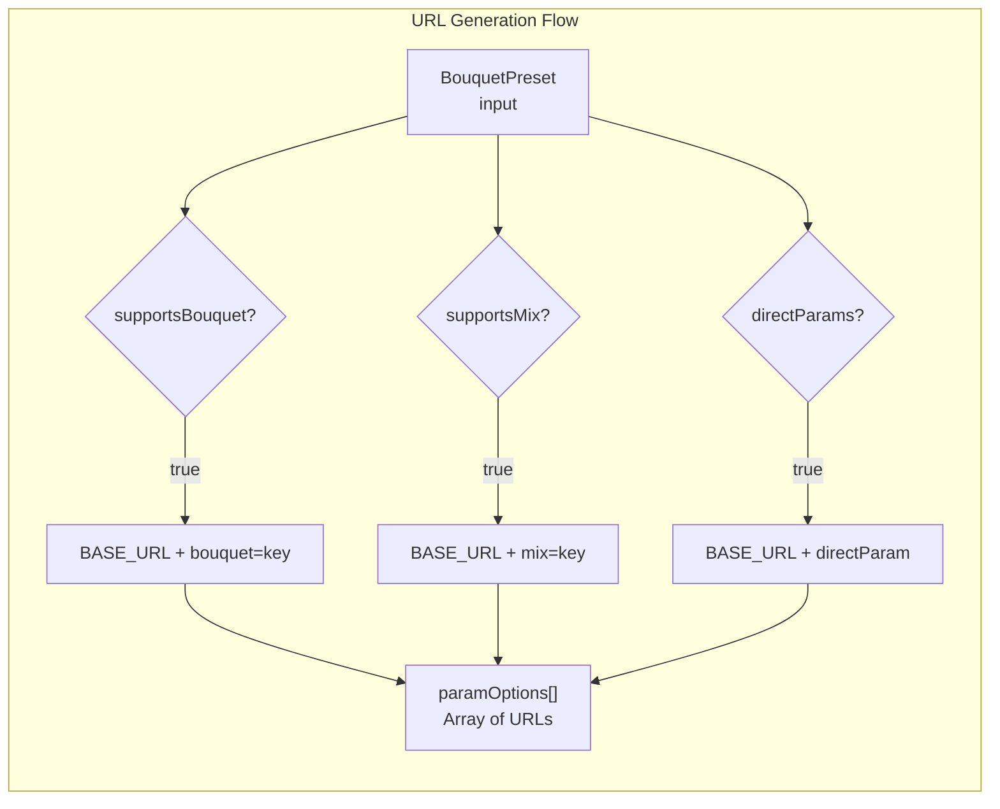

**Sources:** [packages/app/src/web/components/bouquets/ToolPresetsCard.tsx:34-54]()

### Example Links Section

The component displays four example URL patterns to illustrate common use cases:

| Example | URL Pattern | Description |
|---------|-------------|-------------|
| Bouquet override | `?login&bouquet=search` | Overrides saved tool list |
| Mix with saved tools | `?login&mix=docs` | Adds tools to saved settings |
| Add Gradio Spaces | `?login&gradio=victor/websearch` | Includes dynamic Space tools |
| Customise Options | `?login&no_image_content=true` | Disables image downloads |

**Sources:** [packages/app/src/web/components/bouquets/ToolPresetsCard.tsx:11-32]()

---

## Bouquet Configuration System

### Preset Definitions

The `BOUQUETS` object maps preset keys to `AppSettings` configurations:

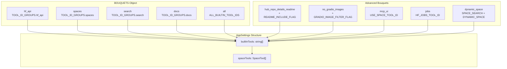

**Sources:** [packages/app/src/shared/bouquet-presets.ts:13-59]()

### Tool Descriptions

The `describeConfigEntry` function maps tool IDs to human-readable descriptions:

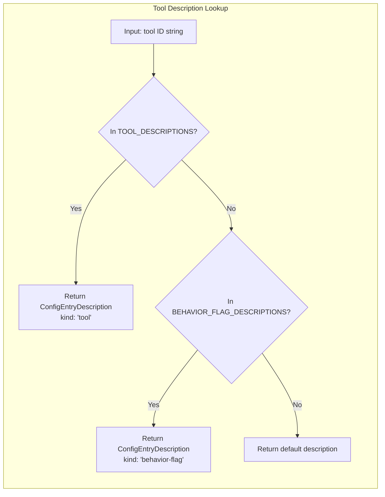

**Tool Descriptions** (lines 190-247):
- `space_search`, `model_search`, `dataset_search`, `paper_search`
- `model_details`, `dataset_details`, `hub_repo_details`
- `duplicate_space`, `space_info`, `space_files`, `use_space`
- `hf_doc_search`, `hf_doc_fetch`, `hf_jobs`

**Behavior Flag Descriptions** (lines 249-258):
- `README_INCLUDE_FLAG`: Permits README sections in responses
- `GRADIO_IMAGE_FILTER_FLAG`: Prevents image downloads

**Sources:** [packages/app/src/shared/bouquet-presets.ts:190-282]()

---

## URL Parameter System

### Parameter to Backend Flow

The Configuration UI generates URLs with query parameters that are processed by the backend tool selection system:

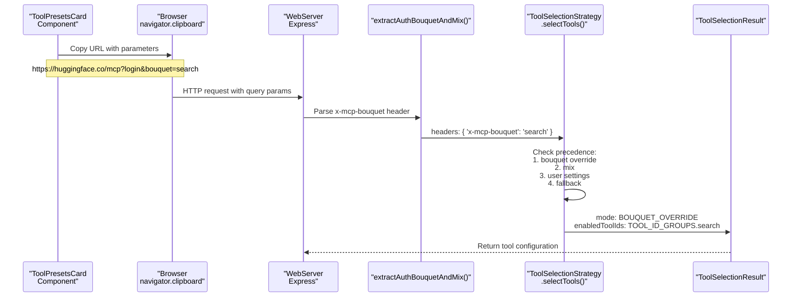

**Sources:** [packages/app/src/web/components/bouquets/ToolPresetsCard.tsx:9-44](), [packages/app/src/server/utils/tool-selection-strategy.ts:129-148]()

### Query Parameter to Header Mapping

URL query parameters are converted to HTTP headers by the backend:

| Query Parameter | HTTP Header | Purpose |
|-----------------|-------------|---------|
| `bouquet=search` | `x-mcp-bouquet: search` | Overrides tool list completely |
| `mix=docs` | `x-mcp-mix: docs` | Adds tools to saved settings |
| `gradio=foo/bar` | `x-mcp-gradio: foo/bar` | Specifies dynamic Gradio endpoints |
| `no_image_content=true` | (processed directly) | Disables Gradio image downloads |

**Sources:** [packages/app/src/server/utils/tool-selection-strategy.ts:130](), [packages/app/src/web/components/bouquets/ToolPresetsCard.tsx:173]()

### Tool Selection Precedence

The backend implements a four-level precedence system described in `ToolSelectionStrategy`:

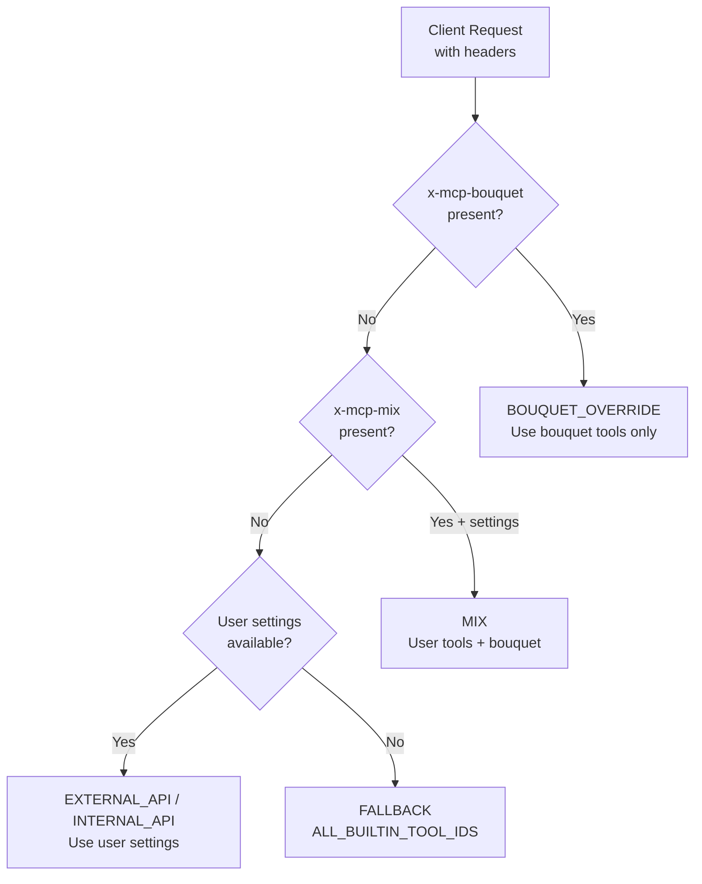

**Sources:** [packages/app/src/server/utils/tool-selection-strategy.ts:33-69, 129-221]()

---

## Copy Button Integration

### CopyButton Component Usage

The UI extensively uses the `CopyButton` component for one-click URL copying:

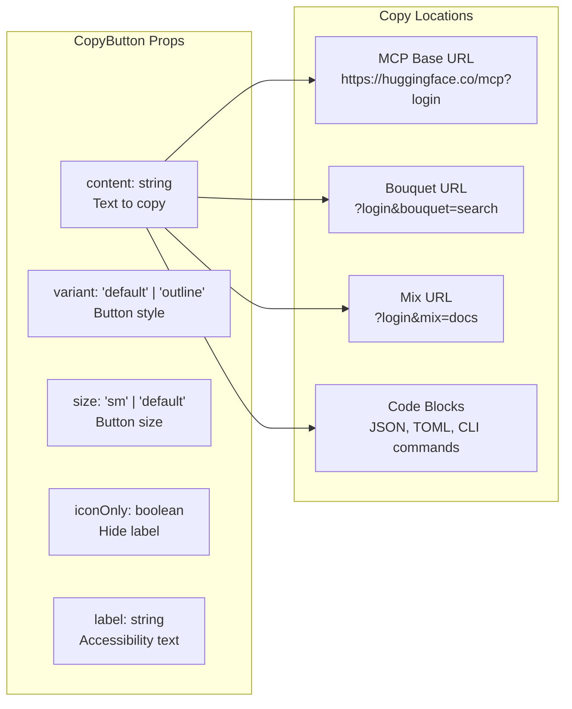

**Usage Examples:**

1. **Inline URL copy** (SettingsCopyPage:1003-1008):
```tsx
<CopyButton
  content="https://huggingface.co/mcp?login"
  variant="secondary"
  size="sm"
  iconOnly
  className="absolute right-2 top-1/2 transform -translate-y-1/2 h-8 px-2"
/>
```

2. **Preset URL copy** (ToolPresetsCard:80-87):
```tsx
<CopyButton
  content={option.url}
  iconOnly
  variant="ghost"
  size="sm"
  label={`Copy ${option.param}`}
  className="h-6 w-6 shrink-0"
/>
```

**Sources:** [packages/app/src/web/components/SettingsCopyPage.tsx:1003-1008](), [packages/app/src/web/components/bouquets/ToolPresetsCard.tsx:80-87]()

---

## State Management

### Component-Level State

Both major components use minimal local state:

**SettingsCopyPage** maintains expanded client sections:
```typescript
const [expandedClients, setExpandedClients] = useState<Set<string>>(new Set());

const toggleClientExpansion = (clientId: string) => {
  setExpandedClients((prev) => {
    const newSet = new Set(prev);
    if (newSet.has(clientId)) {
      newSet.delete(clientId);
    } else {
      newSet.add(clientId);
    }
    return newSet;
  });
};
```

**ToolPresetsCard** maintains collapse/expand state:
```typescript
const [expanded, setExpanded] = useState(false);
```

**Sources:** [packages/app/src/web/components/SettingsCopyPage.tsx:836-864](), [packages/app/src/web/components/bouquets/ToolPresetsCard.tsx:142]()

---

## Configuration Workflow Summary

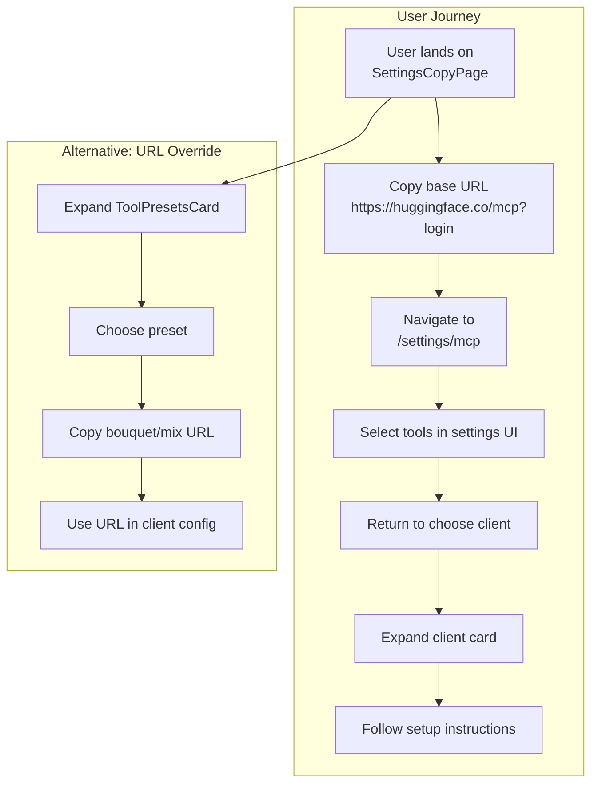

**Sources:** [packages/app/src/web/components/SettingsCopyPage.tsx:976-1042](), [packages/app/src/web/components/bouquets/ToolPresetsCard.tsx:141-226]()

---

