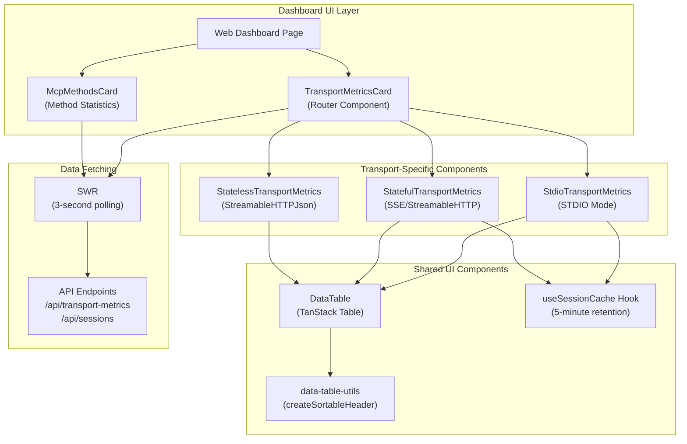
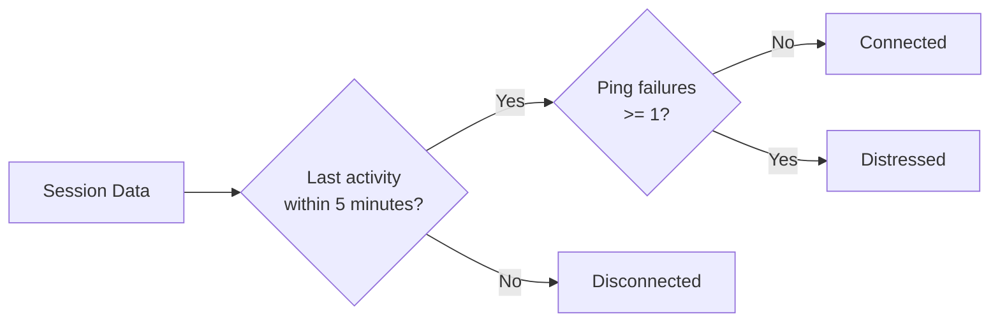
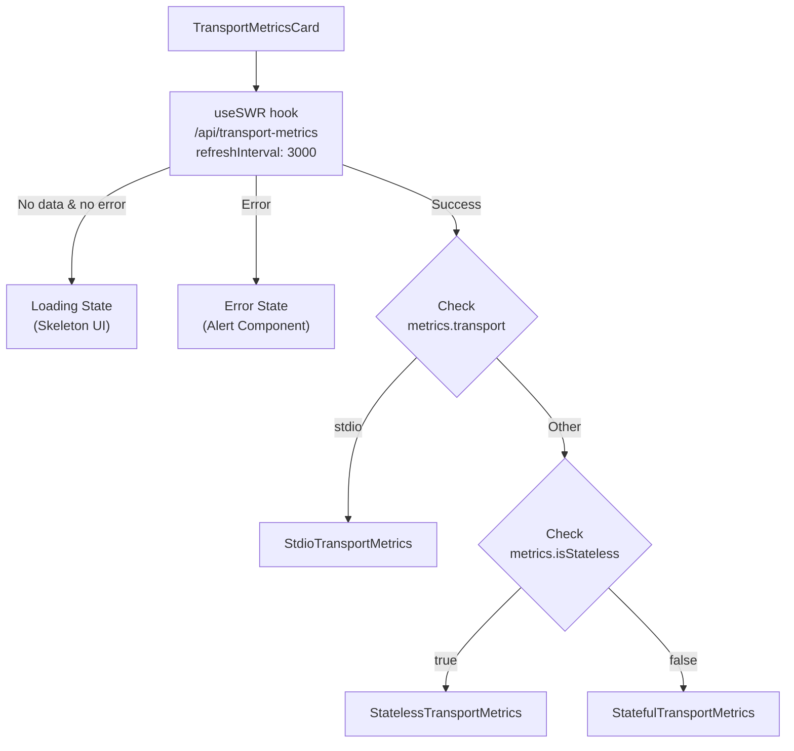
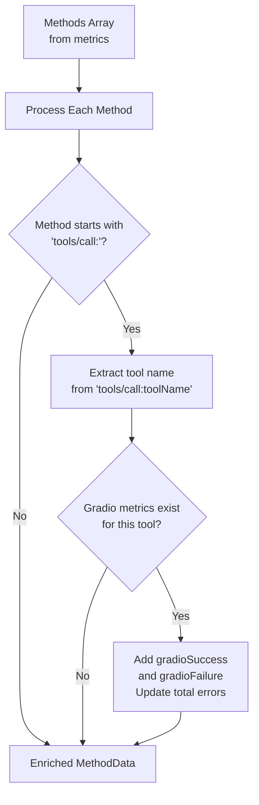
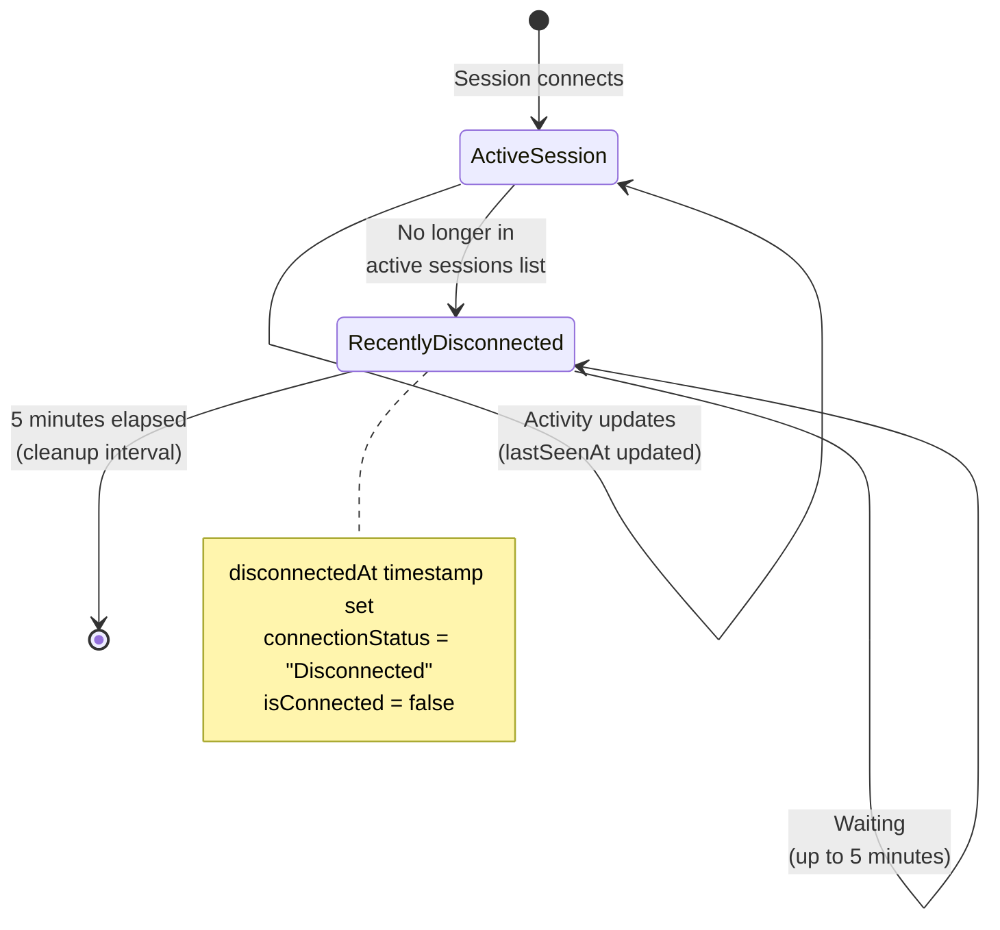
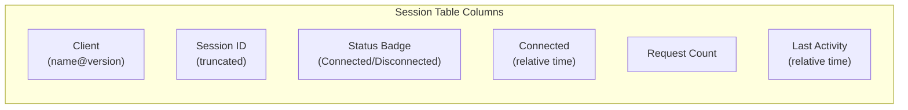
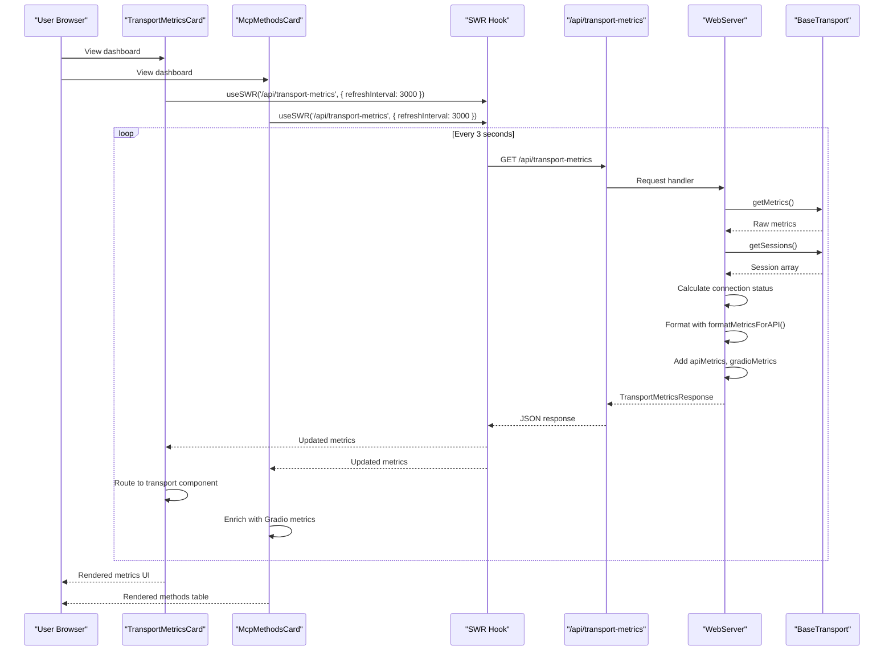

<!-- source: DeepWiki mcp.deepwiki.com · repo huggingface/hf-mcp-server · page 8.3 Monitoring Dashboard · fetched 2026-10-26 -->

# Monitoring Dashboard

<details>
<summary>Relevant source files</summary>

The following files were used as context for generating this wiki page:

- [packages/app/src/server/application.ts](packages/app/src/server/application.ts)
- [packages/app/src/server/web-server.ts](packages/app/src/server/web-server.ts)
- [packages/app/src/web/components/McpMethodsCard.tsx](packages/app/src/web/components/McpMethodsCard.tsx)
- [packages/app/src/web/components/StdioTransportMetrics.tsx](packages/app/src/web/components/StdioTransportMetrics.tsx)
- [packages/app/src/web/components/TransportMetricsCard.tsx](packages/app/src/web/components/TransportMetricsCard.tsx)
- [packages/app/src/web/components/data-table-utils.tsx](packages/app/src/web/components/data-table-utils.tsx)
- [packages/app/src/web/components/data-table.tsx](packages/app/src/web/components/data-table.tsx)
- [packages/app/src/web/hooks/useSessionCache.ts](packages/app/src/web/hooks/useSessionCache.ts)

</details>


The Monitoring Dashboard provides real-time visibility into MCP server operations, displaying connection statistics, method call performance, session tracking, and Gradio integration metrics. The dashboard automatically refreshes every 3 seconds to provide up-to-date information about client connections, tool invocations, and system health.

For information about configuring tools and server settings, see [Configuration UI](#8.2). For details about the API endpoints that power this dashboard, see [Web Server and API Endpoints](#8.1).

---

## Overview

The monitoring dashboard consists of two primary metric cards displayed in the web interface:

1. **TransportMetricsCard** - Displays transport-specific connection metrics, session information, configuration parameters, and uptime statistics
2. **McpMethodsCard** - Shows aggregated statistics for MCP method calls including tool invocations, prompt requests, error rates, and performance metrics

Both cards use SWR (stale-while-revalidate) for data fetching with 3-second polling intervals, ensuring the dashboard displays near-real-time data without manual refreshing.

**Sources:** [packages/app/src/web/components/TransportMetricsCard.tsx:1-72](), [packages/app/src/web/components/McpMethodsCard.tsx:1-298]()

---

## Dashboard Component Architecture

The dashboard follows a component hierarchy where `TransportMetricsCard` acts as a router, delegating to transport-specific components based on the active transport type.



**Sources:** [packages/app/src/web/components/TransportMetricsCard.tsx:19-71](), [packages/app/src/web/components/McpMethodsCard.tsx:31-43](), [packages/app/src/web/components/StdioTransportMetrics.tsx:1-180]()

---

## API Endpoints for Metrics

The dashboard retrieves data from several API endpoints provided by the `WebServer` class. The primary endpoint is `/api/transport-metrics`, which returns comprehensive metrics data.

### Metrics API Endpoint

The `/api/transport-metrics` endpoint is the main data source for the monitoring dashboard.

| Endpoint | Method | Response Interval | Purpose |
|----------|--------|-------------------|---------|
| `/api/transport-metrics` | GET | Polled every 3s | Returns complete metrics including methods, sessions, configuration, API metrics, and Gradio metrics |
| `/api/sessions` | GET | On-demand | Returns current active sessions (used by STDIO mode) |
| `/api/transport` | GET | Initial load | Returns transport configuration and type information |

The `/api/transport-metrics` endpoint performs these operations:

1. Retrieves raw metrics from the active transport via `transport.getMetrics()`
2. Determines if the transport is stateless (`streamableHttpJson` mode)
3. Fetches session data and calculates connection status for each session
4. Formats metrics using `formatMetricsForAPI()` from the transport-metrics module
5. Conditionally includes `apiMetrics` if in external API mode
6. Always includes `gradioMetrics` and `gradioCacheMetrics`
7. Optionally activates temporary logging for stateless transports via the `templog` query parameter

**Sources:** [packages/app/src/server/web-server.ts:254-373]()

### Session Status Calculation

Sessions are classified into three connection states based on activity timestamps and ping failures:



The status calculation logic is implemented in the metrics endpoint handler:

- **Connected**: Recent activity (within 5 minutes) and no ping failures
- **Distressed**: Recent activity but has ping failures
- **Disconnected**: No activity within 5 minutes

**Sources:** [packages/app/src/server/web-server.ts:295-323]()

---

## TransportMetricsCard Component

The `TransportMetricsCard` serves as a router component that displays the appropriate transport-specific metrics component based on the current transport type. It handles loading states, error states, and delegates rendering to specialized components.

### Transport Type Routing



**Sources:** [packages/app/src/web/components/TransportMetricsCard.tsx:19-71]()

---

## McpMethodsCard Component

The `McpMethodsCard` displays aggregated statistics for all MCP method calls, with special focus on tool and prompt invocations. It enriches method data with Gradio-specific metrics when available.

### Method Data Structure

Each method tracked by the system includes the following metrics:

| Field | Type | Description |
|-------|------|-------------|
| `method` | string | Method name (e.g., `tools/call:model_search`, `prompts/get`) |
| `count` | number | Total invocation count |
| `errors` | number | Total error count (includes Gradio failures) |
| `errorRate` | number | Percentage of calls that resulted in errors |
| `averageResponseTime` | number? | Average response time in milliseconds (stateless mode only) |
| `lastCalled` | string | ISO timestamp of last invocation |
| `gradioSuccess` | number? | Successful Gradio invocations (for Gradio tools) |
| `gradioFailure` | number? | Failed Gradio invocations (for Gradio tools) |

**Sources:** [packages/app/src/web/components/McpMethodsCard.tsx:19-29]()

### Gradio Metrics Enrichment

The component enriches tool call data with Gradio-specific success/failure counts by matching tool names against `gradioMetrics.byTool` data:



The enrichment process adds Gradio failure counts to the total error count and recalculates the error rate:

```typescript
// Extract from McpMethodsCard.tsx:52-68
if (method.method.startsWith('tools/call:') && metrics?.gradioMetrics) {
    const toolName = method.method.replace('tools/call:', '');
    const gradioByTool = metrics.gradioMetrics.byTool;
    
    if (gradioByTool[toolName]) {
        gradioSuccess = gradioByTool[toolName].success;
        gradioFailure = gradioByTool[toolName].failure;
        totalErrors += gradioFailure;
    }
}
```

**Sources:** [packages/app/src/web/components/McpMethodsCard.tsx:46-82]()

### Filtering and Summary Statistics

The card provides a checkbox filter to show only tool and prompt calls, and displays summary statistics at the top:

| Statistic | Calculation |
|-----------|-------------|
| Total MCP Calls | Sum of all method counts |
| Tool Calls | Sum of counts for methods starting with `tools/call` |
| Prompt Calls | Sum of counts for methods starting with `prompts/get` |

**Sources:** [packages/app/src/web/components/McpMethodsCard.tsx:84-97]()

---

## Session Caching and Retention

The `useSessionCache` hook provides a 5-minute retention mechanism for disconnected sessions, allowing the dashboard to display recently disconnected sessions for forensic analysis.

### Session Cache Lifecycle



The hook maintains a `Map<string, CachedSession>` where each cached session includes:

- All original session data
- `lastSeenAt`: Timestamp of last update (ISO string)
- `disconnectedAt`: Timestamp when session was marked disconnected (optional)

**Sources:** [packages/app/src/web/hooks/useSessionCache.ts:1-111]()

### Cleanup Process

The cache automatically removes stale disconnected sessions using a cleanup interval:

```typescript
// Cleanup old disconnected sessions every 30 seconds
const cleanup = () => {
    const now = Date.now();
    setCachedSessions((prevCache) => {
        const newCache = new Map(prevCache);
        newCache.forEach((session, sessionId) => {
            if (session.disconnectedAt) {
                const disconnectedTime = new Date(session.disconnectedAt).getTime();
                if (now - disconnectedTime > RETENTION_TIME) {  // 5 minutes
                    newCache.delete(sessionId);
                }
            }
        });
        return newCache;
    });
};
```

**Sources:** [packages/app/src/web/hooks/useSessionCache.ts:68-97]()

---

## DataTable Component

The `DataTable` component is a reusable table implementation built on TanStack Table that provides sorting, filtering, pagination, and column visibility controls. It is used extensively throughout the monitoring dashboard.

### DataTable Features

| Feature | Implementation | Usage in Dashboard |
|---------|----------------|-------------------|
| Sorting | `getSortedRowModel()` with `createSortableHeader()` | Sort methods by count, error rate, response time |
| Filtering | `getFilteredRowModel()` with search input | Filter by method name, session ID |
| Pagination | `getPaginationRowModel()` with configurable page size | Manage large method lists (50 rows/page) and sessions (10 rows/page) |
| Column Visibility | `DropdownMenu` with checkbox items | Show/hide columns like errors, Gradio metrics, response times |
| Default Sorting | `defaultSorting` prop | Sort by count descending or last activity |

The `createSortableHeader` utility function generates column headers with click-to-sort behavior and visual sort indicators (chevron icons):

```typescript
// Alignment options: 'left', 'right', 'center'
createSortableHeader('Method')  // Left-aligned
createSortableHeader('Calls', 'right')  // Right-aligned numeric column
```

**Sources:** [packages/app/src/web/components/data-table.tsx:1-163](), [packages/app/src/web/components/data-table-utils.tsx:1-27]()

---

## STDIO Transport Metrics Display

The `StdioTransportMetrics` component displays metrics specific to STDIO mode, which typically has a single long-lived session. It uses the session cache hook to retain disconnected session history.

### STDIO Metrics Layout

The component displays:

1. **Transport Info Section** - Transport type and uptime
2. **Sessions Table** - Active and recently disconnected sessions with client information

### Session Table Columns



**Client name truncation**: Names longer than 42 characters are truncated to show the first 35 and last 5 characters with ellipsis in between (e.g., `very-long-client-name-with-many-w.....ters`).

**Session ID truncation**: IDs longer than 12 characters show the first 5 and last 5 characters with ellipsis (e.g., `abc12...xyz89`).

**Sources:** [packages/app/src/web/components/StdioTransportMetrics.tsx:1-180]()

### Relative Time Formatting

The component uses helper functions to format timestamps in a human-readable way:

| Duration | Format | Example |
|----------|--------|---------|
| < 60 seconds | "just now" | just now |
| < 60 minutes | "Nm ago" | 5m ago |
| < 24 hours | "Nh ago" | 2h ago |
| ≥ 24 hours | "Nd ago" | 3d ago |

**Sources:** [packages/app/src/web/components/StdioTransportMetrics.tsx:26-42]()

---

## Data Flow: Dashboard to API

The complete data flow from user viewing the dashboard to displaying metrics involves SWR's automatic polling mechanism and React's rendering pipeline.



**Sources:** [packages/app/src/web/components/TransportMetricsCard.tsx:19-25](), [packages/app/src/web/components/McpMethodsCard.tsx:36-40](), [packages/app/src/server/web-server.ts:254-373]()

---

## Metrics Data Structure

The `TransportMetricsResponse` type returned by `/api/transport-metrics` contains comprehensive data about server operation:

### Core Metrics Fields

| Field | Type | Description |
|-------|------|-------------|
| `transport` | string | Transport type: `stdio`, `sse`, `streamableHttp`, `streamableHttpJson` |
| `isStateless` | boolean | Whether transport is stateless (creates per-request servers) |
| `startupTime` | string | ISO timestamp when server started |
| `uptimeSeconds` | number | Server uptime in seconds |
| `sessions` | SessionData[] | Array of active and cached sessions |
| `methods` | MethodMetrics[] | Array of method call statistics |
| `configuration` | TransportConfig? | Heartbeat/ping configuration (stateful only) |
| `apiMetrics` | object? | External API call metrics (external mode only) |
| `gradioMetrics` | object | Gradio tool invocation metrics |
| `gradioCacheMetrics` | object | Gradio schema cache statistics |

### Stateful Transport Configuration

For stateful transports (SSE, StreamableHTTP), the configuration object includes:

| Field | Type | Default | Description |
|-------|------|---------|-------------|
| `heartbeatInterval` | number | 30000 | Heartbeat ping interval (ms) |
| `staleCheckInterval` | number | 90000 | Stale session check interval (ms) |
| `staleTimeout` | number | 600000 | Session timeout threshold (ms) |
| `pingEnabled` | boolean | true | Whether ping mechanism is enabled |
| `pingInterval` | number | 30000 | Ping attempt interval (ms) |
| `pingFailureThreshold` | number | 1 | Consecutive ping failures before marking distressed |

**Sources:** [packages/app/src/server/web-server.ts:329-338](), [packages/app/src/shared/transport-metrics.ts]()

---

## Gradio Metrics Integration

The dashboard displays Gradio-specific metrics to track the health and performance of dynamic Gradio tool integrations.

### Gradio Metrics Structure

The `gradioMetrics` object includes:

- `byTool`: Map of tool names to success/failure counts
- `totalSuccess`: Total successful Gradio invocations across all tools
- `totalFailure`: Total failed Gradio invocations across all tools

The `gradioCacheMetrics` object tracks schema caching performance:

- `size`: Number of cached schemas
- `hits`: Cache hit count
- `misses`: Cache miss count
- `hitRate`: Percentage of requests served from cache

These metrics are displayed in the `McpMethodsCard` as additional columns showing success/failure counts for Gradio tools.

**Sources:** [packages/app/src/server/web-server.ts:346-349](), [packages/app/src/web/components/McpMethodsCard.tsx:146-161]()

---

## Summary

The Monitoring Dashboard provides comprehensive real-time visibility into MCP server operations through:

1. **Automatic polling** - SWR fetches fresh data every 3 seconds
2. **Transport-specific displays** - Different UI components for STDIO, stateful, and stateless modes
3. **Session retention** - 5-minute cache for disconnected sessions enables forensic analysis
4. **Method statistics** - Detailed tracking of tool calls, prompts, errors, and performance
5. **Gradio integration metrics** - Success/failure tracking for dynamic Gradio tools
6. **Sortable, filterable tables** - TanStack Table provides powerful data exploration capabilities

All dashboard components share the same `/api/transport-metrics` endpoint, ensuring consistent data across the UI with minimal server overhead. The dashboard automatically adapts its display based on the active transport type and available metrics.

---

