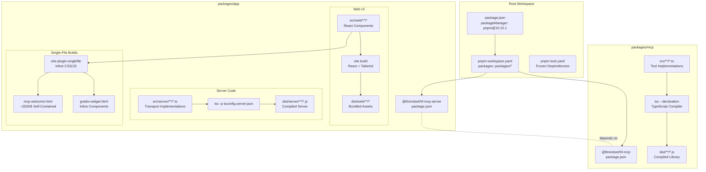
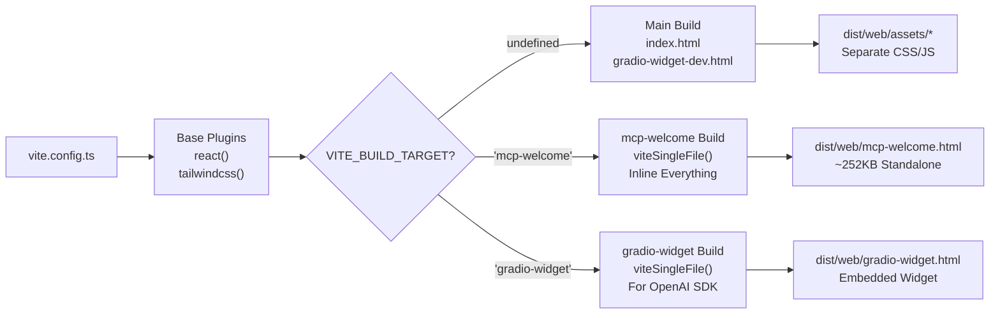
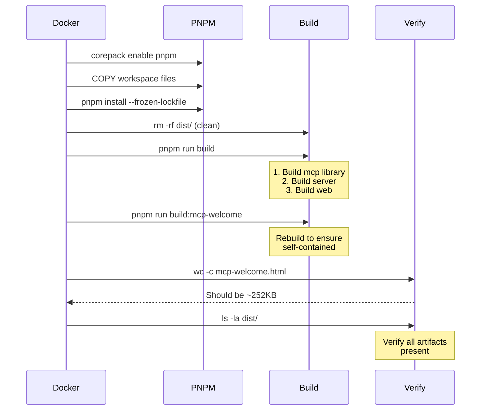
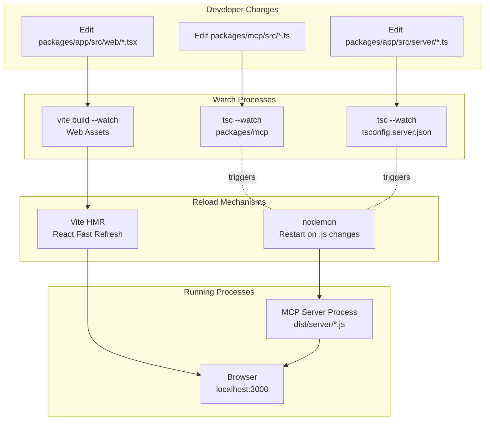
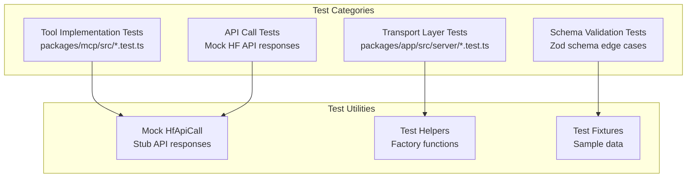
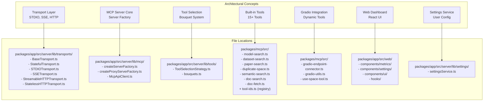

<!-- source: DeepWiki mcp.deepwiki.com · repo huggingface/hf-mcp-server · page 9 Development Guide · fetched 2026-10-26 -->

# Development Guide

<details>
<summary>Relevant source files</summary>

The following files were used as context for generating this wiki page:

- [.dockerignore](.dockerignore)
- [Dockerfile](Dockerfile)
- [README.md](README.md)
- [package.json](package.json)
- [packages/app/package.json](packages/app/package.json)
- [packages/app/vite.config.ts](packages/app/vite.config.ts)
- [packages/mcp/package.json](packages/mcp/package.json)
- [packages/mcp/src/duplicate-space.ts](packages/mcp/src/duplicate-space.ts)
- [packages/mcp/src/error-messages.ts](packages/mcp/src/error-messages.ts)
- [pnpm-lock.yaml](pnpm-lock.yaml)
- [start.sh](start.sh)

</details>


This guide is for developers who want to contribute to or extend the Hugging Face MCP Server. It covers the development environment setup, build system, testing infrastructure, and project organization.

For information about deploying and running the server, see [Getting Started](#2). For architectural details about the system components, see [Architecture](#3). For guidance on creating new tools, see [Tool System Overview](#4.1).

**Scope**: This document covers the development toolchain (pnpm, TypeScript, Vite), build pipeline, hot-reload workflows, testing with Vitest, and the monorepo structure. It does not cover tool implementation details or runtime architecture.

---

## Build System

The project uses a monorepo structure managed by pnpm workspaces with two main packages: `@llmindset/hf-mcp` (core library) and `@llmindset/hf-mcp-server` (application layer). The build system coordinates TypeScript compilation, Vite-based web bundling, and specialized single-file builds.

### Monorepo Architecture



**Sources**: [package.json:1-38](), [pnpm-lock.yaml:1-10](), [packages/app/package.json:1-111](), [packages/mcp/package.json:1-53]()

### Build Pipeline Stages

The build system operates in distinct stages with specific responsibilities:

| Stage | Command | Outputs | Purpose |
|-------|---------|---------|---------|
| **Clean** | `pnpm clean` | Removes `dist/` directories | Ensures fresh builds |
| **Library Build** | `pnpm --filter=@llmindset/hf-mcp build` | `packages/mcp/dist/*.js` + `.d.ts` | Compiles tool implementations |
| **Server Build** | `pnpm --filter=@llmindset/hf-mcp-server build:server` | `packages/app/dist/server/*.js` | Compiles transport layer |
| **Web Build** | `pnpm --filter=@llmindset/hf-mcp-server build:web` | `packages/app/dist/web/*` | Bundles React dashboard |
| **Single-File Builds** | `pnpm --filter=@llmindset/hf-mcp-server build:singlefiles` | `mcp-welcome.html`, `gradio-widget.html` | Creates standalone pages |

**Sources**: [packages/app/package.json:33-39](), [packages/mcp/package.json:25-26]()

### TypeScript Compilation

The project uses two separate TypeScript configurations:

**Library Configuration** (`packages/mcp/tsconfig.json`):
- Compiles `src/**/*.ts` to `dist/`
- Generates `.d.ts` declaration files for consumers
- Target: ES modules with Node.js compatibility
- Command: `tsc --declaration`

**Server Configuration** (`packages/app/tsconfig.server.json`):
- Compiles `src/server/**/*.ts` to `dist/server/`
- Excludes web UI code from server compilation
- Target: Node.js runtime
- Command: `tsc -p tsconfig.server.json`

The separation ensures server code doesn't bundle unnecessary web dependencies.

**Sources**: [packages/app/package.json:35](), [packages/mcp/package.json:26]()

### Vite Build Configuration

The web UI uses Vite with conditional plugin application based on the `VITE_BUILD_TARGET` environment variable:



The `viteSingleFile()` plugin inlines all CSS and JavaScript into a single HTML file, which is required for:
- **mcp-welcome.html**: A self-contained welcome page served at `/` when no `Accept: application/json` header is present
- **gradio-widget.html**: Embedded in MCP responses for OpenAI Apps SDK compatibility

**Sources**: [packages/app/vite.config.ts:1-47](), [packages/app/package.json:37-39]()

### Docker Build Process

The Dockerfile demonstrates the complete build pipeline in a containerized environment:



The Docker build explicitly rebuilds `mcp-welcome.html` as a final step to ensure it's self-contained with all assets inlined. The verification step checks that the file is approximately 252KB, indicating successful asset inlining.

**Sources**: [Dockerfile:1-67](), [packages/app/package.json:37-39]()

---

## Development Workflow

The project provides multiple development modes optimized for different workflows. Each mode supports hot-reload capabilities through TypeScript watch mode or Vite HMR.

### Setting Up the Development Environment

```bash
# 1. Enable Corepack (ensures correct pnpm version)
corepack enable

# 2. Install dependencies
pnpm install

# 3. Initial build (required before dev mode)
pnpm build

# 4. Start development mode
pnpm dev
```

The `corepack enable` command respects the `packageManager` field in `package.json` (pnpm@10.15.1), ensuring consistent tooling across developers.

**Sources**: [package.json:6](), [README.md:173-196]()

### Development Scripts and Watch Modes

The root workspace provides concurrent development scripts that watch both packages simultaneously:

| Command | Description | Transport | Hot Reload |
|---------|-------------|-----------|------------|
| `pnpm dev` | Default HTTP server + HMR | StreamableHTTP | ✓ Web UI + Server |
| `pnpm dev:watch` | Full watch mode | StreamableHTTP | ✓ Library + Server + Web |
| `pnpm dev:stdio` | STDIO transport | STDIO | ✓ Library + Server |
| `pnpm dev:sse` | SSE transport | SSE | ✓ Library + Server |
| `pnpm dev:json` | JSON mode | StreamableHTTPJson | ✓ Library + Server |

The `dev:watch` mode provides the most comprehensive hot-reload experience:

```bash
pnpm dev:watch
# Runs concurrently:
# 1. tsc -p tsconfig.server.json --watch
# 2. vite build --watch
# 3. nodemon dist/server/streamableHttp.js --json
```

**Sources**: [package.json:7-12](), [packages/app/package.json:46]()

### Hot Reload Architecture



**Key behaviors**:
- **TypeScript changes** (`.ts` files): Trigger recompilation → nodemon detects `.js` changes → server restarts
- **React component changes** (`.tsx` files): Vite HMR updates browser without full reload
- **Gradio widget changes**: Requires `pnpm dev:widget` for isolated HMR

**Sources**: [packages/app/package.json:40-46](), [README.md:159-171]()

### Isolated Widget Development

For developing Gradio widget components used in OpenAI Apps SDK integration:

```bash
cd packages/app
pnpm dev:widget
# Opens http://localhost:5173/gradio-widget-dev.html
```

This mode serves `gradio-widget-dev.html` with full Vite HMR, allowing rapid iteration on the widget UI. The development page includes test harnesses for sending structured content to components.

**Sources**: [packages/app/package.json:42](), [README.md:159-171](), [packages/app/vite.config.ts:41]()

### Running Specific Transports

Each transport can be run independently in development mode:

**STDIO Transport** (single process, stdin/stdout):
```bash
pnpm dev:stdio
# or directly:
cd packages/app
pnpm dev:stdio
```

**SSE Transport** (stateful, GET /sse + POST /message):
```bash
pnpm dev:sse
```

**HTTP Transport** (stateful, POST/GET/DELETE /mcp):
```bash
pnpm dev
```

**Stateless JSON Mode** (per-request isolation):
```bash
pnpm dev:json
```

The transport selection determines which `dist/server/*.js` file is executed. All transports serve the web dashboard on port 3000 except STDIO.

**Sources**: [packages/app/package.json:40-46](), [start.sh:33-58]()

---

## Testing

The project uses Vitest for unit and integration testing. Tests are located alongside source files and run in Node.js environment with TypeScript support.

### Test Infrastructure

**Vitest Configuration**:
- Runs in Node.js environment (not browser)
- TypeScript support via `tsx`
- ESM module resolution
- Test files: `**/*.test.ts` or `**/*.spec.ts`

**Running Tests**:

```bash
# Run all tests (both packages)
pnpm test

# Run tests in specific package
pnpm --filter=@llmindset/hf-mcp test
pnpm --filter=@llmindset/hf-mcp-server test

# Watch mode (auto-rerun on changes)
cd packages/mcp
pnpm test --watch
```

**Sources**: [package.json:15](), [packages/app/package.json:51](), [packages/mcp/package.json:27]()

### Test Patterns



**Common patterns observed**:
- **Tool tests**: Mock `HfApiCall` base class to test tool logic without network calls
- **Error handling**: Verify friendly error messages via `explain()` function
- **Schema validation**: Test Zod schemas with valid and invalid inputs
- **Integration tests**: Test full request/response cycles with mock transports

**Example test structure** (inferred from codebase patterns):
```typescript
// Tool test pattern
describe('DuplicateSpaceTool', () => {
  it('normalizes space names correctly', () => {
    const tool = new DuplicateSpaceTool(token, 'username');
    expect(tool.normalizeSpaceName('space-name'))
      .toBe('username/space-name');
  });
});
```

**Sources**: [packages/mcp/src/duplicate-space.ts:74-259](), [packages/mcp/src/error-messages.ts:1-58]()

### Linting and Type Checking

```bash
# Lint all packages (with auto-fix)
pnpm lint

# Check linting without changes
pnpm lint:check

# Type check all packages
pnpm typecheck

# Format code
pnpm format
pnpm format:check
```

The linting setup uses:
- **ESLint** with TypeScript support
- **Prettier** for code formatting
- **typescript-eslint** for TypeScript-specific rules

**Sources**: [package.json:16-20](), [packages/app/package.json:52-54]()

---

## Project Structure

The monorepo is organized into two main packages with clear separation of concerns:

### Directory Layout

```
hf-mcp-server/
├── package.json                    # Root workspace config
├── pnpm-workspace.yaml             # Workspace definition
├── pnpm-lock.yaml                  # Locked dependencies
├── Dockerfile                      # Production container
├── start.sh                        # Container entrypoint
│
├── packages/mcp/                   # Core library (@llmindset/hf-mcp)
│   ├── package.json                # Library package config
│   ├── tsconfig.json               # TypeScript config
│   ├── src/
│   │   ├── index.ts                # Main export
│   │   ├── hf-api-call.ts          # Base class for API calls
│   │   ├── error-messages.ts       # Friendly error handling
│   │   ├── tool-ids.ts             # Tool registry
│   │   ├── utilities.ts            # Shared utilities
│   │   ├── model-search.ts         # Model search tool
│   │   ├── dataset-search.ts       # Dataset search tool
│   │   ├── paper-search.ts         # Paper search tool
│   │   ├── duplicate-space.ts      # Space duplication tool
│   │   ├── semantic-search.ts      # Space semantic search
│   │   ├── doc-search.ts           # Documentation search
│   │   ├── doc-fetch.ts            # Doc fetch & convert
│   │   ├── gradio-*.ts             # Gradio integration
│   │   └── *.test.ts               # Unit tests
│   └── dist/                       # Compiled outputs
│
└── packages/app/                   # Application layer
    ├── package.json                # App package config
    ├── tsconfig.json               # General TypeScript config
    ├── tsconfig.server.json        # Server-specific config
    ├── vite.config.ts              # Vite bundler config
    ├── components.json             # UI component config
    ├── src/
    │   ├── server/                 # Server entrypoints
    │   │   ├── stdio.ts            # STDIO transport entry
    │   │   ├── sse.ts              # SSE transport entry
    │   │   ├── streamableHttp.ts   # HTTP transport entry
    │   │   ├── streamableHttpJson.ts # JSON mode entry
    │   │   ├── lib/                # Server libraries
    │   │   │   ├── application.ts  # Application orchestrator
    │   │   │   ├── webserver.ts    # Express server
    │   │   │   ├── transports/     # Transport implementations
    │   │   │   ├── mcp/            # MCP server factory
    │   │   │   ├── tools/          # Tool selection
    │   │   │   └── settings/       # Settings service
    │   │   └── *.test.ts           # Server tests
    │   │
    │   └── web/                    # Web UI
    │       ├── index.html          # Main dashboard entry
    │       ├── mcp-welcome.html    # Welcome page entry
    │       ├── gradio-widget.html  # Widget entry
    │       ├── gradio-widget-dev.html # Widget dev harness
    │       ├── main.tsx            # React app entry
    │       ├── components/         # React components
    │       │   ├── ui/             # Base UI components
    │       │   ├── metrics/        # Metrics cards
    │       │   └── settings/       # Settings UI
    │       ├── hooks/              # React hooks
    │       └── lib/                # Web utilities
    │
    └── dist/                       # Build outputs
        ├── server/                 # Compiled server code
        │   ├── stdio.js
        │   ├── sse.js
        │   └── streamableHttp.js
        └── web/                    # Bundled web assets
            ├── index.html
            ├── mcp-welcome.html    # ~252KB self-contained
            ├── gradio-widget.html  # Embedded widget
            └── assets/             # CSS/JS chunks
```

**Sources**: [packages/app/package.json:6-14](), [packages/mcp/package.json:7-23](), [Dockerfile:1-67]()

### Component Location Map

This diagram maps high-level system concepts to their actual file locations:



**Sources**: [packages/app/package.json:1-111](), [packages/mcp/package.json:1-53]()

### Package Responsibilities

**`@llmindset/hf-mcp` (packages/mcp)**:
- Tool implementations (search, detail, space management, docs)
- Gradio integration logic (schema parsing, endpoint connectors)
- API call abstractions (`HfApiCall` base class)
- Error handling utilities (`explain()`, friendly messages)
- Type definitions and Zod schemas
- Exports: Library API for external consumers

**`@llmindset/hf-mcp-server` (packages/app)**:
- Transport layer implementations (STDIO, SSE, HTTP)
- MCP server factory pattern (`createServerFactory`, `createProxyServerFactory`)
- Tool selection strategy and bouquet system
- Settings service (internal and external storage)
- Web dashboard (React + TailwindCSS)
- Single-file builds (mcp-welcome, gradio-widget)
- Express server and API routes
- Application orchestrator (`Application` class)

The dependency flow is unidirectional: `packages/app` depends on `packages/mcp`, but not vice versa. This allows `packages/mcp` to be consumed independently by other MCP server implementations.

**Sources**: [packages/app/package.json:59](), [packages/mcp/package.json:7-23]()

### Configuration Files

| File | Purpose | Key Settings |
|------|---------|--------------|
| `package.json` (root) | Workspace config | `packageManager: pnpm@10.15.1`, workspace scripts |
| `pnpm-workspace.yaml` | Package discovery | `packages/*` |
| `packages/app/tsconfig.json` | Web UI TypeScript | React JSX, strict mode |
| `packages/app/tsconfig.server.json` | Server TypeScript | Node.js target, excludes web |
| `packages/mcp/tsconfig.json` | Library TypeScript | ES modules, declaration files |
| `vite.config.ts` | Vite bundler | React, Tailwind, singleFile plugin |
| `components.json` | shadcn/ui config | Component path aliases |
| `.dockerignore` | Docker exclusions | `node_modules`, `dist`, `.git` |

**Sources**: [package.json:1-38](), [packages/app/package.json:1-111](), [packages/app/vite.config.ts:1-47](), [.dockerignore:1-18]()

---

## Advanced Build Scenarios

### Clean Build

For a completely clean build from scratch:

```bash
pnpm clean    # Remove all dist/ directories
pnpm build    # Full rebuild
```

This is recommended after:
- Switching branches with significant changes
- Updating dependencies (`pnpm install`)
- Resolving build errors

**Sources**: [package.json:22]()

### Single Package Builds

Build individual packages without building dependencies:

```bash
# Build only the mcp library
pnpm --filter=@llmindset/hf-mcp build

# Build only the app
pnpm --filter=@llmindset/hf-mcp-server build

# Build specific app components
cd packages/app
pnpm build:server      # Server only
pnpm build:web         # Web UI only
pnpm build:singlefiles # Self-contained pages only
```

**Sources**: [packages/app/package.json:34-39]()

### Production Build Verification

The Docker build includes verification steps to ensure artifacts are correct:

```bash
# Check mcp-welcome.html is self-contained
wc -c packages/app/dist/web/mcp-welcome.html
# Should output ~252000 (252KB)

# Verify all expected outputs exist
ls -la packages/app/dist/server/
ls -la packages/app/dist/web/
```

If `mcp-welcome.html` is significantly smaller (e.g., <50KB), assets were not inlined correctly and the build should be re-run.

**Sources**: [Dockerfile:32-36]()

---

