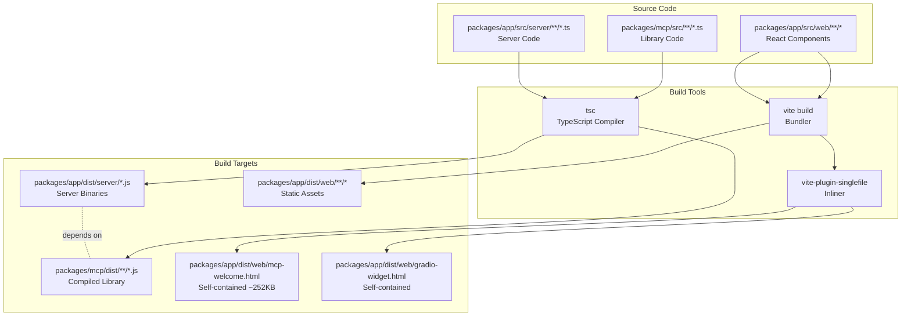
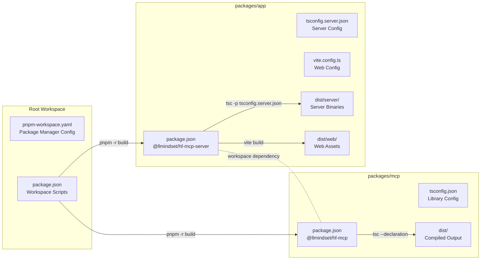
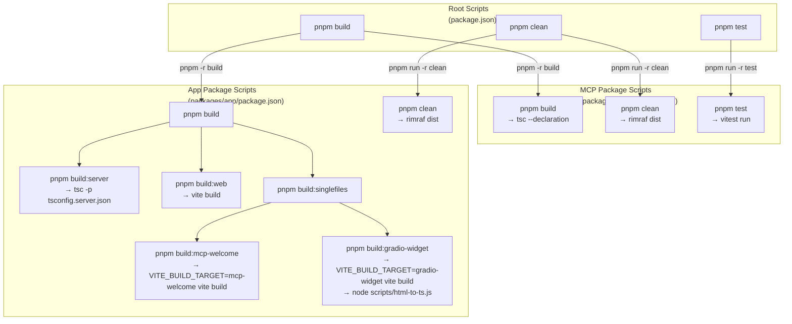
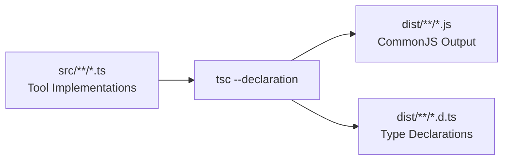
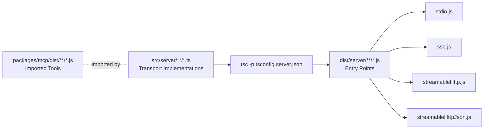
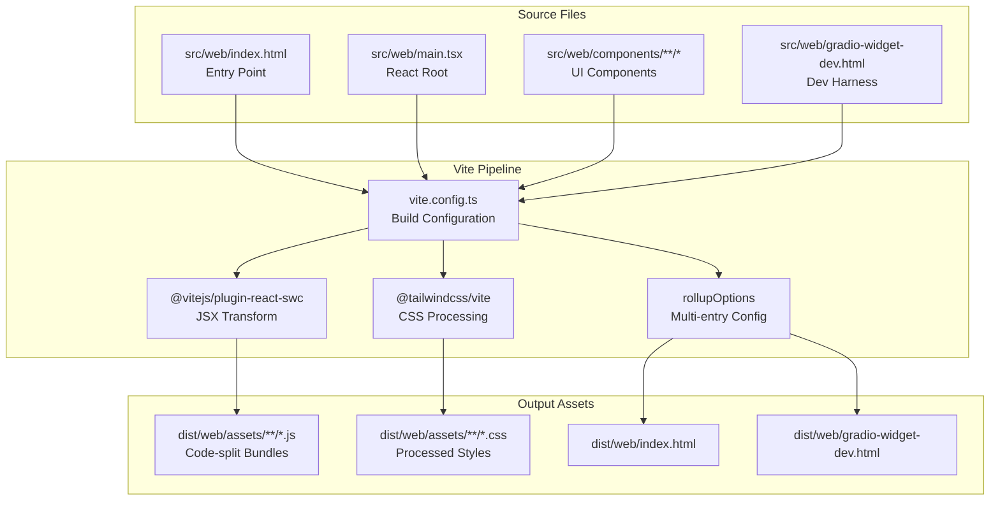
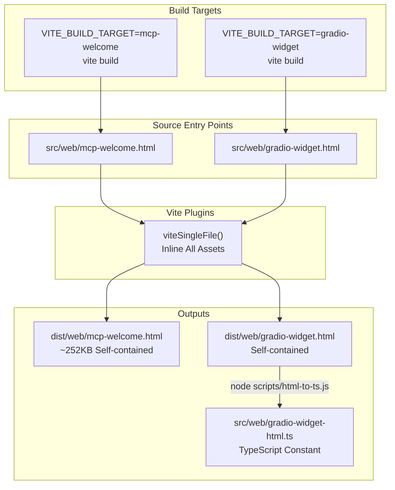

<!-- source: DeepWiki mcp.deepwiki.com · repo huggingface/hf-mcp-server · page 9.1 Build System · fetched 2026-10-26 -->

# Build System

<details>
<summary>Relevant source files</summary>

The following files were used as context for generating this wiki page:

- [.dockerignore](.dockerignore)
- [Dockerfile](Dockerfile)
- [README.md](README.md)
- [package.json](package.json)
- [packages/app/package.json](packages/app/package.json)
- [packages/app/vite.config.ts](packages/app/vite.config.ts)
- [packages/mcp/package.json](packages/mcp/package.json)
- [packages/mcp/src/duplicate-space.ts](packages/mcp/src/duplicate-space.ts)
- [packages/mcp/src/error-messages.ts](packages/mcp/src/error-messages.ts)
- [pnpm-lock.yaml](pnpm-lock.yaml)
- [start.sh](start.sh)

</details>


This document describes the monorepo build pipeline, compilation processes, and artifact generation for the HF MCP Server project. The build system orchestrates TypeScript compilation, Vite bundling, and multiple specialized build targets to produce server binaries, web assets, and self-contained HTML files.

For information about development workflows and watch modes, see [Development Workflow](#9.2). For the overall project structure, see [Project Structure](#9.4).

---

## Build Architecture Overview

The HF MCP Server uses a multi-stage build pipeline that separates library compilation from application bundling. The build system produces three categories of artifacts: TypeScript-compiled server code, Vite-bundled web assets, and self-contained single-file HTML applications.



**Sources:** [package.json:7-24](), [packages/app/package.json:33-39](), [packages/mcp/package.json:25-32]()

---

## Monorepo Structure

The project uses pnpm workspaces with two packages. The workspace configuration enforces proper dependency resolution and enables cross-package builds.

| Package | Purpose | Build Tool | Output |
|---------|---------|------------|--------|
| `@llmindset/hf-mcp` | Core MCP tool implementations | `tsc` | `packages/mcp/dist/` |
| `@llmindset/hf-mcp-server` | Application layer, transports, web UI | `tsc` + `vite` | `packages/app/dist/server/` and `packages/app/dist/web/` |



The workspace configuration uses pnpm's `workspace:^` protocol to link `@llmindset/hf-mcp` into `@llmindset/hf-mcp-server`, ensuring the application always builds against the local library version.

**Sources:** [package.json:1-38](), [packages/app/package.json:59](), [packages/mcp/package.json:2-3](), [pnpm-lock.yaml:47-49]()

---

## Build Scripts Hierarchy

Build commands cascade from the root workspace down to individual packages. The root `build` command orchestrates all package builds in dependency order.



The `-r` flag in root scripts executes commands recursively in all workspace packages. Build order respects workspace dependencies automatically.

**Sources:** [package.json:21-24](), [packages/app/package.json:33-39](), [packages/mcp/package.json:25-32]()

---

## TypeScript Compilation Pipeline

Both packages use the TypeScript compiler directly without intermediate bundlers for server-side code. Each package has distinct `tsconfig.json` configurations.

### Library Compilation (packages/mcp)

The `@llmindset/hf-mcp` package compiles with declaration files for type exports:



The package exports multiple entry points via the `exports` field, enabling selective imports:

- **Main entry**: `dist/index.js` with types `dist/index.d.ts`
- **Semantic search**: `dist/semantic-search.js` 
- **Model tools**: `dist/model-search.js`
- **Paper tools**: `dist/paper-search.js`

**Sources:** [packages/mcp/package.json:5-23](), [packages/mcp/package.json:26]()

### Server Compilation (packages/app)

The application server code compiles using `tsconfig.server.json` which targets Node.js:



The compilation produces four distinct entry point binaries exposed via the `bin` field in `package.json`:

- `hf-mcp-server` → `dist/server/stdio.js`
- `hf-mcp-server-http` → `dist/server/streamableHttp.js`
- `hf-mcp-server-http-json` → `dist/server/streamableHttpJson.js`

**Sources:** [packages/app/package.json:6-10](), [packages/app/package.json:35]()

---

## Vite Build Pipeline

Vite handles all web asset bundling, including the React dashboard and specialized single-file builds. The configuration uses conditional plugin loading based on `VITE_BUILD_TARGET` environment variables.

### Standard Web Build

The default build produces the monitoring dashboard with code splitting:



The `vite.config.ts` excludes `mcp-welcome.html` and `gradio-widget.html` from the main build to prevent interference with single-file builds.

**Sources:** [packages/app/vite.config.ts:1-47](), [packages/app/package.json:36]()

### Single-File Builds

Two specialized builds produce self-contained HTML files with all assets inlined. These use the `vite-plugin-singlefile` plugin to embed JavaScript, CSS, and images directly into the HTML.



The `vite.config.ts` file conditionally applies the `viteSingleFile()` plugin based on the `VITE_BUILD_TARGET` environment variable:

- **mcp-welcome**: Standalone landing page served to HTTP clients in stateless mode
- **gradio-widget**: OpenAI Apps SDK component for rendering Gradio structured content

After building `gradio-widget.html`, a post-processing script converts it to a TypeScript constant exported from `src/web/gradio-widget-html.ts` for embedding in server responses.

**Sources:** [packages/app/vite.config.ts:8-20](), [packages/app/vite.config.ts:29-42](), [packages/app/package.json:37-39](), [Dockerfile:29-35]()

---

## Build Output Structure

The build process generates artifacts in distinct directories with strict separation between server and web outputs:

```
packages/
├── mcp/
│   └── dist/                      # Library compilation output
│       ├── index.js               # Main export
│       ├── index.d.ts             # Type declarations
│       ├── semantic-search.js     # Sub-entry point
│       ├── model-search.js        # Sub-entry point
│       └── ...                    # Other tool implementations
│
└── app/
    └── dist/
        ├── server/                # Server binary output
        │   ├── stdio.js           # STDIO transport entry
        │   ├── sse.js             # SSE transport entry
        │   ├── streamableHttp.js  # HTTP transport entry
        │   └── ...                # Supporting modules
        │
        └── web/                   # Web asset output
            ├── index.html         # Main dashboard
            ├── assets/            # Code-split bundles
            │   ├── index-*.js
            │   └── index-*.css
            ├── mcp-welcome.html   # Self-contained landing
            ├── gradio-widget.html # Self-contained widget
            └── gradio-widget-dev.html  # Dev harness
```

The `emptyOutDir: false` setting in Vite configuration prevents deletion of the `server/` directory during web builds, allowing both outputs to coexist.

**Sources:** [packages/app/vite.config.ts:30-31](), [packages/app/package.json:6-10](), [packages/app/package.json:12-15]()

---

## Docker Build Process

The Dockerfile orchestrates a complete monorepo build in a containerized environment. The build process includes artifact verification steps to ensure single-file builds are self-contained.

```mermaid
graph TB
    subgraph "Dockerfile Stages"
        BaseImage["FROM node:22-alpine<br/>Corepack + pnpm enabled"]
        
        CopyPkg["COPY package files<br/>pnpm-workspace.yaml<br/>pnpm-lock.yaml<br/>package.json (all levels)"]
        
        Install["RUN pnpm install --frozen-lockfile"]
        
        CopySrc["COPY source code<br/>COPY . ."]
        
        CleanBuild["RUN rm -rf ./packages/*/dist"]
        
        BuildAll["RUN pnpm run build<br/>(builds both packages)"]
        
        RebuildWelcome["RUN cd packages/app<br/>pnpm run build:mcp-welcome"]
        
        Verify["RUN wc -c dist/web/mcp-welcome.html<br/>Should be ~252KB"]
        
        ListFiles["RUN find/ls debugging<br/>Verify output structure"]
        
        SetEnv["ENV NODE_ENV=production<br/>ENV TRANSPORT=streamableHttpJson"]
        
        StartCmd["CMD /bin/sh ./start.sh"]
    end
    
    BaseImage --> CopyPkg
    CopyPkg --> Install
    Install --> CopySrc
    CopySrc --> CleanBuild
    CleanBuild --> BuildAll
    BuildAll --> RebuildWelcome
    RebuildWelcome --> Verify
    Verify --> ListFiles
    ListFiles --> SetEnv
    SetEnv --> StartCmd
```



The Docker build includes explicit verification that `mcp-welcome.html` reaches approximately 252KB, confirming all assets are properly inlined. The rebuild step ensures the self-contained page is generated last, after all other builds complete.

**Sources:** [Dockerfile:1-67](), [start.sh:1-58]()

### Docker Build Commands

Key build phases from the Dockerfile:

1. **Install dependencies** (line 13): `pnpm install --frozen-lockfile`
2. **Clean artifacts** (line 20-21): `rm -rf ./packages/*/dist`
3. **Full build** (line 24-26): `pnpm run build`
4. **Rebuild welcome page** (line 29-31): `pnpm run build:mcp-welcome`
5. **Verify size** (line 33-35): `wc -c dist/web/mcp-welcome.html`

The startup script `start.sh` determines which server binary to execute based on the `TRANSPORT` environment variable, defaulting to `streamableHttpJson` in Docker deployments.

**Sources:** [Dockerfile:13-47](), [start.sh:1-58]()

---

## Build Validation

The build system includes file size verification for single-file builds to ensure assets are properly embedded:

| Target | Expected Size | Validation |
|--------|---------------|------------|
| `mcp-welcome.html` | ~252KB | Docker build checks file size with `wc -c` |
| `gradio-widget.html` | Variable | Post-processed to TypeScript constant |

The size verification in the Docker build serves as a canary for detecting issues with the `vite-plugin-singlefile` inlining process. If the file is significantly smaller, it likely indicates external asset references that weren't inlined.

**Sources:** [Dockerfile:33-35](), [README.md:29-35]()

---

## Published Artifacts

The `@llmindset/hf-mcp-server` package publishes specific files defined in the `files` field:

```json
"files": [
  "dist/**/*",
  "components.json"
]
```

This includes:
- All compiled server code (`dist/server/**/*.js`)
- All web assets (`dist/web/**/*`)
- Component configuration for UI library

The `main` field points to `dist/server/streamableHttp.js` as the default entry point when imported as a library, though the primary usage is via the `bin` executables.

**Sources:** [packages/app/package.json:6](), [packages/app/package.json:12-15]()

---

